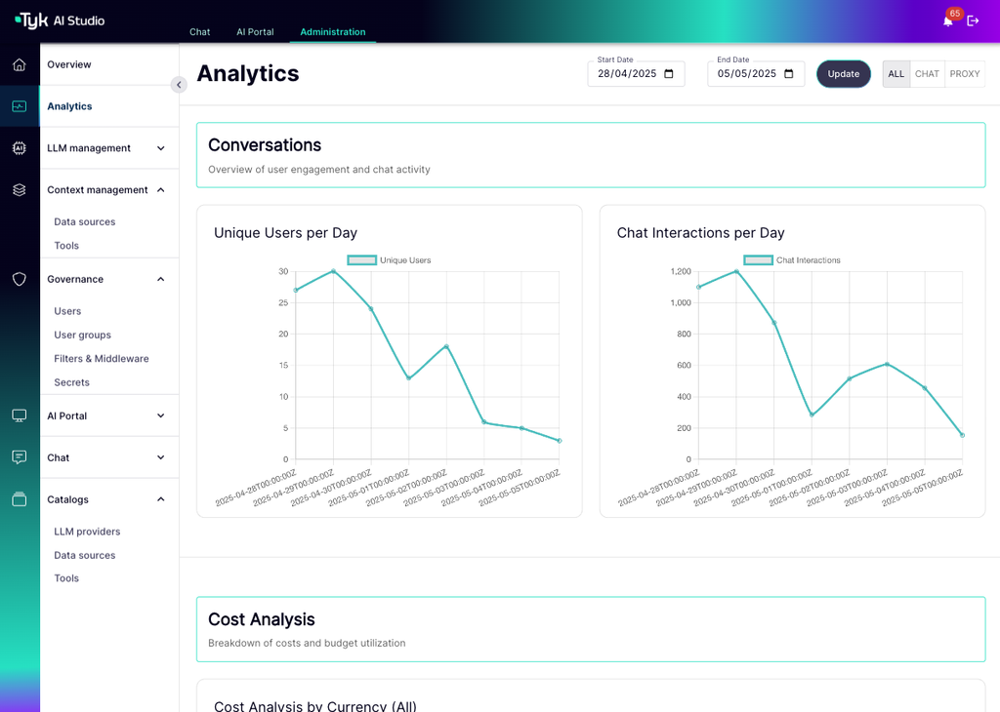

## Availability

| Edition   | Deployment Type |
| :------------- | :---------------------- |
| [Community](/ai-management/ai-studio/overview#community-edition) & [Enterprise](/ai-management/ai-studio/overview#enterprise-edition) | Self-Managed |

In the Community Edition, AI Studio records usage and cost data. Budget totals and the Compliance dashboard are Enterprise Edition features.

Tyk AI Studio incorporates an Analytics System designed to collect, aggregate, and provide insights into the usage, cost, and performance of the platform's core components, particularly LLMs, Tools, and Chat interactions.

## Purpose

The Analytics System serves several key purposes:

*   **Cost Tracking:** Monitor spending associated with different LLM providers and models.
*   **Usage Monitoring:** Understand how users and applications are interacting with LLMs and Tools.
*   **Performance Analysis:** Track metrics like latency and token counts for LLM requests.
*   **Auditing & Debugging:** Provide detailed logs of interactions for troubleshooting and security analysis.
*   **Reporting:** Offer data points for dashboards and reports for administrators and potentially end-users.

## Data Collection

The primary point of data collection is the **[Proxy & API Gateway](/ai-management/ai-studio/proxy)**. As requests flow through the proxy:

1.  **Request Details:** Information about the incoming request is captured (e.g., user ID, application ID, requested LLM/route, timestamp).
2.  **LLM Interaction:** Details about the interaction with the backend LLM are recorded (e.g., model used, prompt tokens, completion tokens, latency).
3.  **Cost Calculation:** Using data from the [Model Pricing System](/ai-management/ai-studio/ai-studio#model-pricing), the cost of the interaction is calculated based on token counts.
4.  **Tool Usage:** If the interaction involved [Tools](/ai-management/ai-studio/tools), relevant details might be logged (e.g., which tool was called, success/failure).
5.  **Chat Context:** For interactions originating from the [Chat Interface](/ai-management/ai-studio/chat-interface), metadata about the chat session might be included.

## Edge Gateway Analytics Configuration

> **Important:** Analytics must be **explicitly enabled** in the Edge Gateway configuration for data to appear in AI Studio dashboards. This is a common stumbling block when first deploying edge gateways.

When enabled, the Edge Gateway batches analytics records and sends them back to AI Studio every few seconds (this interval is configurable). Without this configuration, AI Studio will have no visibility into gateway traffic.

Ensure your Edge Gateway environment includes the appropriate analytics configuration. The default quickstart and packaged deployments enable this, but custom deployments may not.

The analytics subsystem in the Edge Gateway also supports plugins, offering multiple ways to handle data:
- Each data class (Analytics, Logs, Budgets) can have its own processor
- Processors can either override or work in parallel with the default batch system

## Architecture

*   **Asynchronous Ingestion:** To minimize impact on request latency, analytics data is typically collected by the Proxy and sent asynchronously to a dedicated analytics database or processing pipeline.
*   **Data Storage:** Analytics records are stored in the application's relational database (PostgreSQL or SQLite, configured via environment variables). The same database used for other application data stores analytics records.
*   **API Endpoints:** Tyk AI Studio exposes internal API endpoints that allow the Admin UI (and potentially other authorized services) to query the aggregated analytics data.

## Key Metrics Tracked (Examples)

*   **Per LLM Request:**
    *   Timestamp
    *   User ID / API Key ID
    *   LLM Configuration ID / Route ID
    *   Model Name
    *   Prompt Tokens
    *   Completion Tokens
    *   Total Tokens
    *   Calculated Cost
    *   Service tier, when the vendor billed the usage at a tier other than the list price, for example `batch`, `priority`, or `flex` (from v2.3.0)
    *   Request ID and client request ID (from v2.3.0). Refer to [Request IDs](#request-ids).
    *   Latency (ms)
    *   Success/Error Status
*   **Guardrail Second Opinions (Enterprise):** From v2.3.0, AI Studio records the calls of a guardrail to its judge LLM. The interaction type of these records is `guardrail_judge`. The record has the judge LLM and no App. The call counts against the budget and analytics of the judge LLM. It does not count against the budget of the App that sent the request. {/* TODO: link to the guardrail LLM judge section once merged */}
*   **Per Tool Call (if applicable):**
    *   Timestamp
    *   Tool ID
    *   Success/Error Status
    *   Latency (ms)
*   **Aggregated Metrics:**
    *   Total cost per user/application/LLM over time.
    *   Total requests per user/application/LLM over time.
    *   Average latency per LLM.
    *   Most frequently used models/tools.

## Monitoring & Dashboards (Admin)

Administrators typically access analytics data via dashboards within the Tyk AI Studio UI.

*   **Overview:** High-level summaries of cost, usage, and requests.
*   **Filtering & Grouping:** Ability to filter data by time range, user, application, LLM configuration, etc.
*   **Visualizations:** Charts and graphs showing trends in cost, token usage, request volume, and latency.
*   **Detailed Logs:** Access to raw or near-raw event logs for specific interactions (useful for debugging).

    

### Service Tiers

From v2.3.0, the dashboard shows a **Service Tiers** panel. The panel breaks down requests, tokens, and cost by service tier and by model, for the selected date range. The costs already use the price of each tier. The panel includes usage from Edge Gateways.

*   The panel shows traffic at the list price as **Untiered (list price)**.
*   A tier filter applies to the table of models.
*   The panel appears only when some usage in the range has a tier other than the list price.
*   Usage that AI Studio recorded before v2.3.0 has no tier.

The same data is available through the API. Refer to the [AI Studio API reference](/ai-management/ai-studio/ai-studio-swagger). To change the price of a tier for an LLM, refer to [Price Multipliers](/ai-management/ai-studio/llm-management#price-multipliers).

{/* TODO: Add screenshot: the Service Tiers panel on the admin dashboard */}

### Per-LLM Attribution

From v2.1.0, proxy logs are attributed to the specific LLM configuration (`llm_id`) rather than the vendor string. Two LLM entries that share a vendor, for example a personal Anthropic key and a work Anthropic key, no longer cross-pollinate in the LLM detail page. Logs recorded before the upgrade have `llm_id = 0` and do not appear in per-LLM detail views.

### Failover Attempts

When an LLM fails over to a fallback, the proxy logs contain one row for each attempt that got an answer. The LLM and App detail pages show a **Failover** column. To count requests, filter on `failover_attempt = 0`. For more information, refer to [Failover in Analytics](/ai-management/ai-studio/llm-management#failover-in-analytics).

### Delegated Identity in Proxy Logs

From v2.2.1, an [auth plugin](/ai-management/ai-studio/plugins/edge-gateway) on an Edge Gateway can authenticate a delegated token. In this case, the proxy log and the chat record also store:

*   `on_behalf_of`: The user that the call was for (the subject of the delegated token)
*   `acting_agent`: The agent that made the call (from the `auth_actor` claim of the plugin)

The proxy-log tables on the App and LLM pages show these values under the timestamp of the row, as **For** and **Agent**. These fields are for audit only. AI Studio does not use them to authorize requests. The App and its owner are still the identity for billing and authorization, and `user_id` is still the App owner.

For how the OAuth2 Client Credentials plugin fills these fields, refer to [Who Made the Call](/ai-management/ai-studio/oauth2-client-credentials#who-made-the-call).

### Models in Use

The LLM provider detail page shows the models that the provider served, and the Apps that use each model. Refer to [Find the Apps That Use a Model](/ai-management/ai-studio/llm-management#find-the-apps-that-use-a-model).

### Team Costs

In the Enterprise Edition, the dashboard shows a **Team Costs** table with the cost, share, tokens, and requests of each Team. Refer to [Team Costs](/ai-management/ai-studio/budgeting#team-costs).

### Compliance Dashboard

From v2.1.0, the Compliance dashboard (`/admin/compliance`) surfaces [Compliance Events](/ai-management/ai-studio/compliance-events) emitted by filter scripts alongside the existing blocked-request data:

*   **Summary Cards:** Critical Events and Warning Events counts over the selected window, with trend arrows and configurable escalation thresholds.
*   **Policy Violations:** the summary splits **Blocked** (4xx proxy logs) from **Flagged** (warning and critical events that passed through), and the timeline chart merges both streams.
*   **Filter Events Tab:** severity totals with a stacked timeline chart, severity and event-type filters, expandable rows showing raw event metadata, and CSV export.
*   **App Risk:** per-app risk scores are weighted by event severity, and the drill-down interleaves blocked requests with compliance events.

## Request IDs

From v2.3.0, the gateway gives each request an ID. AI Studio and every Edge Gateway return the ID in the `X-Tyk-AI-Request-ID` response header, for example `X-Tyk-AI-Request-ID: tyai_0192d8a4f6b37c1e9a5b2d4c6e8f0a1b`.

*   All the attempts of one request have the same ID. This includes the internal hop of the `/ai/` and `/anthropic/` endpoints, and each fallback of a failover waterfall.
*   The ID is `tyai_` followed by a UUIDv7. IDs from different edges and AI Studio replicas do not collide.
*   The gateway does not set or change the `X-Request-ID` header. When a request contains this header, AI Studio records its value as the client request ID. The value can have up to 128 characters of letters, digits, and `- _ . : /`.
*   The gateway ignores an `X-Tyk-AI-Request-ID` header that a client sends.

| Where | Field |
| :--- | :--- |
| Request logs on the App and LLM pages | `request_id`, `client_request_id`. The log search finds an exact match for either value. |
| Guardrail and filter compliance events | `request_id` and `client_request_id` in the metadata. The event details have a link to the request log. |
| HTTP guardrail classifiers | `meta.request_id` in the classify request |
| Plugins | The `request_id` value of the request context |
| Analytics plugins on Edge Gateways | `gateway_request_id`, `client_request_id` |

Requests without usage, for example a policy block or a vendor or gateway error, also create a request log row. Edge Gateways send these rows to AI Studio with their analytics. AI Studio records them without a chat record or spend.

## Prometheus and OpenTelemetry Metrics

From v2.1.0, both Tyk AI Studio and the Edge Gateway expose operational metrics on a Prometheus-compatible `/metrics` endpoint, with OpenTelemetry trace correlation through the analytics pipeline.

<Warning>
From v2.2.0, the `/metrics` endpoint is secure by default. If you do not set `METRICS_AUTH_TOKEN` or `METRICS_ALLOW_UNAUTHENTICATED=true`, AI Studio and the Edge Gateway do not register the endpoint, and log a warning. Until you set one of these variables, a scrape of the Edge Gateway returns `404`. A scrape of AI Studio returns the HTML of the admin console.
</Warning>

To configure metrics:

| Component | Environment variable | Default |
|---|---|---|
| AI Studio (control plane) | `METRICS_ENABLED` (set to `false` or `0` to disable) | enabled |
| AI Studio (control plane) | `METRICS_PATH` | `/metrics` |
| Edge Gateway | `ENABLE_METRICS` | `true` |
| AI Studio and Edge Gateway | `METRICS_AUTH_TOKEN` | not set. When set, scrapers must send `Authorization: Bearer <token>`. |
| AI Studio and Edge Gateway | `METRICS_ALLOW_UNAUTHENTICATED` | `false`. Set to `true` to allow scrapes without a token, for example in a cluster. |

The endpoint exposes the following metrics:

| Metric | Type | Description |
|---|---|---|
| `aistudio_llm_requests_total` | Counter | LLM requests processed |
| `aistudio_llm_tokens_total` | Counter | Tokens consumed |
| `aistudio_llm_cost_total` | Counter | Calculated cost |
| `aistudio_tool_calls_total` | Counter | Tool invocations |
| `aistudio_policy_blocks_total` | Counter | Requests blocked by policy |
| `aistudio_compliance_events_total` | Counter | [Compliance events](/ai-management/ai-studio/compliance-events) recorded, labeled by `filter_scope`, `severity`, and `event_type` |
| `aistudio_llm_request_duration_seconds` | Histogram | LLM request latency |
| `aistudio_tool_execution_duration_seconds` | Histogram | Tool execution latency |
| `aistudio_llm_inflight_requests` | Gauge | Requests currently in flight |
| `aistudio_llm_failover_total` | Counter | LLM failovers, labeled by source, target, and reason (v2.2.0 and later) |
| `aistudio_guardrail_latency_seconds` | Histogram | Guardrail provider latency (v2.2.0 and later) |
| `aistudio_guardrail_errors_total` | Counter | Guardrail provider calls that failed or timed out, by provider and fail mode (v2.2.0 and later) |
| `aistudio_goroutine_panics_total` | Counter | Panics recovered in background work and gRPC handlers, by goroutine (v2.2.0 and later) |
| `aistudio_native_requests_total` | Counter | [Native API operations](/ai-management/ai-studio/native-api-operations), by vendor, operation, and status code (v2.3.0 and later) |
| `aistudio_native_request_duration_seconds` | Histogram | Native API operation latency (v2.3.0 and later) |
| `aistudio_native_results_bytes_total` | Counter | Bytes of batch results files streamed to clients (v2.3.0 and later) |
| `aistudio_native_reconcile_outcomes_total` | Counter | Batches that the background reconciler checked, by outcome (v2.3.0 and later) |
| `aistudio_decision_questions_total` | Counter | Questions answered by [decision models](/ai-management/ai-studio/decision-models) (v2.3.0 and later) |

For the OpenTelemetry GenAI metric names, tracing, and health endpoints, refer to [Observability](/ai-management/ai-studio/observability).

Point your Prometheus scrape configuration at the `/metrics` path of each component that you want to monitor. You can also use an OpenTelemetry Collector with a Prometheus receiver. If you set `METRICS_AUTH_TOKEN`, add the token to the scrape configuration as a bearer token.

## Integration with Other Systems

*   **[Budget Control](/ai-management/ai-studio/budgeting):** Analytics data (specifically cost) is likely used by the Budget Control system to track spending against defined limits.
*   **[Model Pricing](/ai-management/ai-studio/ai-studio#model-pricing):** The pricing definitions are crucial for calculating the cost metric within the analytics system.

By providing detailed analytics, Tyk AI Studio enables organizations to effectively manage costs, understand usage patterns, and ensure the optimal performance of their AI interactions.