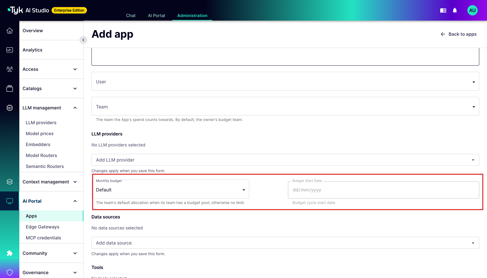

## Availability

| Edition   | Deployment Type |
| :------------- | :---------------------- |
| [Enterprise](/ai-management/ai-studio/overview#enterprise-edition) | Self-Managed |

Tyk AI Studio provides a Budget Control system to help organizations manage and limit spending on Large Language Model (LLM) usage.

## Purpose

The primary goals of the Budget Control system are:

*   **Prevent Overspending:** Set hard limits on costs associated with LLM API calls.
*   **Cost Allocation:** Track and enforce spending limits at different granularities (e.g., per organization, per specific LLM configuration).
*   **Predictability:** Provide better predictability for monthly AI operational costs.

## Scope & Configuration

Budgets are typically configured by administrators and applied at specific levels:

*   **Organization Level:** A global budget limit for all LLM usage within the organization.
*   **LLM Configuration Level:** A budget limit for one LLM setup (e.g., a dedicated budget for a high-cost `gpt-4` configuration).
*   **App Level:** A budget limit for one App.
*   **Team Level:** A budget for all the Apps of a Team. Refer to [Team Budgets](#team-budgets).

**Configuration Parameters:**

*   **Limit Amount:** The maximum monetary value allowed (e.g., `$500`).
*   **Currency:** The currency the budget is defined in (e.g., USD).
*   **Time Period:** The reset interval for the budget, typically monthly (e.g., resets on the 1st of each month).
*   **Scope:** Which entity the budget applies to (Organization, specific LLM Configuration ID, etc.).

Administrators configure these budgets via the Tyk AI Studio UI or API.

    

## No Limit Versus Zero

A budget can be empty or a number. These two values have different meanings:

*   **No limit** (empty, or `null` in the API): AI Studio does not limit spending.
*   **`$0`**: AI Studio blocks all spending. The gateway refuses requests with HTTP 403.
*   **Any other amount**: The gateway refuses requests when the spend in the current period reaches that amount.

In the UI, the budget field has two options: **No limit** and **Fixed amount**. On a new App, the first option is **Default**. The default is the allocation from the App's Team, if the Team has a budget pool. If not, the default is the platform default (`DEFAULT_APP_BUDGET`). If there is no platform default, the App has no limit.

<Warning>
To set no limit in scripts and integrations, send `monthly_budget: null`, or leave out the field. A budget of 0 blocks all requests.
</Warning>

## Enforcement

> **Note:** Budget *enforcement* (blocking requests when limits are exceeded) is an **Enterprise Edition** feature. In Community Edition, budgets are tracked and recorded for reporting purposes, but requests are not blocked when limits are exceeded.

Budget enforcement primarily occurs at the **[Proxy & API Gateway](/ai-management/ai-studio/proxy)**:

Most deployments serve traffic through Edge Gateways. The embedded gateway in AI Studio applies the same rules. On the embedded gateway, the cost of a request counts against its budgets immediately when AI Studio records the request. The next request is then checked against the new total. AI Studio reads the spend from other AI Studio instances and from Edge Gateways a few seconds after it reaches the database. Only requests that run at the same time can take an App over its budget.

1.  **Request Received:** The Proxy receives a request destined for an LLM.
2.  **Cost Estimation:** The Proxy can estimate the maximum cost before it forwards the request. It can also use the cost after the request.
3.  **Budget Check:** The Proxy checks the current spending against all applicable budgets for the current time period. For example, it checks the budget of the LLM configuration AND the budget of the organization.
4.  **Allow or Deny (Enterprise Edition):**
    *   If the current spending plus the estimated or actual cost of the request does *not* exceed the limits, the request continues.
    *   If the request *would* exceed a budget limit, the Proxy blocks it with HTTP 403. It returns an error to the caller.

On the OpenAI-compatible endpoints (`/ai/...` and `/v1/...`), the error is an OpenAI error object:

| Situation | HTTP status | `code` |
| :--- | :--- | :--- |
| The budget is spent | `403` | `budget_exceeded`, with `"type": "permission_error"` and a message that gives the reason, for example `Budget limit exceeded: app monthly budget is 0` |
| The gateway cannot read the budget | `503` | `budget_check_unavailable`. Retry the request after a short time. |
| The App is not active | `403` | `app_inactive`. This is not a budget refusal. |

### Batches and Native API Operations

From v2.3.0, a batch create through a [native API operation](/ai-management/ai-studio/native-api-operations) goes through the same budget check as a synchronous call. The gateway records the usage of the batch one time, at the batch price, and it counts against the App budget. Token counting calls (`count_tokens`) do not count against budgets.

## Distributed Budget Control (Multi-Gateway)

In a hub-and-spoke architecture with multiple Edge Gateways, each gateway sees only its own spend. Tyk AI Studio solves this split-brain problem with a **budget pulse** mechanism:

1. **Analytics batching:** All Edge Gateways send analytics records (including cost data) back to AI Studio in regular batches. This gives AI Studio a **complete view** of token spend across the entire estate.

2. **Budget pulse:** AI Studio periodically sends a budget pulse to each gateway. The pulse contains the **total spend** of each access token across all gateways.

3. **Local update:** Each gateway updates its local spend counter if Studio's reported number is higher than what it has locally.

4. **Blocks:** The same pulse lists the Apps that every gateway must refuse, whatever its local numbers are. These are Apps with a budget of `$0`, and Apps whose [Team](#team-budgets) has spent a blocking Team budget. Gateways keep this list when they restart.

5. **LLM budgets (Enterprise):** From v2.3.0, the pulse also carries the current-period spend of each LLM with a monthly budget. It also lists the LLMs that every gateway must refuse (`$0` budget or budget spent). A gateway refuses a request to an LLM at or over its budget. It uses the higher of the AI Studio figure and its own spend since then. The refusal is the same `403` as an App budget refusal.
    *   A change to an LLM budget in AI Studio gets to the gateways with the next pulse. A configuration push is not necessary.
    *   Gateways keep the list of refused LLMs when they restart. A restarted gateway gets the spend of the other LLMs with the next pulse (30 seconds by default).
    *   AI Studio and the gateways must all run v2.3.0 or later. An older AI Studio sends no LLM budgets.

6. **Alerts:** For each pulse, AI Studio finds the Apps whose spend changed at the gateways. It checks these Apps against their App, LLM, and Team budgets. For this reason, the 80% and 100% alerts also occur for gateway traffic.

This gives **eventually-accurate** budget control. Under very high concurrent load across multiple gateways, a small overrun is possible. The system converges quickly and prevents sustained overspending.

> **Note:** Budget *enforcement* (blocking requests at the limit) is an Enterprise Edition feature. In Community Edition, budgets are tracked and visible in dashboards but requests are not blocked.

## Team Budgets

<Note>
Team budgets are an Enterprise Edition feature.
</Note>

You can also set a budget for each [Team](/ai-management/ai-studio/teams). A Team budget has two functions:

*   **A ceiling:** The maximum that all the Apps of the Team can spend together in a month. When the Team reaches the ceiling, AI Studio sends an alert. It can also block the Apps of the Team.
*   **An allocation pool:** When a Team member creates an App, the App gets a default allocation from the pool. The allocation cannot be more than the amount that is left. When the pool is empty, the App gets nothing. The gateway then refuses its requests until an administrator gives it an allocation. When you delete an App, its allocation goes back to the pool. The money that the App already spent this month still counts for the Team.

### Which Team an App Belongs To

A user can belong to many Teams. For this reason, AI Studio gives each App one Team when the App is created:

1.  The owner's **Budget team**, if the user has one and is still a member of it.
2.  If not, the owner's first Team that is not the Default Team.
3.  If not, the **Default** Team.

Administrators can select a different Team on the App form.

### Turn On Team Budgets

Team budgets are off by default. To turn them on, an administrator sets the **Team budgets** switch on the Teams page. When the switch is on:

*   The Default Team starts with an empty pool (a budget of 0). Apps that go to the Default Team get nothing until you give the Default Team a budget.
*   Apps that you created before you set the switch keep their own budgets.
*   A Team without a budget does not change.

### Team Costs

AI Studio reports the spend of every Team, also Teams without a budget:

*   The dashboard **Team Costs** table shows the cost, share, tokens, and requests of each Team in the date range. It also shows spend that AI Studio cannot connect to a Team.
*   The page of each Team shows its budget, spend, allocations, and a breakdown by App for the current period.
*   The API endpoint `GET /api/v1/analytics/team-costs` returns the same data, for a maximum range of 366 days.

AI Studio stamps each spend record with its Team when it writes the record. Proxy and edge traffic use the Team of the App. Chat traffic uses the Team of the user. If you move an App to a different Team, its history does not change.

### Alerts for Team Budgets

AI Studio notifies administrators at 80% and 100% of a Team budget. At the same thresholds, it publishes `budget.team.threshold` events, and records them in the [audit trail](/ai-management/ai-studio/audit-trail#records-without-an-http-request). The Team page also shows a warning when the App allocations total more than the Team budget.

Edge Gateways receive the list of Apps that a Team blocks with each budget pulse. For this reason, a Team block gets to the edges in one sync interval (30 seconds by default).

## Integration with Other Systems

*   **[Analytics & Monitoring](/ai-management/ai-studio/analytics):** The Analytics system provides the cost data used to track spending against budgets. The current spent amount for a budget period is derived from aggregated analytics data.
*   **[Model Pricing](/ai-management/ai-studio/ai-studio#model-pricing):** The Analytics system uses the pricing definitions to calculate costs. These costs feed the Budget Control system.
*   **[Notification System](/ai-management/ai-studio/notifications):** Budgets trigger notifications when spending reaches defined thresholds. AI Studio sends alerts at **80%** (warning) and **100%** (limit reached) of the budget. It sends each alert one time in each budget period, to the App owner and to administrators.

## Benefits

*   **Financial Control:** Prevents unexpected high bills from LLM usage.
*   **Resource Management:** Ensures fair distribution of AI resources according to allocated budgets.
*   **Accountability:** Tracks spending against specific configurations or organizational units.

Budget Control is a critical feature for organizations looking to adopt AI technologies responsibly and manage their operational costs effectively.
