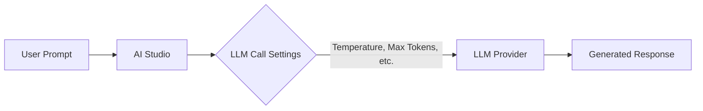
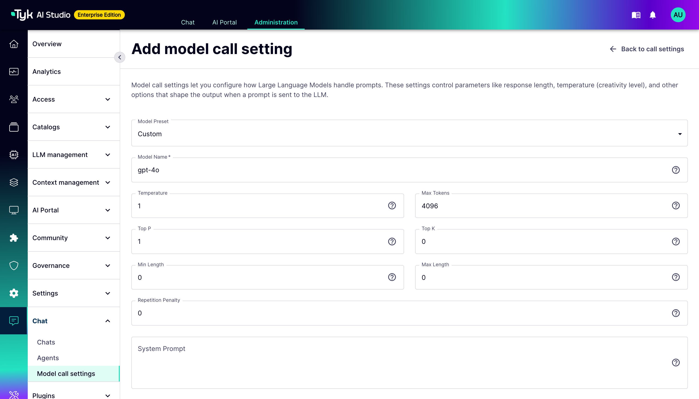

## Availability

| Edition | Deployment Type |
| :------------- | :---------------------- |
| [Community](/ai-management/ai-studio/overview#community-edition) & [Enterprise](/ai-management/ai-studio/overview#enterprise-edition) | Self-Managed |

Model call settings let you configure how Large Language Models handle prompts. These settings control parameters like response length, temperature (creativity level), and other options that shape the output when a prompt is sent to the LLM.

### Use cases

- **Chats**: These settings control how the LLM responds in conversational interfaces within the [Chat](/ai-management/ai-studio/chats) feature, allowing administrators to fine-tune the user experience.
- **Middleware Function Calls**: The settings guide LLM behavior in automated backend processes where the LLM is used for tasks such as data generation or content analysis.

## Managed List of Call Settings

A call setting is not a value you type inline for each chat. Each call setting is a saved entry in a managed list. You pick an existing entry when you [create a Chat](/ai-management/ai-studio/chats#configuration).

Tyk AI Studio seeds this list with default entries on first startup. The seeded list covers current models from major vendors, for example OpenAI, Anthropic, Google, and Meta. Seeded model names include `gpt-5`, `claude-opus-4-5-20251101`, `gemini-2.5-pro`, and `llama-3.3-70b`. This gives you a working set of models to use right away.

AI Studio seeds the list whenever it starts and finds the list empty - on a new installation, or if you delete every entry. Because seeding only happens when the list is empty, it never overwrites settings you have created or modified.

You can edit or delete any seeded entry. You can also add entries for other models. See [How to Create LLM Call Settings](#how-to-create-llm-call-settings).

## LLM Call Settings Details

The **LLM Call Settings** section allows administrators to configure default runtime parameters for Large Language Models (LLMs) used in chat interactions and middleware system function calls. These settings provide control over how the LLM processes inputs and generates outputs. 

It is important to note that these settings are not utilized in the AI Gateway proxy (Tyk Edge Gateway). Applications created in the AI Portal by end users for accessing LLMs provide their own model configurations (like temperature and max tokens) in the API payload when making requests to the AI Gateway.

The Call Settings configured by the admin are specifically used for the built-in Chat Interface (accessed via the AI Portal) and for internal middleware system function calls (such as tool calling and RAG).

## Configuration

The **Edit/Create LLM Call Settings View** enables administrators to configure or update call-time options for a specific Large Language Model (LLM). Below is an explanation of each field and its purpose:

- **Model Name**: The name of the language model (e.g., `gpt-5.2`, `claude-opus-4-5-20251101`).
- **Temperature**: Controls randomness: `1` is very random. Range: `0` to `1`. From v2.3.0, `0` means that AI Studio does not send the value, and the vendor default applies. Refer to [Temperature and Top P](#temperature-and-top-p).
- **Max Tokens**: The maximum number of tokens to generate in the response. Must be at least `1`.
- **Top P**: Controls diversity via nucleus sampling: `0.5` means half of all likelihood-weighted options are considered. Range: `0` to `1`. From v2.3.0, `0` means that AI Studio does not send the value.
- **Top K**: Controls diversity by limiting to `k` most likely tokens. `0` means no limit.
- **Min Length**: The minimum number of tokens to generate in the response.
- **Max Length**: In Chat, the maximum number of input tokens that one turn can send, for example `200000`. Refer to [Max Length and Chat History](#max-length-and-chat-history).
- **Repetition Penalty**: Penalizes repetition: `1.0` means no penalty, `>1.0` discourages repetition. Typically between `1.0` and `1.5`.
- **System Prompt**: A long-form text prompt that sets the context or behavior for the language model.

### Max Length and Chat History

When a conversation is longer than **Max Length**, AI Studio removes the oldest turns first. It removes a full turn at a time, so a tool call and its results stay together. AI Studio always sends the system prompt, the latest user message, and the messages after it.

`0` or an empty value means no limit. In all cases, a chat session sends at most its newest 100 messages and its system prompt.

From v2.3.0, a call setting without a max length sends the conversation history. Before v2.3.0, it sent almost only the latest message. To limit the input, set **Max Length**.

### Temperature and Top P

Claude Sonnet 5 and later models refuse `temperature` and `top_p`. From v2.3.0, new call settings set **Temperature** and **Top P** to `0` by default, so AI Studio does not send them.

Call settings that you saved before v2.3.0 keep their values. For Claude Sonnet 5 and later, set both values to `0`. If you do not, AI Studio Chat fails on these models with `400`.

Exception: on OpenAI models that are not reasoning models, such as `gpt-4o`, the AI Studio Chat client sends `temperature: 0` when the value is `0`. To use a different temperature, set it in the call setting. Gateway and API traffic do not use call settings.

## How to Create LLM Call Settings

1. Navigate to **Chat > Model call settings** in the admin UI sidebar.
2. Click **Add call setting**.
3. Fill in the required fields such as **Model Name** and configure the desired parameters like **Temperature** and **Max Tokens**.
4. Click **Add call setting** to save the configuration.

    

Once saved, the new entry appears in the managed list. You select it from this list when you [create a Chat](/ai-management/ai-studio/chats#configuration).
