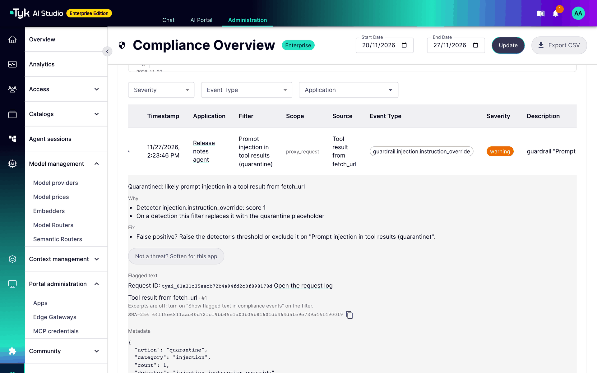

## Availability

| Edition   | Deployment Type |
| :------------- | :---------------------- |
| [Enterprise](/ai-management/ai-studio/overview#enterprise-edition) | Self-Managed |

## Overview

A compliance event is a structured audit record that a filter emits. It flags governance activity, such as a PII redaction, a content rewrite, a policy violation, or a silent failure. It does not change whether the request is blocked or allowed.

Without compliance events, the Compliance dashboard counts only the requests that the gateway blocked (4xx proxy logs). A filter that redacts an email address or flags text and lets the request through leaves no trace beyond a debug log line.

Compliance events go through the same analytics pipeline as proxy logs and chat records. AI Studio stores them on the control plane, shows them in the Compliance dashboard for review and CSV export, and counts them in Prometheus.

For filter script syntax, refer to [Filters](/ai-management/ai-studio/filter-scripting-reference#compliance-event-reporting). For a record of the actions on the management API, refer to [Audit Trail](/ai-management/ai-studio/audit-trail).

## Event Schema

A compliance event has the following shape (`ComplianceEventOutput` in the script API):

| Field | Type | Required | Description |
|---|---|---|---|
| `event_type` | string | Yes | Free-form type. Suggested conventions: `pii_redacted`, `content_rewritten`, `policy_violation`, `harmful_content_detected`, `silent_failure`. |
| `severity` | string | No | `info`, `warning`, or `critical`. Defaults to `info` if omitted or invalid. |
| `description` | string | No | Human-readable description of what happened, shown in the dashboard event row. |
| `metadata` | map | No | Arbitrary key-value data. Stored as JSON. Conventions: `matched_pattern` (string of the trigger), `redacted_types` (array of category names). |

**Validation:**

- AI Studio skips an event without an `event_type`, without an error.
- `severity` values outside `info|warning|critical` are coerced to `info`.
- `event_type` on the API query side is limited to 100 characters; any longer is a 400.
- `severity` on the API query side is validated against the same whitelist; an invalid value is a 400.
- API queries are parameterized. SQL in `event_type` or `severity` is matched as a literal string and returns no results.

### Server-Side Enrichment

Scripts only declare the four fields above. The platform enriches each event at recording time with context from the filter execution site:

| Enriched field | Source |
|---|---|
| `app_id` | App that owns the request (proxy paths). `0` for chat-session paths, where `user_id` is the principal. |
| `user_id` | Authenticated user (chat-session paths). |
| `llm_id` | LLM in scope for the request. |
| `vendor` | LLM vendor string (for example `openai`, `anthropic`, `bedrock`). |
| `model_name` | Model being called. |
| `filter_name` | Name of the filter that emitted the event. |
| `filter_scope` | Where the script ran (see below). |
| `timestamp` | Wall-clock time at recording. |

### Filter Scopes

`filter_scope` identifies the filter execution site that recorded the event:

| Scope | Site |
|---|---|
| `proxy_request` | LLM proxy request filters (before reaching the LLM). |
| `proxy_response` | LLM proxy response filters (REST and streaming). |
| `chat_request` | Chat-session message filters (before RAG search and LLM). |
| `chat_response` | Chat-session response filters (regular and streaming). |
| `file_reference` | File content filters (before RAG indexing). |
| `tool_input` | Tool input filters (before the tool is called). |
| `tool_output` | Tool output filters (after the tool returns). |

You can filter on `filter_scope` indirectly via the dashboard drill-down, or by joining `compliance_events.filter_name` against your filter catalog.

## Emitting Events from a Filter Script

In a Tengo filter script, set `compliance_events` on the output object. For examples, conditional emission, and metadata conventions, refer to [Compliance Event Reporting](/ai-management/ai-studio/filter-scripting-reference#compliance-event-reporting).

### Behavior

- Recording is **asynchronous**. Events are queued and written by the analytics pipeline, so filter latency is unaffected.
- Compliance events **never** affect the block/allow decision. Setting `block: false` with critical events is legitimate (the filter chose to redact rather than block); setting `block: true` with no events is also legitimate.
- The list can be empty or omitted. Most filters emit events only when a condition fires.
- Events are recorded **per filter, per invocation**. A single request can produce multiple events from multiple filters.

## Events That AI Studio Records

AI Studio also records some events itself, without a `compliance_events` entry in the script output.

### Tool Blocks

When a [tool filter](/ai-management/ai-studio/filters#tool-filters) blocks a call and its script reports no event, AI Studio records one:

| Event type | Scope |
| :--- | :--- |
| `tool_input_blocked` | `tool_input` |
| `tool_output_blocked` | `tool_output` |

For this reason, every tool block has a compliance event. The caller sees only the generic `blocked by policy` refusal. The filter name and the reason are in the event.

### Guardrail Hits (Enterprise)

Each hit of a [guardrail](/ai-management/ai-studio/guardrails) records an event:

*   `event_type` is `guardrail.<detector>`, for example `guardrail.pii.email` or `guardrail.prompt_attack`.
*   `severity` comes from the provider. If the provider does not set one, it is `warning`. When the guardrail action is `block`, the severity is `critical`.
*   `metadata` contains `provider`, `detector`, `category`, `count`, `max_score`, `action`, `roles`, and `latency_ms`.

The event does not contain the matched text, unless the filter adds a masked excerpt.

When the guardrail provider times out or returns an error, AI Studio records a `guardrail.error` event, whatever the fail mode is. For the other guardrail event types, such as `guardrail.unscanned` and `guardrail.judge`, refer to [Guardrails Reference](/ai-management/ai-studio/guardrails-reference#compliance-events-and-metrics).

From 2.3.0, guardrail events also have these metadata keys:

| Key | Description |
| :--- | :--- |
| `filter_id` | The ID of the guardrail filter that recorded the event. |
| `kinds` | Where the flagged text came from: `text`, `tool_result`, `tool_call`, or `tool_definition`. |
| `tool_names` | The tools of the flagged tool results, tool calls, or tool definitions. |
| `request_id` | The request ID that the gateway returns in `X-Tyk-AI-Request-ID`. |
| `client_request_id` | The `X-Request-ID` of the caller, when the caller sent one. |
| `segments` | Up to five flagged segments. Each segment has its index, role, kind, tool, and the SHA-256 of its text. It can also have a masked excerpt, the matched [trusted prompt template](/ai-management/ai-studio/how-to-tune-guardrails#trusted-prompt-templates), and the [exception](/ai-management/ai-studio/how-to-tune-guardrails#guardrail-exceptions) that softened it. |
| `exceptions` | The IDs of the exceptions that softened the findings of this detector. |
| `alert`, `alerts` | The [alert](/ai-management/ai-studio/guardrails-reference#alerts) that the findings raised. `alerts` lists them when there are more than one. |
| `shadow` | `true` when a [shadow](/ai-management/ai-studio/how-to-tune-guardrails#shadow-mode) filter recorded the event. |

AI Studio removes these keys from the events of a script filter.

## Edge Gateways

In a hub-spoke deployment, filter scripts run on the [Edge Gateway](/ai-management/ai-studio/proxy), but compliance events live on the control plane. The propagation path is:

1. Filter script on the edge sets `compliance_events` in its output.
2. The Edge Gateway's analytics handler (`MicrogatewaAnalyticsHandler.RecordComplianceEvents`) queues the events to the pulse plugin's local buffer, which survives a gateway restart.
3. On the next analytics pulse (every 30 seconds by default), events are batched into the gRPC `AnalyticsPulse` message as `ComplianceEventProto` entries.
4. The control server's `SendAnalyticsPulse` handler reconstructs the compliance event from each entry, preserving `LLMID`, `AppID`, `UserID`, severity, type, description, metadata, vendor, and model name, and persists it.

An event from an Edge Gateway goes into the same table, with the same enrichment, as an event from the embedded gateway.

To check that edge events arrive, watch the `aistudio_compliance_events_total` counter on the control-plane `/metrics` endpoint.

## Querying Compliance Events

### Admin API

```
GET /api/v1/compliance/events
```

Admin-only (requires the v1 route group's auth middleware and an admin role).

**Query parameters:**

| Param | Type | Description |
|---|---|---|
| `start_date` | ISO8601 date | Lower bound (inclusive) on `timestamp`. |
| `end_date` | ISO8601 date | Upper bound (inclusive) on `timestamp`. |
| `app_id` | uint | Filter by app. |
| `event_type` | string (max 100 chars) | Exact match on `event_type`. |
| `severity` | `info` / `warning` / `critical` | Whitelist; other values return 400. |
| `page_size` | int | Events per page. The default is 100 and the maximum is 1000. |
| `page` | int | Page number, from 1. |
| `limit` | int | Older form of `page_size`. Used only when the request has no `page_size` or `page`. |
| `offset` | int | Older form of `page`: the number of events to skip. Used only with `limit`. |

**Example:**

```bash
curl -H "Authorization: Bearer $ADMIN_TOKEN" \
  "https://studio.example.com/api/v1/compliance/events?start_date=2026-05-01&end_date=2026-05-14&severity=critical&page_size=50"
```

**Response shape:**

```json expandable
{
  "events": [
    {
      "id": 1234,
      "app_id": 42,
      "user_id": 0,
      "llm_id": 7,
      "filter_name": "PII Detector",
      "filter_scope": "proxy_request",
      "event_type": "pii_redacted",
      "severity": "info",
      "description": "Email addresses redacted from request",
      "metadata": "{\"redacted_types\":[\"email\"]}",
      "vendor": "openai",
      "model_name": "gpt-4",
      "timestamp": "2026-05-14T09:23:17Z"
    }
  ],
  "total_count": 1,
  "meta": { "total_count": 1, "total_pages": 1, "page_size": 50, "page_number": 1, "offset": 0 }
}
```

`metadata` is returned as a JSON-encoded string (the storage shape). Parse it client-side.

### SQL

The underlying table is `compliance_events`. Useful indexes:

- `(app_id, timestamp)`: composite, for per-app time-bounded queries.
- `user_id`, `llm_id`, `filter_name`, `event_type`, `severity`: single-column, for filtering.
- `timestamp`: for retention sweeps.

Example:

```sql
SELECT filter_name, event_type, COUNT(*) AS n
FROM compliance_events
WHERE timestamp >= NOW() - INTERVAL '7 days'
  AND severity IN ('warning', 'critical')
GROUP BY filter_name, event_type
ORDER BY n DESC;
```

## Dashboard Surfaces

The Compliance dashboard (`/admin/compliance`) shows compliance events alongside the existing blocked-request data.

### Summary Cards

Two cards are next to the blocked-request total. Each shows the count over the selected window, with a trend arrow:

- **Critical Events**: the card shows an error style when there is at least one critical event.
- **Warning Events**: the card shows a warning style when there are more than 20 warning events.

### Policy Violations Tab

The summary is split into three counters:

- **Blocked**: 4xx proxy logs.
- **Flagged**: warning and critical compliance events that passed through.
- **Affected Apps**: distinct apps appearing in either source.

The timeline chart merges both streams. The per-app violation list includes the events, so an App that only flags requests shows in the drill-down.

### Filter Events Tab

A dedicated tab for compliance events with:

- Severity totals (info / warning / critical) with a stacked timeline chart.
- Severity and event-type filters (the event-type dropdown is populated from observed values in the window).
- Pagination over the event list.
- A **Source** column that shows where the flagged text of a guardrail came from: `User message`, `System prompt`, `Tool result from <tool>`, or `Tool result`. Events without this data show `-`. Available from Tyk AI Studio 2.3.0.
- Expandable rows showing the raw `metadata` JSON. From 2.3.0, a guardrail event starts with a summary of what happened, the causes, and up to two fixes. It also shows the flagged segments and the opinion of the [LLM judge](/ai-management/ai-studio/how-to-tune-guardrails#second-opinion-from-an-llm).
- From 2.3.0, a **Not a threat? Soften for this app** action on a guardrail event. Refer to [Guardrail Exceptions](/ai-management/ai-studio/how-to-tune-guardrails#guardrail-exceptions).
- CSV export wired to `GET /compliance/events`.

From 2.3.0, a link to `/admin/compliance?event=<id>` opens the **Filter Events** tab with that event expanded. Guardrail alerts and outcome events contain this link. The user must sign in and have permission to read compliance data.



### App Risk Modal

The risk score of an App includes the event counts. A critical event counts three times as much as a warning event.

**Recent Violations** lists blocked requests and compliance events together, sorted by timestamp and styled by severity.

## Metrics

A Prometheus / OpenTelemetry counter is exposed on the `/metrics` endpoint:

```
aistudio_compliance_events_total{event_type, severity, filter_name}
```

Use it to alert on bursts of critical events. A sudden drop in redactions can show a misconfigured filter. To get a rate for each request, divide by `aistudio_llm_requests_total`.

For the full metric catalog, refer to [Analytics & Monitoring](/ai-management/ai-studio/analytics#prometheus-and-opentelemetry-metrics). For metrics, traces, and health checks, refer to [Observability](/ai-management/ai-studio/observability).

## Suggested Event-Type Conventions

`event_type` is free-form. Use the same types across filters, so that dashboards and queries group them. The bundled filter scripts use these types:

| Event type | When to emit |
|---|---|
| `pii_redacted` | Filter replaced PII patterns with placeholders. Set `metadata.redacted_types` to an array of categories (`["email", "ssn", "phone"]`). |
| `content_rewritten` | Filter transformed user or LLM content in a way the user can't see (for example system-prompt augmentation, anonymization). |
| `sensitive_content_detected` | Filter found content matching a sensitive pattern. Pair with `block: true` for hard blocks; pair with `block: false` to record the detection without blocking. |
| `harmful_content_detected` | Response filter detected harmful output. Set `metadata.matched_pattern` to the trigger. |
| `policy_violation` | Filter detected a policy breach that may or may not be blocked. |
| `silent_failure` | Filter ignored an error and allowed the request, for example when a classifier service is not available. Use `severity: warning`. |

For `metadata` keys, prefer:

- `matched_pattern` (string): the substring or regex match that fired the event.
- `redacted_types` (array of strings): categories of PII or content removed.

These keys are what the bundled filter scripts and the dashboard expect.

## Migration Notes

- **Filter scripts**: The `compliance_events` field is optional. AI Studio ignores it if it is absent.
- **Bundled filter library**: The bundled scripts (PII redaction, content blocking, response guardrails) emit compliance events with the conventions above.
- **Custom analytics handlers**: the `AnalyticsHandler` interface takes `context.Context` on its recording methods, including `RecordComplianceEvents`. Update the signatures of custom implementations. If you do not use compliance events, `RecordComplianceEvents` can do nothing. Refer to the [Tyk AI Studio release notes](/developer-support/release-notes/ai-studio).
