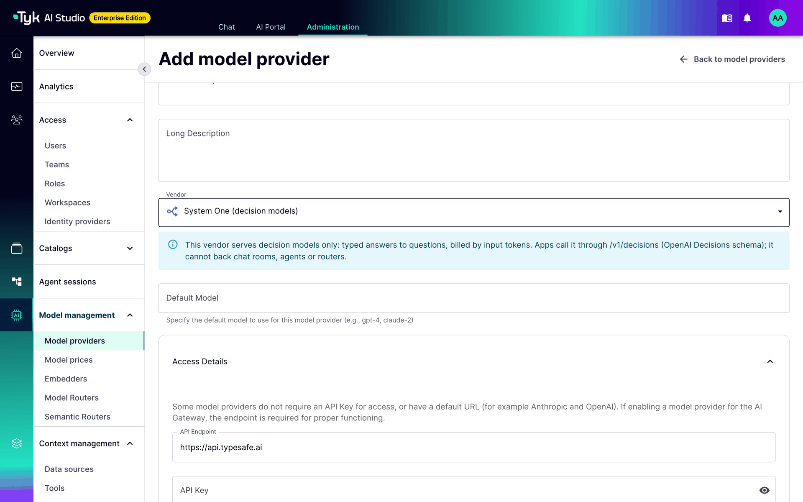
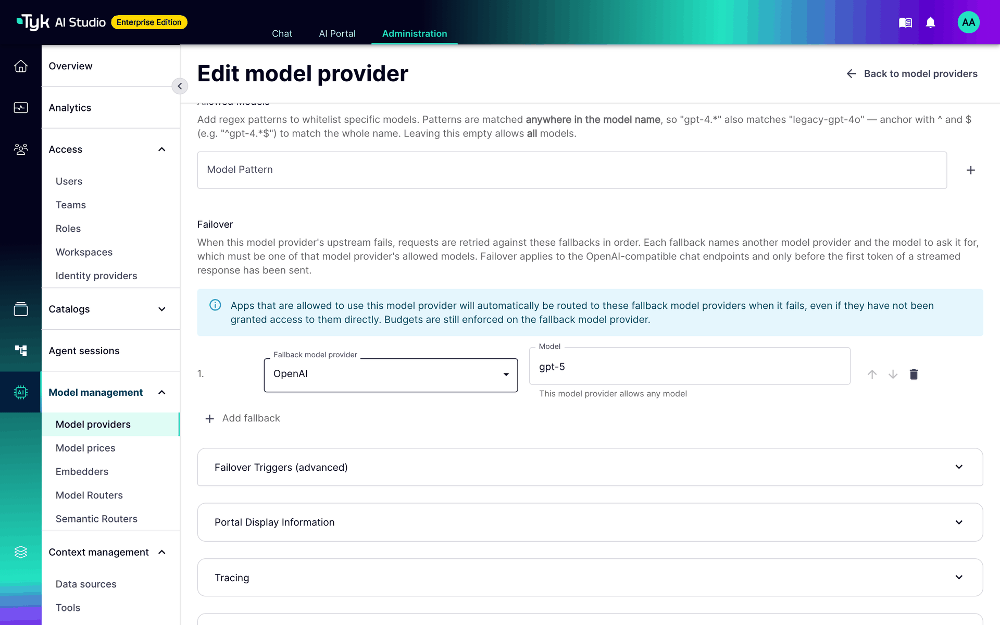
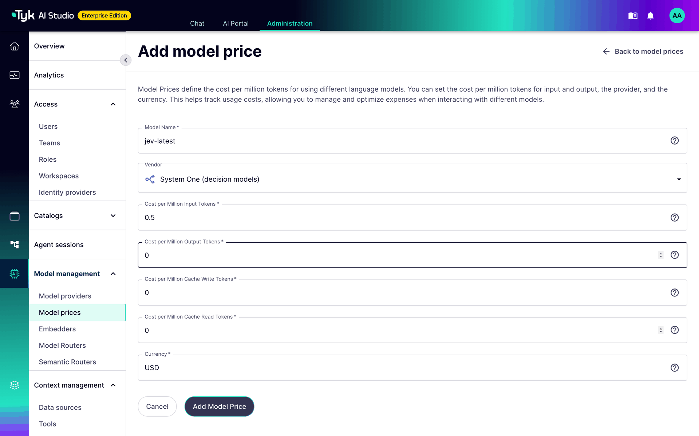

## Availability

| Edition   | Deployment Type |
| :------------- | :---------------------- |
| [Community](/ai-management/ai-studio/overview#community-edition) & [Enterprise](/ai-management/ai-studio/overview#enterprise-edition) | Self-Managed |

Decision models are available from Tyk AI Studio 2.3.0.

## Overview

A decision model does not generate text. It answers questions about a piece of evidence. The evidence can be a customer message, a document, or a transcript. For each question, the model returns one of these answers:

- A predicate question gets a probability for yes.
- A choice question gets one option from a list that you supply.
- A score question gets a score on a scale of levels that you supply.

Each answer includes a calibrated probability or confidence. Your code can act on the answer directly. Decision models are a good fit for routing, triage, moderation, and policy checks.

AI Studio governs decision models in the same way as chat models. Apps call them through the AI Gateway with their own credentials. Each call goes through access control, filters, guardrails, plugins, budgets, and analytics.

## Supported Providers

| Provider | Vendor in the LLM form | Example models |
| :--- | :--- | :--- |
| OpenAI Decisions API (public beta) | **OpenAI** | `gpt-6-luna` |
| TypeSafe Jev, hosted by TypeSafe | **System One (decision models)** | `jev-latest`, `jev-1.13.0` |
| A self-hosted model that uses the System One API | **System One (decision models)** | The model name of your server |

An OpenAI LLM provider serves chat models and decision models with one API key. To use a decision model, add it to the allowed models of the LLM provider.

A System One LLM provider serves decision models only. It cannot back chat rooms, agents, Model Routers, or Semantic Routers.

## Configure a System One LLM Provider

1. Go to **Model management** > **Model providers** and add a model provider. For more information, refer to [LLM Management](/ai-management/ai-studio/llm-management).
2. In **Vendor**, select **System One (decision models)**.
3. In **API Endpoint**, keep the default `https://api.typesafe.ai` to use the hosted Jev API. For a self-hosted model, enter the URL of your server, for example `http://llama:8080`.
4. In **API Key**, enter your TypeSafe API key, or a [secret](/ai-management/ai-studio/secrets) reference such as `$SECRET/typesafe-key`. The hosted API requires a key. A self-hosted server can run without a key.
5. In **Default Model** or **Allowed Models**, add the models that Apps can use, for example `jev-latest`.
6. Save the LLM provider.
7. Give Apps access to the LLM provider, the same as for other LLM providers.



## Call a Decision Model

Apps send decision requests in the OpenAI Decisions schema to `POST /v1/decisions` on the [Main Ingress](/ai-management/ai-studio/proxy#main-ingress). The model string has the form `{llmSlug}/{model}`.

The gateway uses the same schema for all providers. For a System One provider, the gateway translates the request to the System One format. It then translates the answers back, in the order of your questions.

```bash
curl https://your-gateway-host/v1/decisions \
  -H "Authorization: Bearer YOUR_APP_API_KEY" \
  -H "Content-Type: application/json" \
  -d '{
    "model": "jev/jev-latest",
    "input": "I was charged twice for my order last week.",
    "questions": [{"type": "predicate", "name": "angry", "instructions": "Is the customer angry?"}]
  }'
```

To send the request to one LLM provider, use `POST /ai/{llmSlug}/v1/decisions` with the model name only. Clients that use the native format of a provider can use the [vendor-native endpoint](/ai-management/ai-studio/proxy#vendor-native-endpoint): `/llm/rest/{llmSlug}/v1/decisions` for OpenAI, or `/llm/rest/{llmSlug}/v1/systemone` for System One. The gateway governs and records these calls in the same way.

`GET /v1/models` lists the models that the App can use. Each entry has a `capabilities` field. Decision-capable routes include `decisions`.

{/* TODO: Link to the request and response schema of /v1/decisions when it is in the API reference. Blocked (2026-11-27): /v1/decisions is a gateway proxy endpoint. The AI Studio API reference (swagger/ai-studio-swagger.yml) covers the management API only, so the endpoint has no reference page to link to. */}

### Request Rules

The gateway rejects these requests with `400`:

- A request with `"stream": true`. Decision models do not stream.
- A request with image input to a System One provider. System One providers accept text only.
- A score question with fewer than 2 levels.
- For a System One provider, a choice question with more than 255 options.
- For a System One provider, a score question with more than 10 levels.
- A request to a Model Router or a Semantic Router. Routers do not route decision calls.

Errors use the OpenAI error format. A System One validation error (`422`) becomes `400` with the type `invalid_request_error`. A System One "overloaded" response (`529`) becomes `503`, which clients can retry.

## Governance

### Filters and Guardrails

[Filters](/ai-management/ai-studio/filters) and [guardrails](/ai-management/ai-studio/guardrails) see a decision request as a list of messages:

- One system message for each question. The message holds the instructions of the question.
- One final user message that holds the evidence.

Guardrail scopes such as the last user message thus check the evidence. The evidence is the untrusted part of the request. When a filter redacts text, the gateway writes the change back into the evidence and the instructions, in the format of the provider.

A filter script can identify decision traffic. The value of `input.context.request_kind` is `"decision"` for decision requests. For other requests, the value is empty.

Response filters see the answers as text, with one answer on each line. A response filter can block the answers in the same way as other responses.

### Plugins

Gateway plugins and AI Studio plugins receive the request kind in their context. For decision calls, the request kind is `decision`. For more information, refer to [Request Kind (Decision Models)](/ai-management/ai-studio/plugins/sdk#request-kind-decision-models) in the Plugin SDK reference.

### Budgets

Decision spend counts against App, LLM, and team [budgets](/ai-management/ai-studio/budgeting), the same as other spend. When a budget is spent, the gateway refuses decision calls with `403`.

### Analytics

AI Studio records each decision call with its token usage and cost. It also records the number of questions and the number of questions that the model did not answer (refusals).

When there is decision traffic, the **Overview** page of the AI Studio admin UI shows a **Decision Models** panel for the selected period:

- Tiles show the decision calls, the questions answered, the refusal rate, and the cost.
- A table shows the calls, questions, refusals, input tokens, cost, and cost per 1,000 calls for each model.

Decision spend is also part of the cost totals on the **Overview** page.

{/* TODO: Add screenshot: Overview page "Decision Models" panel with stat tiles and the per-model table. Blocked (2026-11-27): the panel needs real decision-model traffic, which needs a System One (TypeSafe) API key. We do not have one for testing. */}

The `aistudio_decision_questions_total` metric counts questions by `vendor`, `model`, and `outcome` (`answered` or `refused`). For more information, refer to [Observability](/ai-management/ai-studio/observability).

To get the same data from the API, use `GET /api/v1/analytics/decisions`. For the parameters and the response, refer to [Get decision-model usage](https://tyk.io/docs/api-reference/analytics/get-decision-model-usage) in the AI Studio API reference.

## Failover

The [failover waterfall](/ai-management/ai-studio/llm-management#failover) of an LLM provider applies to decision calls. The gateway skips a fallback in these cases:

- The provider of the fallback serves no decision models.
- The fallback cannot take the request, for example image input to a System One model.

The gateway changes the request to the format of each fallback provider. For example, a System One primary can fail over to an OpenAI fallback. Chat requests skip fallbacks that serve decision models only.

The **Failover** section of the LLM form shows only compatible fallbacks. A compatible fallback serves a request type that the primary also serves.



## Pricing

Providers bill decision models by input tokens. Output is usually free. [Add a model price](/ai-management/ai-studio/model-prices) for each decision model:

- Set **Cost per Million Input Tokens** to the input price of the provider.
- Set **Cost per Million Output Tokens** to `0`.



If a decision model has no price, AI Studio records its calls at zero cost. Such calls do not use any budget.

A provider can answer with a different model name than the name in the request. For example, `jev-latest` can come back as `jev-1.13.0`.

AI Studio first uses the price of the model that the provider reports. If that model has no price, AI Studio uses the price of the model in the request. Thus, you can price the alias that you configure or the resolved version.
