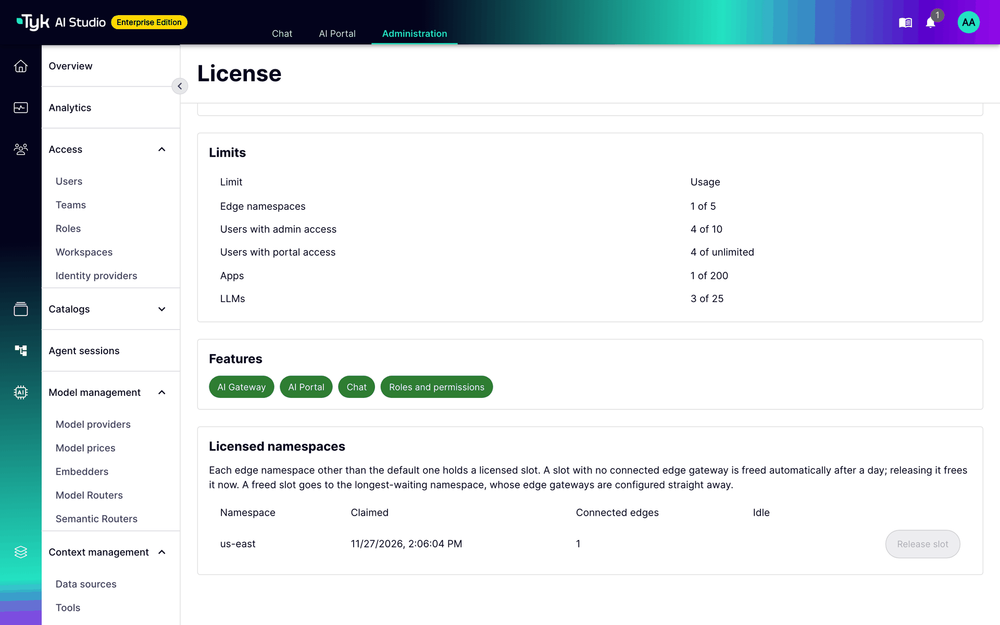

## Availability

| Edition   | Deployment Type |
| :------------- | :---------------------- |
| [Community](/ai-management/ai-studio/overview#community-edition) & [Enterprise](/ai-management/ai-studio/overview#enterprise-edition) | Self-Managed |

Edge Gateway management is available in both editions, and this page marks each Enterprise Edition feature.

## Edge Gateway Properties

The Edge Gateways list (**Portal administration > Edge Gateways**) shows these properties for each edge:

| Property | Description |
|--------|-------------|
| **Edge ID** | The unique identifier of the edge. |
| **Namespace** | The isolated environment of the edge (Enterprise). The Community Edition uses one namespace, `default`, and does not show this column. |
| **Connection** | The status from the last heartbeat: **Connected** (less than 5 minutes ago), **Stale** (5 to 15 minutes ago), or **Disconnected**. |
| **Config Sync** | **Synced**, **Pending**, or **Unknown**. |
| **Version** | The version and build hash of the edge. From v2.3.0, the FIPS 140-3 status of the edge shows under the version. |
| **Held by** | The AI Studio replica that holds the connection of the edge, by its [CLUSTER_NODE_LABEL](/ai-management/ai-studio/deployment-active-active#failover-and-cluster-settings) or its node ID. The column shows only when the listed edges connect to more than one replica. |
| **Last Heartbeat** | The time since the last heartbeat from the edge. |

The detail page of an edge also shows the loaded and expected checksums and the session IDs. It also shows the metadata that the edge reports, for example its region. The list and the detail page show **Last pushed**, the time of the last push to the namespace.

## Licensed Namespaces (Enterprise)

From v2.3.0, the Enterprise license sets how many edge namespaces a deployment can use. The default namespace (`default`, `global`, or an empty [EDGE_NAMESPACE](/ai-management/ai-studio/edge-gateway-env#edge_namespace)) does not count. Each other namespace uses one slot while it is in use.

- An edge in a namespace without a slot registers and stays connected. It gets no new configuration, and keeps any configuration that it already has. The Edge Gateways list marks it **Unlicensed namespace**.
- Namespaces without a slot wait in a queue. When a slot becomes free, the namespace that waited longest and has a connected edge gets the slot. AI Studio then pushes the configuration to its edges. The edges do not need a restart.
- A namespace with no connected edge for 24 hours loses its slot.
- A license with fewer namespaces than are in use does not remove slots. The namespaces keep their slots until they become idle.
- An Owner can see the slots and the queue on the license page. An Owner can also release a slot that has no connected edge.

