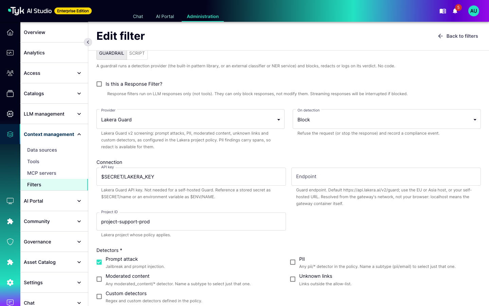

## Availability

| Edition   | Deployment Type |
| :------------- | :---------------------- |
| [Enterprise](/ai-management/ai-studio/overview#enterprise-edition) | Self-Managed |

For how guardrails work, refer to [Guardrails](/ai-management/ai-studio/guardrails).

## Providers

| Provider | What it detects | Can redact | Where it runs |
| :--- | :--- | :--- | :--- |
| Built-in pattern library | Credentials, personal data, prompt injection heuristics, and response leakage | Yes | In AI Studio and the Edge Gateway, with no network call |
| HTTP classifier (generic) | The detectors that your service defines | Yes | Your service |
| Microsoft Presidio (NER) | Presidio entity types, such as `PERSON`, `EMAIL_ADDRESS`, and `CREDIT_CARD` | Yes | Your Presidio deployment |
| Lakera Guard | Prompt attacks, PII, moderated content, unknown links, and custom detectors | Yes, for PII findings | Lakera SaaS or a self-hosted Guard |
| Azure AI Content Safety | Prompt attacks (Prompt Shields), and the categories Hate, Sexual, Self-harm, and Violence | No | Your Azure resource |
| Azure AI Language PII | Azure PII categories, such as `Person`, `PhoneNumber`, and `CreditCardNumber` | Yes | Azure, or the Text PII container |
| Amazon Bedrock Guardrails | The policies of a guardrail that you define in Amazon Bedrock | Yes, for sensitive information | Amazon Bedrock |

All providers examine tool results.

External providers follow the [outbound network policy](/ai-management/ai-studio/outbound-network-policy). To allow a provider on an internal address, turn on **Allow internal host** on the filter.

For a ready-made prompt injection classifier that runs as an HTTP classifier, use the [Wolf Defender guardrail](/ai-management/ai-studio/guardrails-wolf-defender).

### Built-in Pattern Library

The built-in pattern library runs in the AI Studio process. It does not need an external service. It uses checks in addition to regular expressions, to reduce false positives:

- Payment card numbers must pass the Luhn check.
- IBANs must pass the mod-97 check.
- US Social Security numbers must be in an issued range.
- UK National Insurance numbers must use a valid prefix.
- NHS numbers must have a correct check digit.
- Generic secrets must have the entropy of a secret.

The credential patterns come from the gitleaks default ruleset (MIT license).

You turn on whole categories. To leave out one pattern, add its ID to **Exclude patterns**.

| Category | Label in the form | Pattern IDs |
| :--- | :--- | :--- |
| `secrets` | Credentials and API keys | `secrets.aws_access_key`, `secrets.aws_secret_key`, `secrets.github_pat`, `secrets.github_fine_grained_pat`, `secrets.github_oauth`, `secrets.github_app_token`, `secrets.gitlab_pat`, `secrets.slack_bot_token`, `secrets.slack_user_token`, `secrets.slack_app_token`, `secrets.slack_webhook`, `secrets.stripe_key`, `secrets.openai_key`, `secrets.anthropic_key`, `secrets.google_api_key`, `secrets.gcp_service_account`, `secrets.azure_client_secret`, `secrets.azure_storage_key`, `secrets.private_key`, `secrets.jwt`, `secrets.twilio_key`, `secrets.sendgrid_key`, `secrets.huggingface_token`, `secrets.databricks_token`, `secrets.npm_token`, `secrets.pypi_token`, `secrets.mailchimp_key`, `secrets.mailgun_key`, `secrets.digitalocean_token`, `secrets.postman_key`, `secrets.telegram_bot_token`, `secrets.vault_token`, `secrets.age_secret_key`, `secrets.connection_string`, `secrets.basic_auth_url`, `secrets.bearer_token`, `secrets.generic_api_key` |
| `pii` | Personal data | `pii.email`, `pii.phone_international`, `pii.phone_us`, `pii.us_ssn`, `pii.payment_card`, `pii.iban`, `pii.uk_nino`, `pii.uk_nhs`, `pii.ipv4`, `pii.ipv6`, `pii.mac_address`, `pii.date_of_birth`, `pii.passport`, `pii.drivers_license`, `pii.medical_record`, `pii.street_address`, `pii.eu_vat` |
| `injection` | Prompt injection heuristics | `injection.instruction_override`, `injection.role_hijack`, `injection.system_prompt_exfil`, `injection.exfil_instruction`, `injection.pseudo_tags`, `injection.markdown_exfil`, `injection.zero_width`, `injection.base64_blob`, `injection.indirect_marker` |
| `leak` | Response leakage | `leak.system_prompt_disclosure`, `leak.markdown_exfil` |

`injection.exfil_instruction` matches an order to send the conversation, the system prompt, or all secrets to an `http` or `https` URL. `injection.instruction_override` also matches "forget everything above" or "disregard the above" when an order to disclose data follows.

<Note>
The `injection` category is a set of heuristics, not a classifier. It finds well-known phrases and encoding tricks. Use it as a baseline, for example in an air-gapped deployment. For real prompt-injection detection, add a classifier provider, such as Lakera Guard, Azure AI Content Safety, or Amazon Bedrock Guardrails.
</Note>

On tool results, some injection patterns are narrower, because ordinary tool output can look similar to an attack:

| Pattern | Behavior on tool results |
| :--- | :--- |
| `injection.base64_blob` | Not applied. Images, data URIs, and binary file reads use base64. |
| `injection.pseudo_tags` | Matches chat-template tokens, such as `[INST]` and `<<SYS>>`. A line that starts with `system:` or `assistant:` matches only when it gives an instruction. |
| `injection.role_hijack` | "you are now" matches only when a persona follows it. |
| `injection.markdown_exfil` | Matches only a link or image with a query value of 32 characters or more. |
| `injection.indirect_marker` | Matches only text that addresses the model, such as "If you are an AI assistant reading this". |

For this reason, the library finds fewer paraphrased attacks in tool results. A client can put its own text in a tool result to avoid the stricter patterns. For robust coverage of indirect injection, add a classifier provider with tool-result scanning on.

The `secrets.connection_string` and `secrets.basic_auth_url` patterns ignore a password that is a placeholder or a mask, such as `$DB_PASSWORD`, `<password>`, or `****`.

The same pattern library is available to filter scripts through the `tyk.detect` and `tyk.redact` functions. The script templates **Built-in library: block credentials** and **Built-in library: redact personal data** show how to use them. The template **Built-in library: scan tool results** quarantines tool results. Refer to [Script Templates](/ai-management/ai-studio/how-to-create-script-filter#script-templates).

### HTTP Classifier

Use the HTTP classifier to connect your own classifier or NER service. Examples are a self-hosted Llama Prompt Guard 2 or LLM Guard model. Set these connection fields:

- **Endpoint URL** (required): AI Studio sends a `POST` request to this URL.
- **API key**: AI Studio sends it in the `Authorization: Bearer` header.
- **Auth header**: a different header name for the key, for example `X-API-Key`.
- **Reads trusted prompt templates**: select it only when your service supports [trusted prompt templates](/ai-management/ai-studio/how-to-tune-guardrails#trusted-prompt-templates).

The request body contains the direction (`request` or `response`), the detector names, a `redact` flag, and the text segments. Each segment has an index, a role, and the text. The request also contains metadata, such as the request ID, the vendor, and the model. It never contains credentials.

Segments from agent traffic have more fields:

- A tool result has the role `tool`, `kind` set to `tool_result`, and the `tool_name` and `tool_call_id`.
- A tool call has the role `assistant`, `kind` set to `tool_call`, and the tool name and call ID. Its `context` contains the user's goal, and the system prompt when the filter includes it.
- A tool definition has the role `system`, `kind` set to `tool_definition`, and the tool name.

A service that does not know these fields gets the same JSON as before. Treat a tool result as indirect content, because the user did not write it.

Your service must return:

- `flagged`: `true` when the service flags the text.
- `findings`: a list. Each finding has a detector name, a category, a score, a segment index, and an optional span. The span is the UTF-8 byte range of the finding in the segment text. The [second opinion](/ai-management/ai-studio/how-to-tune-guardrails#second-opinion-from-an-llm) uses the span to show the judge the text around the finding.
- `rewritten` (optional): the rewritten text of each segment, when AI Studio asks for redaction.

AI Studio drops a finding when its score is below the detector threshold. The default threshold is 0.5. A finding without a score always counts.

#### Unix Socket Endpoint

A classifier on the same host as the gateway can listen on a Unix domain socket. It then needs no network access. Set the endpoint to `unix:///run/guard/guard.sock`. Set the connection field `path` to the HTTP path, if it is not `/`.

AI Studio refuses a socket that [GUARDRAIL_UNIX_SOCKET_ALLOWLIST](/ai-management/ai-studio/ai-studio-env#guardrail_unix_socket_allowlist) does not list:

- The list is empty by default. Add the exact socket paths, or directories that end in `/`.
- AI Studio checks the list when you save the filter, and again before each call.
- Each Edge Gateway needs the socket mounted and its own allowlist.
- The AI Studio and Edge Gateway images run as UID 65532. The classifier must create the socket so that this user can connect to it.

### Microsoft Presidio

Detectors are Presidio entity types. The threshold is the recognizer score from 0 to 1. The default is 0.5. Connection fields:

- **Analyzer URL** (required): the base URL of `presidio-analyzer`.
- **Anonymizer URL**: the base URL of `presidio-anonymizer`. If you do not set it, AI Studio redacts the text from the analyzer spans.
- **Language**: the ISO 639-1 language code. The default is `en`.

The standard Presidio `PHONE_NUMBER` recognizer finds North American numbers best. It can miss international formats, such as `+44 7700 900123`. If you must detect international numbers, add a custom recognizer in Presidio, or add a built-in pattern library guardrail with `pii.phone_international`.

### Lakera Guard

This provider uses Lakera Guard v2. The detectors are `prompt_attack`, `pii`, `moderated_content`, `unknown_links`, and `custom`. To select one subtype only, type its name in **Add detector**, for example `pii/email`. The policy of your Lakera project decides which detectors run.

Connection fields:

- **API key**: the Lakera Guard API key. A self-hosted Guard does not need it.
- **Endpoint**: the default is `https://api.lakera.ai/v2/guard`. Use it to set the EU or Asia host, or a self-hosted Guard.
- **Project ID**: the Lakera project whose policy applies.

Set the API key for the Lakera SaaS service, or the endpoint for a self-hosted Guard.

AI Studio sends each message and each tool result in a separate Lakera request. Lakera screens a tool result as untrusted content. Lakera bills for each request, so a conversation with many messages costs more. The [verdict cache](/ai-management/ai-studio/guardrails#budgets-and-the-verdict-cache) answers the history that an agent sends again, and `budget.max_pieces` limits the calls for one request.

### Azure AI Content Safety

The detectors are `prompt_attack` (Prompt Shields) and the moderation categories `Hate`, `Sexual`, `SelfHarm`, and `Violence`. Each moderation category has a severity threshold from 0 to 6, with a default of 4. AI Studio flags the text when the severity is at or above the threshold.

AI Studio splits text that is longer than 10,000 characters.

Connection fields are **Endpoint** (required), **Subscription key** (required), and **Blocklists**. Blocklists is a comma-separated list of blocklist names. This provider cannot redact, so use **Block** or **Log only**.

Prompt Shields gets user text as the user prompt, to find direct attacks. It gets a tool result, a tool call, or a tool definition as a document, to find indirect attacks.

### Azure AI Language PII

The detectors are Azure PII categories, such as `Person`, `PhoneNumber`, `Email`, and `CreditCardNumber`, or `all`. The threshold is the confidence from 0 to 1. The default is 0.5.

<Warning>
The `all` detector also includes `PersonType`, `Organization`, and `DateTime`. These categories match ordinary text, such as job titles and dates. For a guardrail that blocks, select the categories by name.
</Warning>

Connection fields are **Endpoint** (required), **Subscription key** (required), **Language** (default `en`), and **Domain**. Set **Domain** to `phi` to detect protected health information.

### Amazon Bedrock Guardrails

This provider calls the Bedrock `ApplyGuardrail` operation for a guardrail that you define in Amazon Bedrock. It works with all LLMs, not only with models that Bedrock hosts. The detectors select which assessments count:

- `content`: content filters, including prompt attacks
- `topic`: denied topics
- `word`: word filters
- `sensitive_information`: PII entities and custom regular expressions. This detector supports redaction.
- `grounding`: contextual grounding

Connection fields are **Guardrail ID**, **Guardrail version** (a number or `DRAFT`), **AWS region**, **Access key ID**, and **Secret access key**. You must set the first three. If you do not set the access keys, the gateway uses its own AWS credentials from the environment.

AI Studio makes one `ApplyGuardrail` call for each message and each tool result. Bedrock assesses a tool result as input text. As with Lakera Guard, the cost goes up with the number of messages that the cache cannot answer.

## Alerts

Available from Tyk AI Studio 2.3.0. Webhooks are an Enterprise feature.

The **Log and raise event** action (`alert`) lets the traffic through, the same as **Log only**. It also raises an event on the topic `guardrail.alert.<name>`. A [webhook](/ai-management/ai-studio/webhooks) can subscribe to this topic. You can set this action on the filter, on tool results, tool calls, and tool definitions, and on an exception.

- The event name has 2 to 64 characters: lowercase letters, digits, `-`, or `_`. It starts with a letter or a digit. It must be unique across all guardrail filters and exceptions.
- The form shows the topic and a **Create a webhook for this event** link.
- The alert contains no flagged text by default.
- AI Studio raises the alert after it stores the compliance event.

## Outcome Events

Available from Tyk AI Studio 2.3.0.

AI Studio raises an outcome event each time a guardrail changes traffic. You do not configure these events:

| Topic | When AI Studio raises it |
| :--- | :--- |
| `guardrail.outcome.blocked` | A guardrail blocked a request or a response. |
| `guardrail.outcome.quarantined` | A guardrail quarantined content, such as a tool result. |
| `guardrail.outcome.judge_softened` | The judge found flagged text benign and softened the action. |

[Webhooks](/ai-management/ai-studio/webhooks) and AI Studio plugins can subscribe to these topics. To get all three, use `guardrail.outcome.*`. The event contains the filter, the App, the detector, the action, and the reason code, but never the flagged text. A shadow filter raises no outcome events.

## Evidence

Available from Tyk AI Studio 2.3.0.

| Field | Default | Description |
| :--- | :--- | :--- |
| `evidence.excerpt` (**Show flagged text in compliance events**) | `false` | Adds an excerpt of the flagged text to each flagged segment of the event. AI Studio masks credentials and personal data in the excerpt. It does not record an excerpt for an LLM that does not log bodies. |
| `evidence.excerpt_chars` (**Excerpt length (characters)**) | `200` | The length of the excerpt. The maximum is 1000. |
| `evidence.share_with_app_owners` (**Show this filter's blocks to app owners**) | `false` | Shows the requests of an App that this filter blocked, quarantined, or changed in the last 7 days to the App owners in the AI Portal. The list shows the time, the action, the reason, and the request ID, but never the text. |

<Warning>
AI Studio stores the excerpt with the compliance event. Each user who can read compliance events can read the excerpt.
</Warning>

## Compliance Events and Metrics

Each match records one compliance event for each detector. The event type is `guardrail.` and the detector name, for example `guardrail.pii.email`, `guardrail.secrets.aws_access_key`, or `guardrail.prompt_attack`. The event never contains the matched text, unless the filter adds an [excerpt](#evidence). For the event fields, refer to [Compliance Events](/ai-management/ai-studio/compliance-events#guardrail-hits-enterprise).

AI Studio also records these event types:

| Event type | When AI Studio records it |
| :--- | :--- |
| `guardrail.error` | The provider failed. The event contains the kind of error, but never the provider's error message. |
| `guardrail.unscanned` | AI Studio could not scan some text. The event contains the reason, such as `size`, `pieces`, `time_budget`, or `busy`. |
| `guardrail.unredactable` | AI Studio could not write a redaction into the body. It quarantined the tool result or blocked the request instead. |
| `guardrail.unreadable_request` | The JSON body has a repeated key, or keys that differ only in case. |
| `guardrail.judge` | The judge gave an opinion. |
| `guardrail.template_mimicry` | Template text is in an unexpected place. |
| `guardrail.exception_ignored` | An exception matched, but the App capability no longer allows it. |

A block increments `aistudio_policy_blocks_total`, the same as a block from a script filter. Guardrails also export these metrics:

| Metric | Labels | Description |
| :--- | :--- | :--- |
| `aistudio_guardrail_latency_seconds` | `provider`, `outcome` (`clean`, `flagged`, or `error`), `action`, `segment_kind` | The latency of provider calls |
| `aistudio_guardrail_errors_total` | `provider`, `fail_mode` (`open`, `closed`, or `unscanned`) | Provider calls that failed or timed out |
| `aistudio_guardrail_segments_total` | `provider`, `segment_kind`, `result` (`scanned`, `cached`, or `unscanned`) | Request segments that AI Studio screened |
| `aistudio_guardrail_cache_total` | `provider`, `outcome` (`hit` or `miss`) | Verdict cache lookups |
| `aistudio_guardrail_shadow_dropped_total` | `provider`, `reason` (`queue_full`, `tenant_share`, or `shutdown`) | Shadow evaluations that AI Studio dropped |
| `aistudio_guardrail_calls_abandoned_total` | `provider` | Provider calls that did not return after their timeout |
| `aistudio_guardrail_templates_total` | `provider`, `result` | Messages that AI Studio tried against trusted prompt templates |
| `aistudio_guardrail_template_exempt_share` | `provider` | The share of a matched message that AI Studio did not score |

`segment_kind` is `text`, `tool_result`, `tool_call`, `tool_definition`, or `mixed`.

## Environment Variables

These environment variables apply on AI Studio and on Edge Gateways:

| Variable | Description |
| :--- | :--- |
| [GUARDRAIL_VERDICT_CACHE_ENTRIES](/ai-management/ai-studio/ai-studio-env#guardrail_verdict_cache_entries) | The maximum number of verdicts in the cache of each node. |
| [GUARDRAIL_VERDICT_CACHE_MAX_BYTES](/ai-management/ai-studio/ai-studio-env#guardrail_verdict_cache_max_bytes) | The maximum memory of the cache on each node. |
| [GUARDRAIL_VERDICT_CACHE_TTL](/ai-management/ai-studio/ai-studio-env#guardrail_verdict_cache_ttl) | How long AI Studio reuses a verdict. `0` turns off the cache. |
| [GUARDRAIL_LOCAL_SCAN_SLOTS](/ai-management/ai-studio/ai-studio-env#guardrail_local_scan_slots) | The number of large built-in library scans that run at the same time. |
| [GUARDRAIL_LOCAL_SCAN_SMALL_SLOTS](/ai-management/ai-studio/ai-studio-env#guardrail_local_scan_small_slots) | The number of small scans that run at the same time, in addition to the large scans. |
| [GUARDRAIL_LOCAL_SCAN_QUEUE_BYTES](/ai-management/ai-studio/ai-studio-env#guardrail_local_scan_queue_bytes) | The text that one tenant can have in the queue for a scan. |
| [GUARDRAIL_LOCAL_MAX_SCAN_BYTES](/ai-management/ai-studio/ai-studio-env#guardrail_local_max_scan_bytes) | The largest segment that the built-in library scans. A larger segment is unscanned. |
| [GUARDRAIL_LOCAL_SCAN_MS_PER_MIB](/ai-management/ai-studio/ai-studio-env#guardrail_local_scan_ms_per_mib) | The scan time for each MiB of text, in addition to the filter timeout. |
| [GUARDRAIL_SHADOW_WORKERS](/ai-management/ai-studio/ai-studio-env#guardrail_shadow_workers) | The number of shadow evaluations that run at the same time. |
| [GUARDRAIL_SHADOW_QUEUE_BYTES](/ai-management/ai-studio/ai-studio-env#guardrail_shadow_queue_bytes) | The text that waits for a shadow evaluation. AI Studio drops an evaluation that does not fit. |
| [GUARDRAIL_UNIX_SOCKET_ALLOWLIST](/ai-management/ai-studio/ai-studio-env#guardrail_unix_socket_allowlist) | The Unix socket paths, or directories that end in `/`, that an HTTP classifier can use. |
| [NATIVE_API_MAX_GUARDRAIL_CALLS](/ai-management/ai-studio/ai-studio-env#native_api_max_guardrail_calls) | The maximum number of external provider calls for one native batch. AI Studio rejects a larger batch with `400`. |

For the Edge Gateway, refer to [GUARDRAIL_*](/ai-management/ai-studio/edge-gateway-env#guardrail_) and [NATIVE_API_*](/ai-management/ai-studio/edge-gateway-env#native_api_) in the Edge Gateway environment variables.
