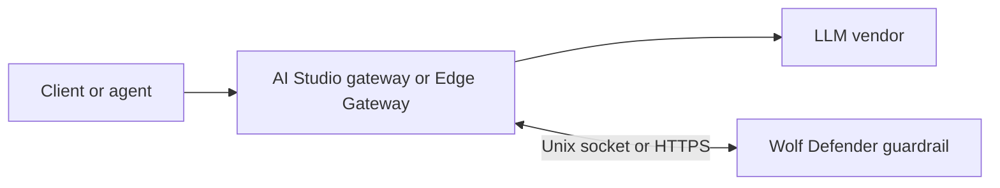
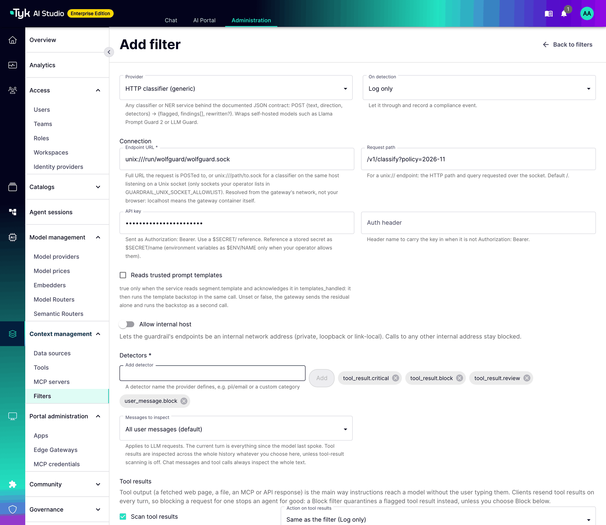

## Availability

| Edition | Deployment Type |
| :------------- | :---------------------- |
| [Enterprise](/ai-management/ai-studio/overview#enterprise-edition) | Self-Managed |

The Wolf Defender guardrail is available from Tyk AI Studio 2.3.0.

## Overview

The Wolf Defender guardrail is a prompt-injection classifier for agent traffic. It runs the [Wolf Defender Jev](https://huggingface.co/patronus-studio/wolf-defender-jev) model by [Patronus Protect](https://patronus.studio/) (Casdo Labs GmbH). Tyk packages the model as a service with an HTTP API that AI Studio calls as a [guardrail](/ai-management/ai-studio/guardrails).

The guardrail scores four stages of an agent conversation:

| Stage | What the guardrail scores | Typical action |
| :--- | :--- | :--- |
| `tool_result` | The content that a tool returns, for example a file, a web page, or command output | Quarantine the tool result, or stop the conversation |
| `tool_call` | The arguments of a tool call that the model asks for, compared with the goal of the user | Block the call before the client runs it |
| `user_message` | The text of the user, or the prompt of a bot runner around untrusted text | Block |
| `tool_definition` | The description and the schema of a tool, for example a poisoned MCP tool | Remove the tool |

For each stage, the guardrail reports three detector levels: `<stage>.review`, `<stage>.block`, and `<stage>.critical`. A detector matches its own level and the levels above it, so `tool_result.block` acts on block and critical findings. To act differently on each level, use two filters. For example, one filter stops the conversation on `tool_result.critical`, and the other quarantines on `tool_result.block`.

The guardrail also does these things in addition to the model:

- It applies rules without the model. Some tool calls are critical immediately. Examples are a call that reads credentials, sends a file over the network, or contains a planted canary string. The guardrail also flags hidden text, such as Unicode tag characters and bidirectional controls.
- It keeps a verdict store. Agents send the full history again with each request. The guardrail answers known text from its store. A flagged tool result stops each later request in the same conversation.
- It reads a versioned YAML policy. The policy holds the thresholds and the enforcement mode of each stage. It also holds a description of each app and switches that stop the scoring. The guardrail reloads the policy when the file changes.

The guardrail source, its policy reference, and its API are in the [ai-studio-guardrail-wolf](https://github.com/TykTechnologies/ai-studio-guardrail-wolf) repository.

## How It Fits

{/* Diagram for the designer.
Purpose: show where the Wolf Defender guardrail sits.
Structure: left to right. Client or agent, then the AI Studio gateway or Edge Gateway, then the LLM vendor. The guardrail sits beside the gateway.
Key elements: a two-way link between the gateway and the guardrail, labelled "Unix socket or HTTPS".
Design notes: the guardrail is not on the path to the vendor. */}



Request filters send user messages, tool results, and tool definitions to the guardrail. Response filters send the tool calls of the model. The guardrail returns findings, and the filter applies its action.

## Choose a Deployment

Tyk publishes two images. Both images and the model are under the MIT License.

| | CPU, next to the gateway | GPU, over HTTPS |
| :--- | :--- | :--- |
| Image | `tykio/ai-studio-guardrail-wolf` | `tykio/ai-studio-guardrail-wolf-gpu` |
| Platforms | linux/amd64 and linux/arm64 | linux/amd64, NVIDIA GPU with CUDA 12.6 |
| Connection | A Unix socket, with no network | HTTPS, with a bearer token and a client IP allowlist |
| Short message or tool call | 0.15 to 0.5 seconds | About 20 ms, plus the network time |
| Tool result of 6,000 tokens | 9 to 18 seconds | About 0.3 seconds |
| Use for | Log-only rollouts, enforcement on short content, low traffic | Enforcement on all stages |

The CPU figures come from a container with 4 CPUs. The GPU figures come from an NVIDIA A40. Your figures can be different.

On a CPU, a long tool result takes several seconds. The guardrail can score it in **deferred** mode: it lets new content through immediately and scores it in the background. The agent sends its history again, so the guardrail stops the next request that contains the same content. On a GPU, use **inline** mode for all stages. In inline mode, a flagged tool result never gets to the model. You set the mode in the guardrail policy. Refer to [Tune the Policy](#tune-the-policy).

Pin each image by its digest (`image@sha256:...`). Do not use a tag that can move.

## Run the Guardrail on a CPU

Run the CPU image in the same Docker Compose project as AI Studio and the Edge Gateways. The guardrail has no network. AI Studio and the Edge Gateways connect to it through a Unix socket on a shared volume.

1. Create a token and write it to `wolfguard.env` as `WOLFGUARD_TOKEN=<token>`. Set the file mode to `0600`. Do not commit the file. The guardrail does not start without a token.

    ```bash
    openssl rand -base64 32
    ```

2. Create the state directory. The guardrail runs as user `10001` and group `65532`.

    ```bash
    install -d -o 10001 -g 65532 -m 0750 wolfguard-state
    ```

3. Add the guardrail service, the socket volume, and the socket settings to your Compose file:

    ```yaml expandable
    volumes:
      guard-sock: {}

    services:
      wolfguard:
        image: tykio/ai-studio-guardrail-wolf@sha256:<digest>
        network_mode: none
        read_only: true
        tmpfs: ["/tmp:rw,noexec,nosuid,size=256m"]
        cap_drop: [ALL]
        security_opt: ["no-new-privileges:true"]
        cpus: 4
        mem_limit: 4g
        env_file: [./wolfguard.env]
        environment:
          WOLFGUARD_STATE_DIR: /var/lib/wolfguard
        volumes:
          - guard-sock:/run/wolfguard
          - ./wolfguard-state:/var/lib/wolfguard
          # - ./policy.yaml:/etc/wolfguard/policy.yaml:ro
        restart: always

      ai-studio:
        environment:
          GUARDRAIL_UNIX_SOCKET_ALLOWLIST: /run/wolfguard/
        volumes: [guard-sock:/run/wolfguard]
        depends_on: {wolfguard: {condition: service_healthy}}

      microgateway:
        environment:
          GUARDRAIL_UNIX_SOCKET_ALLOWLIST: /run/wolfguard/
        volumes: [guard-sock:/run/wolfguard]
        depends_on: {wolfguard: {condition: service_healthy}}
    ```

4. Start the services:

    ```bash
    docker compose up -d
    ```

    The guardrail is healthy when it has loaded the model. This takes 20 to 60 seconds.

With fewer than 4 CPUs, scoring is much slower. With less than 4 GB of memory, the guardrail can stop while it loads the model.

The guardrail creates the socket `/run/wolfguard/wolfguard.sock` with mode `0660` and group `65532`. The AI Studio and Edge Gateway images run with this group, so only they can connect.

Set [`GUARDRAIL_UNIX_SOCKET_ALLOWLIST`](/ai-management/ai-studio/ai-studio-env#guardrail_unix_socket_allowlist), and mount the socket volume, on AI Studio and on each Edge Gateway that runs the filter. The value `/run/wolfguard/` allows all sockets in that directory. AI Studio refuses a socket that is not in the list.

## Run the Guardrail on a GPU

Run `tykio/ai-studio-guardrail-wolf-gpu` on a host with an NVIDIA GPU. The image listens on TCP port 8000 and keeps its state in `/workspace/wolfguard`.

```bash
docker run -d --gpus all -p 127.0.0.1:8000:8000 -v wolfguard-state:/workspace \
  -e WOLFGUARD_TOKEN=<token> \
  -e WOLFGUARD_ALLOW_IPS=203.0.113.10/32 \
  tykio/ai-studio-guardrail-wolf-gpu@sha256:<digest>
```

Configure the host:

- Put a TLS proxy in front of the guardrail. The HTTP classifier trusts only publicly trusted certificates.
- In `WOLFGUARD_ALLOW_IPS`, list the outbound addresses or CIDR ranges of AI Studio and of each Edge Gateway. The guardrail refuses other addresses with HTTP 403.
- A proxy can hide the address of the caller. In this case, set `WOLFGUARD_CLIENT_IP_HEADER` to a header that only the proxy can set. Set `WOLFGUARD_TRUSTED_PROXIES` to the addresses of the proxy.
- To use your own policy, set `WOLFGUARD_POLICY_YAML_B64` to the policy in base64.

{/* TODO: Link each WOLFGUARD_* variable to the configuration reference in the ai-studio-guardrail-wolf repository. */}

A GPU host has no automatic fallback. When the host is down, each filter that uses it gets an error. Refer to [Operate the Guardrail](#operate-the-guardrail).

## Store the Token in AI Studio

1. Go to **Settings > Secrets** and add a secret with the name `WOLFGUARD_TOKEN`.
2. Set the value to the same token as the guardrail.

The filters refer to the token as `$SECRET/WOLFGUARD_TOKEN`. Thus, the filter does not contain the token. For more information, refer to [Secrets](/ai-management/ai-studio/secrets) and [Provider Credentials](/ai-management/ai-studio/guardrails#provider-credentials).

## Give the Agent Its Own LLM

A filter attaches to an LLM and applies to all apps that use that LLM. If the agent shares an LLM with other apps, do these steps:

1. Create a second LLM with the same vendor, endpoint, key, and models.
2. Give access to the new LLM only to the app of the agent.
3. Attach the Wolf Defender filters to the new LLM.

Other apps then do not depend on the guardrail. An outage of the guardrail does not block their requests.

## Create the Filters in Log-Only Mode

Start in shadow mode with the **Log only** action. In shadow mode, the gateway does not wait for the guardrail and does not change traffic. It records each decision as a [compliance event](/ai-management/ai-studio/compliance-events). The compliance events show what enforcement would do. Run shadow mode on real traffic for about two weeks before you enforce.

### Request Filter

Go to **Context management > Filters**, select **Add filter**, and set these fields:

| Field | Value |
| :--- | :--- |
| **Filter type** | **Guardrail** |
| **Is this a Response Filter?** | Off |
| **Provider** | **HTTP classifier (generic)** |
| **Endpoint URL** | CPU: `unix:///run/wolfguard/wolfguard.sock`. GPU: the full URL, for example `https://guard.example.com/v1/classify?policy=<policy-version>` |
| **Request path** | CPU only: `/v1/classify?policy=<policy-version>`. Leave it empty for an HTTPS endpoint. |
| **API key** | `$SECRET/WOLFGUARD_TOKEN` |
| **On detection** | **Log only** |
| **Detectors** | `tool_result.critical`, `tool_result.block`, `tool_result.review`, `user_message.block`, `user_message.review`, `tool_call.block`, `tool_call.review`, `tool_definition.block`, `tool_definition.review`. Set the **Threshold** of each to `0.01`. |
| **Messages to inspect** | **User text of the current turn** |
| **Scan tool results** | On. Set **Action on tool results** to **Log only**. |
| **Scan tool calls** | On |
| **Scan tool definitions** | On |
| **Shadow (don't wait)** | On |
| **If the provider fails** | **Let the request through** |
| **Timeout (ms)** | `30000` |
| **Reuse verdicts for text already scanned** | Off. This setting is under **Advanced: verdict cache and budgets**. |
| **Max provider pieces per request** | `2000`. This setting is under **Advanced: verdict cache and budgets**. |



Why these values:

- **Threshold `0.01`**: The guardrail policy holds the real thresholds, and the guardrail reports only decided findings. The gateway drops a finding below the detector threshold. The default threshold is 0.5, so the gateway would drop review findings.
- **`?policy=` in the path**: This parameter names the policy version that you expect. Use the `version` value from the policy file. When you change the policy, you also edit the filter, and the guardrail counts calls that name a different version.
- **Verdict reuse off**: The guardrail keeps its own verdict store. If the gateway also keeps verdicts, it can reuse a "not scored yet" answer from deferred mode. Then the stored verdict does not get to the request.
- **Max pieces `2000`**: With verdict reuse off, the gateway sends the full history with each request. The guardrail answers known text from its store. A long conversation has more than the default of 256 pieces, and pieces over the limit are not scanned.
- **Timeout `30000`**: Inline scoring of a long tool result can take several seconds on a CPU. Keep `WOLFGUARD_QUEUE_WAIT` on the guardrail (default 20 seconds) less than the timeout. Then a busy guardrail replies before the gateway stops waiting.

### Response Filter for Tool Calls

Add a second filter for the tool calls of the model. Use the same provider, endpoint, and API key, and set these fields:

- **Is this a Response Filter?**: On
- **Detectors**: `tool_call.block` and `tool_call.review`, each with a **Threshold** of `0.01`
- **Scan tool calls**: On
- **On detection**: **Log only**
- **Shadow (don't wait)**: On
- **Reuse verdicts for text already scanned**: Off
- **Timeout (ms)**: `30000`

### Read Trusted Prompt Templates

An administrator can approve the instructions of an app as a [trusted prompt template](/ai-management/ai-studio/guardrails#trusted-prompt-templates). Request guardrails then score only the parts that change.

The Wolf Defender guardrail can process trusted prompt templates itself, from image version 0.2.0. To turn this on, select **Reads trusted prompt templates** in the connection of the request filter. In the API, this is the connection field `templates: "true"`. The guardrail then scores the variable parts and also scores the full message in the same call as a backstop. Without this setting, the gateway sends only the variable parts and scores the full message in a second call.

### Create the Filters with the API

The API uses the same settings as the form. For the field names and the filters endpoint, refer to the [AI Studio API reference](/ai-management/ai-studio/ai-studio-swagger). The **Reads trusted prompt templates** setting is the connection field `templates: "true"`.

## Attach and Check the Filters

1. Go to **Model management > Model providers**, open the LLM, and add both filters. Filters run from top to bottom. The first block stops the request.
2. If you use Edge Gateways, wait until AI Studio pushes the configuration to them.
3. In the **Test** panel of the request filter, set **Request body format** to the vendor format of your agent. Select **Insert a tool-result sample** and run the test. The result shows a `tool_result` compliance event. The test is a real call, so it also checks the endpoint, the socket allowlist, and the token. Refer to [Test a Guardrail](/ai-management/ai-studio/guardrails#test-a-guardrail).

    {/* TODO: Add screenshot: Test panel of the request filter with a tool_result compliance event */}
4. Send one real turn from the agent. Go to **Governance > Compliance overview** and select the **Filter Events** tab. The decisions show as shadow events, with the stage, the tool name, and the score.

{/* TODO: Add screenshot: Governance > Compliance overview, Filter Events tab, with a Wolf Defender shadow event expanded */}

## Tune the Policy

Examine the shadow decisions each week before you enforce. Use these sources:

- **Compliance events in AI Studio**: What the guardrail flagged, by stage, app, and tool.
- **The decision log of the guardrail**: The file `decisions.jsonl` in the state directory has one line for each scored segment. The line has the scores, the stage, the app, and the tool. It also has the policy version and the SHA-256 hash of the text. It does not contain the text. With `WOLFGUARD_PREVIEW=1`, the file `previews.jsonl` keeps the first 200 characters of each flagged segment, with secrets masked.
- **Metrics**: The guardrail serves Prometheus metrics on `/metrics`, with the bearer token.

The policy is the YAML file `/etc/wolfguard/policy.yaml` in the image. To use your own policy, mount a file at that path, or set `WOLFGUARD_POLICY_YAML_B64` on a GPU host. The guardrail reloads the file within 2 seconds. If the new file is not valid, the guardrail keeps the last valid policy. Increase the `version` value for each change, and update `?policy=` in the filters.

These policy settings are the most useful to tune:

| Setting | Description |
| :--- | :--- |
| `apps."<id>".system_context` | A sentence that describes the app. It makes user-message scoring more accurate. |
| `apps."<id>".user_messages: untrusted` | For a bot whose user message is the prompt of its runner around untrusted text. The guardrail scores the message as untrusted content, and only the critical level blocks. |
| `apps."<id>".skip` | The guardrail answers clean for this app and does not score it. |
| `stages.<stage>.questions.<q>.review`, `.block`, `.critical` | The thresholds of each level. |
| `enforcement.stages.<stage>.mode` | `inline` scores the content before the gateway continues. `deferred` lets new content through and scores it in the background. |
| `enforcement.stages.<stage>.when_busy` | What the guardrail returns when it cannot score in time: `error` (HTTP 503), `pass`, or `unscanned`. |
| `rules.secret_access` | The rule for tool calls that read credentials. It is on by default. |
| `canaries` | Strings that must never appear in a tool call. Put them in system prompts or documents. |

For all policy fields, refer to the [policy reference](https://github.com/TykTechnologies/ai-studio-guardrail-wolf/blob/main/docs/REFERENCE.md) in the guardrail repository.

During the shadow period, expect these results:

| Result | Cause and solution |
| :--- | :--- |
| Security text scores as an attack | Documentation about prompt injection and test fixtures can look like attacks. For this reason, the default policy stops a conversation only at the critical level and quarantines at the block level. |
| Issues or comments are flagged as user messages | The runner of the app puts them inside its own instruction. Set `user_messages: untrusted` for that app. If the instruction of the runner is flagged, approve it as a trusted prompt template for the app. |
| Decisions arrive one turn late | The stage uses deferred mode. Use inline mode where the latency is acceptable, for example on a GPU. |

## Enforce the Guardrail

Enforce one stage at a time. Wait one week between stages and examine the decisions. Replace the shadow request filter with these filters, in this order on the LLM:

1. **Stop the conversation**: Start with the detector `tool_result.critical`. Add `user_message.block` when the user-message decisions are correct.
    - Set **On detection** and **Action on tool results** to **Block**.
    - Set a **Block message**, for example "This conversation was stopped by the security guardrail."
    - Turn off **Shadow (don't wait)**. Keep the other settings from the shadow filter.
2. **Quarantine the other tool results**: Set the detector to `tool_result.block`. Set **On detection** to **Log only** and **Action on tool results** to **Quarantine**. Set a **Quarantine placeholder**, for example `[content removed by policy: {{tool_name}} returned text that looked like instructions to the AI]`. Turn off **Shadow (don't wait)**.
3. **Block tool calls**: In the response filter, set the detector to `tool_call.block` and **Action on tool calls** to **Block**. Turn off **Shadow (don't wait)**.
4. **Remove poisoned tools**: Add `tool_definition.block` to the quarantine filter. Turn on **Scan tool definitions** and set **Action on tool definitions** to **Remove the tool**.

Keep the shadow filter attached to record the review level.

When the guardrail enforces, clients see these results:

- A blocked request gets the block message with HTTP 400.
- A quarantined tool result gets to the model as the placeholder, and the agent continues.
- A blocked tool call ends the response with the error event of the vendor.

The guardrail remembers flags. Each later request in a stopped conversation is also stopped, for 7 days or until you remove the flag.

The model scores the input only. To check the text that the model returns, add a response filter with the **Built-in pattern library** provider and the `secrets` and `leak` detectors. Start it in shadow mode.

## Operate the Guardrail

### Turn Off Quickly

Use these methods, from the fastest:

- In AI Studio, set the actions of the filters to **Log only**.
- In the policy, `skip` an app, increase a threshold, or change the mode of a stage. The change takes effect within 2 seconds.
- Detach the filters, then stop the guardrail. If you stop the guardrail first, filters that block tool results also block each request that contains a tool result.

### Remove a False Flag

To remove one flag, find the `sha256` value of the text in the compliance event or in the decision log. Then use the admin API of the guardrail, or the store command in the container. Refer to the [guardrail repository](https://github.com/TykTechnologies/ai-studio-guardrail-wolf) for the commands. A change of the policy version removes all flags.

### Monitor the Guardrail

| Metric | What to monitor |
| :--- | :--- |
| `wolfguard_decisions_total` | A sudden change in the rate of a stage |
| `wolfguard_rejected_total` | Any HTTP 503, which shows that the guardrail is busy |
| `wolfguard_denied_total` | Calls refused by the client IP allowlist |
| `wolfguard_policy_invalid` | The value is 1 while the policy file is not valid |
| `aistudio_guardrail_errors_total` | Errors from the gateway when it calls the guardrail |

If the GPU host stops, alert on `aistudio_guardrail_errors_total`. Then set the filters to **Log only**, or point them to a CPU guardrail next to the gateway. A CPU guardrail has its own empty verdict store.

Do not rotate or truncate `verdicts.db`. The guardrail removes old rows itself.

