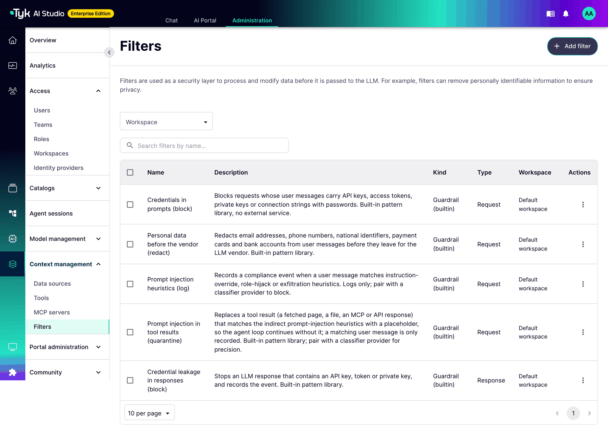

## Availability

| Edition   | Deployment Type |
| :------------- | :---------------------- |
| [Enterprise](/ai-management/ai-studio/overview#enterprise-edition) | Self-Managed |

Guardrails for agent traffic are available from Tyk AI Studio 2.3.0.

## Overview

A guardrail is a [filter](/ai-management/ai-studio/filters) that sends text to a detection provider instead of running a script. You select a [provider](/ai-management/ai-studio/guardrails-reference#providers), the detectors, and the action to take on a match. You do not write code.

A guardrail attaches and runs in the same way as a script filter:

- You attach it to LLMs, chat rooms, and tools. Refer to [Filters](/ai-management/ai-studio/filters).
- It runs on requests, on responses, and on tool arguments and tool results. Streamed responses are also included.
- It runs in AI Studio and on each [Edge Gateway](/ai-management/ai-studio/manage-edge-gateway).
- Each match records a [compliance event](/ai-management/ai-studio/compliance-events).

A request guardrail can also examine the tool results, tool calls, and tool definitions of agent traffic. Refer to [Guardrails for Agent Traffic](/ai-management/ai-studio/guardrails-agent-traffic).

<Note>
In the Community Edition, AI Studio does not run a guardrail that you create and attach. The guardrail lets all content through, and AI Studio logs a warning, the same as for a script filter. App capabilities, exceptions, and prompt templates have no effect.
</Note>

To see your guardrails, go to **Context management > Filters**. The **Kind** column shows **Guardrail** and the provider name in brackets.



To create a guardrail, refer to [Create a Guardrail](/ai-management/ai-studio/how-to-create-guardrail).

## Default Guardrails

A new Enterprise installation includes five guardrails that use the built-in pattern library:

| Name | Detectors | Action | Type |
| :--- | :--- | :--- | :--- |
| Credentials in prompts (block) | `secrets` | Block | Request |
| Personal data before the vendor (redact) | `pii` | Redact | Request |
| Prompt injection heuristics (log) | `injection` | Log only | Request |
| Prompt injection in tool results (quarantine) | `injection` | Log only. Quarantine on tool results. | Request |
| Credential leakage in responses (block) | `secrets`, `leak` | Block | Response |

They have no effect until you attach them.

- AI Studio creates each one by name only if it does not exist. It does not change a default guardrail that you edited, and it does not create a deleted guardrail again.
- An upgraded installation gets **Prompt injection in tool results (quarantine)** on its next start.
- To skip them on a new installation, set [SKIP_FILTER_DEFAULTS=true](/ai-management/ai-studio/ai-studio-env#skip_filter_defaults).

## Actions

| Action | On a request | On a response |
| :--- | :--- | :--- |
| Block | AI Studio rejects the request and returns the block message. | AI Studio stops the response. |
| Redact | AI Studio replaces the matched text before the request goes to the vendor. | AI Studio records the finding and lets the response through. |
| Quarantine | AI Studio replaces the flagged message or tool result with a placeholder. The request continues. | Not available. |
| Log only | AI Studio lets the request through. | AI Studio lets the response through. |
| Log and raise event | AI Studio lets the request through and raises an alert. | AI Studio lets the response through and raises an alert. |

All actions record a compliance event for each detector that matches. **Quarantine** and **Log and raise event** are available from Tyk AI Studio 2.3.0. Refer to [Quarantine](/ai-management/ai-studio/guardrails-agent-traffic#quarantine) and [Alerts](/ai-management/ai-studio/guardrails-reference#alerts).

### Redaction

Redaction applies to request-side filters only: LLM requests, chat messages, and tool arguments.

<Warning>
On a response filter, **Redact** does not change the content. It records the finding and lets the content through to the client. This applies to LLM responses and to the output of a tool that has the filter attached. The form shows the action as **Redact (logs only on responses)**.

The same is true on a request filter when the provider finds a match but cannot rewrite it. For example, Lakera Guard can rewrite PII findings, but not a prompt attack.

If you must stop the content, use **Block**.
</Warning>

| Redaction style | Result |
| :--- | :--- |
| Placeholder (default) | The matched text becomes the placeholder. The default placeholder is `[REDACTED:{{type}}]`. |
| Mask (same length) | Each character of the matched text becomes `*`. |
| Hash | The matched text becomes the type and a short SHA-256 prefix, such as `[EMAIL:1a2b3c4d]`. The same value always gives the same token. |

You can use these variables in the placeholder:

- `{{type}}`: the detector name in upper case, such as `EMAIL` or `AWS_ACCESS_KEY`
- `{{category}}`: the category, such as `PII` or `SECRETS`

On OpenAI, Ollama, Anthropic, Google, Vertex AI, and Bedrock requests, a redaction replaces only the matched strings. Tool calls, tool results, images, and all other fields go to the vendor unchanged. Sometimes AI Studio cannot write a redaction into the body, for example when the match crosses two content blocks. Then it quarantines the tool result, or blocks the request.

<Warning>
A guardrail protects the content that goes to the vendor. It does not change what AI Studio stores. The proxy log keeps a blocked request as the caller sent it, with the flagged text. Refer to [Filters and Proxy Logs](/ai-management/ai-studio/filters#filters-and-proxy-logs).
</Warning>

## Messages to Inspect

On an LLM request, **Messages to inspect** selects the messages that the provider gets:

- **All user messages** (default)
- **User text of the current turn**: the user text since the model last replied
- **System and user messages**
- **Every message, including assistant turns**

When [tool-result scanning](/ai-management/ai-studio/guardrails-agent-traffic#tool-results) is on, the guardrail examines all tool results in the conversation history, whatever this setting is. A client sends its tool results again on each turn. Tool calls and tool definitions are also examined in the full request when their scan is on.

Chat messages always have one text only, so the guardrail always examines all of it.

## Provider Failures

**If the provider fails** controls what happens when the provider returns an error or the call takes longer than the timeout:

- On request filters, the default is to block. This is fail closed. Request filters include filters on tool arguments.
- On response filters, the default is to let the content through. This is fail open. Response filters include filters on tool results.

In both cases, AI Studio records a `guardrail.error` compliance event.

<Warning>
With fail closed, the guardrail blocks all requests while the provider is not available. With fail open, the guardrail does not examine any content while the provider is not available, so sensitive content can get through. Set a timeout that matches the latency of your provider.
</Warning>

From 2.3.0, the fail mode applies only to an ordinary request. A request is ordinary when it has at most `budget.single_call_chars` characters to scan and needs few provider calls. For a per-message provider, such as Lakera Guard or Bedrock Guardrails, this means at most four messages and four tool results.

On a larger request, a provider failure leaves the affected text unscanned. AI Studio then applies the filter's action to the unscanned text, the same as to a finding. For this reason, a fail-open filter can block a large request during a provider outage.

To bring more requests under the fail mode, raise `budget.single_call_chars`. Refer to [Budgets and the Verdict Cache](#budgets-and-the-verdict-cache).

Sometimes only the call for the tool results fails on an ordinary request. With fail closed, AI Studio then quarantines the tool results, and the request continues.

When a provider call does not return 100 ms after its timeout, AI Studio stops waiting and counts it as a timeout. If an external provider does this often, AI Studio suspends calls to it for 10 seconds. A suspended call fails at once and the fail mode applies.

## Streamed Responses

On a streamed response, a guardrail does not examine each chunk. It examines the accumulated response each time the response gets longer by N characters. The default N is 250 for the built-in pattern library and 1000 for external providers. To change it, set **Streaming: evaluate every N characters**.

The guardrail also examines the full response once when the stream ends. This makes sure that it examines a response that is shorter than N.

If the guardrail blocks during the stream, AI Studio stops the stream. If it blocks at the end of the stream, AI Studio ends the stream with an error and records the block. But the client already has the chunks that AI Studio sent before.

From 2.3.0, response guardrails screen all stream formats: OpenAI chat completions and the Responses API, Anthropic, Google, Ollama, and Bedrock through the bridges. A block ends the stream with the error event of the vendor, so the vendor SDK raises an error.

## Budgets and the Verdict Cache

A sender controls the size of a request. A tool result can have any length, and an agent sends its full history on each turn. Two mechanisms keep the cost of scanning under control.

The verdict cache keeps each provider verdict on a request segment, such as one message or one tool result. AI Studio answers the history that an agent sends again from the cache, so the provider examines each segment one time.

- AI Studio reuses a verdict only for the same filter version, provider version, kind of segment, text, and App.
- It caches only the verdicts of successful calls.
- It does not cache responses or **Test** panel results.
- To turn off the cache for one filter, clear **Reuse verdicts for text already scanned** (`cache: false`). Do this for a provider whose verdict depends on more than the text.

With an external provider, the `budget` settings limit the scan of one request:

| Field | Default | Description |
| :--- | :--- | :--- |
| `budget.max_scan_chars` (**Max characters per segment**) | `262144` | The longest segment that AI Studio sends, in characters. The maximum is 16 MiB. A longer segment is unscanned. |
| `budget.max_pieces` (**Max provider pieces per request**) | `256` | The maximum number of segments, or parts of segments, that AI Studio sends for one request. Cached verdicts do not count. |
| `budget.time_ms` (**Time budget (ms)**) | 4 × `timeout_ms` | The total time for all provider calls of the request. AI Studio runs four calls at a time. |
| `budget.single_call_chars` (**Fail mode applies up to (characters)**) | `32768` | The largest request for which the fail mode decides a provider failure. It cannot be more than `max_scan_chars`. |

AI Studio never treats text outside a budget as clean. It marks the text as unscanned and applies the filter's action:

- **Block** blocks the request. For a tool result, it quarantines the tool result.
- **Redact** also blocks, or quarantines a tool result, because AI Studio cannot redact unscanned text.
- **Quarantine** replaces the segment.
- **Log only** records it.

AI Studio also marks text as unscanned when the provider rejects it with `400`, `413`, or `422`.

The built-in pattern library is not subject to these budgets. It scans each segment in full, up to `GUARDRAIL_LOCAL_MAX_SCAN_BYTES`. Response filters use no cache and no budgets, and the fail mode decides each provider failure.

For the environment variables that size the verdict cache and the built-in library scans, refer to [Environment Variables](/ai-management/ai-studio/guardrails-reference#environment-variables).

<Warning>
On a host with 2 CPUs, many large tool results can keep both cores busy. Run gateways that scan agent traffic with the built-in library on 4 or more CPUs, or set `GUARDRAIL_LOCAL_SCAN_SLOTS=1`.
</Warning>

## When a Guardrail Blocks a Request

From 2.3.0, the caller gets HTTP `400` with the filter name, the block message, the reason, and the request ID. For example, for a filter named `Prompt attacks`:

```text
Policy error: Prompt attacks - Request blocked by policy. Reason: a tool result from fetch_results of 321,097 characters is longer than this guardrail scans (262,144 characters, budget.max_scan_chars), so it was not checked (guardrail_too_large_to_scan). Request ID: tyai_0192d8a4f6b37c1e9a5b2d4c6e8f0a1b.
```

The reason never contains the matched text, a score, or the detector. On the `/llm/` endpoints, the JSON body also contains `reason_code`, `reason`, `filter`, and `request_id`. The `X-Tyk-AI-Guardrail-Reason` response header contains the reason code. Match on the reason code instead of the message text.

| Reason code | Cause |
| :--- | :--- |
| `guardrail_detected` | The provider flagged the text. |
| `guardrail_too_large_to_scan` | A message or tool result is longer than `budget.max_scan_chars`. |
| `guardrail_scan_budget_exceeded` | The request needs more than `budget.max_pieces` or `budget.time_ms`. |
| `guardrail_unavailable` | The provider failed and the filter fails closed. |
| `guardrail_unscanned` | The provider rejected the text, or AI Studio could not decode it. |
| `guardrail_unreadable_request` | The JSON body has a repeated key, or keys that differ only in case. |

The message of a script filter block does not change.

In **Compliance > Filter Events**, the details of a guardrail event start with a summary of what happened. **Why** gives the causes, and **Fix** gives up to two actions.

If a guardrail blocks legitimate traffic, refer to [Tune Guardrails](/ai-management/ai-studio/how-to-tune-guardrails).

## Edge Gateways

Guardrails go to Edge Gateways in the configuration snapshot, together with the script filters. After you change a guardrail, push the configuration. Each Edge Gateway runs the same filter chain as AI Studio, so a guardrail gives the same result in both places. The Edge Gateway sends the compliance events to AI Studio with its analytics data.

Approved [exceptions](/ai-management/ai-studio/how-to-tune-guardrails#guardrail-exceptions) and [trusted prompt templates](/ai-management/ai-studio/how-to-tune-guardrails#trusted-prompt-templates) also go to Edge Gateways in the snapshot. A change marks the Edge Gateways as pending until the next push. AI Studio raises [alerts](/ai-management/ai-studio/guardrails-reference#alerts) and [outcome events](/ai-management/ai-studio/guardrails-reference#outcome-events) for Edge Gateway traffic when the analytics pulse arrives.

<Warning>
Upgrade Edge Gateways together with AI Studio. An Edge Gateway older than 2.3.0 blocks all traffic that a guardrail examines, even with fail open, because guardrail credentials reach it encrypted. It also does not scan tool results.
</Warning>
