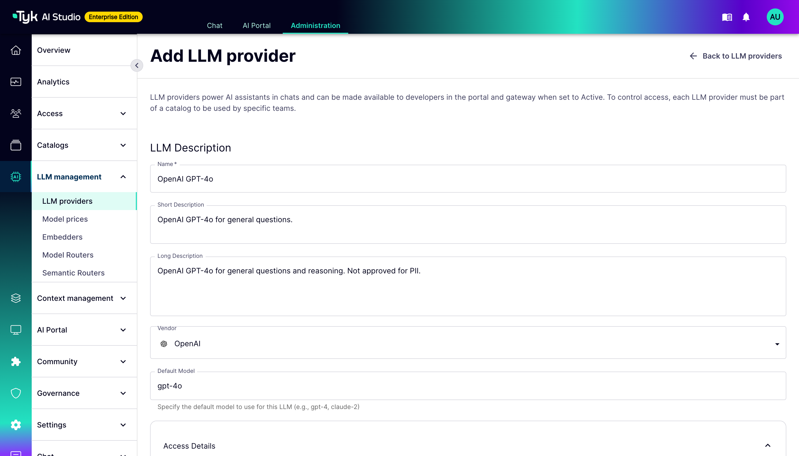
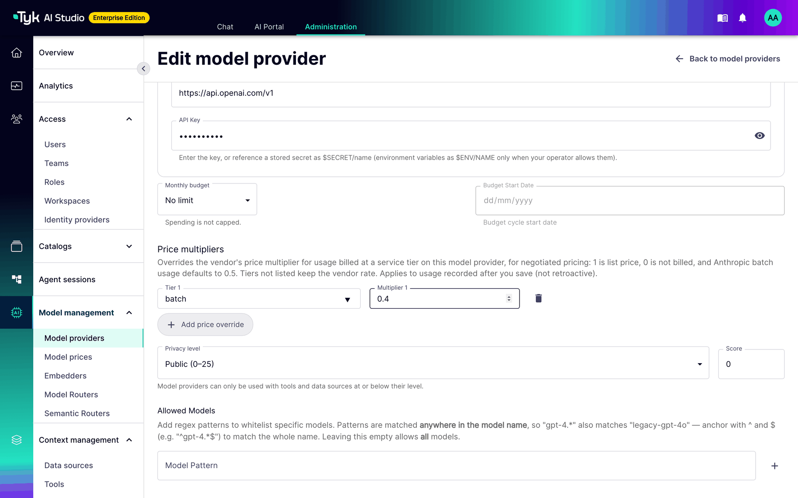
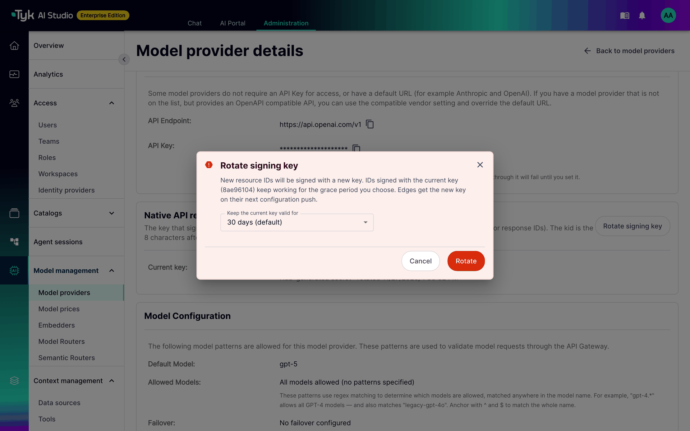

## Availability

| Edition   | Deployment Type |
| :------------- | :---------------------- |
| [Community](/ai-management/ai-studio/overview#community-edition) & [Enterprise](/ai-management/ai-studio/overview#enterprise-edition) | Self-Managed |

For what an LLM provider holds, refer to [LLM Management](/ai-management/ai-studio/llm-management).

Create the LLM provider in the Tyk AI Studio Admin UI, then change its pricing, failover, and signing key as necessary.

## Create an LLM Provider

1. **Navigate:** Go to the LLM providers section in the Admin UI. This view lists all configured LLMs, showing their Name, Short Description, Vendor, Privacy Level, and whether they are Proxied.
2. **Add New LLM:** Click "Add LLM provider".
3. **Fill in the LLM Details:**
   - **Name:** A user-friendly name for this configuration (Required). AI Studio creates the LLM slug from the name. From v2.3.0, two LLMs cannot have the same slug, in any namespace. AI Studio refuses a name that differs from the name of another LLM only in case, spaces, or punctuation.
   - **Short/Long Description:** Provide descriptions for the LLM.
   - **Vendor:** Select the LLM vendor (e.g., OpenAI, Anthropic).
   - **Default Model:** Specify the default model to use for this LLM (e.g., `gpt-4`, `claude-2`).
   - **Monthly budget:** Select **No limit** or **Fixed amount**, and set a **Budget Start Date**. A fixed amount of `$0` blocks all requests.
   - **Price multipliers:** From v2.3.0, OpenAI and Anthropic LLMs have this field. Refer to [Set Price Multipliers](#set-price-multipliers).
   - **Privacy levels:** Select a level (Public, Internal, Confidential, or Restricted) or enter a score from 0 to 100. LLMs with lower privacy levels can't access higher-level data sources and tools.
   - **Allowed Models:** Add regex patterns to whitelist specific models (e.g., `gpt-4.*` for all GPT-4 models).
   - In the **Access Details** section,
      - **API Endpoint:** Provide the endpoint URL (required if enabling an LLM for the AI Gateway, even for providers with default URLs).
      - **API Key:** Securely provide the necessary authentication credentials.
      - For Gemini Platform (Vertex), AWS Bedrock, and the Anthropic workspace, refer to [Vendor Access Details](#vendor-access-details).
   - In the **Portal Display Information** section,
      - **Logo URL:** Configure the logo used in the AI Portal for end-users.
      - **Active:** Set the LLM to active to use it in the proxy. For example, you must activate the LLM before you create an App that uses it.
      - **Disable Request/Response Body Logging:** When enabled, AI Studio does not store the request and response bodies of this LLM in logs or analytics events.
      - **Allow internal host:** From v2.3.0. Refer to [Allow Internal Host](/ai-management/ai-studio/outbound-network-policy#allow-internal-host).
   - **Plugins:** Select plugins to attach to this LLM. They execute in the order selected during the request lifecycle.
   - **Available Namespaces:** Select which edge namespaces this configuration should be available to (leave empty for global availability).
   - **Failover:** (Optional) Add fallback LLMs. Refer to [Add a Failover Waterfall](#add-a-failover-waterfall).
4. **Save:** Save the configuration to make the LLM provider available.

    

## Vendor Access Details

### Gemini Platform (Vertex) Credentials

From v2.3.0, AI Studio checks the access details of a Gemini Platform (Vertex) LLM when you save it. It refuses a malformed value with `400`.

- **API Endpoint:** `project:location`, for example `my-project:us-central1`. The location is a region, `us`, `eu`, or `global`. You can also enter an `http://` or `https://` URL, for example a Private Service Connect address. If the URL ends in `/projects/{project}/locations/{location}`, the gateway takes the project and the location from it.
- **API Key:** A Google credential JSON, such as a service account key or a Workload Identity Federation configuration. The gateway gets Google access tokens from this credential. An access token that starts with `ya29.` also works, but it expires within one hour, so use it only for tests.

If the gateway cannot get a token from the credential, it answers `502` with the message `LLM credential not usable` and the reason.

A Workload Identity Federation credential uses the identity of the host. It needs [AI_STUDIO_VERTEX_ADC](/ai-management/ai-studio/ai-studio-env#ai_studio_vertex_adc)`=true` on AI Studio and on each Edge Gateway that serves the LLM.

You can leave the API key empty. The gateway endpoints (`/llm/`, `/ai/`, and `/v1`) then refuse the LLM, unless `AI_STUDIO_VERTEX_ADC` is `true`. With this setting, the LLM uses the Google credentials of the host. AI Studio Chat still uses the host credentials for an LLM with no key, but logs a deprecation warning. A future release will also need the setting for AI Studio Chat.

### AWS Bedrock Credentials

For AWS Bedrock, the form shows labeled credential fields: **AWS Access Key ID**, **AWS Secret Access Key**, and **AWS Session Token** (optional). These are stored in the LLM's `metadata` map rather than `APIKey`. Use `$SECRET/NAME` references in these fields to keep credentials encrypted at rest via the [Secrets](/ai-management/ai-studio/secrets) manager.

### Anthropic Workspace

From v2.3.0, you can set **Vendor workspace (Anthropic)** in the **Access Details** section of an Anthropic LLM (`vendor_workspace_id` in the API). The value is 1 to 128 letters, digits, `_`, or `-`, for example `wrkspc_01...`.

When the field is set, the gateway sends it as the `anthropic-workspace-id` header on every call for this LLM. This includes gateway calls, batches, AI Studio Chat sessions, and the `/ai/` and `/v1` endpoints, on AI Studio and on Edge Gateways. The gateway ignores the workspace headers of a client. When the field is empty, calls run in the default workspace of the API key.

## Set Price Multipliers

From v2.3.0, if you have negotiated pricing, override the rate for a [service tier](/ai-management/ai-studio/model-prices#service-tiers) on the LLM:

1. Open the LLM provider form.
2. Below the budget fields, in **Price multipliers**, click **Add price override**.
3. Enter the tier in **Tier 1**, for example `batch`, and the multiplier in **Multiplier 1**. `1` is the list price, and `0` means that AI Studio does not bill the usage. The maximum is `10`.
4. Save the LLM provider.

For example, a multiplier of `0.4` for `batch` bills batch usage at 40% of the list price. A tier without an override keeps the vendor rate. The API field is `price_multipliers`, for example `{"batch": 0.4}`.

- The form shows the field for OpenAI and Anthropic LLMs, and for any LLM that already has overrides.
- AI Studio refuses the tiers `default` and `auto`, because AI Studio records list-price usage without a tier.
- The multipliers apply to usage that AI Studio records after you save. They do not change existing records.
- Edge Gateways receive the multipliers with the LLM configuration.

## Add a Failover Waterfall

For how the gateway uses the waterfall, refer to [LLM Failover](/ai-management/ai-studio/llm-failover).

1. Open the LLM provider and go to the **Failover** section of the edit form.
2. Click **Add fallback** and select a **Fallback LLM**.
3. Select the **Model** to use on that LLM. The model must be one of the allowed models of that LLM. If the LLM has no allowed models, you can select any model.
4. To change the order of the fallbacks, use the arrows. The gateway tries the first fallback first.
5. Save the LLM provider.

AI Studio checks these rules when you save:

- A fallback must be active. It must not be the provider itself. The same LLM and model pair cannot be in the list two times.
- A fallback must have a privacy level that is equal to or higher than the provider's level. It must be in the same namespace as the provider, or be global.
- A provider can have a maximum of 10 fallbacks.
- You cannot delete a provider while the waterfall of another provider contains it.

To change the [default triggers](/ai-management/ai-studio/llm-failover#when-failover-occurs), use **Failover Triggers (advanced)**:

- Remove status codes from the list. You can add only 5xx codes, `408`, and `429`. Other 4xx responses are caller or configuration errors, and every fallback would return the same error.
- Turn off **Fail over when the upstream times out** or **Fail over when the upstream cannot be reached**.
- Set a **Per-attempt timeout (seconds)**. Then a primary that does not respond cannot use all the time of the request.

## Rotate the Native API Signing Key

Rotate the [signing key of the LLM](/ai-management/ai-studio/llm-management#native-api-resource-ids) to revoke open resource IDs:

1. Open the LLM details page.
2. In **Native API resource IDs**, click **Rotate signing key**.
3. In **Keep the current key valid for**, select the grace period. The options are **30 days (default)**, **7 days**, **1 day**, or **No grace period**. IDs signed with the old key stay valid for this period. **No grace period** revokes them immediately.
4. Confirm the rotation.

You need permission to edit LLMs to rotate the key. AI Studio keeps only the key that you replace. If the previous key is still in its grace period, it stops working immediately. Edge Gateways get the new key with the next configuration push. You can also rotate the key with the API. Refer to the [AI Studio API reference](/ai-management/ai-studio/ai-studio-swagger).
