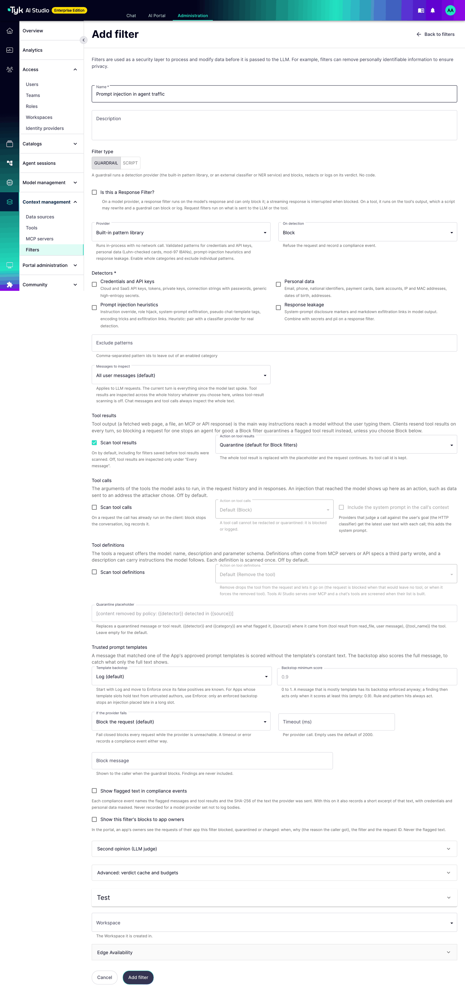
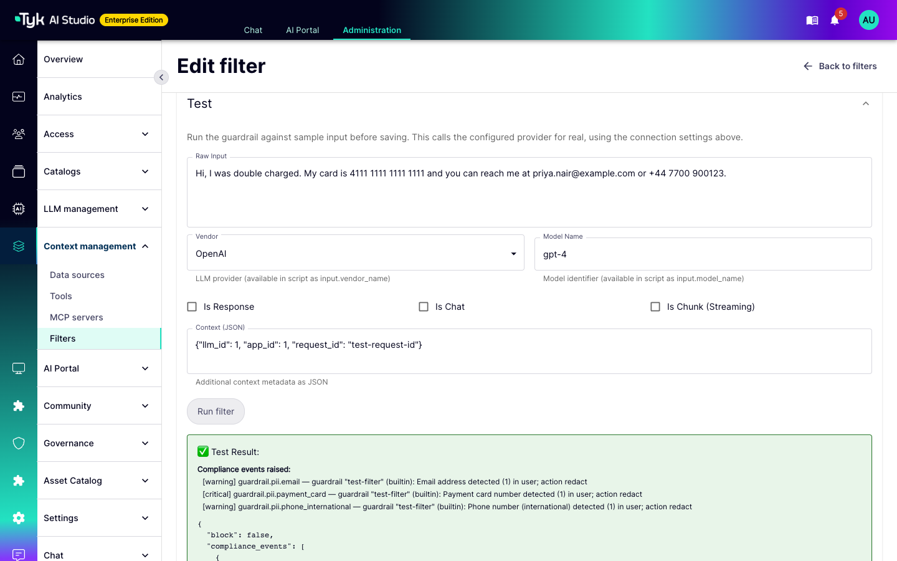
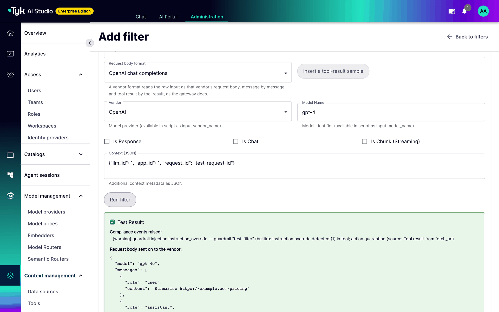

## Availability

| Edition   | Deployment Type |
| :------------- | :---------------------- |
| [Enterprise](/ai-management/ai-studio/overview#enterprise-edition) | Self-Managed |

For how guardrails work, refer to [Guardrails](/ai-management/ai-studio/guardrails).

Create a guardrail filter, test it, and then attach it to an LLM, a chat room, or a tool.

## Create a Guardrail

1. Go to **Context management > Filters** and select **Add filter**.
2. In **Filter type**, select **Guardrail**.
3. To check the LLM response instead of the request, select **Is this a Response Filter?**.
4. Select a **Provider** and an **On detection** action.
5. Select one or more **Detectors**.
6. Set the other fields. The table below describes them.
7. Use the **Test** panel to check the guardrail. Refer to [Test a Guardrail](#test-a-guardrail).
8. Save the filter. Then attach it to an LLM, a chat room, or a tool.

| Field | Description |
| :--- | :--- |
| Provider | The service that examines the text. Refer to [Providers](/ai-management/ai-studio/guardrails-reference#providers). |
| On detection | **Block**, **Redact**, **Quarantine**, **Log only**, or **Log and raise event**. Refer to [Actions](/ai-management/ai-studio/guardrails#actions). |
| Connection | The endpoint, key, and other settings of an external provider. Refer to [Provider Credentials](#provider-credentials). |
| Detectors | What the provider looks for. Some detectors have a **Threshold**. For providers that define their own detector names, type the name in **Add detector**. |
| Exclude patterns | Built-in pattern library only. A comma-separated list of pattern IDs to leave out of a category that you turned on, for example `pii.ipv4, pii.ipv6`. |
| Redaction style and Placeholder | Shown when the action is **Redact** on a request filter. Refer to [Redaction](/ai-management/ai-studio/guardrails#redaction). |
| Messages to inspect | Request filters only. Refer to [Messages to Inspect](/ai-management/ai-studio/guardrails#messages-to-inspect). |
| Tool results | Request filters only. **Scan tool results**, **Action on tool results**, and **Quarantine placeholder**. Refer to [Tool Results](/ai-management/ai-studio/guardrails-agent-traffic#tool-results). |
| Tool calls | **Scan tool calls**, **Action on tool calls**, and **Include the system prompt in the call**. Refer to [Tool Calls](/ai-management/ai-studio/guardrails-agent-traffic#tool-calls). |
| Tool definitions | Request filters only. **Scan tool definitions** and **Action on tool definitions**. Refer to [Tool Definitions](/ai-management/ai-studio/guardrails-agent-traffic#tool-definitions). |
| Shadow (don't wait) | Shown when each action of the filter is **Log only**. Refer to [Shadow Mode](/ai-management/ai-studio/how-to-tune-guardrails#shadow-mode). |
| Second opinion (LLM judge) | Refer to [Second Opinion from an LLM](/ai-management/ai-studio/how-to-tune-guardrails#second-opinion-from-an-llm). |
| Trusted prompt templates | Request filters only. **Template backstop** and **Backstop minimum score**. Refer to [Trusted Prompt Templates](/ai-management/ai-studio/how-to-tune-guardrails#trusted-prompt-templates). |
| Show flagged text in compliance events | Adds a masked excerpt of the flagged text to the compliance event. Refer to [Evidence](/ai-management/ai-studio/guardrails-reference#evidence). |
| Show this filter's blocks to app owners | Shows the blocks of this filter to the App owners in the AI Portal. Refer to [Evidence](/ai-management/ai-studio/guardrails-reference#evidence). |
| If the provider fails | What happens when the provider returns an error or does not reply in time. Refer to [Provider Failures](/ai-management/ai-studio/guardrails#provider-failures). |
| Timeout (ms) | The time limit for one provider call. The default is 2000. |
| Streaming: evaluate every N characters | Response filters only. Refer to [Streamed Responses](/ai-management/ai-studio/guardrails#streamed-responses). |
| Block message | The message that the caller gets when the guardrail blocks. The default is `Request blocked by policy` or `Response blocked by policy`. The message never contains the findings. |
| Advanced: verdict cache and budgets | Request filters only. **Reuse verdicts for text already scanned**, and the scan budgets of an external provider. Refer to [Budgets and the Verdict Cache](/ai-management/ai-studio/guardrails#budgets-and-the-verdict-cache). |

AI Studio validates the configuration when you save it. For example, it rejects an unknown detector, a **Redact** action on a provider that cannot redact, or a missing required connection field. The error message gives the cause.

The form saves only the settings that you change. A filter that you do not change keeps the defaults of the AI Studio version that runs it.

## Test a Guardrail

The **Test** panel on the filter form runs the guardrail against sample text before you save it. The result shows the compliance events and the output. In this example, the built-in pattern library finds a payment card, an email address, and a phone number. It masks all three.

For an external provider, the test sends a real call with the connection settings. Use it to check the credentials. If a connection field uses a `$SECRET/` or `$ENV/` reference, save the filter first. AI Studio resolves references in a test only when the provider and the connection settings are the same as the saved filter.

To test a request filter on agent traffic, set **Request body format** to a vendor format, such as OpenAI chat completions or Anthropic messages. AI Studio then reads the sample as a request body. Select **Insert a tool-result sample** to add a request with an injection in a tool result. The result shows the source of each event, and the body that AI Studio sends on to the vendor.

## Provider Credentials

For a connection field that holds a credential, such as an API key, use a reference instead of the value:

- `$SECRET/name` refers to a [secret](/ai-management/ai-studio/secrets).
- `$ENV/NAME` refers to an environment variable. From 2.3.0, AI Studio resolves it only when [AI_STUDIO_ENV_REF_ALLOWLIST](/ai-management/ai-studio/ai-studio-env#ai_studio_env_ref_allowlist) lists the variable name.

AI Studio resolves the reference when the guardrail runs. Edge Gateways do not have access to the secret store, so AI Studio resolves the references before it pushes the configuration to them. This is the same as for LLM API keys. From 2.3.0, guardrail credentials reach Edge Gateways encrypted.

AI Studio keeps a resolved configuration for 30 seconds. A rotated secret takes effect within 30 seconds. A change to the filter takes effect immediately.

From 2.3.0, the API does not return a literal credential, such as an `api_key` or a Bedrock `secret_access_key`. It returns `[redacted]` for all roles. When you save the form with `[redacted]`, AI Studio keeps the stored key. References and endpoints show as written.

<Warning>
A user who can edit filters can put any `$SECRET/` reference in a connection field and set the endpoint. The gateway then sends the secret value to that endpoint.

Give write access to filters and LLMs only to users that you trust with your stored secrets. From 2.3.0, a user must also have permission to read secrets to add a reference to a filter.
</Warning>
