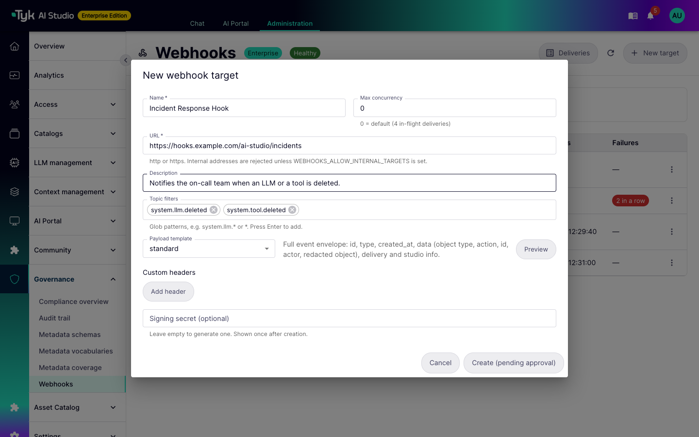

## Availability

| Edition   | Deployment Type |
| :------------- | :---------------------- |
| [Enterprise](/ai-management/ai-studio/overview#enterprise-edition) | Self-Managed |

For how webhooks work, refer to [Webhooks](/ai-management/ai-studio/webhooks).

Add a target in the admin console, then approve it so that AI Studio starts to send events to it.

## Prerequisites

- `TYK_AI_SECRET_KEY` is set. Refer to [Configuration](/ai-management/ai-studio/webhooks#configuration).
- Your role has the `write` and `execute` [permissions](/ai-management/ai-studio/webhooks-reference#permissions) on the `webhooks` resource.

## Create and Approve a Target

1. In the admin console, go to **Governance > Webhooks**.
2. Select **New target**.
3. Enter a name, the URL, the [topic filters](/ai-management/ai-studio/webhooks-reference#topic-filters), and the [payload template](/ai-management/ai-studio/webhooks-reference#payloads). You can also add custom headers.
4. Optional: in **Signing secret (optional)**, enter your own secret of 16 to 256 characters. If you leave it empty, AI Studio makes a random secret.
5. Select **Create (pending approval)**. The new target stays `pending` until an administrator approves it.
6. Copy the secret from the **Signing secret** dialog and keep it in your receiver. The console shows the secret one time only. Then select **I have saved it**.
7. To approve the target, open the menu of the target and select **Approve**. Confirm with **Approve**. If [WEBHOOKS_REQUIRE_DIFFERENT_APPROVER](/ai-management/ai-studio/ai-studio-env#webhooks_require_different_approver) is `true`, a different administrator does this step.
8. To check the target, open the menu of the target and select **Send test event**. AI Studio sends a sample event with the topic `webhooks.test`.

To check the signature of each delivery in your receiver, refer to [Verify a Webhook Delivery](/ai-management/ai-studio/how-to-verify-webhook-delivery).
