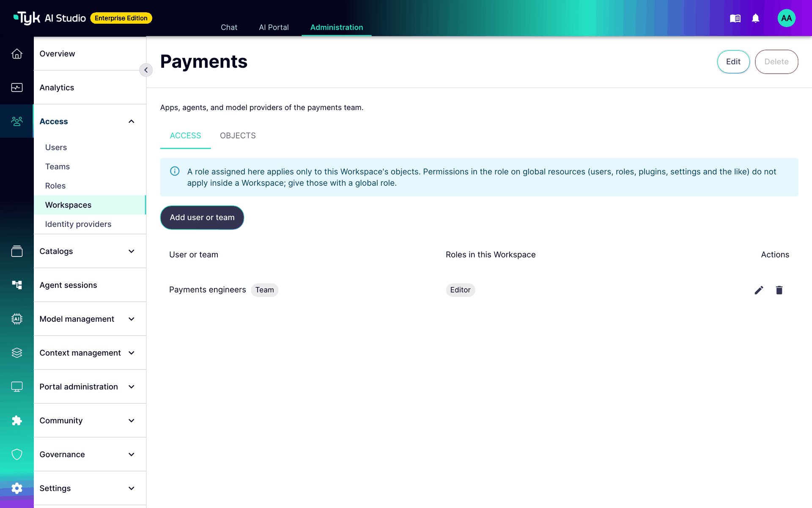
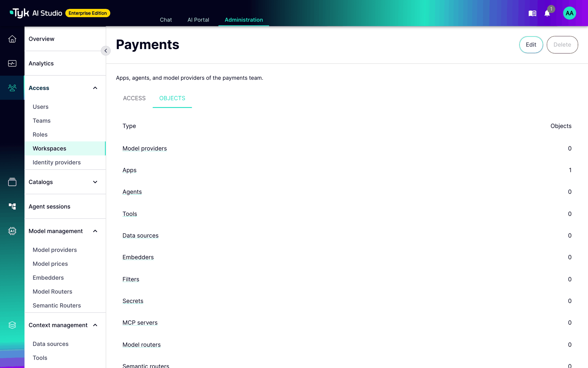
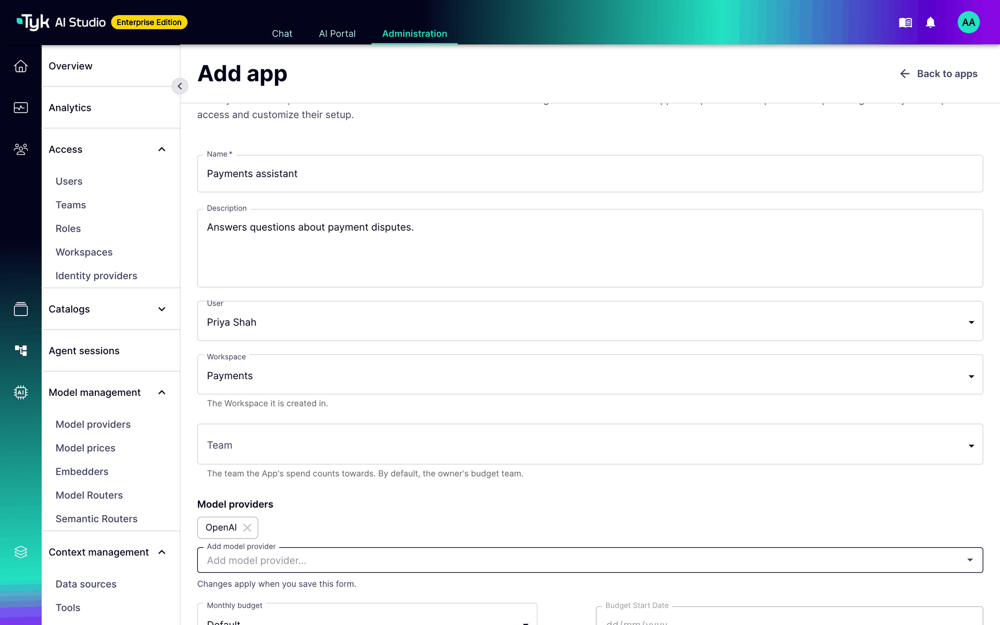

## Availability

| Edition | Deployment Type |
| :------------- | :---------------------- |
| [Enterprise](/ai-management/ai-studio/overview#enterprise-edition) | Self-Managed |

Workspaces are available from Tyk AI Studio 2.3.0.

Create Workspaces in the admin console, give Teams roles within them, and move objects into them. For how Workspaces control access, refer to [Workspaces](/ai-management/ai-studio/workspaces).

## Prerequisites

Each task needs a global role with its permission. Refer to the [Permission Reference](/ai-management/ai-studio/rbac#permission-reference).

| Permission | Allows |
| :--- | :--- |
| `workspaces:read` | Open the **Workspaces** page |
| `workspaces:write` | Create a Workspace, and change its name or description |
| `workspaces:delete` | Delete a Workspace |
| `roles:write` | Assign roles within a Workspace |

## Give a Team a Workspace

In this example, the Team "Payments engineers" gets a Workspace named "Payments". The Team members manage their own Apps, agents, and LLM providers, and nothing else. You need a global Administrator or Owner role.

1. Go to **Access > Workspaces** and click **Add Workspace**. Enter the **Name** "Payments" and an optional **Description**, then click **Add Workspace**.
2. Go to **Access > Teams** and click **Add team**. Name the Team "Payments engineers" and add its members. To map a group from your identity provider to the Team, refer to [Single Sign-On](/ai-management/ai-studio/sso).
3. Open the "Payments" Workspace and select the **Access** tab. Click **Add user or team**. Set **Type** to **Team**, select "Payments engineers", and select the Editor role in **Roles in this Workspace**.
4. Remove access that is too wide. For each member, open the user in **Access > Users**. Check the **Roles** field and the Teams of the user, including the **Default** Team. The **Effective permissions** section shows the global permissions of the user and the permissions in each Workspace.
5. Move the existing objects of the Team into the Workspace. Open each App, agent, router, or LLM provider, change its **Workspace** to "Payments", and save. Refer to [Move Objects](#move-objects).
6. Decide who pushes configuration to the Edge Gateways: your administrators, or a user with a global push role. Refer to [Workspaces and Edge Gateway Pushes](/ai-management/ai-studio/workspaces#workspaces-and-edge-gateway-pushes).

For what a Team member then sees, refer to [What a User With Only a Workspace Role Sees](/ai-management/ai-studio/workspaces#what-a-user-with-only-a-workspace-role-sees).

## Adopt Workspaces in an Existing Installation

The upgrade to 2.3.0 does not change access, and a new Workspace does not change access. Access becomes narrower only when you replace global role assignments with scoped role assignments. Refer to [Upgrade and Rollback](/ai-management/ai-studio/workspaces#upgrade-and-rollback).

1. List the global role assignments. The page of each user and each Team shows them. After an upgrade from 2.2, administrators have the Administrator role, and other users have no role.
2. Choose your Workspaces. Usually, you make one Workspace for each Team that owns Apps and agents. Shared building blocks can stay in the **Default** Workspace. All users can read and link them. Only users with a role in **Default**, or a global role, can change them.
3. Create the Workspaces and move objects into them. Refer to steps 1 and 5 of [Give a Team a Workspace](#give-a-team-a-workspace).
4. Assign roles within each Workspace to the Team that owns it.
5. Remove the global role assignments that users no longer need, including the roles of the **Default** Team. Keep global roles for the users who manage the full installation and for the users who push to Edge Gateways.
6. Check the access of a Team member. The **Effective permissions** section of the user must show few or no global permissions. It must show the correct roles under each Workspace.
7. Plan your namespaces. Refer to [Workspaces and Edge Gateway Pushes](/ai-management/ai-studio/workspaces#workspaces-and-edge-gateway-pushes).

To undo the change, assign the global roles again. The objects can stay in their Workspaces.

## Manage Workspaces

Go to **Access > Workspaces**. The page lists the Workspaces and the number of objects in each Workspace.

- A Workspace name must be unique. AI Studio ignores case when it compares names. The name can have up to 128 characters, and the description up to 1024 characters.
- The **Default** Workspace always exists and is first in the list. You cannot delete it. Objects that a user with a global role creates go into **Default**.
- Each Workspace page has two tabs:
  - **Access**: The users, service accounts, and Teams that have a role in the Workspace. Click **Add user or team** to give a role. You can also change or remove the roles. The Owner role is not available.
  - **Objects**: The number of objects of each type in the Workspace. Each type links to its list, filtered to the Workspace.
- You cannot delete a Workspace while a user, service account, or Team has a role in it. Remove them on the **Access** tab first. When you delete a Workspace, AI Studio moves all its objects to the **Default** Workspace.

### Create Objects in a Workspace

The form of each Workspace object has a **Workspace** field. The field lists the Workspaces where you can create that type of object. If there is only one choice, AI Studio selects it.

In the management API, send `workspace_id` with the object. If you do not send it:

- If you have the write permission as a global permission, the object goes into the **Default** Workspace.
- If you have the write permission in one Workspace only, the object goes into that Workspace.
- If you have the write permission in more than one Workspace, the request fails with `422` and the code `workspace_required`.

If the Workspace does not exist, or you do not have the permission in it, the request fails with `422` and the code `invalid_workspace`. To filter a list of objects by Workspace, add `?workspace_id=<id>`. For the endpoints, refer to the [AI Studio API reference](/ai-management/ai-studio/ai-studio-swagger).

### Move Objects

To move an object, change its **Workspace** in the edit form. In the API, send a different `workspace_id` in the update request. You need write permission in the two Workspaces.

- The object keeps its links. App credentials move with the App.
- The move shows as a pending change for the Edge Gateways. AI Studio counts the change in the new Workspace.
- You cannot move an object that references a secret in a different Workspace. You cannot move a secret while an object references it.
