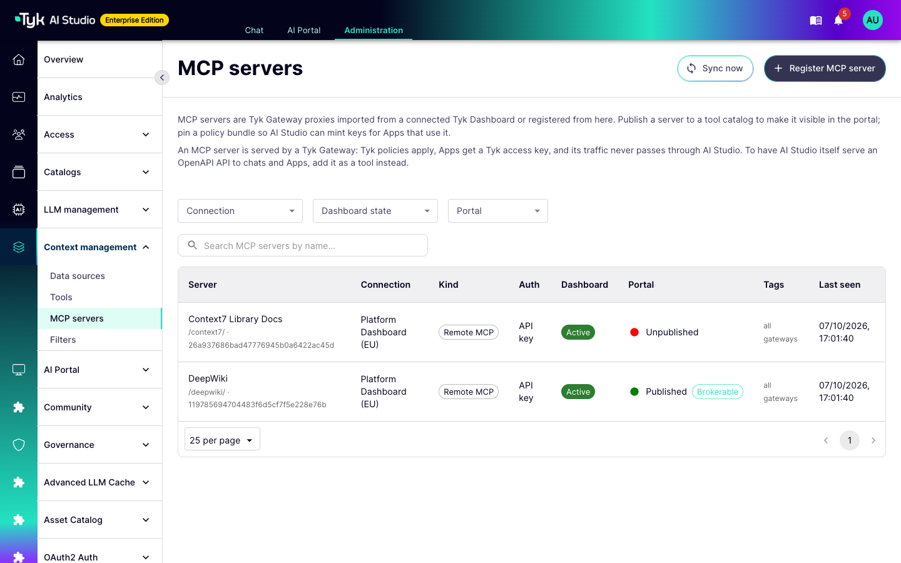
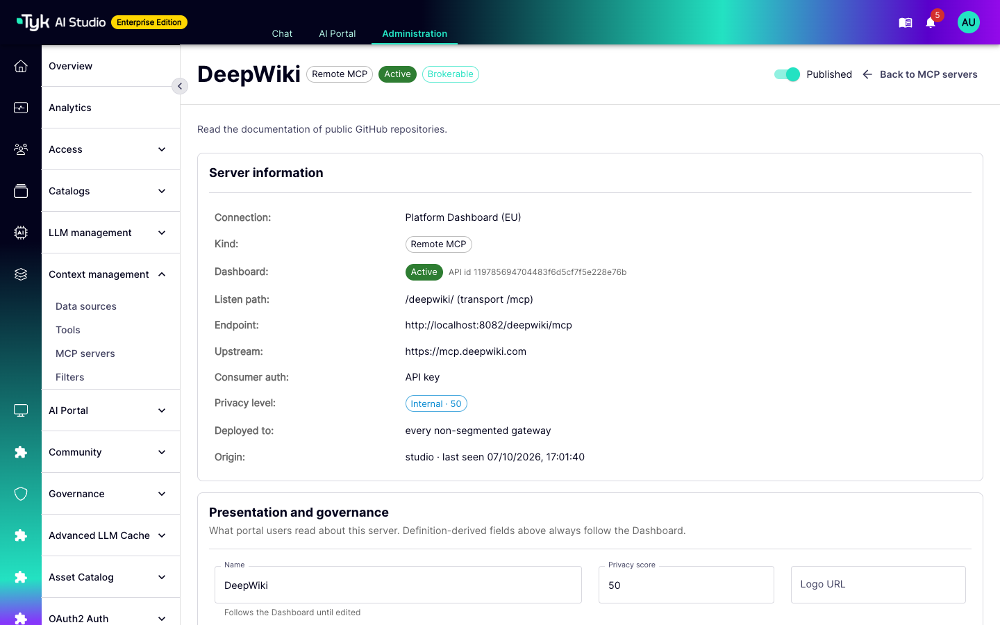
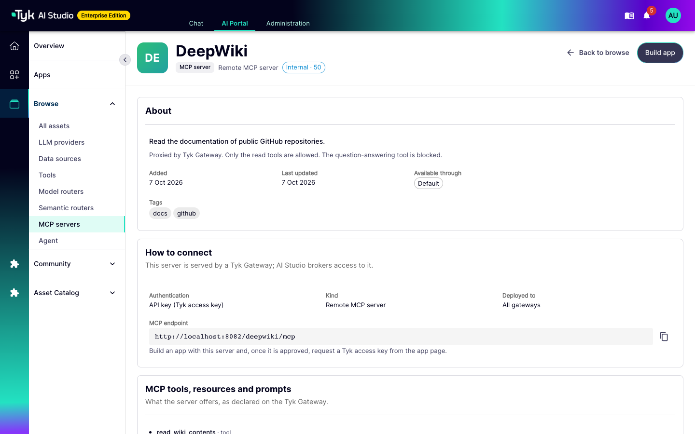

## Availability

| Edition | Deployment Type |
| :------------- | :---------------------- |
| [Enterprise](/ai-management/ai-studio/overview#enterprise-edition) | Self-Managed |

For how AI Studio imports MCP servers, refer to [Discover and Publish MCP Servers](/ai-management/ai-studio/tyk-mcp-integration#discover-and-publish-mcp-servers).

An imported server is not published. Publish it so that the Teams that can see its tool catalogs find it in the AI Portal.

## Prerequisites

- The proxy is active on the Tyk Dashboard. You can publish a server only while its proxy is active.
- Your role has the `publish` action on `mcp-servers`. Refer to [Permissions](/ai-management/ai-studio/tyk-mcp-integration#permissions).

## Publish a Server

1. Go to **Context management > MCP servers**. To import new proxies at once, click **Sync now**.
2. Open the server.
3. Set a **Privacy score**, and click **Save**. An imported server has no privacy score until you set one.
4. In **Portal visibility**, add the [tool catalogs](/ai-management/ai-studio/catalogs) of the Teams that must see the server. Click **Save catalogs**.
5. To let AI Studio issue keys for the server, select a policy bundle in **Access policies**, and click **Save bundle**. Refer to [Policy Bundles](/ai-management/ai-studio/mcp-access-keys#policy-bundles).
6. Turn on **Published**.

In the AI Portal, a published server has its own page with its authentication, its MCP endpoint, and its tools.

