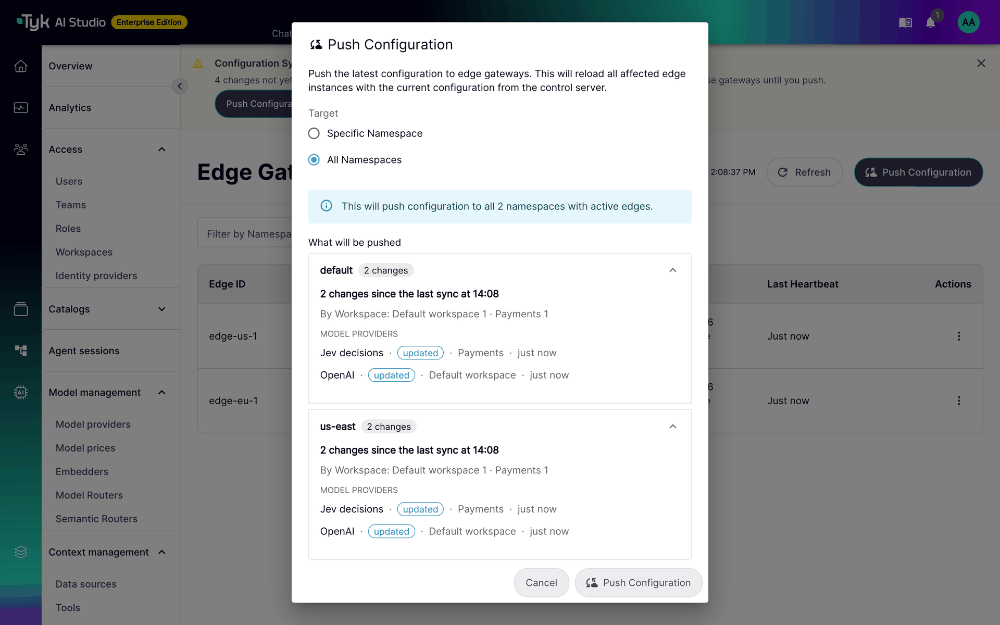

## Availability

| Edition   | Deployment Type |
| :------------- | :---------------------- |
| [Community](/ai-management/ai-studio/overview#community-edition) & [Enterprise](/ai-management/ai-studio/overview#enterprise-edition) | Self-Managed |

Edge Gateway management is available in both editions, and this page marks each Enterprise Edition feature.

AI Studio does not send configuration changes to edges until an administrator pushes them. For how AI Studio tracks the sync status of each edge, refer to [Manage Edge Gateway](/ai-management/ai-studio/manage-edge-gateway#how-it-works).

<Note>
From v2.3.0, several AI Studio replicas can serve one database, in one region or in two. Any replica can start a push, and each edge gets it from the replica that holds its connection. Refer to [Active-Active Deployment of Tyk AI Studio](/ai-management/ai-studio/deployment-active-active).
</Note>

## Push Configuration

1. Click **Push Configuration**.
2. Select the target scope: **All Namespaces** or a **Specific Namespace** (Enterprise).
3. Read the list of changes. The dialog shows each object created, updated, or deleted since the last push to the namespace. It groups the objects by type, with a link to each admin page.
    - A summary line shows the number of changes, for example "12 changes since the last push at 13:12".
    - With **All Namespaces**, each namespace has its own section.
    - From v2.3.0, with [Workspaces](/ai-management/ai-studio/workspaces) (Enterprise), each change shows its Workspace, and a line counts the changes for each Workspace.

   

4. Click **Push Configuration**. If nothing has changed, the button is **Push anyway**, for example to push again after an edge registers again.

AI Studio then does these steps:

1. It records the push, with one entry for each target edge and a deadline of 5 minutes. The dialog shows which edges are connected, and shows a warning for the others.
    - The push leaves out edges that are offline for more than 5 minutes. It also leaves out (Enterprise) edges in a namespace without a [licensed slot](/ai-management/ai-studio/manage-edge-gateway#licensed-namespaces-enterprise). The dialog lists these edges with the reason.
    - If no edge can receive the push, the dialog shows a message and disables **Push**.
2. It sends a reload request to each edge. An offline edge gets the push when it reconnects, until the deadline. If an edge disconnects during a reload, AI Studio sends the push again when the edge reconnects.
3. Each edge gets the current configuration, applies it, and reports **ready** or **failed** with the reason.
4. The dialog shows the result of each edge (Enterprise). The Community Edition shows the overall result.
    - **Updated**: The edge loaded the configuration.
    - **Updated, with a warning**: The edge loaded a configuration that changed again after the push. Push again.
    - **Failed**: The edge did not apply the configuration, or three delivery attempts in sequence did not complete. The dialog shows the error.
    - **Timed out**: The edge did not connect, or did not finish, before the deadline.

The push continues when you close the dialog. Edges confirm the push in their next heartbeat, a few seconds later. For what an edge does with the configuration, refer to [How an Edge Applies a Snapshot](/ai-management/ai-studio/manage-edge-gateway#how-an-edge-applies-a-snapshot).

### Pushes Limited to One Workspace (Enterprise)

A push always delivers the whole namespace, which can contain objects from many Workspaces. From v2.3.0, an automated client, such as a CI pipeline, can ask AI Studio to refuse a push with changes from other Workspaces. Refer to [Workspaces and Edge Gateway Pushes](/ai-management/ai-studio/workspaces#workspaces-and-edge-gateway-pushes).

## Remove an Edge Gateway

To remove a decommissioned edge from the control plane:

1. Open the three-dot menu on the edge row, or open its detail page.
2. Select **Remove Entry**.
3. Confirm the removal.

This removes only the database entry. A running edge registers again at its next connection attempt.
