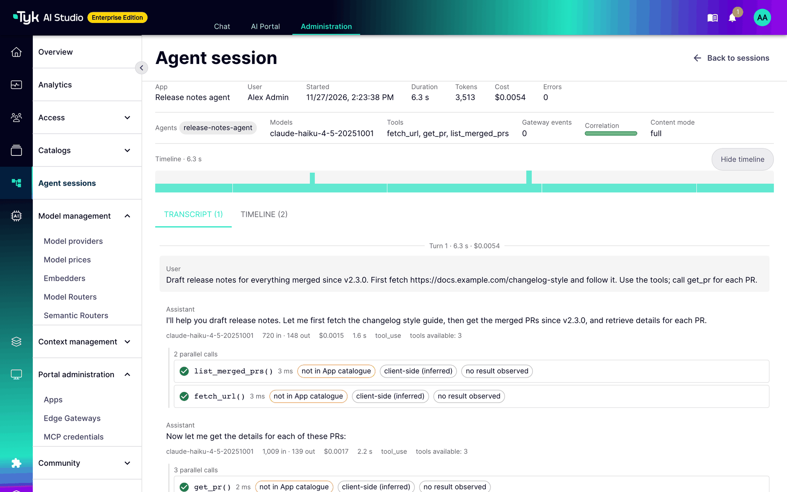
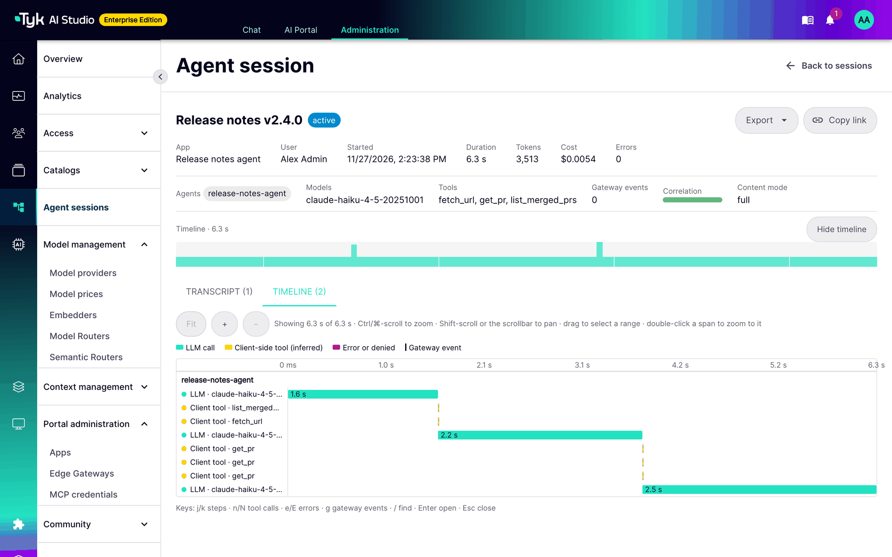
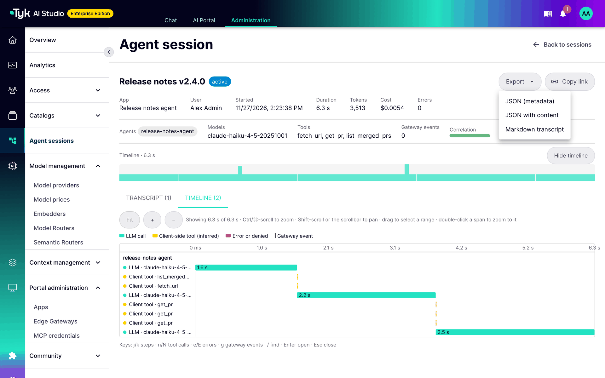

## Availability

| Edition | Deployment Type |
| :------------- | :---------------------- |
| [Enterprise](/ai-management/ai-studio/overview#enterprise-edition) | Self-Managed |

Agent Call Tracing is available from Tyk AI Studio 2.3.0.

Read each agent session as a transcript or a timeline in the admin console. Export it as JSON or Markdown. For how tracing works, refer to [Agent Call Tracing](/ai-management/ai-studio/agent-tracing).

## Prerequisites

- [Agent Call Tracing is on](/ai-management/ai-studio/how-to-turn-on-agent-tracing).
- Your role has the `traces:read` [permission](/ai-management/ai-studio/agent-tracing#permissions). To read captured content, it also has `trace-content:read`. To export, it has `traces:execute`.

## Open a Session

1. In the admin console, select **Agent sessions**.
2. Filter the list. The filters include **Time range**, **App**, **User**, **Status**, **Has errors**, **Has gateway events**, **Session source**, and **Contains weak links**. Expand **More filters** to filter by **Agent name**, **Model**, **Tool called**, **End user**, cost, and duration.
3. Select a session to open it.

The session opens in one of two views:

- **Transcript**: The conversation, with the tool calls and results inline, and the gateway decisions as chips. Without captured content, the view shows the structure, timing, tokens, and cost. A notice tells you how to capture content.
- **Timeline**: Each span on a time axis, with one labeled row for each span and each provider attempt. Use **‹ Turn** and **Turn ›** to move between turns.

Drag on the activity strip above the views to select a time range for all views.

For a session with more than 5,000 spans, AI Studio loads a window of whole turns. Use **‹ Earlier** and **Later ›**, or drag on the activity strip, to load a different part.

The find bar searches names and metadata. If you have `trace-content:read`, it also searches the captured content. AI Studio audits each content search.

AI Studio shows captured text as plain Markdown. It does not load images or show raw HTML. Links show their target.

## Export a Session

1. Open the session.
2. Select **Export**.
3. Select a format:
   - **JSON (metadata)**
   - **JSON with content**: Only for users with `trace-content:read`.
   - **Markdown transcript**: A readable transcript, up to 512 KiB. It includes content if you have `trace-content:read`.

The JSON export uses the type `application/vnd.tyk.agent-trace+json; v=1`. The `X-Tyk-Export-Content` response header shows `included` or `not-included`. AI Studio refuses exports that are larger than 64 MiB.

For the agent tracing API, refer to the [AI Studio API reference](/ai-management/ai-studio/ai-studio-swagger).
