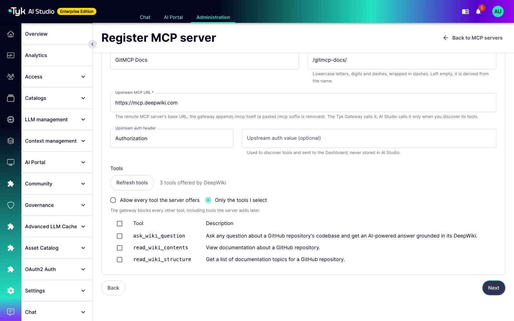

## Availability

| Edition | Deployment Type |
| :------------- | :---------------------- |
| [Enterprise](/ai-management/ai-studio/overview#enterprise-edition) | Self-Managed |

For how the integration works, refer to [Tyk Dashboard MCP Integration](/ai-management/ai-studio/tyk-mcp-integration).

On a Full mode connection, you can create a new MCP proxy on the Tyk Dashboard from AI Studio.

## Prerequisites

- A connection in Full mode. Refer to [Trust Modes](/ai-management/ai-studio/tyk-mcp-integration#trust-modes).
- Your role has the `execute` action on `mcp-servers`. Refer to [Permissions](/ai-management/ai-studio/tyk-mcp-integration#permissions).

## Register a Proxy

1. Go to **Context management > MCP servers**, and click **Register MCP server**.
2. **Connection and kind:** Select the connection and the kind.
   - **Remote MCP server** proxies an existing MCP endpoint.
   - **REST API to MCP** makes the operations of a Tyk OAS API into MCP tools. It needs Tyk 5.15 or later.
3. **Proxy details:** Enter the name and the listen path.
   - For a remote MCP server, enter the base URL of the upstream server in **Upstream MCP URL**. Then select the tools that the gateway allows. The gateway adds `/mcp` itself, so AI Studio removes a `/mcp` suffix from the URL that you enter.
   - For REST API to MCP, select the source API and its operations.
4. **Access and governance:** Select the consumer authentication: API key, OAuth 2.1, or keyless. Then select the deployment target, the privacy score, the tool catalogs, and whether to publish at once.
   - On a Tyk Dashboard connection, a proxy with API key authentication does not set [stripAuthorizationData](/api-management/client-authentication#managing-authorization-data). Tyk Gateway then sends the Tyk key of the App to the upstream MCP server. Proxies on Tyk Gateway connections set it.
5. **Review and create:** Examine the definition, the endpoint, and the warnings. Then create the proxy.

To find the tools of a remote server, AI Studio calls the upstream server one time. It does this only from the wizard.

- The call uses the same host rules as connections, with no exception for internal hosts. To permit an internal upstream host, add it to [TYK_MCP_ALLOWED_HOSTS](/ai-management/ai-studio/ai-studio-env#tyk_mcp_allowed_hosts).
- If AI Studio cannot reach the upstream server, type the tool names.
- The gateway blocks each tool that you do not select, including tools that the server adds later.

AI Studio sends the upstream credential to the Tyk Dashboard and does not store it.

## Edit or Delete a Proxy

You can edit the definition on the server page and push it to the Tyk Dashboard. AI Studio refuses the push if the proxy changed on the Tyk Dashboard after you opened the page. Before AI Studio overwrites a proxy that was created on the Tyk Dashboard, it asks you to confirm.

When you delete a proxy that AI Studio registered, AI Studio deletes it from the Tyk Dashboard. For a proxy created on the Tyk Dashboard, you can only unpublish it in AI Studio.
