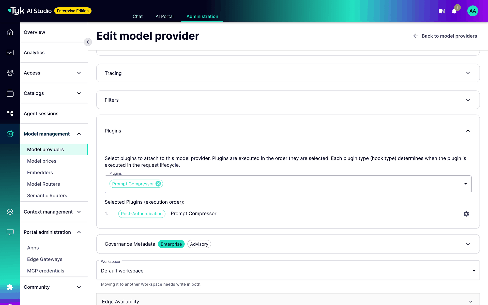
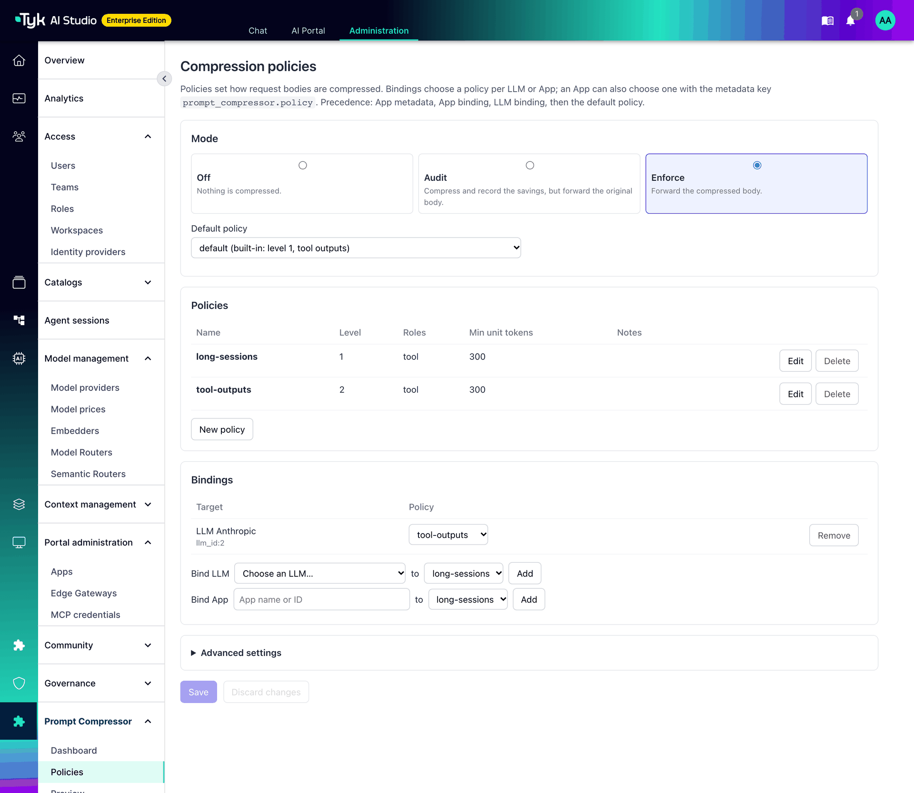
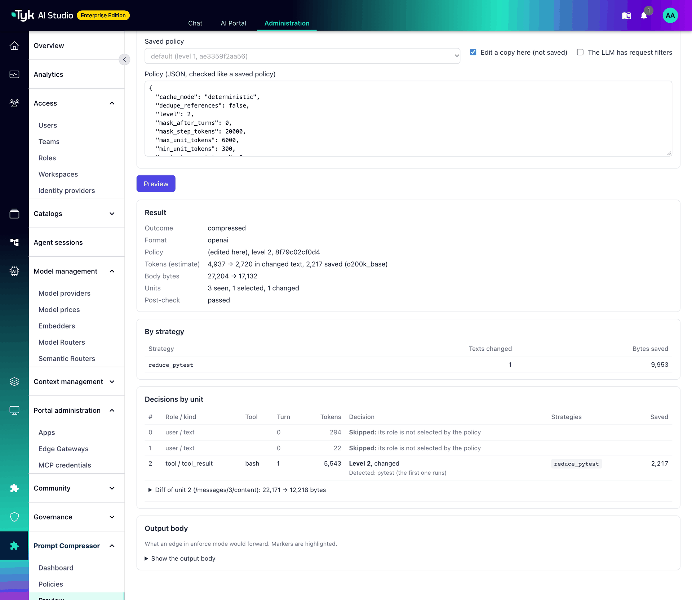
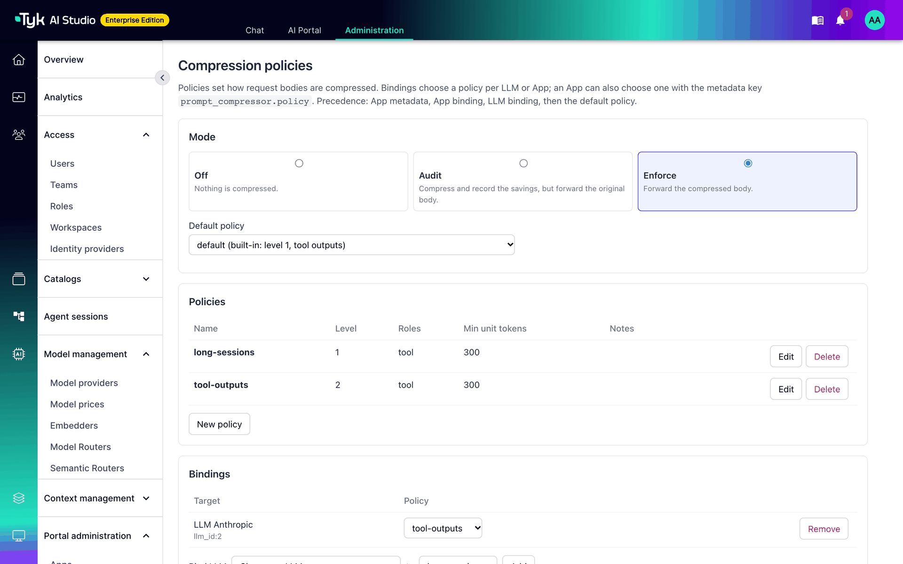

## Availability

| Edition | Deployment Type |
| :------------- | :---------------------- |
| [Community](/ai-management/ai-studio/overview#community-edition) and [Enterprise](/ai-management/ai-studio/overview#enterprise-edition) | Self-Managed |

The Prompt Compressor is available from Tyk AI Studio 2.3.0.

Install the plugin, attach it to your LLMs, and measure the savings in `audit` mode before you turn on `enforce` mode. For how the plugin compresses requests, refer to [Prompt Compressor](/ai-management/ai-studio/prompt-compressor).

## Install the Plugin

These steps install version 1.0.3 of the plugin. The marketplace ID is `com.tyk.prompt-compressor`.

1. In the admin console, go to **Plugins > Marketplace**.
2. Find **Prompt Compressor** and install version 1.0.3.
3. Approve the service scopes that the plugin requests. Refer to [Service Scopes](/ai-management/ai-studio/prompt-compressor-reference#service-scopes).
4. Make sure that the plugin is active. The admin sidebar then shows a **Prompt Compressor** section with the **Dashboard**, **Policies**, and **Preview** pages.

{/* TODO: Add screenshot: Plugins > Marketplace with the Prompt Compressor plugin and the service scopes to approve. Blocked (2026-11-27): Prompt Compressor is not in the public marketplace index (TykTechnologies/tyk-ai-studio-plugins-ce, index.yaml) yet. Take the screenshot when it is published there. */}

## Attach the Plugin to an LLM

The plugin compresses requests only to the LLMs that it is attached to.

1. Go to **LLM management > LLM providers** and edit the LLM.
2. In the **Plugins** section, select **Prompt Compressor**.
3. Save the LLM.
4. [Push the configuration](/ai-management/ai-studio/how-to-push-edge-configuration) to your Edge Gateways.



For the position of the plugin in the plugin list, refer to [Plugin Order](/ai-management/ai-studio/prompt-compressor#plugin-order).

## Measure the Savings in Audit Mode

A new installation starts in `audit` mode with level 1 on tool outputs. In this mode, the plugin does not change the requests that go to the vendor.

1. Send your usual traffic through the Edge Gateways for a few days.
2. Go to **Prompt Compressor > Dashboard** and examine the projected savings and the cache-read share. Refer to [Savings Dashboard](/ai-management/ai-studio/prompt-compressor#savings-dashboard).
3. Go to **Prompt Compressor > Preview** and test your policies on real request bodies. Refer to [Preview a Policy](#preview-a-policy).

## Configure Policies

1. Go to **Prompt Compressor > Policies**.
2. Edit the policies and the bindings.
3. Select **Save**. The page validates the configuration before it saves it. It also tells you that a change causes one prompt cache miss for each affected session.
4. [Push the configuration](/ai-management/ai-studio/how-to-push-edge-configuration) to your Edge Gateways.



This example uses level 1 for most traffic. It uses level 2 for the LLM with ID 3, and it turns off compression for the App with ID 42:

```json expandable
{
  "mode": "audit",
  "default_policy": "safe",
  "policies": {
    "safe": { "level": 1 },
    "agents": {
      "level": 2,
      "min_unit_tokens": 400,
      "tool_overrides": {
        "Bash": { "max_unit_tokens": 4000 },
        "read_contract": { "exclude": true }
      },
      "protect_patterns": ["[A-Z]{2,6}-[0-9]+"]
    }
  },
  "bindings": { "llm_id:3": "agents", "app:42": "off" }
}
```

For each setting, refer to [Prompt Compressor Reference](/ai-management/ai-studio/prompt-compressor-reference).

## Preview a Policy

The **Prompt Compressor > Preview** page shows the result of a policy before you use it.

1. Go to **Prompt Compressor > Preview**.
2. In the **Input** section, select the type of input:
   - **Tool output**: Paste a tool output.
   - **Request body**: Select the **Vendor**. Then paste a request body, or upload a JSON file.
3. In the **Policy** section, select a policy in **Saved policy**. To try a change, select **Edit a copy here (not saved)** and edit the policy.
4. Select **Preview**.

The page shows the compressed output with each change marked, the decision for each unit, and the tool definitions that `drop_tools` removes or keeps. The preview uses the same compression as the Edge Gateway. It does not call an external engine, and AI Studio does not store the input.



## Turn On Enforce Mode

1. Go to **Prompt Compressor > Policies**.
2. Set **Mode** to **Enforce**.
3. Select **Save**.
4. [Push the configuration](/ai-management/ai-studio/how-to-push-edge-configuration) to your Edge Gateways. The Edge Gateways show the change as pending until the push.



Before you use level 2 or level 3 in `enforce` mode, use the level in `audit` mode first. Compare the dashboard with your own quality signals.
