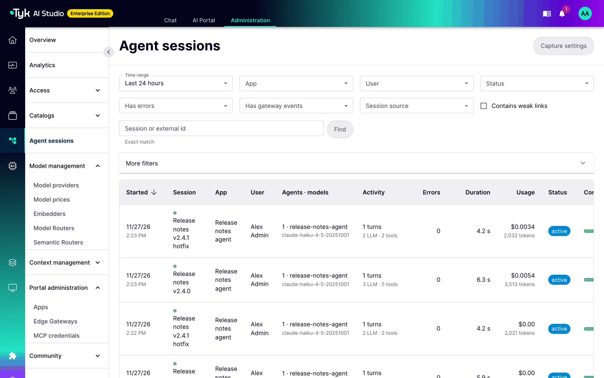
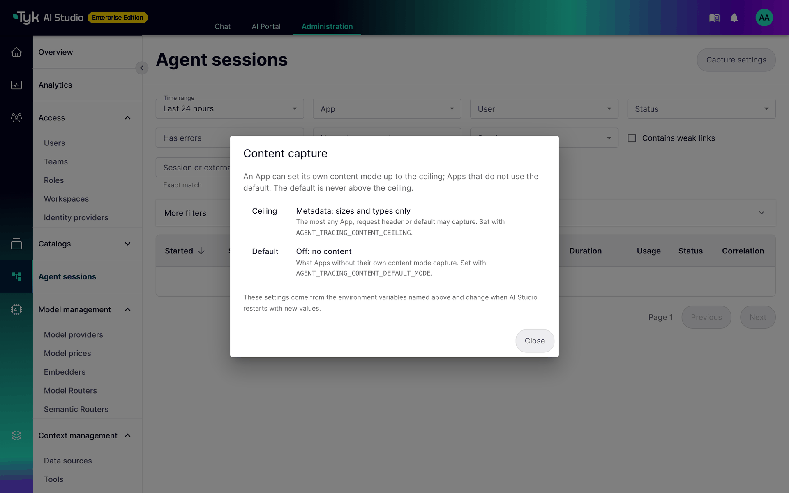
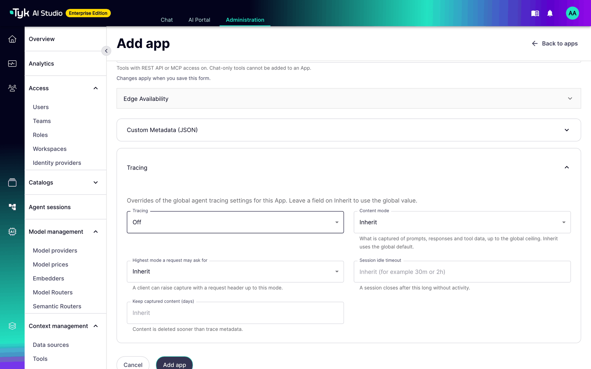
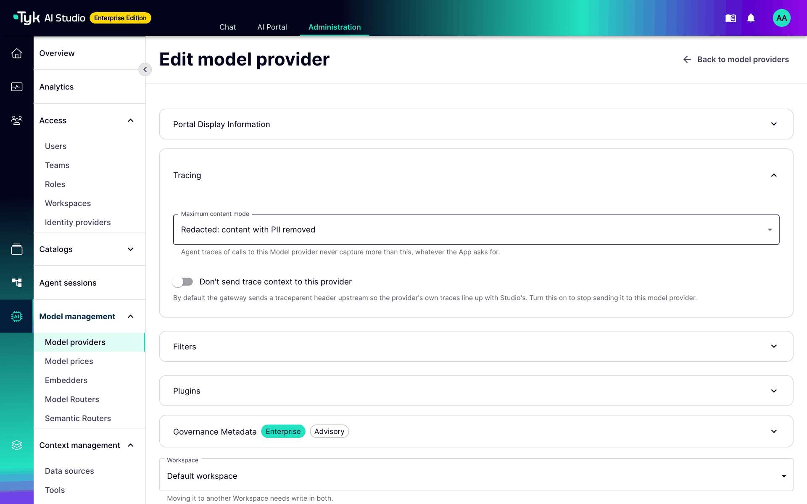

## Availability

| Edition | Deployment Type |
| :------------- | :---------------------- |
| [Enterprise](/ai-management/ai-studio/overview#enterprise-edition) | Self-Managed |

Agent Call Tracing is available from Tyk AI Studio 2.3.0.

Turn on tracing on AI Studio and on each Edge Gateway, then select which content AI Studio captures. For how tracing works, refer to [Agent Call Tracing](/ai-management/ai-studio/agent-tracing).

## Prerequisites

- To change the tracing settings of Apps, LLMs, tools, and datasources, your role has the `traces:write` [permission](/ai-management/ai-studio/agent-tracing#permissions).

## Configure AI Studio

1. Set these environment variables on the AI Studio server:

   ```bash
   AGENT_TRACING_ENABLED=true
   AGENT_TRACING_KEY=<a long random value of 16 bytes or more>
   ```

   If you do not set `AGENT_TRACING_KEY`, AI Studio uses `TYK_AI_SECRET_KEY`. If neither is set, tracing does not start.
2. Restart AI Studio.
3. In the admin console, select **Agent sessions** in the sidebar. If tracing does not run, the page shows "Agent Call Tracing is not running".



For all tracing variables, refer to the [AI Studio environment variables](/ai-management/ai-studio/ai-studio-env#agent_tracing_enabled).

## Rotate the Root Key

AI Studio derives two keys from the root key. One key creates the fingerprints and the correlation index. The other key encrypts the captured content with AES-256-GCM.

To rotate the root key:

1. Set the new value in `AGENT_TRACING_KEY`.
2. Move the old value to `AGENT_TRACING_KEY_PREVIOUS`. AI Studio supports one previous key only.
3. Restart AI Studio.

AI Studio reads content that either key encrypted. It does not encrypt old content again, so keep the previous key until the content retention period ends.

## Configure Edge Gateways

An Edge Gateway captures traffic only when all these conditions are true:

- The Edge Gateway is an Enterprise build with a valid license.
- The Edge Gateway is connected to AI Studio.
- The Edge Gateway has its analytics pulse.
- `AGENT_TRACING_ENABLED=true` is set.
- Tracing runs on AI Studio. The Edge Gateway gets the content settings and the fingerprint key from AI Studio in the configuration sync.

If one condition is false, the Edge Gateway logs a warning and does not capture.

An Edge Gateway sends captured content only over a verified TLS connection to AI Studio. If `EDGE_TLS_ENABLED=false` or `EDGE_SKIP_TLS_VERIFY=true`, the Edge Gateway sends metadata only and logs a warning at start. Its spans then have the attribute `tyk.content.withheld=edge_link_unverified_tls`. Refer to [TLS](/ai-management/ai-studio/edge-gateway-resilience#tls).

For the tracing variables of an Edge Gateway, refer to the [Edge Gateway environment variables](/ai-management/ai-studio/edge-gateway-env#agent_tracing_enabled).

## Capture Content for All Apps

AI Studio captures no prompt or response content until you raise the [content mode](/ai-management/ai-studio/agent-tracing#content-capture).

1. Set `AGENT_TRACING_CONTENT_CEILING` to `redacted` or `full`.
2. Set `AGENT_TRACING_CONTENT_DEFAULT_MODE` to the same mode or a lower mode.
3. Restart AI Studio.

To capture content for some Apps only, set the ceiling, and then set the **Content mode** of each of these Apps. Sessions that AI Studio recorded before the change keep their content mode.

To see the global ceiling and the default mode, select **Capture settings** on the **Agent sessions** page.



## Turn Tracing Off for One App

1. Open the App and expand the **Tracing** section.
2. Set **Tracing** to **Off**.
3. Save the App.



AI Studio then records nothing of the traffic of this App.

## App Settings

Open an App and expand **Tracing**. A field that is set to **Inherit** uses the global value.

| Setting | Description |
| :--- | :--- |
| **Tracing** | **Off** stops all capture for the App. |
| **Content mode** | The content mode of the App, up to the global ceiling. |
| **Highest mode a request may ask for** | The request ceiling of the App. It cannot be higher than the global request ceiling. |
| **Session idle timeout** | From 1 minute to 168 hours, for example `30m` or `2h`. |
| **Keep captured content (days)** | From 0 to 365. |

## LLM, Tool, and Datasource Settings

Each LLM, tool, and datasource has a **Tracing** section:

- **Maximum content mode**: The highest mode that AI Studio captures of calls to this resource, for all Apps.
- **Don't send trace context to this provider**: LLMs only. The gateway does not send `traceparent`, `tracestate`, or baggage to this LLM. This setting also works in Community Edition.


