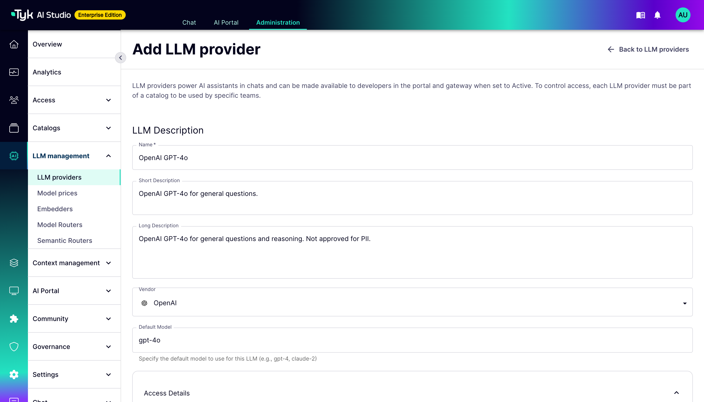
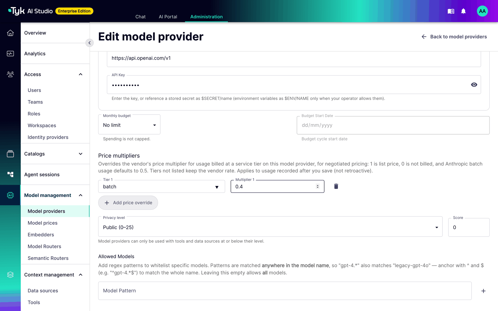
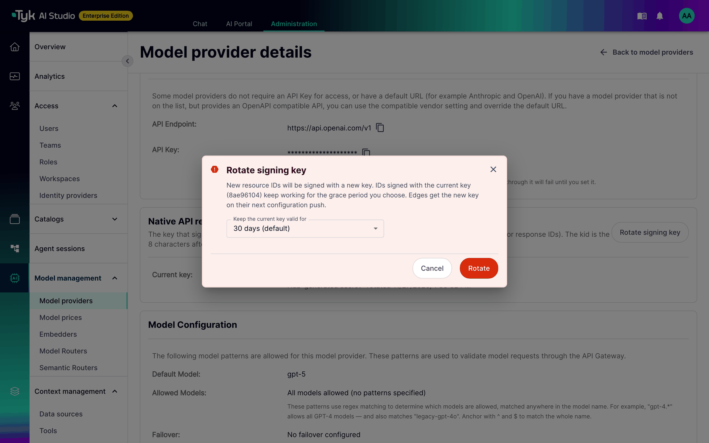

## Availability

| Edition   | Deployment Type |
| :------------- | :---------------------- |
| [Community](/ai-management/ai-studio/overview#community-edition) & [Enterprise](/ai-management/ai-studio/overview#enterprise-edition) | Self-Managed |

Tyk AI Studio provides a centralized system for managing Large Language Model (LLM) providers, models, associated costs, and usage budgets. This allows administrators to control which models are available, how they are used, and track associated expenses.

### Use Cases

- **Centralized AI Access Control:** Manage all the LLM connections of your organization (OpenAI, Anthropic, etc.) in one place. Control which teams and applications can access specific models.
- **Cost Management and Budgeting:** Set monthly spending limits per LLM or per application. This prevents unexpected AI costs and tracks usage against budgets.
- **Data Privacy Enforcement:** Assign privacy levels to LLMs. Only approved, secure models then process sensitive data, and the data does not leak to public LLMs.

## LLM Provider

The LLM Management system acts as the core registry for all AI models accessible through Tyk AI Studio. It bridges the gap between external AI providers and internal consumers (Applications and Chat).

Key components of an LLM entity include:
- **Basic Info:** Name, descriptions, vendor, and active status.
- **Connection:** API credentials, endpoints, and the default model to use.
- **Access & Security:** Privacy scores, allowed model regex patterns, and namespace restrictions.
- **Budgeting:** Monthly spending limits and budget cycle start dates.
- **Failover:** An ordered list of fallback LLMs that the gateway tries when the upstream of this LLM fails.
- **Extensibility:** Support for attaching plugins that execute in the AI Gateway during the request lifecycle.

The LLM entity is closely related to [Model Prices](/ai-management/ai-studio/model-prices) (which define the cost of using the LLM) and [Model Routers](/ai-management/ai-studio/model-router) (which can route requests across multiple LLMs).

## Configuration

Administrators can configure connections to different LLM providers through the UI or API. The configuration includes:

- **Vendor Selection:** Choose from supported vendors such as `openai`, `anthropic`, `bedrock` (AWS Bedrock), `vertex` (Google Vertex AI), `google_ai`, `huggingface`, and `ollama`. From v2.3.0, you can also select `systemone` for System One [decision models](/ai-management/ai-studio/decision-models).
- **Authentication:** Set the API key and the endpoint on each LLM. From v2.3.0, AI Studio and the Edge Gateway do not read vendor keys or hosts from environment variables, such as `OPENAI_API_KEY` or `OLLAMA_HOST`, and the gateway refuses a provider that needs a key and has none. Vertex AI still uses the Google Cloud credentials of the host.
- **Internal Endpoints:** From v2.3.0, the gateway refuses an API endpoint on an internal network address. An example is a local Ollama at `http://localhost:11434`. Refer to [Outbound Network Policy](/ai-management/ai-studio/outbound-network-policy).
- **Price Multipliers:** From v2.3.0, set a multiplier for each service tier for negotiated pricing. Refer to [Price Multipliers](#price-multipliers).
- **Anthropic Workspace:** From v2.3.0, run all the calls of an Anthropic LLM in one Anthropic workspace. Refer to [Anthropic Workspace](#anthropic-workspace).
- **Model Restrictions:** Use regex patterns (e.g., `gpt-4.*`) to whitelist specific models from a vendor.
- **Privacy Levels:** Define how data is protected by controlling LLM access based on its sensitivity. Refer to [Privacy Levels](/ai-management/ai-studio/privacy-levels).
- **Budget Control:** Set a monthly budget to limit total spending across all applications using this LLM configuration. **No limit** and **`$0`** are different. Refer to [Budget Control](/ai-management/ai-studio/budgeting#no-limit-versus-zero). From v2.3.0, Edge Gateways also enforce the LLM budget (Enterprise). Refer to [Distributed Budget Control](/ai-management/ai-studio/budgeting#distributed-budget-control-multi-gateway).
- **Failover:** Add fallback LLMs for the gateway to try when this LLM's upstream fails. Refer to [Failover](#failover).
- **Body Logging Control:** Enable **Disable Request/Response Body Logging** (`dont_log_bodies`) to clear request and response bodies before they are stored in proxy logs, chat logs, and analytics events. Use this for privacy or compliance-sensitive providers. It applies on both the embedded gateway and Edge Gateways, and defaults to off.
- **Plugins:** Attach plugins that execute in the AI Gateway when a request flows through the REST endpoint.
- **Authentication Plugins:** From v2.2.1, attach an ordered list of auth plugins to the LLM on its detail page. When the list is not empty, only these plugins authenticate requests to the LLM on Edge Gateways. The Edge Gateways refuse App keys for this LLM. Refer to [Edge Gateway Plugins](/ai-management/ai-studio/plugins/edge-gateway). To authenticate machine clients with tokens from your identity provider, refer to [OAuth2 Client Credentials](/ai-management/ai-studio/oauth2-client-credentials).

For a self-hosted model in Kubernetes that a Kubernetes Gateway API `InferencePool` serves, refer to [Run Tyk AI Studio With the Kubernetes Inference Gateway](/ai-management/ai-studio/deployment-k8s-inference-gateway).

## How to Create a LLM Provider

You can create and manage LLM providers through the Tyk AI Studio Admin UI.

1. **Navigate:** Go to the LLM providers section in the Admin UI. This view lists all configured LLMs, showing their Name, Short Description, Vendor, Privacy Level, and whether they are Proxied.
2. **Add New LLM:** Click "Add LLM provider".
3. **Fill in the LLM Details:**
   - **Name:** A user-friendly name for this configuration (Required). AI Studio creates the LLM slug from the name. From v2.3.0, two LLMs cannot have the same slug, in any namespace. AI Studio refuses a name that differs from the name of another LLM only in case, spaces, or punctuation.
   - **Short/Long Description:** Provide descriptions for the LLM.
   - **Vendor:** Select the LLM vendor (e.g., OpenAI, Anthropic).
   - **Default Model:** Specify the default model to use for this LLM (e.g., `gpt-4`, `claude-2`).
   - **Monthly budget:** Select **No limit** or **Fixed amount**, and set a **Budget Start Date**. A fixed amount of `$0` blocks all requests.
   - **Price multipliers:** From v2.3.0, OpenAI and Anthropic LLMs have this field. Click **Add price override** to set a multiplier for a service tier. Refer to [Price Multipliers](#price-multipliers).
   - **Privacy levels:** Select a level (Public, Internal, Confidential, or Restricted) or enter a score from 0 to 100. LLMs with lower privacy levels can't access higher-level data sources and tools.
   - **Allowed Models:** Add regex patterns to whitelist specific models (e.g., `gpt-4.*` for all GPT-4 models).
   - In the **Access Details** section,
      - **API Endpoint:** Provide the endpoint URL (required if enabling an LLM for the AI Gateway, even for providers with default URLs).
      - **API Key:** Securely provide the necessary authentication credentials.
      - **Vendor workspace (Anthropic):** From v2.3.0, for Anthropic LLMs only. Refer to [Anthropic Workspace](#anthropic-workspace).
      - For **AWS Bedrock**, the form instead shows labeled credential fields: **AWS Access Key ID**, **AWS Secret Access Key**, and **AWS Session Token** (optional). These are stored in the LLM's `metadata` map rather than `APIKey`. Use `$SECRET/NAME` references in these fields to keep credentials encrypted at rest via the [Secrets](/ai-management/ai-studio/secrets) manager.
   - In the **Portal Display Information** section,
      - **Logo URL:** Configure the logo used in the AI Portal for end-users.
      - **Active:** Set the LLM to active to use it in the proxy. For example, you must activate the LLM before you create an App that uses it.
      - **Disable Request/Response Body Logging:** When enabled, request and response bodies are not stored in proxy logs, chat logs, or analytics events for this LLM.
      - **Allow internal host:** From v2.3.0. Refer to [Allow Internal Host](/ai-management/ai-studio/outbound-network-policy#allow-internal-host).
   - **Plugins:** Select plugins to attach to this LLM. They execute in the order selected during the request lifecycle.
   - **Available Namespaces:** Select which edge namespaces this configuration should be available to (leave empty for global availability).
   - **Failover:** (Optional) Add fallback LLMs. Refer to [Failover](#failover).
4. **Save:** Save the configuration to make the LLM provider available.

    

## Failover

Each LLM provider can have a **failover waterfall**. This is an ordered list of fallback LLM providers, each with the model to use on that provider. When the upstream of the provider fails, the gateway sends the same request to each fallback in turn before it returns an error. An outage at one vendor then does not become an outage for your Apps.

Failover is available in the Community Edition and the Enterprise Edition.

### Configure a Failover Waterfall

1. Open the LLM provider and go to the **Failover** section of the edit form.
2. Click **Add fallback** and select a **Fallback LLM**.
3. Select the **Model** to use on that LLM. The model must be one of the allowed models of that LLM. If the LLM has no allowed models, you can select any model.
4. To change the order of the fallbacks, use the arrows. The gateway tries the first fallback first.
5. Save the LLM provider.

AI Studio checks these rules when you save:

- A fallback must be active. It must not be the provider itself. The same LLM and model pair cannot be in the list two times.
- A fallback must have a privacy level that is equal to or higher than the provider's level. It must be in the same namespace as the provider, or be global.
- A provider can have a maximum of 10 fallbacks.
- You cannot delete a provider while the waterfall of another provider contains it.

### Access to Fallbacks

Apps that have a grant for a provider can use its fallbacks when the provider fails. They do not need a grant for the fallbacks. The gateway still applies the budget of the fallback provider.

<Note>
Each fallback attempt goes through the gateway again. AI Studio calculates its cost from the model prices of the fallback. The cost counts against the App budget and the budget of the fallback LLM. Before you add a fallback, compare its model prices and its budget with the primary. A more expensive fallback increases costs during an outage. A fallback with a low budget can refuse requests when the primary fails.
</Note>

### When Failover Occurs

By default, the gateway tries the next fallback when one of these conditions occurs:

- The upstream returns `408`, `429`, `500`, `502`, `503`, or `504`.
- The attempt times out.
- The gateway cannot connect to the upstream.

In **Failover Triggers (advanced)**, you can change this behavior:

- Remove status codes from the list. You can add only 5xx codes, `408`, and `429`. Other 4xx responses are caller or configuration errors, and every fallback would return the same error.
- Turn off **Fail over when the upstream times out** or **Fail over when the upstream cannot be reached**.
- Set a **Per-attempt timeout (seconds)**, so that a primary that does not respond does not use all the time of the request.

A `401` or `403` from the upstream never causes failover. These codes show that the credentials or configuration of the provider are wrong. The gateway returns the error to the caller.

### Response Headers

| Header | Value |
| :--- | :--- |
| `X-Tyk-Served-LLM` | The slug of the LLM that answered |
| `X-Tyk-Served-Model` | The model that answered |
| `X-Tyk-Failover` | `true` when a fallback answered |

The `model` field in the response body is the model that answered. If all the fallbacks fail, the gateway returns the error from the last fallback.

### Scope and Limits

- Failover applies to the OpenAI-compatible chat endpoints: `/ai/{llmSlug}/v1/chat/completions`, the Main Ingress `/v1/chat/completions`, and [Model Routers](/ai-management/ai-studio/model-router). It does not apply to the vendor-native endpoints, the Anthropic Messages endpoint, or chat sessions. Refer to [Endpoints](/ai-management/ai-studio/proxy).
- A streamed response can fail over only before the gateway sends the first token. After that, the request stays with the provider that started the stream.
- The gateway uses only the waterfall of the provider that the request was sent to. It does not use the waterfall of a fallback.
- Edge Gateways receive the waterfall with their configuration, and fail over in the same way.
- From v2.3.0, a decision call fails over only to models that can answer decision calls. A chat call skips decision-only models. The **Fallback LLM** list shows only compatible LLMs. Refer to [Decision Models](/ai-management/ai-studio/decision-models).

### Failover in Analytics

The proxy logs record every attempt that gets an answer from its upstream. For example, a request that fails over because of a status code has one failed row for the provider and one row for the fallback that answered. An attempt that the gateway cancels because of the per-attempt timeout or a connection error has no row. Only the row of the fallback appears.

- The LLM and App detail pages show a **Failover** column in the proxy logs.
- The proxy-log endpoints (`/analytics/proxy-logs-for-llm` and `/analytics/proxy-logs-for-app`) return `failover_attempt` and `failover_from_llm_id`. `failover_attempt` is `0` for the primary attempt, and `1` or more for each fallback. `failover_from_llm_id` is the provider that the request failed over from. It is not present on primary rows.
- To count requests, filter on `failover_attempt = 0`, because each fallback attempt is a row of its own.
- The `aistudio_llm_failover_total` metric counts each failover by source, target, and reason.

## Price Multipliers

From v2.3.0, AI Studio prices usage at the [service tier](/ai-management/ai-studio/model-prices#service-tiers) that the vendor reports, for example `batch`, `flex`, or `priority`.

If you have negotiated pricing, override the rate for a tier on the LLM:

1. Open the LLM provider form.
2. Below the budget fields, in **Price multipliers**, click **Add price override**.
3. Enter the tier in **Tier 1**, for example `batch`, and the multiplier in **Multiplier 1**. `1` is the list price, and `0` means that AI Studio does not bill the usage. The maximum is `10`.
4. Save the LLM provider.

For example, a multiplier of `0.4` for `batch` bills batch usage at 40% of the list price. A tier without an override keeps the vendor rate. The API field is `price_multipliers`, for example `{"batch": 0.4}`.

- The form shows the field for OpenAI and Anthropic LLMs, and for any LLM that already has overrides.
- AI Studio refuses the tiers `default` and `auto`, because AI Studio records list-price usage without a tier.
- The multipliers apply to usage that AI Studio records after you save. They do not change existing records.
- Edge Gateways receive the multipliers with the LLM configuration.

## Anthropic Workspace

From v2.3.0, you can set **Vendor workspace (Anthropic)** in the **Access Details** section of an Anthropic LLM (`vendor_workspace_id` in the API). The value is 1 to 128 letters, digits, `_`, or `-`, for example `wrkspc_01...`.

When the field is set, the gateway sends it as the `anthropic-workspace-id` header on every call for this LLM. This includes gateway calls, batches, AI Studio Chat sessions, and the `/ai/` and `/v1` endpoints, on AI Studio and on Edge Gateways. The gateway ignores the workspace headers of a client. When the field is empty, calls run in the default workspace of the API key.

## Native API Resource IDs

From v2.3.0, the gateway signs the resource IDs of [native API operations](/ai-management/ai-studio/native-api-operations), such as batch and response IDs. AI Studio generates a signing key for each LLM. When you rotate the vendor API key, open resource IDs stay valid.

The LLM details page shows the current and previous key IDs in the **Native API resource IDs** section. The key ID is the 8 characters after `.t1k` in a resource ID. AI Studio never shows the key.

To revoke open resource IDs, rotate the signing key:

1. Open the LLM details page.
2. In **Native API resource IDs**, click **Rotate signing key**.
3. In **Keep the current key valid for**, select the grace period: **30 days (default)**, **7 days**, **1 day**, or **No grace period**. IDs signed with the old key stay valid for this period. **No grace period** revokes them immediately.
4. Confirm the rotation.

You need permission to edit LLMs to rotate the key. AI Studio keeps only the key that you replace. If the previous key is still in its grace period, it stops working immediately. Edge Gateways get the new key with the next configuration push. You can also rotate the key with the API. Refer to the [AI Studio API reference](/ai-management/ai-studio/ai-studio-swagger).

LLMs that existed before v2.3.0 accept their earlier batch IDs for 30 days after the upgrade. This is also true if you change the API key in this period.

## AI Portal Visibility

In the Community Edition, AI Studio adds a new LLM provider to the Default catalog when you save it. In the Enterprise Edition, AI Studio does not do this. The provider is not visible in the AI Portal until you add it to a catalog that the correct Teams have. Refer to [Catalogs](/ai-management/ai-studio/catalogs).

## Find the Apps That Use a Model

When a vendor deprecates a model, you must find the Apps that still use it. The LLM provider detail page shows this information.

1. Go to **LLM management** > **LLM providers** and open the provider.
2. Below the usage charts, find the **Models in use** table. It lists every model that the provider served in the selected date range. Each row shows:
    - **Requests** and **Apps**: the number of calls, and the number of different Apps that made them
    - **Last used**: the time of the most recent call
    - **Total cost** and the token totals. The prompt, response, and cache cost columns split the recorded cost of each request. Their sum is always the total.
3. To sort the table, click a column header. The default order is most recently used first. To change the period, use the date range picker above the table.
4. To see the details of a model, click its name. The model detail page shows token and cost charts for that model. It also shows the **Apps using this model** table, with the owner email, requests, tokens, cost, and the first and last use of each App in the period.

Notes:

- AI Studio records the model name from the vendor's response. For this reason, an alias such as `gpt-4o` shows as the snapshot it resolved to, for example `gpt-4o-2024-08-06`.
- The view shows only the traffic of the provider that you opened. If two providers use the same model name, each provider shows only its own traffic.
- The view includes requests through Edge Gateways. Edge requests without a model name show as `unknown-model`.
- **Last used** is limited to the selected date range. An App with a most recent call before the start of the range is not in the list until you make the range wider.
- The view includes chat traffic and proxy traffic.

The same data is available through the API. All three endpoints accept `start_date` and `end_date` in the format `YYYY-MM-DD`.

| Endpoint | Returns |
| :--- | :--- |
| `GET /api/v1/analytics/total-cost-per-vendor-and-model?llm_id=…` | One row for each model, with `requestCount`, `appCount`, and `lastUsed` |
| `GET /api/v1/analytics/apps-for-model?llm_id=…&model_name=…` | The Apps that use one model |
| `GET /api/v1/analytics/usage?llm_id=…&model_name=…` | Usage over time for one model |
