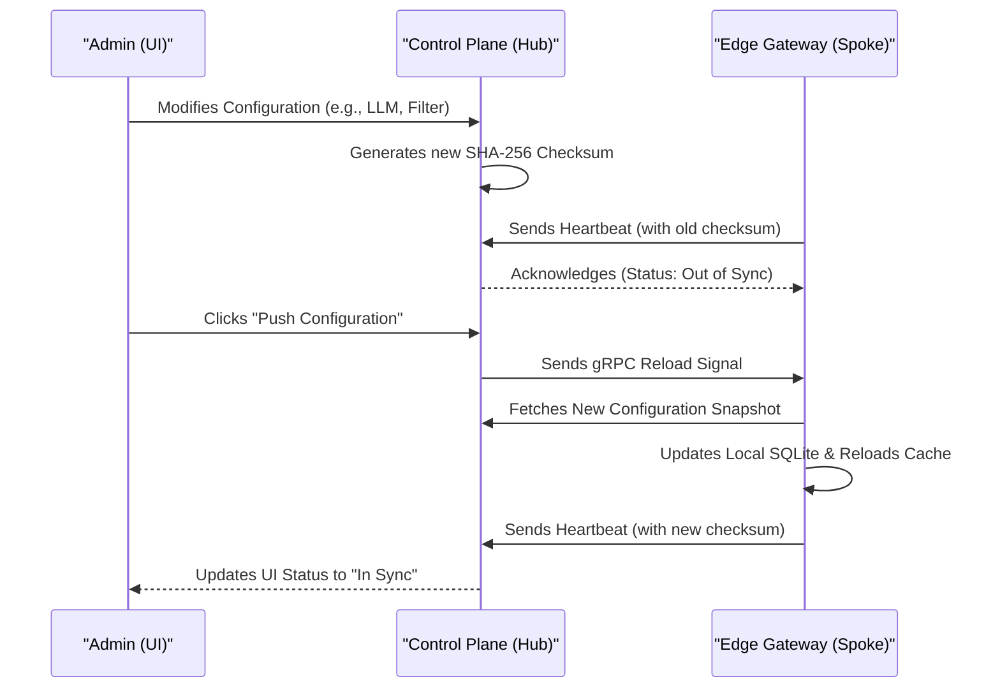

## Availability

| Edition   | Deployment Type |
| :------------- | :---------------------- |
| [Community](/ai-management/ai-studio/overview#community-edition) & [Enterprise](/ai-management/ai-studio/overview#enterprise-edition) | Self-Managed |

## What is Edge Gateway Management?

In a hub-and-spoke architecture, Tyk AI Studio acts as the central control plane (Hub), while distributed gateway proxy instances act as Edge Gateways (Spokes). Edge Gateway management provides administrators with the tools to monitor the health, connection status, and configuration synchronization of these distributed instances from a single interface.

This centralized management ensures that all edge instances are running the correct policies, routing rules, and configurations, while allowing data processing to remain local to the edge.

For more details on the data plane architecture and request processing, see the [Edge Gateway (Data Plane) Component](/ai-management/ai-studio/proxy) documentation.

## How it works

Tyk AI Studio uses a robust, checksum-based synchronization system to manage configurations across all connected Edge Gateways.

1. **Checksum Generation:** Whenever a configuration change occurs on the control plane (e.g., updating an LLM configuration, modifying a filter, or changing a tool), a SHA-256 checksum is computed from the serialized configuration snapshot.
2. **Heartbeat Reporting:** Edge gateways periodically send heartbeats to the control plane via gRPC. Each heartbeat includes the checksum of the configuration currently loaded on that edge.
3. **Status Comparison:** The control plane compares the reported checksum against the expected checksum for that edge's namespace to determine its synchronization status.
4. **Pull-on-miss for Credentials:** To balance performance and security, access tokens are not pushed in the initial snapshot. Instead, edges use a pull-on-miss strategy: they request validation for unknown tokens on-demand and cache them locally. This allows admins to revoke access without waiting for a full configuration push.

From v2.3.0, AI Studio tells every connected edge about each change to an App key or to the status of its App. The edge then drops its cached validation for that key. A revoked key stops working on a connected edge in about one second. An edge that is offline at that time learns about the change when its cache entry expires ([EDGE_TOKEN_CACHE_TTL](/ai-management/ai-studio/edge-gateway-env#edge_token_cache_ttl), 5 minutes by default) or at the next pull-on-miss. To validate keys without a control plane, refer to [Full Credential Sync](#full-credential-sync-enterprise).

## Edge Gateway Properties

When viewing the Edge Gateways list (**Portal administration > Edge Gateways**), administrators can monitor several key properties for each instance:

| Property | Description |
|--------|-------------|
| **Edge ID** | A unique identifier for the edge gateway instance. |
| **Namespace** | The isolated environment the edge belongs to. Many namespaces are an Enterprise Edition feature. The Community Edition uses one namespace, `default`. **Unlicensed namespace** marks an edge whose namespace has no licensed slot. Refer to [Licensed Namespaces](#licensed-namespaces-enterprise). |
| **Connection** | The current network status based on heartbeats (`Connected`, `Disconnected`, or `Stale`). |
| **Config Sync** | Indicates if the edge has the latest configuration (`In Sync`, `Pending`, `Stale`, or `Unknown`). |
| **Version** | The software version and build hash of the running Edge Gateway. From v2.3.0, the FIPS 140-3 status of the edge shows under the version. |
| **Held by** | The AI Studio replica that holds the connection of the edge, by its [CLUSTER_NODE_LABEL](/ai-management/ai-studio/deployment-active-active#failover-and-cluster-settings) or its node ID. The column shows only when the listed edges connect to more than one replica. |
| **Last Heartbeat** | The time elapsed since the control plane last received a heartbeat from this edge. |

Clicking on an individual Edge Gateway reveals additional details, such as the exact loaded and expected configuration checksums, session IDs, and custom metadata reported by the edge (e.g., region or environment).

The list and the detail page also show **Last pushed** with the time of the last push to the namespace.

### Checksum Behavior

*   **Stable checksum:** The snapshot encrypts secrets for the Edge Gateways. Examples are LLM API keys, tool auth keys, data source credentials, and plugin and guardrail credentials. From v2.3.0, AI Studio encrypts each secret with a new random nonce every time it builds a snapshot. The checksum uses a keyed digest of each secret instead of its encrypted value. An unchanged configuration always gives the same checksum. A changed secret, for example a rotated API key, changes the checksum.
*   **Change detection:** A recalculation can give the same checksum. In that case, AI Studio does not change the sync status of the namespace or the edges. Only a change to the snapshot marks edges as pending.

### Sync Status Banner

When an edge is out of sync, a banner shows at the top of the admin UI. The banner shows what is waiting, for example "3 changes not yet pushed to 1 edge gateway in namespace default". Click the banner to open the **Push Configuration** dialog. After a push, the banner refreshes every 3 seconds, for a maximum of 30 seconds, until the edges confirm the new configuration.

### Push Reminder

From v2.3.0, the admin UI shows a message when you save an object that edges use and an edge is out of date. The message is **Saved, not live on edge gateways yet**, at the bottom right. Click **Push Configuration** in the message to open the push dialog. The message does not show when there are no edges, or when all edges are in sync.

## Licensed Namespaces (Enterprise)

From v2.3.0, the Enterprise license sets how many edge namespaces a deployment can use. The default namespace (`default`, `global`, or an empty [EDGE_NAMESPACE](/ai-management/ai-studio/edge-gateway-env#edge_namespace)) does not count. Each other namespace uses one slot while it is in use.

- An edge in a namespace without a slot registers and stays connected. It gets no configuration, and the Edge Gateways list marks it **Unlicensed namespace**. The edge keeps any configuration that it already has.
- Namespaces without a slot wait in a queue. When a slot becomes free, the namespace that waited longest and has a connected edge gets the slot. AI Studio then pushes the configuration to its edges. The edges do not need a restart.
- A namespace with no connected edge for 24 hours loses its slot.
- An Owner can see the slots and the queue on the license page. An Owner can also release a slot that has no connected edge.

A license with fewer namespaces than are in use does not remove slots. The namespaces keep their slots until they become idle.

## Admin Actions

Administrators have full control over the lifecycle and configuration of Edge Gateways through the AI Studio UI.

### Pushing Configuration

Configuration changes are not applied automatically. Administrators must explicitly push configurations to ensure they maintain control over deployment rollouts.

<Note>
From v2.3.0, several AI Studio replicas can serve one database, in one region or in two. Any replica can start a push, and each edge gets it from the replica that holds its connection. Refer to [Active-Active Deployment of Tyk AI Studio](/ai-management/ai-studio/deployment-active-active).
</Note>

To push configuration:

1. Click **Push Configuration**.
2. Select the target scope: **All Namespaces** or a **Specific Namespace** (Enterprise).
3. Read the list of changes. The dialog shows each object that was created, updated, or deleted since the last push to the namespace, grouped by type. Each object links to its admin page. A summary line shows the number of changes, for example "12 changes since the last push at 13:12". With **All Namespaces**, each namespace has its own section. From v2.3.0, with Workspaces (Enterprise), each change also shows its Workspace. A line counts the changes for each Workspace. Refer to [Workspaces](/ai-management/ai-studio/workspaces).

   

4. Click **Push Configuration**. If nothing has changed, the button is **Push anyway**. A push can still be useful, for example after an edge registers again.

AI Studio then does these steps:

1. It records the push, with one entry for each target edge and a deadline of 5 minutes. The dialog shows which edges are connected, and shows a warning for the others.
2. It sends a reload request to each edge.
3. Each edge gets the current configuration, applies it, and reports **ready** or **failed** with the reason.
4. The dialog shows the result of each edge:
    - **Updated**: The edge loaded the configuration.
    - **Updated, with a warning**: The edge loaded a configuration that changed again after the push. Push again.
    - **Failed**: The edge could not apply the configuration (the dialog shows the error), or three delivery attempts in sequence did not complete.
    - **Timed out**: The edge did not connect, or did not finish, before the deadline.

You can close the dialog at any time. The push continues.

- An edge that is offline receives the push when it reconnects, until the deadline.
- If an edge disconnects during a reload, AI Studio sends the push again when the edge reconnects.
- A push to a namespace or to all namespaces leaves out edges that are offline for more than 5 minutes, and (Enterprise) edges in a namespace without a licensed slot. The dialog lists these edges with the reason.
- If no edge can receive the push, the dialog shows a message and disables **Push**.

The Community Edition shows the overall result of a push. The result for each edge is an Enterprise Edition feature.

### Pushes Limited to One Workspace (Enterprise)

A push always delivers the whole namespace, which can contain objects from many Workspaces. From v2.3.0, an automated client, such as Tyk Operator, can ask AI Studio to refuse a push with changes from other Workspaces. Refer to [Workspaces and Edge Gateway Pushes](/ai-management/ai-studio/workspaces#workspaces-and-edge-gateway-pushes).

### How an Edge Applies a Snapshot

- **In one transaction:** If a snapshot fails to apply, the edge keeps the previous configuration.
- **Apps and LLMs are retired, not deleted:** A snapshot can remove an App or an LLM. The edge then stops serving it, but keeps the row. Its analytics and budget data stay valid. If the App comes back, the edge serves it again.
- **Newer Apps are kept:** An edge can learn about an App from token validation after AI Studio took the snapshot. The snapshot does not remove that App.
- **Spend is never lowered:** The snapshot contains the spend of each App as AI Studio knows it. This value can be older than the edge's own value. The edge uses the higher of the two.
- **Templates and exceptions travel in the snapshot:** From v2.3.0, the snapshot contains the approved [trusted prompt templates and guardrail exceptions](/ai-management/ai-studio/guardrails) of the Apps. A change to them marks the edges **Pending**. An edge uses its old set until the next push.
- **Duplicate slugs are left out:** An edge needs unique LLM and tool slugs. A version before v2.3.0 can have stored a duplicate slug; from v2.3.0, AI Studio refuses a new tool or LLM name whose slug is in use. The snapshot keeps the entry with the lowest ID and leaves out each duplicate. The edge applies the rest of the configuration and shows as **Pending**. Find the entries in the push warning or the AI Studio log, rename them, then push again.
- **Attachments from another namespace:** An edge gets the filters and plugins of its own namespace and of the global namespace. From v2.3.0, the edge leaves out an LLM or tool that uses a filter or plugin from another namespace. Move the filter or plugin to the global namespace or to the namespace of the LLM.
- **Applied configuration in heartbeats:** From v2.3.0, an edge reports the configuration it applied, and not the last one it received. A snapshot that the edge could not apply does not show as in sync.

### Removing Edge Gateways

If an edge gateway is decommissioned or needs to be reset, administrators can remove it from the control plane:
1. Open the three-dot menu (⋮) on the edge row or navigate to its detail view.
2. Select **Remove Entry**.
3. Confirm the removal.

> **Note:** This action only removes the entry from the control plane database. If the edge gateway process is still running, it will automatically re-register on its next connection attempt.

## Plugins on Edge Gateways

- **A plugin that cannot load stops its LLM.** From v2.3.0, an edge can fail to load a pre-auth or post-auth plugin of an LLM. The edge then refuses requests to that LLM with `503`, the error code `plugin_load_failed`, and `Retry-After: 30`. Causes include a failed signature check, a refused plugin source, or a bad path. Other LLMs are not affected. No setting turns this off. Before v2.3.0, the edge skipped all plugins of that LLM and sent the request to the vendor.
- **Retries.** The edge logs `Plugin could not be loaded` with the plugin and the cause, once for each failure. It tries to load the plugin again after 30 seconds, and at each configuration push.
- **Plugin updates.** From v2.3.0, an edge reloads a plugin when a configuration push changes its command. Examples are a new file path, `grpc://` address, or OCI reference. The edge runs the same checks as for a first load. If the new plugin cannot load, the edge does not keep the old one, and requests to its LLMs get `503`. A push that does not change a plugin does not restart it.
- **Plugin order.** From v2.3.0, an edge runs the plugins of an LLM in the order set in AI Studio. Earlier edges used the install order.
- **Plugin sources.** Each edge accepts only the plugin deployment types that its own `PLUGINS_ALLOWED_SOURCES` allows, whatever AI Studio pushes. Refer to [Restrict Plugin Sources](/ai-management/ai-studio/plugins/security#restrict-plugin-sources).
- **Enterprise plugins at startup.** From v2.3.0, an edge answers the license check of Enterprise plugins before any plugin starts. Before v2.3.0, Enterprise plugins on a new edge could exit at startup, and their LLMs returned `500` for about 30 seconds.

## Management API on Edge Gateways

An Edge Gateway ([GATEWAY_MODE](/ai-management/ai-studio/edge-gateway-env#gateway_mode)`=edge`) does not serve the management API. Every `/api/v1` path returns `404`. The edge gets its LLMs, Apps, credentials, filters, and plugins only from AI Studio. The `mgw` CLI uses the management API, so it works only with a standalone Edge Gateway. The edge still serves the AI gateway endpoints, custom plugin endpoints under `/plugins/`, `/health`, `/ready`, and, when enabled, `/metrics`.

This change is also in v2.2.2. Before v2.2.2, an unauthenticated route of the management API issued admin tokens. Upgrade every edge, and let only the clients that need the gateway reach the edge ports.

The control mode of the Edge Gateway binary (`GATEWAY_MODE=control` on the Edge Gateway) is deprecated. A future release removes it. Register edges with AI Studio.

## Connection Settings

### Several Control Planes

From v2.3.0, you can give an edge an ordered list of control planes in [CONTROL_ENDPOINTS](/ai-management/ai-studio/edge-gateway-env#control_endpoints), for example one for each region. All endpoints must be replicas of one AI Studio deployment, with the same [GRPC_AUTH_TOKEN](/ai-management/ai-studio/ai-studio-env#grpc_auth_token) and [MICROGATEWAY_ENCRYPTION_KEY](/ai-management/ai-studio/ai-studio-env#microgateway_encryption_key).

The edge shows the endpoint in use in its log (`Connected to control plane`), in the `control_endpoint` field of `/ready`, and in the metric `microgateway_control_connected`. For the failover order, the failback behavior, and the settings, refer to [Configure Edge Gateways](/ai-management/ai-studio/deployment-active-active#configure-edge-gateways).

### TLS

AI Studio serves the control connection with TLS, unless [GRPC_TLS_INSECURE=true](/ai-management/ai-studio/ai-studio-env#grpc_tls_insecure). It uses [GRPC_TLS_CERT_PATH](/ai-management/ai-studio/ai-studio-env#grpc_tls_cert_path) and [GRPC_TLS_KEY_PATH](/ai-management/ai-studio/ai-studio-env#grpc_tls_key_path). The edge verifies the certificate with these settings:

| Edge setting | Purpose |
| :--- | :--- |
| [EDGE_TLS_CA_PATH](/ai-management/ai-studio/edge-gateway-env#edge_tls_ca_path) | A PEM file with the CA certificates that issued the AI Studio certificate, for a private CA. When set, it replaces the system root certificates. When not set, the edge uses the system root certificates. |
| [EDGE_TLS_SERVER_NAME](/ai-management/ai-studio/edge-gateway-env#edge_tls_server_name) | The name to verify on the certificate, when it is different from the host of the control endpoint. For example, an IP address or the internal name of a load balancer. With [CONTROL_ENDPOINTS](/ai-management/ai-studio/edge-gateway-env#control_endpoints), the edge verifies each certificate against the host of its own endpoint, and this setting applies to all endpoints. |
| [EDGE_TLS_CERT_PATH](/ai-management/ai-studio/edge-gateway-env#edge_tls_cert_path), [EDGE_TLS_KEY_PATH](/ai-management/ai-studio/edge-gateway-env#edge_tls_key_path) | A client certificate for mutual TLS. |
| [EDGE_SKIP_TLS_VERIFY](/ai-management/ai-studio/edge-gateway-env#edge_skip_tls_verify) | Turns off verification. Use it for development only. |

The edge requires TLS 1.2 or later. If the edge cannot read `EDGE_TLS_CA_PATH`, or the file has no PEM certificates, the connection stops with an error that names the setting.

### Keepalive and Message Size

Edges ping AI Studio every 30 seconds, also when no stream is open. An edge drops a connection if a ping gets no answer in 5 seconds. AI Studio accepts pings as often as every 10 seconds, and pings idle edges on the same schedule. This finds connections that are half open behind a load balancer or NAT.

| AI Studio setting | Purpose |
| :--- | :--- |
| [GRPC_MAX_MESSAGE_SIZE](/ai-management/ai-studio/ai-studio-env#grpc_max_message_size) | The largest message in each direction: configuration snapshots to edges, and analytics pulses and plugin data from edges. Set it to the same value as `GRPC_MAX_MESSAGE_SIZE` on the edges. |

### Shared Edge Credentials

All edges authenticate to AI Studio with the same token: [EDGE_AUTH_TOKEN](/ai-management/ai-studio/edge-gateway-env#edge_auth_token) on the edge, which matches [GRPC_AUTH_TOKEN](/ai-management/ai-studio/ai-studio-env#grpc_auth_token) on AI Studio. The token is not bound to an edge or a namespace. A holder of the token can register as any edge, in any namespace, and get the configuration snapshot of that namespace. The snapshot contains the secrets of the namespace, encrypted with [MICROGATEWAY_ENCRYPTION_KEY](/ai-management/ai-studio/ai-studio-env#microgateway_encryption_key), which every edge also has. From v2.3.0, this includes the credentials in LLM metadata, such as the AWS keys of a Bedrock LLM, and guardrail provider credentials.

Plugin configuration is not encrypted in the snapshot. Do not put a literal credential in plugin configuration. Use a `$SECRET/` reference. Refer to [Plugin Configuration and Secrets](/ai-management/ai-studio/plugins/security#plugin-configuration-and-secrets).

Keep the token and `MICROGATEWAY_ENCRYPTION_KEY` as secrets of the whole deployment. If an attacker gets access to an edge host, do these steps:

1. Rotate the edge token (with [GRPC_AUTH_TOKEN_NEXT](/ai-management/ai-studio/ai-studio-env#grpc_auth_token_next)) and `MICROGATEWAY_ENCRYPTION_KEY`.
2. In each namespace that the edge served, rotate the LLM provider keys and the secrets in plugin configuration. Also rotate the tool, data source, embedder, and guardrail provider credentials.
3. Revoke the OAuth access tokens issued to MCP clients in those namespaces.

App keys do not need rotation. An edge holds only hashes of App keys.

## Edge Gateway Resilience

An edge continues to serve traffic while no control plane answers. It reconnects in the background.

| Edge setting | Purpose |
| :--- | :--- |
| [OVERLOAD_SHEDDING_ENABLED](/ai-management/ai-studio/edge-gateway-env#overload_shedding_enabled) | Refuses new requests with `503` and `Retry-After` when memory use is near the limit. The edge recovers when memory use falls. |
| [OVERLOAD_MEMORY_LIMIT](/ai-management/ai-studio/edge-gateway-env#overload_memory_limit) | The memory limit for load shedding. If not set, the edge uses `GOMEMLIMIT`, and then the container limit. If no limit is known, load shedding is off. |
| [OVERLOAD_MEMORY_THRESHOLD](/ai-management/ai-studio/edge-gateway-env#overload_memory_threshold) | The fraction of the memory limit at which load shedding starts. |
| [MAX_INFLIGHT_REQUESTS](/ai-management/ai-studio/edge-gateway-env#max_inflight_requests) | An optional limit on the number of proxy requests at the same time. |
| [EDGE_TOKEN_CACHE_STALE_GRACE](/ai-management/ai-studio/edge-gateway-env#edge_token_cache_stale_grace) | Lets the edge use a token validation that just expired, but only while AI Studio cannot be reached. `0` fails closed. Any grace period lets a token that was revoked in AI Studio work on the edge for that time during an outage. |
| [ANALYTICS_RETENTION_DAYS](/ai-management/ai-studio/edge-gateway-env#analytics_retention_days) | The edge deletes older analytics. After an upgrade, the first cleanup deletes old rows in small batches. |
| [CONTROL_ENDPOINTS](/ai-management/ai-studio/edge-gateway-env#control_endpoints) | From v2.3.0. An ordered, comma-separated list of control planes. Refer to [Several Control Planes](#several-control-planes). |
| [EDGE_CONTROL_FAILBACK_INTERVAL](/ai-management/ai-studio/edge-gateway-env#edge_control_failback_interval) | From v2.3.0. How often an edge that is not on its first control plane tries to go back to it. |
| [EDGE_START_FROM_LAST_KNOWN_GOOD](/ai-management/ai-studio/edge-gateway-env#edge_start_from_last_known_good) | From v2.3.0. Lets the edge start from the configuration it last applied when no control plane answers at startup. |
| [EDGE_STARTUP_CONTROL_TIMEOUT](/ai-management/ai-studio/edge-gateway-env#edge_startup_control_timeout) | From v2.3.0. How long the edge tries its control planes at startup before it uses the stored configuration. |
| [EDGE_LAST_KNOWN_GOOD_MAX_AGE](/ai-management/ai-studio/edge-gateway-env#edge_last_known_good_max_age) | From v2.3.0. The longest time an edge can be without a control plane and still start from the stored configuration. `0` means no limit. |
| [EDGE_CREDENTIAL_SYNC](/ai-management/ai-studio/edge-gateway-env#edge_credential_sync) | From v2.3.0. Set `full` (Enterprise) to validate App keys from a synced, hashed list. |
| [EDGE_CREDENTIAL_SYNC_MAX_AGE](/ai-management/ai-studio/edge-gateway-env#edge_credential_sync_max_age) | From v2.3.0. How long the edge trusts the synced list after the last successful sync. `0` means no limit. |

### Start Without a Control Plane

From v2.3.0, every edge stores the configuration it last applied in its own database, encrypted with a key derived from its [ENCRYPTION_KEY](/ai-management/ai-studio/edge-gateway-env#encryption_key). The stored configuration can be as large as a snapshot, up to [GRPC_MAX_MESSAGE_SIZE](#keepalive-and-message-size) (16 MB by default).

With `EDGE_START_FROM_LAST_KNOWN_GOOD=true`, an edge that starts while no control plane answers waits for `EDGE_STARTUP_CONTROL_TIMEOUT`, and then starts from the stored configuration. It reports `config_source: last_known_good` on `/ready`. When a control plane accepts it, the edge applies the live configuration.

- The edge serves the configuration it last knew. An LLM, App, or filter that you removed in AI Studio works on the edge until it reconnects. For this reason, the option is off by default.
- The edge exits when it has no stored configuration, or when the configuration is for another namespace or another `ENCRYPTION_KEY`. It also exits when it was without a control plane for longer than `EDGE_LAST_KNOWN_GOOD_MAX_AGE`.
- Without full credential sync, the restarted edge cannot validate any App key until a control plane answers. Each request gets `503` with `Retry-After` and the code `credential_check_unavailable`. `EDGE_TOKEN_CACHE_STALE_GRACE` does not help, because the cache is empty after a restart.
- The edge database must survive a restart. On Kubernetes, set `kind: StatefulSet` and `persistence.enabled: true` in the Edge Gateway chart. An `emptyDir` volume covers only a container restart. The chart prints a warning when you set the option without persistence. Refer to [Scaling Edge Gateways](https://github.com/TykTechnologies/ai-studio/blob/main/docs/site/docs/deployment-helm-k8s.md#scaling-edge-gateways).

### Full Credential Sync (Enterprise)

By default, an edge asks a control plane about a key that it has not seen, and caches the answer for `EDGE_TOKEN_CACHE_TTL`. While no control plane answers, a key that is not in the cache gets `503` with the code `credential_check_unavailable`.

From v2.3.0, with `EDGE_CREDENTIAL_SYNC=full`, AI Studio sends the edge a keyed hash of every App key of its namespace, and of global Apps. AI Studio never sends the keys. The edge stores the list in its database and validates keys from it, also while no control plane answers:

- The edge accepts an active key on the list if its App is active.
- The edge refuses a listed key that is inactive or deleted, or whose App is inactive.
- The edge asks a control plane about a key that is not on the list, as in on-demand mode. An example is a key that a user created a moment ago.

The edge syncs the list at each registration and heartbeat. It also syncs about one second after AI Studio reports a change to a key on the list. It gets the full list at least every 15 minutes, and only the changes between those syncs. While no control plane answers, a revoked key can work on the edge until the list is older than `EDGE_CREDENTIAL_SYNC_MAX_AGE`. Keep the clocks of the control planes and the database within 30 seconds of each other.

Full credential sync needs an Enterprise Edition AI Studio and Edge Gateway, both on v2.3.0 or later. A Community Edition edge with `full` validates keys on demand and logs a warning. A Community Edition control plane cannot send the list, so the edge stays on demand. Use a persistent volume for the edge database, as for last-known-good.

### Analytics During a Control-Plane Outage

From v2.3.0, an edge keeps the analytics that it cannot deliver in a backlog in memory. When a control plane answers, the edge sends the backlog to AI Studio, oldest first. AI Studio stores each pulse once, so it does not count a pulse twice after a failover.

- `max_backlog_bytes` in the [analytics pulse configuration](/ai-management/ai-studio/quickstart#5-create-confs%2Fanalytics-pulse-yaml) sets the size of the backlog. The default is 256 MiB, about 900,000 requests. The Helm chart sets 64 MiB (`analyticsPulse.maxBacklogBytes`). `0` turns off the backlog.
- When the backlog is full, the edge discards the oldest records and counts them in `microgateway_analytics_pulse_dropped_records_total{reason="over_backlog"}`.
- The edge loses the whole backlog if it restarts during the outage. Do not restart edges during a control-plane outage.
- Size the memory of the edge for its working set, plus `max_backlog_bytes`, plus about 50 MB.

## Troubleshooting Synchronization

If an Edge Gateway shows a `Pending` or `Stale` sync status, or if a checksum mismatch persists:
- **Check Connectivity:** Ensure the edge gateway is running and firewall rules allow gRPC traffic (default port 50051) to the control plane.
- **Wait for Heartbeat:** After a push, it may take a few seconds for the heartbeat cycle to complete and the UI to update.
- **Review Logs:** Check the edge gateway logs for configuration load errors or permission issues preventing it from fetching the latest snapshot.
- **Entries Not Applied:** Check the push warning, and search the edge log for `Configuration entry not applied`. Refer to [How an Edge Applies a Snapshot](#how-an-edge-applies-a-snapshot).
- **Database Full:** An edge whose volume is full continues to serve, but cannot apply a push. Its `/ready` response shows `"database_full": true`, and the metric `microgateway_database_full` is `1`. Free space or increase the volume.
- **Reconnect After an Outage:** After AI Studio restarts or has an outage, edges reconnect automatically. They retry with exponential backoff, from `EDGE_RECONNECT_INTERVAL` (default 5 seconds) to a maximum of 30 seconds.
- **Analytics Missing in AI Studio:** Edges send analytics and spend to AI Studio in the analytics pulse. They load the pulse from `PLUGINS_CONFIG_PATH`. If AI Studio shows no data for an edge that serves traffic, make sure that `PLUGINS_CONFIG_PATH` points to an existing analytics pulse configuration. Search the edge logs for `startup path` and for `Failed to send analytics pulse`.
