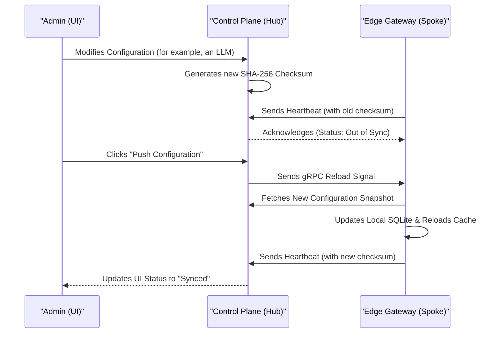
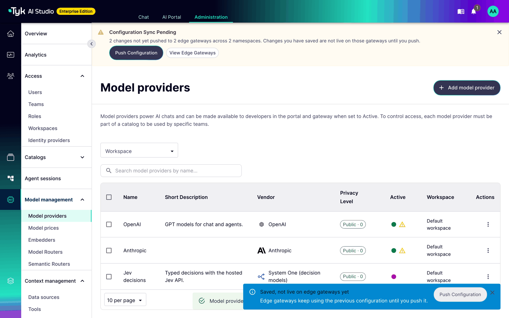
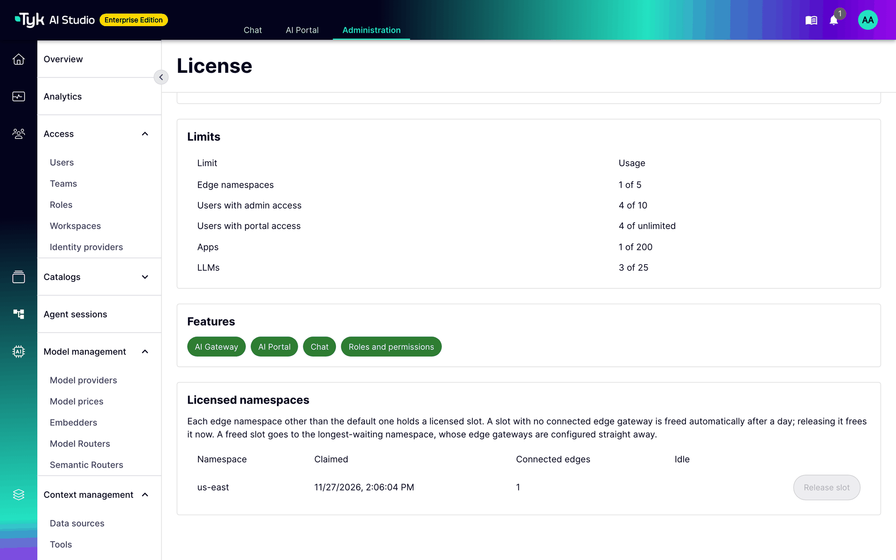

## Availability

| Edition   | Deployment Type |
| :------------- | :---------------------- |
| [Community](/ai-management/ai-studio/overview#community-edition) & [Enterprise](/ai-management/ai-studio/overview#enterprise-edition) | Self-Managed |

Edge Gateway management is available in both editions, and this page marks each Enterprise Edition feature.

## What Is Edge Gateway Management?

Tyk AI Studio is the control plane (hub) for distributed Edge Gateways (spokes). From one interface, administrators monitor the connection and the configuration sync of each edge, and [push configuration](/ai-management/ai-studio/how-to-push-edge-configuration) to it. The [Edge Gateway Properties](#edge-gateway-properties) section lists the properties that AI Studio shows for each edge.

Requests stay on the edge. An edge continues to serve traffic while no control plane answers. Refer to [Edge Gateway Connection and Resilience](/ai-management/ai-studio/edge-gateway-resilience). For the data plane, refer to [Edge Gateway (Data Plane) Component](/ai-management/ai-studio/proxy).

## How It Works

AI Studio uses checksums to track the configuration of each connected Edge Gateway.

1. **Checksum generation:** A change to an LLM, a filter, a tool, or other configuration gives a new snapshot. AI Studio computes a SHA-256 checksum of the snapshot.
2. **Heartbeat reporting:** Each edge sends heartbeats to the control plane over gRPC. A heartbeat contains the checksum of the configuration that the edge loaded.
3. **Status comparison:** The control plane compares the reported checksum with the expected checksum for the namespace of the edge. The result is the sync status of the edge.
4. **Pull-on-miss for credentials:** The snapshot does not contain access tokens. An edge asks the control plane to validate a token that it does not know, and caches the answer. Thus, administrators can revoke access without a configuration push.

From v2.3.0, AI Studio tells every connected edge about each change to an App key or to the status of its App. The edge then drops its cached validation for that key. A revoked key stops working on a connected edge in about one second.

An edge that is offline at that time learns about the change at the next pull-on-miss, or when its cache entry expires ([EDGE_TOKEN_CACHE_TTL](/ai-management/ai-studio/edge-gateway-env#edge_token_cache_ttl)). To validate keys without a control plane, refer to [Full Credential Sync](/ai-management/ai-studio/edge-gateway-resilience#full-credential-sync-enterprise).

### Checksum Behavior

- **Stable checksum:** The snapshot encrypts secrets. Examples are LLM API keys, tool auth keys, data source credentials, and plugin and guardrail credentials.
    - From v2.3.0, AI Studio encrypts each secret with a new random nonce for each snapshot. The checksum uses a keyed digest of each secret instead of its encrypted value.
    - An unchanged configuration always gives the same checksum. A changed secret, for example a rotated API key, changes the checksum.
- **Change detection:** Only a change to the snapshot marks edges **Pending**. A recalculation that gives the same checksum does not change the sync status.

### Sync Status Banner

When an edge is out of sync, a banner at the top of the admin UI shows what is waiting. An example is "3 changes not yet pushed to 1 edge gateway in namespace default". Click the banner to open the **Push Configuration** dialog. Refer to [Push Configuration to Edge Gateways](/ai-management/ai-studio/how-to-push-edge-configuration).

After a push, the banner refreshes every 3 seconds, for a maximum of 30 seconds, until the edges confirm the new configuration.

### Push Reminder

From v2.3.0, the message **Saved, not live on edge gateways yet** can show at the bottom right after you save. It shows when edges use the object and an edge is out of date. Click **Push Configuration** in the message to open the push dialog.

## Edge Gateway Properties

The Edge Gateways list (**Portal administration > Edge Gateways**) shows these properties for each edge:

| Property | Description |
|--------|-------------|
| **Edge ID** | The unique identifier of the edge. |
| **Namespace** | The isolated environment of the edge (Enterprise). The Community Edition uses one namespace, `default`, and does not show this column. |
| **Connection** | The status from the last heartbeat: **Connected** (less than 5 minutes ago), **Stale** (5 to 15 minutes ago), or **Disconnected**. |
| **Config Sync** | **Synced**, **Pending**, or **Unknown**. |
| **Version** | The version and build hash of the edge. From v2.3.0, the FIPS 140-3 status of the edge shows under the version. |
| **Held by** | The AI Studio replica that holds the connection of the edge, by its [CLUSTER_NODE_LABEL](/ai-management/ai-studio/deployment-active-active#failover-and-cluster-settings) or its node ID. The column shows only when the listed edges connect to more than one replica. |
| **Last Heartbeat** | The time since the last heartbeat from the edge. |

The detail page of an edge also shows the loaded and expected checksums and the session IDs. It also shows the metadata that the edge reports, for example its region. The list and the detail page show **Last pushed**, the time of the last push to the namespace.

## Licensed Namespaces (Enterprise)

From v2.3.0, the Enterprise license sets how many edge namespaces a deployment can use. The default namespace (`default`, `global`, or an empty [EDGE_NAMESPACE](/ai-management/ai-studio/edge-gateway-env#edge_namespace)) does not count. Each other namespace uses one slot while it is in use.

- An edge in a namespace without a slot registers and stays connected. It gets no new configuration, and keeps any configuration that it already has. The Edge Gateways list marks it **Unlicensed namespace**.
- Namespaces without a slot wait in a queue. When a slot becomes free, the namespace that waited longest and has a connected edge gets the slot. AI Studio then pushes the configuration to its edges. The edges do not need a restart.
- A namespace with no connected edge for 24 hours loses its slot.
- A license with fewer namespaces than are in use does not remove slots. The namespaces keep their slots until they become idle.
- An Owner can see the slots and the queue on the license page. An Owner can also release a slot that has no connected edge.

## How an Edge Applies a Snapshot

- **In one transaction:** If a snapshot fails to apply, the edge keeps the previous configuration. Look in the edge log for the load error.
- **Full database:** An edge whose volume is full continues to serve, but cannot apply a push. Its `/ready` response shows `"database_full": true`, and the metric `microgateway_database_full` is `1`. Free space or increase the volume.
- **Apps and LLMs are retired, not deleted:** A snapshot can remove an App or an LLM. The edge then stops serving it, but keeps the row. Its analytics and budget data stay valid. If the App comes back, the edge serves it again.
- **Newer Apps are kept:** An edge can learn about an App from token validation after AI Studio took the snapshot. The snapshot does not remove that App.
- **Spend is never lowered:** The snapshot contains the spend of each App as AI Studio knows it. This value can be older than the edge's own value. The edge uses the higher of the two.
- **Templates and exceptions:** From v2.3.0, the snapshot contains the [trusted prompt templates and guardrail exceptions](/ai-management/ai-studio/guardrails) of Apps. It contains only the approved ones. A change to them marks the edges **Pending**. An edge uses its old set until the next push.
- **Duplicate slugs are left out:** An edge needs unique LLM and tool slugs.
    - A version before v2.3.0 can have stored a duplicate slug. From v2.3.0, AI Studio refuses a new tool or LLM name whose slug is in use.
    - The snapshot keeps the entry with the lowest ID and leaves out each duplicate. The edge applies the rest of the configuration and shows as **Pending**.
    - Find the entries in the push warning, the AI Studio log, or the edge log (`Configuration entry not applied`). Rename them, then push again.
- **Attachments from another namespace:** An edge gets the filters and plugins of its own namespace and of the global namespace. From v2.3.0, the edge leaves out an LLM or tool that uses a filter or plugin from another namespace. Move the filter or plugin to the global namespace or to the namespace of the LLM.
- **Applied configuration in heartbeats:** From v2.3.0, an edge reports the configuration it applied, and not the last one it received. A snapshot that the edge did not apply does not show as in sync.

## Plugins on Edge Gateways

For plugin load failures, retries, and the plugin order on an edge, refer to [When a Plugin Cannot Be Loaded](/ai-management/ai-studio/plugins/edge-gateway#when-a-plugin-cannot-be-loaded).

- **Plugin updates.** From v2.3.0, an edge reloads a plugin when a configuration push changes its command. Examples are a new file path, `grpc://` address, or OCI reference. The edge runs the same checks as for a first load. If the new plugin cannot load, the edge does not keep the old one, and requests to its LLMs get `503`. A push that does not change a plugin does not restart it.
- **Plugin sources.** Each edge accepts only the plugin deployment types that its own `PLUGINS_ALLOWED_SOURCES` allows, whatever AI Studio pushes. Refer to [Restrict Plugin Sources](/ai-management/ai-studio/plugins/security#restrict-plugin-sources).
- **Enterprise plugins at startup.** From v2.3.0, an edge answers the license check of Enterprise plugins before any plugin starts. Before v2.3.0, Enterprise plugins on a new edge sometimes exited at startup, and their LLMs returned `500` for about 30 seconds.

## Management API on Edge Gateways

An Edge Gateway ([GATEWAY_MODE](/ai-management/ai-studio/edge-gateway-env#gateway_mode)`=edge`) does not serve the management API. Every `/api/v1` path returns `404`. The edge gets its LLMs, Apps, credentials, filters, and plugins only from AI Studio.

- The `mgw` CLI uses the management API, so it works only with a standalone Edge Gateway.
- The edge still serves the AI gateway endpoints, custom plugin endpoints under `/plugins/`, `/health`, `/ready`, and, when enabled, `/metrics`.
- This change is also in v2.2.2. Before v2.2.2, an unauthenticated route of the management API issued admin tokens. Upgrade every edge, and let only the clients that need the gateway reach the edge ports.

The control mode of the Edge Gateway binary (`GATEWAY_MODE=control` on the Edge Gateway) is deprecated. A future release removes it. Register edges with AI Studio.

