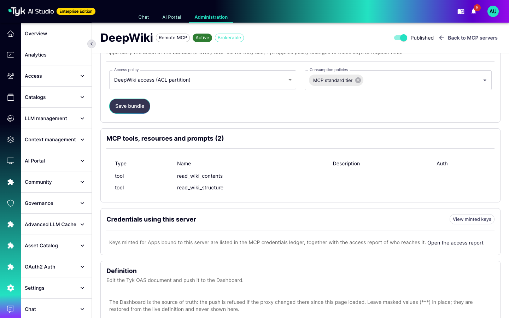
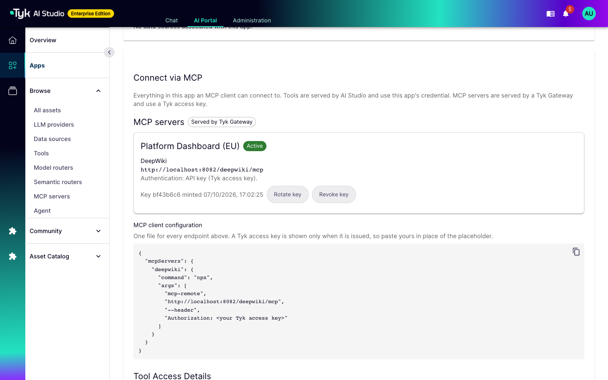
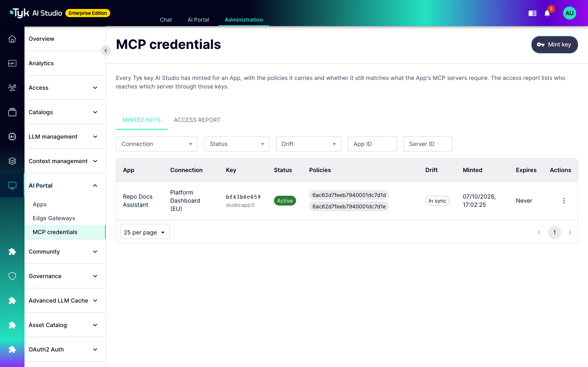

## Availability

| Edition | Deployment Type |
| :------------- | :---------------------- |
| [Enterprise](/ai-management/ai-studio/overview#enterprise-edition) | Self-Managed |

For how the integration works, refer to [Tyk Dashboard MCP Integration](/ai-management/ai-studio/tyk-mcp-integration).

## Policy Bundles

A Tyk key does not carry its own access rights. It carries policy IDs, and Tyk Gateway applies those policies to each request. AI Studio does not create a policy for each App. Instead, you select one bundle of policies for each MCP server:

- One access policy. Its access rights must include the MCP proxy. It must be unpartitioned, or it must use the ACL partition.
- Zero or more consumption policies. Each one must use the rate limit, quota, or complexity partition, and must not use the ACL partition.

You cannot select a policy that uses the `per_api` partition. For the partitions, refer to [Partitioned Policies](/api-management/access-control/policies/applying-policies#partitioned-policies). For the MCP access rules in a policy, refer to [MCP Gateway Policies](/ai-management/mcp-gateway/policies).

On a Full mode connection, you can also create a policy from the server page. AI Studio creates a partitioned policy on the Tyk Dashboard, tags it `studio-managed`, and adds it to the bundle. You can edit these policies from AI Studio. Policies from other sources link to the Tyk Dashboard.

When you change a policy on the Tyk Dashboard, the change applies to every key that uses it.

## Access Keys for Apps

A user adds MCP servers to an App, in the same way as tools. Only servers with an API key authentication can go into an App.

After an administrator approves the App, the App page shows a **Connect via MCP** section. It has one card for each connection, with the endpoint of each server and the key actions. The section also gives one MCP client configuration for all the MCP servers and tools of the App.

A key is issued in one of two ways:

- The App owner requests the key on the App page in the AI Portal.
- An administrator clicks **Mint key** on the **Portal administration > MCP credentials** page, for an App.

Each App gets one key for each connection. The key carries the policies of the bundles of all the App's MCP servers on that connection. AI Studio shows the key one time only. It does not store the key in plain text.

On the **MCP credentials** page, an administrator can rotate, suspend, resume, and revoke keys. The **Access report** tab shows which App reaches which MCP server, and with which key.

When you rotate a key, the old key stops at once. There is no grace period.

When you revoke a key, AI Studio deletes it on the Tyk Dashboard. Some gateways do not let AI Studio delete a key by its hash. In this case, AI Studio switches the key off and records this on the connection.

### Policy Changes on Keys

A key must get different policies when a bundle changes, when an App gains or loses a server, or when a policy is deleted. AI Studio checks this at once and at each sync:

| Change | What AI Studio Does |
| :--- | :--- |
| The key loses access, for example a policy is removed | It applies the change at once. |
| The key gets access to an MCP proxy that it did not reach before | It waits for an administrator to apply the change. The key shows **Change pending**. If the person who made the change has the `execute` action on `mcp-credentials`, AI Studio applies it at once. |
| No access policy is left | It switches the key off. |
| Someone added a policy to the key on the Tyk Dashboard | It keeps the policy and shows it as external. |

### Servers Without Keys

AI Studio catalogs and publishes servers that use OAuth 2.1, external OAuth, JWT, mTLS, or no authentication. It does not issue keys for them. You cannot add these servers to an App. Their page in the AI Portal tells the user how to connect directly. The access report does not show them.
