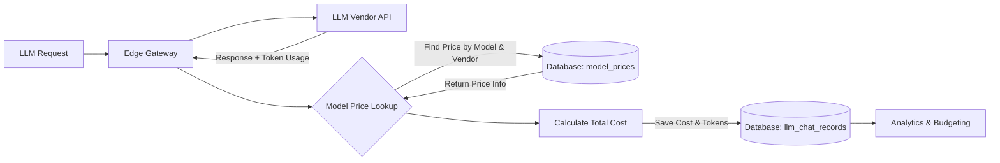
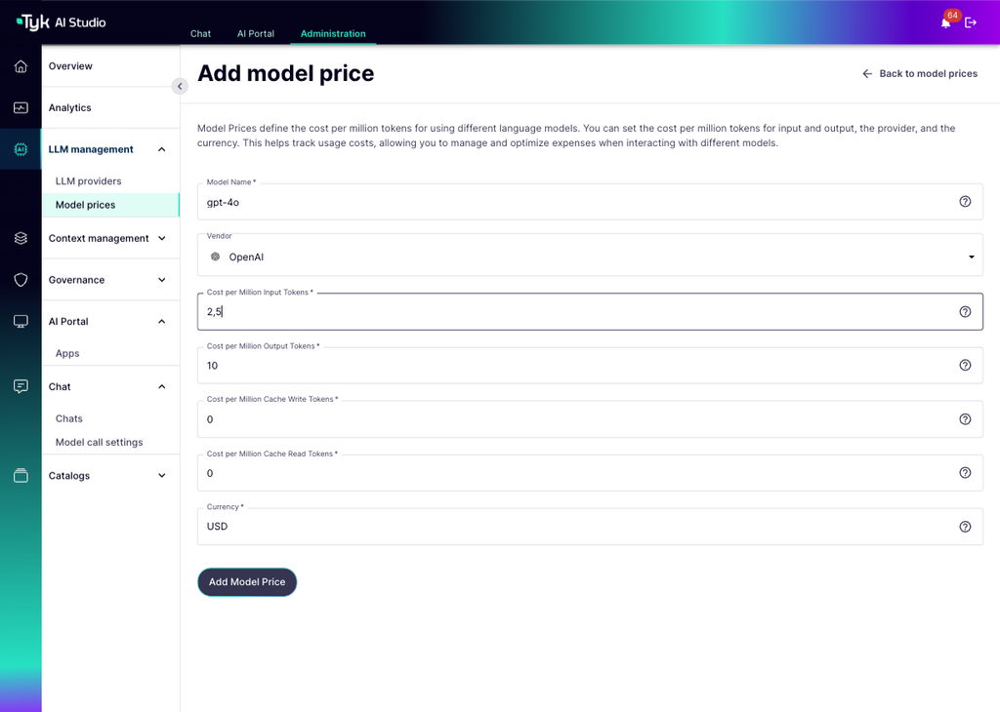

## Availability

| Edition   | Deployment Type |
| :------------- | :---------------------- |
| [Community](/ai-management/ai-studio/overview#community-edition) & [Enterprise](/ai-management/ai-studio/overview#enterprise-edition) | Self-Managed |

Model Prices define the cost per million tokens for using different language models. This helps track usage costs, allowing you to manage and optimize expenses when interacting with different models.

### Use cases

- **AI Gateway Tracking:** Ensures that token-based costs for API calls through the AI Gateway are accurately logged and monitored.
- **Chat Room Cost Analysis:** Tracks and evaluates expenses associated with user interactions in the Chat Room feature.
- **Budget Enforcement:** Provides the underlying cost data needed to enforce monthly budgets set on LLMs and Applications.

## Model Prices

The Model Prices system allows administrators to define the cost structure for specific Large Language Models (LLMs). The pricing information configured here is used by the Analytics system for cost tracking and billing purposes.

Key components of a Model Price entity include:
- **Model Identification:** The exact name of the model (e.g., `claude-3.5-sonnet-20240620`) and the vendor providing it.
- **Token Costs:** The price charged per million input tokens and output tokens.
- **Cache Costs:** Optional pricing for tokens written to or read from the LLM's prompt cache.
- **Currency:** The currency in which the model's pricing is defined (e.g., USD).

The Model Price entity is closely related to [LLM Management](/ai-management/ai-studio/llm-management), as the pricing defined here applies to the models configured in the LLM settings.

## Configuration

Administrators can configure pricing for specific models through the UI or API. The configuration includes:

- **Model Name:** Must match the exact name used in client API calls or the LLM settings in the admin console for correct mapping.
- **Vendor:** Selectable from pre-configured vendors in the admin console.
- **Cost per Million Input Tokens:** The price charged per million input tokens sent to the LLM.
- **Cost per Million Output Tokens:** The price charged per million output tokens generated by the LLM.
- **Cost per Million Cache Write Tokens:** The price charged per million tokens written to the prompt cache (defaults to input token pricing if not set).
- **Cost per Million Cache Read Tokens:** The price charged per million cached tokens read (typically much lower than input costs).
- **Currency:** The currency in which the pricing is defined.

### Cache Prices

A model has one cache-write price. Anthropic and Bedrock charge more for one-hour cache writes than for five-minute cache writes. AI Studio records one-hour cache writes at the single cache-write price. If most of the traffic of a model uses one-hour caching, set the cache-write price to the one-hour rate. An example is Claude Code with `promptCacheTtl` set to `"1h"`.

AI Studio Chat bills cached tokens at the cache price, in the same way as the gateway.

### Service Tiers

From v2.3.0, AI Studio applies the vendor rate of a service tier to the model price. For example, Anthropic batch usage costs half the list price. To change the rate for an LLM, refer to [Price Multipliers](/ai-management/ai-studio/llm-management#price-multipliers).

### Model Aliases

From v2.3.0, when a vendor reports a model that has no price, AI Studio prices the call by the model name in the request. For example, a call to an alias such as `gpt-4o` uses the price of `gpt-4o` when the reported snapshot has no price. Before v2.3.0, AI Studio recorded these calls at zero cost.

### Bedrock Model IDs, Inference Profiles, and ARNs

From v2.3.0, one price covers all the ways to name a Bedrock model. A client can send the model ID (`amazon.nova-lite-v1:0`), a cross-region inference profile ID (`apac.amazon.nova-lite-v1:0`), or an ARN. AI Studio uses the first of these names that has a price:

1. The identifier that the client sent.
2. For an inference profile ARN, the profile ID at its end. For a foundation model ARN, the model ID at its end.
3. For a profile ID, the model ID without the geography prefix, such as `us.`, `eu.`, `apac.`, or `global.`.

A price for `apac.amazon.nova-lite-v1:0` applies only to that profile. The usage record keeps the identifier that the client sent as the requested model. The model name is the name that has the price.

The ID of an application inference profile, or of a provisioned, custom, or imported model, does not name a model. AI Studio records these calls at zero cost unless you add a price for the full ARN.

Decision models also need a model price. Refer to [Decision Models](/ai-management/ai-studio/decision-models).

### Prices in the API

The admin form shows prices per million tokens. The REST API stores and returns prices per single token. For example, to store `$3` per million input tokens, send `0.000003`. The API refuses a value above `0.01` per token with HTTP `400`, because the value is most likely a price per million tokens. The error message gives the correct value. For the field names, refer to the [AI Studio API reference](/ai-management/ai-studio/ai-studio-swagger).

## How to Create the Entity

You can create and manage Model Prices through the Tyk AI Studio Admin UI.

1. **Navigate:** Go to the Model Prices section in the Admin UI. This view lists all configured model prices, showing the Model Name, Vendor, Cost per Input Token, Cost per Output Token, Cost per Cache Write Token, Cost per Cache Read Token, and Currency.
2. **Add New Model Price:** Click the "+ ADD MODEL PRICE" button.
3. **Fill in the Model Price Details:**
   - **Model Name:** The exact name of the model this price configuration applies to (Required).
   - **Vendor:** Select the name of the LLM provider (e.g., Anthropic, OpenAI).
   - **Cost per Million Input Tokens:** The price charged per million input tokens sent to the LLM (Required).
   - **Cost per Million Output Tokens:** The price charged per million output tokens generated by the LLM (Required).
   - **Cost per Million Cache Write Tokens:** The price charged per million tokens written to the prompt cache (Optional).
   - **Cost per Million Cache Read Tokens:** The price charged per million cached tokens read (Optional).
   - **Currency:** The currency in which the pricing is defined (e.g., USD) (Required).
4. **Save:** Click "Update Model Price" or "Create Model Price" to save the configuration.

   