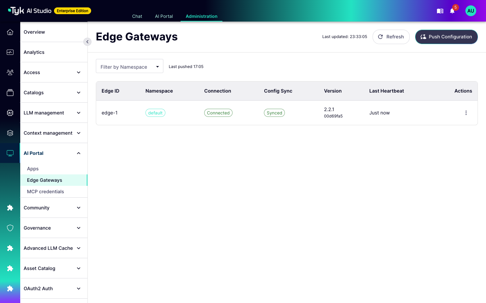
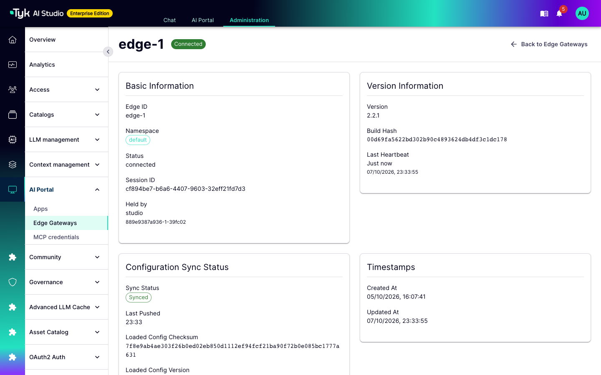

## Availability

| Edition   | Deployment Type |
| :------------- | :---------------------- |
| [Community](/ai-management/ai-studio/overview#community-edition) & [Enterprise](/ai-management/ai-studio/overview#enterprise-edition) | Self-Managed |

## Overview

Observability in AI Studio is the operational data about the gateway data path: metrics, traces, request timing, health, and logs. Use it to connect AI Studio to your monitoring stack, such as Prometheus, Grafana, or an OpenTelemetry Collector.

The embedded gateway in AI Studio and the Edge Gateway use the same proxy code. For this reason, the metrics, traces, and timing on this page work the same on both.

Other features also give operational data. They have their own pages:

| Feature | What It Shows | Source |
| :--- | :--- | :--- |
| [Analytics](/ai-management/ai-studio/analytics) | Usage, cost, and token dashboards in the admin console | The AI Studio database |
| [Audit trail](/ai-management/ai-studio/audit-trail) | Who changed what through the management API | The AI Studio database |
| [Compliance events](/ai-management/ai-studio/compliance-events) | Events from filters and [guardrails](/ai-management/ai-studio/guardrails) | The AI Studio database |
| [Notifications](/ai-management/ai-studio/notifications) and [Webhooks](/ai-management/ai-studio/webhooks) | Alerts to people and to external systems | AI Studio events |
| [Telemetry](/ai-management/ai-studio/telemetry) | Anonymous product usage statistics that AI Studio sends to Tyk | Not for your monitoring |

## Metrics

AI Studio and the Edge Gateway expose Prometheus metrics on a `/metrics` endpoint. The endpoint is secure by default. To turn it on, and for the list of governance metrics, refer to [Prometheus and OpenTelemetry Metrics](/ai-management/ai-studio/analytics#prometheus-and-opentelemetry-metrics).

<Note>
If you do not set `METRICS_AUTH_TOKEN` or `METRICS_ALLOW_UNAUTHENTICATED=true`, AI Studio and the Edge Gateway do not register the metrics endpoint. A scrape of the Edge Gateway then returns `404`. A scrape of AI Studio returns `200` with the HTML of the admin console, because AI Studio serves the console for unknown paths. Prometheus reports this as a parse error.
</Note>

### GenAI Metrics

AI Studio also exports metrics that follow the [OpenTelemetry semantic conventions for generative AI](https://opentelemetry.io/docs/specs/semconv/gen-ai/). Dashboards that you build for other AI gateways can use the same names.

| Metric | Type | Description |
| :--- | :--- | :--- |
| `gen_ai_server_request_duration_seconds` | Histogram | The duration of an LLM request, from end to end |
| `gen_ai_server_time_to_first_token_seconds` | Histogram | The time until the first output token. Streaming requests only. |
| `gen_ai_server_time_per_output_token_seconds` | Histogram | The time for each output token after the first. Streaming requests only. |
| `gen_ai_client_token_usage` | Histogram | The tokens of each request |
| `gen_ai_client_operation_duration_seconds` | Histogram | The duration of a tool call |

The GenAI metrics have these labels:

- `gen_ai_operation_name`: `chat` for LLM requests, and `execute_tool` for tool calls.
- `gen_ai_provider_name`: the LLM vendor.
- `gen_ai_request_model`: the model of the request.
- `gen_ai_token_type`: on `gen_ai_client_token_usage` only.
- `error_type`: the HTTP status code. AI Studio adds this label only when the request fails.

AI Studio reports some vendors with the names from the conventions:

| Vendor in AI Studio | `gen_ai_provider_name` |
| :--- | :--- |
| `bedrock` | `aws.bedrock` |
| `vertex` | `gcp.vertex_ai` |
| `google_ai` | `gcp.gemini` |
| Other vendors | The vendor name, for example `openai` |

The token type is `input` for prompt tokens and `output` for completion tokens. The conventions have no value for prompt cache tokens. AI Studio reports them as `cache_read` and `cache_write`.

<Note>
The GenAI conventions are not stable yet. The metric names can change in a later release of the conventions.
</Note>

### Legacy Metric Names

Three earlier metrics now have GenAI equivalents:

| Earlier Metric | GenAI Metric |
| :--- | :--- |
| `aistudio_llm_request_duration_seconds` | `gen_ai_server_request_duration_seconds` |
| `aistudio_llm_tokens_total` | `gen_ai_client_token_usage` |
| `aistudio_tool_execution_duration_seconds` | `gen_ai_client_operation_duration_seconds` |

By default, AI Studio exports both names, so your dashboards continue to work after an upgrade. The token metric also changed its type, from a counter to a histogram. Where you used `aistudio_llm_tokens_total`, use `gen_ai_client_token_usage_sum`.

When your dashboards use the GenAI names, set `METRICS_LEGACY_NAMES=false` to stop the three earlier metrics. The other `aistudio_*` metrics, such as cost and policy blocks, have no GenAI equivalent. AI Studio always exports them.

### Example Queries

```promql expandable
# 95th percentile request duration by model
histogram_quantile(0.95,
  sum by (le, gen_ai_request_model) (rate(gen_ai_server_request_duration_seconds_bucket[5m])))

# 95th percentile time to first token
histogram_quantile(0.95,
  sum by (le) (rate(gen_ai_server_time_to_first_token_seconds_bucket[5m])))

# Output tokens per second by provider
sum by (gen_ai_provider_name) (
  rate(gen_ai_client_token_usage_sum{gen_ai_token_type="output"}[5m]))

# Error rate
sum(rate(gen_ai_server_request_duration_seconds_count{error_type!=""}[5m]))
  / sum(rate(gen_ai_server_request_duration_seconds_count[5m]))

# Share of requests that a policy blocked
sum(rate(aistudio_policy_blocks_total[5m])) / sum(rate(aistudio_llm_requests_total[5m]))
```

### Edge Gateway Resilience Metrics

From v2.3.0, the Edge Gateway exports these metrics about its control-plane connection, its stored configuration, and its analytics backlog:

| Metric | Description |
| :--- | :--- |
| `microgateway_control_connected{endpoint}` | `1` for the control endpoint in use, `0` for the others |
| `microgateway_config_source{source}` | `1` for the source of the configuration: `control` or `last_known_good` |
| `microgateway_config_age_seconds` | How long the edge has been without a control plane |
| `microgateway_credential_sync_last_success_timestamp` | The time of the last successful [credential sync](/ai-management/ai-studio/edge-gateway-resilience#full-credential-sync-enterprise) (Enterprise) |
| `microgateway_credentials_synced` | The number of usable keys on the synced list |
| `microgateway_credential_validations_total{source}` | Key validations by source: `local`, `control`, or `stale` |
| `microgateway_credential_sync_calls_total{trigger}` | Credential syncs by trigger: `registration`, `heartbeat`, or `event` |
| `microgateway_analytics_pulse_backlog_bytes` | The size of the analytics that wait for delivery to AI Studio |
| `microgateway_analytics_pulse_backlog_batches` | The number of pulses that wait for delivery |
| `microgateway_analytics_pulse_dropped_records_total{reason}` | Analytics records that the edge discarded. Alert on `reason="over_backlog"`. |
| `microgateway_database_full` | `1` while the edge database has no space |
| `microgateway_database_full_writes_total{write}` | Writes refused because the database has no space |

For what to watch in a two-region deployment, refer to [Monitoring](/ai-management/ai-studio/deployment-active-active#monitoring).

### Database Metrics

From v2.3.0, with PostgreSQL, each AI Studio replica reports the state of its database:

| Metric | Description |
| :--- | :--- |
| `aistudio_db_writable` | `1` while the database of the replica accepts writes. `0` while it is read-only or unreachable. |
| `aistudio_db_failovers_total` | The number of times the replica saw the writable database server change |
| `aistudio_db_write_retries_total{outcome}` | Statements that AI Studio tried again during a database failover |
| `aistudio_db_write_hold_seconds{outcome}` | The time a statement waited for a writable database (histogram) |
| `aistudio_db_writes_held` | The number of statements that wait for a writable database now |
| `aistudio_db_unavailable_responses_total` | Requests that AI Studio answered with `503 database_unavailable` |

Alert when `aistudio_db_writable == 0` lasts longer than the promotion time of your failover manager. With SQLite, AI Studio does not report these metrics.

## Tracing

AI Studio and the Edge Gateway can export OpenTelemetry traces to a collector over OTLP gRPC. Export is off by default.

| Variable | Default | Description |
| :--- | :--- | :--- |
| `ENABLE_TRACING` | `false` | Set to `true` to export spans. |
| `TRACING_ENDPOINT` | Not set | The address of the collector, for example `otel-collector.observability:4317`. Required when tracing is on. |

The endpoint format sets the transport security:

- `host:port`: AI Studio connects without TLS.
- `https://host:port`: AI Studio connects with TLS.
- `http://host:port`: AI Studio connects without TLS.

Spans can include the model names of your requests. If the collector is outside your network, use an `https://` endpoint.

If you turn on tracing without an endpoint, AI Studio logs an error and continues without tracing.

The service name is `tyk-ai-studio` for AI Studio and `tyk-microgateway` for the Edge Gateway.

### Spans

Each LLM request through the gateway creates one span. The span name has the form `{operation} {model}`, for example `chat gpt-4o`. The span has the same `gen_ai.*` attributes as the metrics. When the request fails, the span status is error, and the span records `http.response.status_code`.

### Trace Propagation

The gateway joins the trace of the caller. It reads the W3C `traceparent` header of the incoming request, and sends the trace context to the LLM vendor. Thus, one request stays on one trace from your ingress, through AI Studio, to the model server.

Propagation works also when tracing is off. The `ENABLE_TRACING` setting controls only whether AI Studio records spans. If you trace the services in front of and behind the gateway, the trace stays connected without tracing in AI Studio.

## Gateway Timing Headers

To see how much time the gateway adds to one request, set `GATEWAY_SERVER_TIMING=true`. Set it on the Edge Gateway, or on AI Studio for its embedded gateway. LLM responses then include a standard `Server-Timing` header. Browser developer tools and most HTTP clients show this header.

```text
Server-Timing: gw-pre;dur=0.812, upstream-ttfb;dur=287.340, elapsed;dur=288.402, conn;desc="reused"
```

All durations are in milliseconds:

| Name | Meaning |
| :--- | :--- |
| `gw-pre` | From the time the gateway receives the request to the start of the upstream request. This includes authentication, policies, and request filters. |
| `upstream-ttfb` | From the start of the upstream request to the upstream response headers |
| `upstream` | From the start of the upstream request until the gateway reads all of the upstream body |
| `gw` | All gateway time outside the upstream call |
| `gw-ttfb` | The part of the time to the first body byte that the gateway adds |
| `total` | From the time the gateway receives the request until the response is complete |
| `elapsed` | From the time the gateway receives the request until it writes the response headers |
| `conn` | `reused` or `new`: the upstream connection came from the pool, or is new |
| `attempts` | The number of upstream attempts, when there was more than one, for example after a failover |

The header contains only the values that are known when the gateway writes the headers. On a chunked response, such as a streamed response, the gateway also writes a `Server-Timing` trailer after the body. The trailer has the complete values, including `total`, `gw`, and `gw-ttfb`.

For the OpenAI-compatible endpoints (`/ai` and the unified `/v1` endpoint), the gateway calls the vendor through an internal second request. On these endpoints, `upstream` is the time of the vendor call, and `gw-pre` includes the internal request.

<Warning>
The header shows internal timing to every client. Turn it on for tests and diagnosis. Do not keep it on permanently in production.
</Warning>

## Health Endpoints

AI Studio and the Edge Gateway have health endpoints that need no authentication. Use them for load balancer checks and Kubernetes probes.

| Component | Endpoint | Returns |
| :--- | :--- | :--- |
| AI Studio | `/health` or `/healthz` | `200` when the process runs |
| AI Studio | `/ready` or `/readyz` | `200` when AI Studio can reach its database. `503` when it cannot. On PostgreSQL, `/ready` stays `200` for [DATABASE_READY_GRACE](/ai-management/ai-studio/ai-studio-env#database_ready_grace) after the database stops accepting writes. |
| Edge Gateway | `/health` | `200` when the process runs |
| Edge Gateway | `/ready` | `200` when the local database of the Edge Gateway (SQLite or PostgreSQL) is healthy. `503` when not. A plugin that failed or is still loading does not cause `503`. The response lists these plugins in `plugins_not_ready`, and the counts in `plugin_health`. |
| Edge Gateway | `/health/detailed` | The status of the local database and each plugin, and the OCI plugin statistics |

The `/health/detailed` endpoint shows details about the plugins of the Edge Gateway, without authentication. Do not make it available outside your network. For example, block the path at your load balancer or ingress.

The admin console shows the connection of each Edge Gateway to AI Studio. Go to **Edge Gateways** to see the connection, the configuration sync status, and the last heartbeat of each edge.



Open an edge to see its session and the checksum of its loaded configuration. The page also shows the time of its last sync acknowledgment. For the meaning of each value, refer to [Edge Gateway Properties](/ai-management/ai-studio/manage-edge-gateway#edge-gateway-properties).



## Logs

AI Studio and the Edge Gateway write logs to standard output.

| Variable | Component | Default | Values |
| :--- | :--- | :--- | :--- |
| `LOG_LEVEL` | AI Studio and Edge Gateway | `info` | `trace`, `debug`, `info`, `warn`, `error`, `fatal`, or `panic` |
| `LOG_FORMAT` | Edge Gateway | `text` | `text` or `json` |

Use `LOG_FORMAT=json` when a log collector reads the Edge Gateway logs. The Edge Gateway does not start if `LOG_LEVEL` or `LOG_FORMAT` has a value that is not in the list.

## Kubernetes

The Edge Gateway Helm chart (`microgateway`) sets the metrics and tracing variables from its values:

| Value | Default | Variable |
| :--- | :--- | :--- |
| `metrics.enabled` | `true` | `ENABLE_METRICS` |
| `metrics.allowUnauthenticated` | `true` | `METRICS_ALLOW_UNAUTHENTICATED` |
| `metrics.bearerTokenSecret.name` and `.key` | Empty, `token` | The Secret with the token that the ServiceMonitor sends. It must match `METRICS_AUTH_TOKEN`. |
| `metrics.legacyNames` | `true` | `METRICS_LEGACY_NAMES` |
| `metrics.serviceMonitor.enabled` | `false` | Creates a Prometheus Operator ServiceMonitor |
| `tracing.enabled` | `false` | `ENABLE_TRACING` |
| `tracing.endpoint` | Empty | `TRACING_ENDPOINT` |

The default `metrics.allowUnauthenticated: true` is for scrapes from inside the cluster. If the metrics endpoint is available from outside the cluster, set `metrics.allowUnauthenticated` to `false` and use `metrics.bearerTokenSecret`.

The chart does not render a ServiceMonitor unless `metrics.allowUnauthenticated` is `true` or `metrics.bearerTokenSecret.name` is set. This prevents a ServiceMonitor that scrapes an endpoint that does not exist.

For the full deployment, refer to [Deploy on Kubernetes](/ai-management/ai-studio/deployment-k8s).
