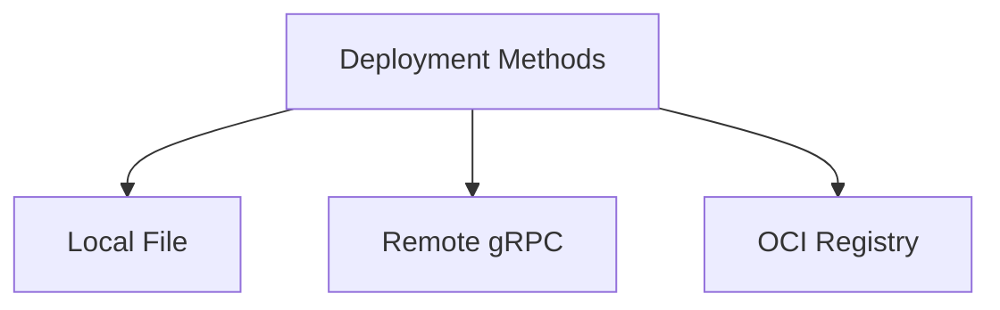

## Availability

| Edition   | Deployment Type |
| :------------- | :---------------------- |
| [Community](/ai-management/ai-studio/overview#community-edition) & [Enterprise](/ai-management/ai-studio/overview#enterprise-edition) | Self-Managed |




Tyk AI Studio supports three plugin deployment methods: local filesystem (`file://`), remote gRPC (`grpc://`), and OCI registry (`oci://`). Choose the deployment method based on your environment and requirements.

## Deployment Methods Comparison

| Method | Use Case | Pros | Cons |
|--------|----------|------|------|
| `file://` | Development, testing | Fast, simple, easy debugging | Not suitable for production, requires filesystem access |
| `grpc://` | Production, distributed systems | Remote deployment, scalable | Requires network setup, more complex |
| `oci://` | Production, containerized | Version control, registry management | Requires OCI registry, packaging overhead |

An administrator can turn off a deployment method. Set `AI_STUDIO_PLUGIN_ALLOWED_SOURCES` on AI Studio and `PLUGINS_ALLOWED_SOURCES` on each Edge Gateway. Refer to [Restrict Plugin Sources](/ai-management/ai-studio/plugins/security#restrict-plugin-sources).

## file:// - Local Filesystem

Deploy plugins from the local filesystem.

> **Safety settings:** AI Studio runs local plugin binaries only from allowed directories. Refer to [Security Considerations](#security-considerations).

### Building Your Plugin

```bash
# Build for current platform
go build -o my-plugin main.go

# Build for Linux (Docker/K8s deployment)
GOOS=linux GOARCH=amd64 go build -o my-plugin-linux main.go

# Make executable
chmod +x my-plugin
```

### Creating Plugin via API

```bash expandable
curl -X POST http://localhost:3000/api/v1/plugins \
  -H "Authorization: Bearer $TOKEN" \
  -H "Content-Type: application/json" \
  -d '{
    "name": "My Plugin",
    "slug": "my-plugin",
    "command": "file:///absolute/path/to/my-plugin",
    "hook_type": "pre_auth",
    "plugin_type": "gateway",
    "is_active": true
  }'
```

**Important**: Use absolute paths with `file://`:

```bash
✅ file:///usr/local/bin/my-plugin
✅ file:///opt/plugins/my-plugin
❌ file://./my-plugin  # Relative paths not supported
❌ /usr/local/bin/my-plugin  # Missing file:// prefix
```

AI Studio runs plugin binaries only from allowed directories: `/usr/bin/`, `/bin/`, `/usr/local/bin/`, and `/opt/plugins/`. To add directories, set `AI_STUDIO_PLUGIN_ALLOWED_DIRS` to a colon-separated list.

### Docker Deployment

When deploying with Docker, mount plugins into the container:

```yaml
# docker-compose.yml
services:
  ai-studio:
    image: tykio/ai-studio:latest
    volumes:
      - ./plugins:/plugins
    environment:
      - ALLOW_INTERNAL_NETWORK_ACCESS=true  # For development only
```

Then register with container path:

```bash
curl -X POST http://localhost:3000/api/v1/plugins \
  -d '{"command": "file:///plugins/my-plugin", ...}'
```

### Kubernetes Deployment

Mount plugins via ConfigMap or PersistentVolume:

```yaml Expandable expandable
apiVersion: v1
kind: ConfigMap
metadata:
  name: plugins
binaryData:
  my-plugin: <base64-encoded-binary>
---
apiVersion: apps/v1
kind: Deployment
metadata:
  name: ai-studio
spec:
  template:
    spec:
      containers:
      - name: ai-studio
        image: tykio/ai-studio:latest
        volumeMounts:
        - name: plugins
          mountPath: /plugins
      volumes:
      - name: plugins
        configMap:
          name: plugins
          defaultMode: 0755
```

## grpc:// - Remote gRPC

Deploy plugins as remote gRPC services.

### Running Plugin as gRPC Server

Your plugin already implements gRPC via go-plugin. To run it as a remote service, you need a gRPC wrapper:

```go Expandable expandable
package main

import (
    "log"
    "net"

    "github.com/TykTechnologies/midsommar/v2/pkg/ai_studio_sdk"
    "google.golang.org/grpc"
)

func main() {
    // Create gRPC server
    lis, err := net.Listen("tcp", ":50051")
    if err != nil {
        log.Fatalf("Failed to listen: %v", err)
    }

    grpcServer := grpc.NewServer()

    // Register your plugin
    plugin := &MyPlugin{}
    ai_studio_sdk.RegisterPluginServer(grpcServer, plugin)

    log.Printf("Plugin gRPC server listening on :50051")
    if err := grpcServer.Serve(lis); err != nil {
        log.Fatalf("Failed to serve: %v", err)
    }
}
```

### Deploying with Docker

```dockerfile
FROM golang:1.26-alpine AS builder
WORKDIR /build
COPY . .
RUN go build -o plugin-server main.go

FROM alpine:latest
COPY --from=builder /build/plugin-server /usr/local/bin/
EXPOSE 50051
CMD ["/usr/local/bin/plugin-server"]
```

```bash
# Build and run
docker build -t my-plugin-server .
docker run -d -p 50051:50051 my-plugin-server
```

### Register Remote Plugin

```bash
curl -X POST http://localhost:3000/api/v1/plugins \
  -H "Authorization: Bearer $TOKEN" \
  -d '{
    "name": "My Remote Plugin",
    "slug": "my-remote-plugin",
    "command": "grpc://plugin-server:50051",
    "hook_type": "pre_auth",
    "plugin_type": "gateway",
    "is_active": true
  }'
```

### Network Configuration

#### Internal Network Access

From Tyk AI Studio 2.3.0, AI Studio and the Edge Gateway refuse a `grpc://` plugin at an internal address, such as a private IP address or a cluster-internal service name. To allow one host, turn on **Allow internal host** on the plugin, or add the host to `LLM_UPSTREAM_ALLOWED_INTERNAL_HOSTS`. Refer to [Internal Registries and Hosts](/ai-management/ai-studio/plugins/security#internal-registries-and-hosts).

#### Load Balancing

Use Kubernetes services for load balancing:

```yaml expandable
apiVersion: v1
kind: Service
metadata:
  name: my-plugin
spec:
  selector:
    app: my-plugin
  ports:
  - port: 50051
    targetPort: 50051
  type: ClusterIP
```

Register with service DNS:

```bash
"command": "grpc://my-plugin.default.svc.cluster.local:50051"
```

## oci:// - OCI Registry

Deploy plugins as OCI artifacts in container registries.

### Prerequisites

- Docker or Podman
- OCI-compatible registry (Docker Hub, GHCR, ECR, GCR, Harbor, etc.)
- Registry credentials configured

### Packaging Plugin as OCI Artifact

AI Studio reads the first layer of the artifact as the plugin binary, so push the binary with ORAS, not as a Docker image. For the commands, signing, and marketplace listing, refer to [Publish Plugins](/ai-management/ai-studio/plugins/publishing).

### Registering OCI Plugin

```bash expandable
curl -X POST http://localhost:3000/api/v1/plugins \
  -H "Authorization: Bearer $TOKEN" \
  -d '{
    "name": "My OCI Plugin",
    "slug": "my-oci-plugin",
    "command": "oci://registry.example.com/plugins/my-plugin:v1.0.0",
    "oci_reference": "registry.example.com/plugins/my-plugin:v1.0.0",
    "hook_type": "pre_auth",
    "plugin_type": "gateway",
    "is_active": true
  }'
```

### Registry Authentication

OCI registry authentication is configured via environment variables using the pattern:

```
OCI_PLUGINS_REGISTRY_<REGISTRY_NAME>_<FIELD>=<value>
```

Where `<REGISTRY_NAME>` is the registry hostname with dots replaced by underscores (e.g., `docker.tyk.io` → `DOCKER_TYK_IO`).

#### Authentication Methods

**Entitlement Token** (Cloudsmith and similar registries):

```bash
# Entitlement token — sent as Basic auth (username: "token", password: entitlement)
OCI_PLUGINS_REGISTRY_DOCKER_TYK_IO_ENTITLEMENT=your-entitlement-token

# Custom username for entitlement (default: "token")
OCI_PLUGINS_REGISTRY_DOCKER_TYK_IO_ENTITLEMENTUSERNAME=custom-user
```

**Username + Password**:

```bash
OCI_PLUGINS_REGISTRY_GHCR_IO_USERNAME=github-user
OCI_PLUGINS_REGISTRY_GHCR_IO_PASSWORDENV=GITHUB_TOKEN  # reads from this env var
```

**OAuth2/Bearer Token**:

```bash
OCI_PLUGINS_REGISTRY_REGISTRY_EXAMPLE_COM_TOKEN=your-access-token
# Or read from env var:
OCI_PLUGINS_REGISTRY_REGISTRY_EXAMPLE_COM_TOKENENV=MY_REGISTRY_TOKEN
```

#### AI Studio vs Edge Gateway

Both runtimes use the same `OCI_PLUGINS_REGISTRY_*` environment variables for auth. The difference is in how OCI support is enabled:

| Setting | AI Studio | Edge Gateway |
|---------|-----------|-------------|
| **Enable OCI** | `AI_STUDIO_OCI_CACHE_DIR=/path` | `OCI_PLUGINS_CACHE_DIR=/path` (default: `/var/lib/microgateway/plugins`) |
| **Require signatures** | `AI_STUDIO_OCI_REQUIRE_SIGNATURE` (default `true`) | `OCI_PLUGINS_REQUIRE_SIGNATURE` (default `true`) |
| **Registry auth** | `OCI_PLUGINS_REGISTRY_*` (shared) | `OCI_PLUGINS_REGISTRY_*` (shared) |

**Important**: `AI_STUDIO_OCI_CACHE_DIR` must be set for OCI plugin support to be enabled in AI Studio. Without it, OCI plugins cannot be installed or loaded, and registry auth configuration is ignored.

#### Plugin Size Limit

AI Studio and the Edge Gateway stream plugin layers directly from the registry. The maximum layer size is 512 MB by default. To change it, set `AI_STUDIO_OCI_MAX_PLUGIN_SIZE` (AI Studio) or `OCI_PLUGINS_MAX_PLUGIN_SIZE` (Edge Gateway).

#### Signature Verification

From Tyk AI Studio 2.3.0, AI Studio and the Edge Gateway require a valid signature on each OCI plugin by default (Enterprise Edition). The Helm charts also require signatures by default. An unsigned plugin, or a plugin signed with a key that is not configured, does not load.

The host verifies the signature in its own process, with the registry authentication of the plugin (`OCI_PLUGINS_REGISTRY_*`). You do not need the `cosign` binary or a Docker credential store.

The host always trusts the Tyk signing key. To trust your own key or the key of a publisher, add it on AI Studio and on each Edge Gateway:

```bash
# Public key for verifying plugin signatures (PEM content)
OCI_PLUGINS_PUBKEY_ACME="-----BEGIN PUBLIC KEY-----..."
# Or a path to the key file
OCI_PLUGINS_PUBKEY_FILE_ACME=/path/to/cosign.pub
```

To load unsigned plugins while you develop a plugin, set `AI_STUDIO_OCI_REQUIRE_SIGNATURE=false` on AI Studio and `OCI_PLUGINS_REQUIRE_SIGNATURE=false` on the Edge Gateway.

For key selection with `?pubkey=`, the signature formats, the transparency log policy, key settings and Community Edition behavior, refer to [Signature Verification](/ai-management/ai-studio/plugins/security#signature-verification). To sign a plugin, refer to [Sign the Plugin](/ai-management/ai-studio/plugins/publishing#sign-the-plugin).

#### Cloudsmith-Specific Notes

When using Cloudsmith with a custom Docker domain (e.g., `docker.tyk.io`):

- **Entitlement auth** is the recommended method for programmatic access
- Entitlements bypass the Docker token exchange, which avoids scope issues with Cloudsmith's namespace-level scope requirements
- Each Cloudsmith repository has its own entitlement tokens — use repository-level entitlements
- The `ENTITLEMENT` auth type sends Basic auth directly on every request, which Cloudsmith supports natively

### Version Management

Use tags for version management:

```bash expandable
# Development
oci://registry.example.com/plugins/my-plugin:latest

# Staging
oci://registry.example.com/plugins/my-plugin:v1.2.3-rc.1

# Production
oci://registry.example.com/plugins/my-plugin:v1.2.3

# Immutable digest
oci://registry.example.com/plugins/my-plugin@sha256:abc123...
```

### Caching

OCI plugins are pulled and cached locally:

```bash
# AI Studio
AI_STUDIO_OCI_CACHE_DIR=/var/cache/ai-studio/plugins

# Edge Gateway (defaults to /var/lib/microgateway/plugins)
OCI_PLUGINS_CACHE_DIR=/var/cache/microgateway/plugins
```

From Tyk AI Studio 2.3.0, the host checks each cached binary against its SHA-256 hash. After an upgrade, the host fetches each OCI plugin again on its first load, so the registry must be available. Refer to [Cached Plugin Binaries](/ai-management/ai-studio/plugins/security#cached-plugin-binaries).

## Security Considerations

Plugins run as separate processes with the privileges of the host. Install only plugins that you trust. For the complete security model, refer to [Plugin Security](/ai-management/ai-studio/plugins/security).

### Command Validation

The platform validates plugin commands:

1. **Absolute Paths**: `file://` commands must use absolute paths. The path must be in an allowed directory ([AI_STUDIO_PLUGIN_ALLOWED_DIRS](/ai-management/ai-studio/ai-studio-env#ai_studio_plugin_allowed_dirs)).
2. **Internal Hosts**: AI Studio and the Edge Gateway refuse `oci://` registries and `grpc://` hosts at internal addresses. Refer to [Internal Network Access](#internal-network-access). [PLUGIN_BLOCK_INTERNAL_URLS](/ai-management/ai-studio/ai-studio-env#plugin_block_internal_urls) is deprecated.
3. **Allowlist**: [PLUGIN_COMMAND_ALLOWLIST](/ai-management/ai-studio/ai-studio-env#plugin_command_allowlist) is advisory. The host logs a warning for a command that does not match it, but it still accepts the command. Its entries are comma-separated substrings.

### Production Security

Follow the [Production Checklist](/ai-management/ai-studio/plugins/security#production-checklist). For an example configuration, refer to [Restrict Plugin Sources](/ai-management/ai-studio/plugins/security#restrict-plugin-sources).

### Plugin Process Environment

From Tyk AI Studio 2.3.0, `file://` and `oci://` plugins do not inherit the environment of their host. They get only an allowlist of variables. To pass more host variables, set [PLUGIN_ENV_PASSTHROUGH](/ai-management/ai-studio/ai-studio-env#plugin_env_passthrough). Refer to [Plugin Environment](/ai-management/ai-studio/plugins/security#plugin-environment).

The GitHub RAG ingest plugin reads `GITHUB_RAG_SECRET_ENCRYPTION_KEY` and `GITHUB_RAG_KNOWN_HOSTS` from its environment. If you set either variable, add `GITHUB_RAG_*` to `PLUGIN_ENV_PASSTHROUGH` before you upgrade. As an alternative, set `secret_encryption_key` and `known_hosts_path` in the plugin configuration. Without the key, repositories with encrypted credentials do not sync, and the plugin stores new credentials unencrypted.

### Plugin Message Size

The host and the plugin exchange each hook call as one gRPC message. The message holds the body, the headers and the context. From Tyk AI Studio 2.3.0, plugins built on the 2.3.0 SDK accept the host limit below.

| Variable | Default | Description |
| :--- | :--- | :--- |
| [PLUGIN_GRPC_MAX_MSG_BYTES](/ai-management/ai-studio/ai-studio-env#plugin_grpc_max_msg_bytes) | `67108864` (64 MiB) | Largest message, in bytes, between the host and its plugins. Set it on the host. The host passes it to each plugin that it starts. |

For the Edge Gateway, refer to [PLUGIN_GRPC_MAX_MSG_BYTES](/ai-management/ai-studio/edge-gateway-env#plugin_grpc_max_msg_bytes) in the Edge Gateway environment variables.

On an Edge Gateway LLM with `pre_auth`, `auth` or `post_auth` plugins, the gateway refuses a request body over this limit with `413`.

A plugin built on an SDK before 2.3.0 accepts only 4 MiB. When such a plugin refuses a larger message:

- For `pre_auth`, `auth` and `post_auth` plugins, the gateway returns `413` with `request too large for the gateway's plugins (<bytes> bytes)`. It does not forward the request. The log names the plugin.
- For response plugins, the gateway sends the response without the changes of that plugin. It logs the plugin name and the size.

Rebuild your request-path plugins on the 2.3.0 SDK. A `grpc://` plugin sets its own server limit.

Calls from a plugin to the [Service API](/ai-management/ai-studio/plugins/service-api) are limited to 8 MiB for each message.

## Troubleshooting


<AccordionGroup>

<Accordion title="Plugin Not Loading">

**Symptoms**: Plugin shows as inactive, errors in logs

**Solutions**:
- Verify plugin binary has execute permissions (`chmod +x`)
- Check absolute path is correct for `file://`
- Verify network connectivity for `grpc://`
- Check registry authentication for `oci://`
- Check that the plugin is signed and that its key is configured, for `oci://` (Enterprise Edition)
- Check that `AI_STUDIO_PLUGIN_ALLOWED_SOURCES` or `PLUGINS_ALLOWED_SOURCES` allows the source
- Look for log lines that start with `plugin host "<host>" is an internal address`
- Review plugin logs for initialization errors

On an Edge Gateway, requests to an LLM with a plugin that cannot load get `503` with the error code `plugin_load_failed`. Refer to [When a Plugin Cannot Be Loaded](/ai-management/ai-studio/plugins/edge-gateway#when-a-plugin-cannot-be-loaded).

</Accordion>

<Accordion title="Large Requests Return 413">

**Symptoms**: Requests with large bodies, such as screenshots or PDF documents, fail with `413` and `request too large for the gateway's plugins`

**Solutions**:

* Rebuild the plugins of the LLM on the 2.3.0 SDK. The log names the plugin.
* Upgrade the shipped plugins to their 2.3.0 releases.
* Check `PLUGIN_GRPC_MAX_MSG_BYTES`. Refer to [Plugin Message Size](#plugin-message-size).

</Accordion>

<Accordion title="Permission Denied">

**Symptoms**: "Permission denied" error when loading plugin

**Solutions**:

```bash
# Check file permissions
ls -la /path/to/plugin

# Make executable
chmod +x /path/to/plugin

# Check SELinux context (if applicable)
chcon -t container_file_t /path/to/plugin
````

</Accordion>

<Accordion title="Network Connection Errors">

**Symptoms**: "connection refused", "no route to host" for `grpc://`

**Solutions**:

* Verify plugin server is running: `telnet plugin-host 50051`
* Check firewall rules
* Verify Kubernetes service is created
* Check DNS resolution
* Enable internal network access if needed (development only)

</Accordion>

<Accordion title="OCI Pull Failures">

**Symptoms**: "Failed to pull image", "authentication required"

**Solutions**:

* Verify registry URL is correct
* Check credentials are configured
* Test manual pull: `docker pull registry.example.com/plugins/my-plugin:v1.0.0`
* Check registry permissions
* Verify image exists with correct tag

</Accordion>

<Accordion title="Plugin Crashes on Start">

**Symptoms**: Plugin loads but immediately crashes

**Solutions**:

* Check plugin logs for panics
* Verify Go version compatibility
* Check for missing dependencies
* Test plugin standalone: `./my-plugin`
* Review initialization code for errors

</Accordion>

</AccordionGroup>

## Best Practices

### Development Workflow

1. **Local Development**: Use `file://` for fast iteration
2. **Reload Loop**: Use `POST /api/v1/plugins/{id}/reload` to test changes instantly
3. **Testing**: Deploy to staging with `grpc://` or `oci://`
4. **Production**: Use `oci://` with versioned tags

**See [Plugin Development Workflow](/ai-management/ai-studio/plugins/development-workflow)** for detailed setup, helper scripts, and the fastest development loop.

### Version Management

1. Use semantic versioning
2. Tag releases in Git and OCI registry
3. Never reuse tags (immutable releases)
4. Document breaking changes

### Deployment Pipeline

```bash Expandable expandable
# 1. Build
go build -o plugin main.go

# 2. Test locally
./plugin  # Verify it runs

# 3. Package and push (refer to Publish Plugins)
oras push registry.example.com/plugins/my-plugin:v1.2.3 \
  --artifact-type application/vnd.tyk.plugin.binary.v1 \
  ./plugin:application/vnd.tyk.plugin.layer.v1

# 4. Sign by digest (signatures are required by default)
cosign sign --key plugin-signing.key registry.example.com/plugins/my-plugin@<digest>

# 5. Deploy to staging
curl -X POST .../plugins -d '{"command": "oci://registry.../my-plugin:v1.2.3-rc.1", ...}'

# 6. Test in staging
# Run integration tests

# 7. Deploy to production
curl -X POST .../plugins -d '{"command": "oci://registry.../my-plugin:v1.2.3", ...}'
```

### Monitoring

- Monitor plugin health via `/api/v1/plugins/{id}/health`
- Track plugin performance metrics
- Set up alerts for plugin failures
- Log all plugin operations

