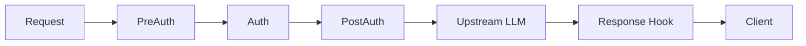

## Availability

| Edition   | Deployment Type |
| :------------- | :---------------------- |
| [Community](/ai-management/ai-studio/overview#community-edition) & [Enterprise](/ai-management/ai-studio/overview#enterprise-edition) | Self-Managed |



Edge Gateway plugins provide middleware hooks in the LLM proxy request/response pipeline using the **Unified Plugin SDK**. Use them for custom authentication, request/response transformation, content filtering, and data collection to external systems.

All Edge Gateway plugins now use `pkg/plugin_sdk`. The SDK automatically detects the Edge Gateway runtime. It gives access to universal services (KV storage, logging) and to services specific to the Edge Gateway (app management, budget status).

## Plugin Capabilities

Edge Gateway plugins implement one or more of these capability interfaces:

### 1. PreAuthHandler

**Interface**: `PreAuthHandler`
**Method**: `HandlePreAuth(ctx Context, req *pb.EnrichedRequest) (*pb.PluginResponse, error)`

Executes **before** authentication. Use for:
- Request validation and early rejection
- Request enrichment with metadata
- Header modification
- Logging and auditing

**Working Example**: [examples/plugins/gateway/request_enricher/](https://github.com/TykTechnologies/ai-studio/tree/main/examples/plugins/gateway/request_enricher)

### 2. AuthHandler

**Interface**: `AuthHandler`
**Method**: `HandleAuth(ctx Context, req *pb.AuthRequest) (*pb.AuthResponse, error)`

**Replaces** App key authentication on the endpoints that it is attached to. Use for:
- Custom authentication schemes (OAuth, JWT, API keys)
- Integration with external identity providers
- Multi-factor authentication

Return `Authenticated: true` with the `AppId` that the caller acts as. The gateway treats a response without a valid `AppId` as a rejection. The gateway uses the grants of that App to decide what the request can reach.

You can also return identity information for audit. The gateway records these values with the request:

- `UserId`: The user that the call is for, for example the subject of a delegated token. The proxy log stores it as `on_behalf_of`.
- `Claims["auth_actor"]`: The agent that acts for the user, for example the `act` or `azp` claim of the token. The proxy log stores it as `acting_agent`.
- Other `Claims`: Other values for audit.

The gateway sends these values to post-auth plugins and custom endpoints. The proxy logs on the App and LLM pages show them as **For** and **Agent**. These values are for audit only. The plugin does not decide what the request can reach.

#### Where Auth Plugins Run

Every endpoint of the Edge Gateway has an ordered list of auth plugins:

| Endpoint | List |
| :--- | :--- |
| `/llm/...` | The plugins of the LLM that have the auth hook |
| `/ai/{slug}`, `/v1`, `/anthropic/{slug}`, `/router/{slug}` | The list of the LLM, or the list of the Model Router or Semantic Router when the slug is a router |
| `/datasource/{slug}` | The list of the data source |
| `/tools/{slug}` and its MCP transports | The list of the tool |
| `/plugins/{slug}/...` (endpoints that require authentication) | The list of the custom endpoint plugin |

When an endpoint has auth plugins, the gateway uses only these plugins to authenticate its requests:

- The gateway asks the plugins in order. The first plugin that authenticates the request wins. Put the plugin that authenticates the most requests first, to make fewer plugin calls.
- If all plugins refuse the request, the gateway returns `401` with `invalid credential`. The gateway logs the reason of the plugin, but does not send it to the caller.
- The gateway refuses App keys on that endpoint. AI Studio OAuth access tokens for MCP still work on tools.
- If the gateway cannot load any of the attached plugins, it returns `503`. It does not use App keys instead.

An endpoint without auth plugins uses App keys as usual.

<Warning>
- Auth plugin lists apply on Edge Gateways only. The embedded gateway in AI Studio does not run auth plugins. It accepts App keys and refuses plugin tokens on every endpoint. Serve plugin-authenticated traffic through an Edge Gateway. If an endpoint must accept only plugin tokens, do not make the embedded gateway available to its clients.
- If you deactivate an attached auth plugin, its endpoints accept App keys again. An endpoint is protected only while its plugin is active. To stop access to an endpoint, deactivate the endpoint or remove its grants. Do not remove only its plugin.
- The auth plugins of an LLM run on `/llm/`, `/ai`, `/v1`, `/anthropic`, and `/router`. For an LLM with an auth plugin, clients on these endpoints need tokens that the plugin accepts.
</Warning>

**Note**: Unified SDK provides credential validation via `ctx.Services.Gateway().ValidateCredential()`

### 3. PostAuthHandler

**Interface**: `PostAuthHandler`
**Method**: `HandlePostAuth(ctx Context, req *pb.EnrichedRequest) (*pb.PluginResponse, error)`

Executes **after** authentication. Most common capability for gateway plugins. Use for:
- Enriching requests with user-specific data
- Per-user request transformation
- Access control enforcement
- Usage quota checks

**Working Example**: [examples/plugins/gateway/request_enricher/](https://github.com/TykTechnologies/ai-studio/tree/main/examples/plugins/gateway/request_enricher)

### 4. ResponseHandler

**Interface**: `ResponseHandler`
**Methods**:
- `OnBeforeWriteHeaders(ctx Context, req *pb.ResponseWriteRequest) (*pb.ResponseWriteResponse, error)`
- `OnBeforeWrite(ctx Context, req *pb.ResponseWriteRequest) (*pb.ResponseWriteResponse, error)`

Modifies LLM responses before returning to client. Two-phase processing:
- **OnBeforeWriteHeaders**: Modify response headers
- **OnBeforeWrite**: Modify response body

`OnBeforeWriteHeaders` returns the full header set, and on the Edge Gateway it also runs on streamed responses. `OnBeforeWrite` runs only on buffered responses. For the rules, refer to [ResponseHandler](/ai-management/ai-studio/plugins/sdk#4-responsehandler).

Use for:
- Response filtering and content moderation
- Response transformation and formatting
- Injecting additional metadata
- Response validation

**Working Example**: [examples/plugins/gateway/response_modifier/](https://github.com/TykTechnologies/ai-studio/tree/main/examples/plugins/gateway/response_modifier)

### 5. DataCollector

**Interface**: `DataCollector`
**Methods**:
- `HandleProxyLog(ctx Context, log *pb.ProxyLogData) error`
- `HandleAnalytics(ctx Context, analytics *pb.AnalyticsData) error`
- `HandleBudgetUsage(ctx Context, usage *pb.BudgetUsageData) error`

Intercepts data before database storage. Use for:
- Exporting proxy logs to external systems
- Sending analytics to data warehouses
- Custom budget tracking
- Real-time monitoring and alerting

**Working Examples**:
- [examples/plugins/data-collectors/file-analytics-collector/](https://github.com/TykTechnologies/ai-studio/tree/main/examples/plugins/data-collectors/file-analytics-collector) (unified SDK)
- [examples/plugins/data-collectors/file-budget-collector/](https://github.com/TykTechnologies/ai-studio/tree/main/examples/plugins/data-collectors/file-budget-collector) (unified SDK)
- [examples/plugins/data-collectors/file-proxy-collector/](https://github.com/TykTechnologies/ai-studio/tree/main/examples/plugins/data-collectors/file-proxy-collector) (unified SDK)
- [examples/plugins/gateway/legacy-collectors/elasticsearch_collector/](https://github.com/TykTechnologies/ai-studio/tree/main/examples/plugins/gateway/legacy-collectors/elasticsearch_collector)

### 6. CustomEndpointHandler

**Interface**: `CustomEndpointHandler`
**Methods**:
- `GetEndpointRegistrations() ([]*pb.EndpointRegistration, error)`
- `HandleEndpointRequest(ctx Context, req *pb.EndpointRequest) (*pb.EndpointResponse, error)`
- `HandleEndpointRequestStream(ctx Context, req *pb.EndpointRequest, stream grpc.ServerStreamingServer[pb.EndpointResponseChunk]) error`

Registers and serves custom HTTP endpoints under `/plugins/{slug}/`. Plugins have full control over the response. Use for:
- Custom APIs (OAuth endpoints, webhooks, health checks)
- MCP Streamable HTTP proxy servers
- Protocol-specific proxies
- Any endpoint that doesn't fit the LLM/Tool/Datasource model

Supports both unary responses and streaming (SSE) via the `stream_response` flag on endpoint registrations.

**Full Guide**: [Custom Endpoints Guide](/ai-management/ai-studio/plugins/custom-endpoints)

## Where Request Plugins Run

Pre-auth, post-auth and response plugins run on the `/llm/` endpoints, which take requests in the native API of the vendor. The `/ai/{slug}`, unified `/v1`, `/router/{slug}` and `/anthropic/{slug}` endpoints translate each request into the API of the vendor. Then they send it through an internal `/llm/` hop:

- The plugin chain runs once, on the vendor-native request and response.
- A failover waterfall makes one attempt on each rung. Each attempt runs the chain again with the same request ID.
- Auth plugins run once, on the endpoint that the client called. The internal hop runs no auth plugin.

From the internal hop, these items reach the client:

- **Blocks**: A plugin block keeps its status and message, in the error format of the endpoint that the client called. A 4xx block does not fail over to the next rung. A 5xx or 429 block fails over.
- **Headers**: The gateway passes on the `X-Cache*`, `X-Tyk-Compression*`, `X-LB-*` and `X-RateLimit-*` headers that plugins set, on buffered and streamed responses. Other plugin headers stay on the internal hop.

Edge Gateways run the plugins of an LLM in the order set in AI Studio. Before Tyk AI Studio 2.3.0, they used the install order.

### Plugins on Bedrock

From Tyk AI Studio 2.3.0, every plugin attached to a Bedrock LLM runs on `/ai/`, `/v1`, routers and `/anthropic/`, as for other vendors. Before 2.3.0, only auth plugins ran on these endpoints for Bedrock. A plugin on a Bedrock LLM sees the Bedrock Converse API on every endpoint:

| Item | Bedrock Value |
| :--- | :--- |
| `Vendor` | `bedrock` |
| Path | `/llm/call/{slug}/model/{modelId}/converse` or `.../converse-stream`. The model ID is in the path. An ARN or inference profile keeps its `/`. |
| Request body | A Converse request. The body has no `model` field. |
| Buffered response | A Converse response, with camelCase `usage.inputTokens` and `usage.outputTokens` |
| Streamed response | One SSE `data:` line for each Converse event, such as `{"contentBlockDelta":{...}}` |

To read the model, the streaming flag and the token usage for any vendor, use the SDK helpers `plugin_sdk.RequestModel`, `plugin_sdk.IsStreamingRequest` and `plugin_sdk.ResponseUsage`. Do not parse the bodies yourself. Refer to [Reading Model, Streaming and Usage](/ai-management/ai-studio/plugins/sdk#reading-model-streaming-and-usage).

When a plugin refuses a Bedrock runtime call with a status of 400 or more, the gateway answers in the AWS error format. It sets `X-Amzn-ErrorType` from the status, for example `ThrottlingException` for `429`, and returns the message of the plugin. AWS SDK clients show this message.

## When a Plugin Cannot Be Loaded

From Tyk AI Studio 2.3.0, an Edge Gateway refuses requests to an LLM while one of its pre-auth or post-auth plugins cannot load. The missing plugin can enforce a policy, such as a firewall or a rate limiter. For this reason, the gateway does not run the rest of the chain or forward the request. Before 2.3.0, the gateway skipped every plugin of the LLM and sent the request to the vendor.

A load fails for these causes:

- A missing binary, or a plugin that does not start
- An unsigned plugin, or a failed signature or transparency log check
- A source that `PLUGINS_ALLOWED_SOURCES` refuses
- An internal host that is not allowed
- A registry or `grpc://` host that the gateway cannot reach

The client gets `503` with `Retry-After: 30` and the error code `plugin_load_failed`. The message names the LLM. It does not name the plugin or the cause:

```json
{"error": {"message": "A plugin attached to LLM \"claude\" could not be loaded, so the gateway did not forward the request. ...", "type": "api_error", "code": "plugin_load_failed"}}
```

On `/ai/`, `/v1`, `/anthropic/` and `/router/`, the refusal uses the error format of that endpoint. A failover waterfall moves to its next rung.

To find the cause, look for this log line on the gateway: `Plugin could not be loaded; requests to the LLMs it is attached to are refused until it loads`. The gateway logs it once when the failure starts or its cause changes. The health of the plugin is `failed`.

The gateway caches a failed load for 30 seconds and refuses requests during that time. The next request after that time, or a configuration push from AI Studio, tries the load again.

Other LLMs on the gateway are not affected. No setting lets requests through without the plugin. Fix the plugin, or detach or deactivate it in AI Studio and push the configuration.

Auth plugins follow their own rule: the gateway returns `503` only when it cannot load any of the auth plugins of the endpoint. Refer to [Where Auth Plugins Run](#where-auth-plugins-run). A response plugin that cannot load does not stop a response.

## Quick Start

### 1. Project Setup

```bash
# Create plugin directory
mkdir my-gateway-plugin && cd my-gateway-plugin

# Initialize Go module
go mod init github.com/myorg/my-gateway-plugin

# Add unified SDK dependency
go get github.com/TykTechnologies/midsommar/v2/pkg/plugin_sdk
```

### 2. Implement Plugin Structure

Use the unified SDK with `BasePlugin` convenience struct:

```go Expandable expandable
package main

import (
    "github.com/TykTechnologies/midsommar/v2/pkg/plugin_sdk"
    pb "github.com/TykTechnologies/midsommar/v2/proto"
)

type MyGatewayPlugin struct {
    plugin_sdk.BasePlugin
    apiKey string
}

func NewMyGatewayPlugin() *MyGatewayPlugin {
    return &MyGatewayPlugin{
        BasePlugin: plugin_sdk.NewBasePlugin(
            "my-gateway-plugin",
            "1.0.0",
            "Custom gateway middleware",
        ),
    }
}

// Initialize is called when plugin starts
func (p *MyGatewayPlugin) Initialize(ctx plugin_sdk.Context, config map[string]string) error {
    // Parse configuration
    p.apiKey = config["api_key"]

    ctx.Services.Logger().Info("Plugin initialized",
        "runtime", ctx.Runtime,
    )

    return nil
}

// Shutdown performs cleanup
func (p *MyGatewayPlugin) Shutdown() error {
    return nil
}

func main() {
    plugin_sdk.Serve(NewMyGatewayPlugin())
}
```

### 3. Implement Capability Interfaces

Implement one or more capability interfaces based on your needs:

#### PostAuthHandler (Most Common)

```go Expandable expandable
// Implement PostAuthHandler interface
func (p *MyGatewayPlugin) HandlePostAuth(ctx plugin_sdk.Context, req *pb.EnrichedRequest) (*pb.PluginResponse, error) {
    // Log request
    ctx.Services.Logger().Info("Processing request",
        "app_id", ctx.AppID,
        "user_id", ctx.UserID,
        "path", req.Path,
    )

    // Enrich request with custom header
    if req.Headers == nil {
        req.Headers = make(map[string]string)
    }
    req.Headers["X-Custom-Header"] = "gateway-plugin"
    req.Headers["X-App-ID"] = fmt.Sprintf("%d", ctx.AppID)

    return &pb.PluginResponse{
        Modified: true,
        Request:  req,
    }, nil
}
```

#### PreAuthHandler

```go Expandable expandable
// Implement PreAuthHandler interface
func (p *MyGatewayPlugin) HandlePreAuth(ctx plugin_sdk.Context, req *pb.EnrichedRequest) (*pb.PluginResponse, error) {
    // Validate request early
    if req.Method != "POST" {
        return &pb.PluginResponse{
            Block:        true,
            ErrorMessage: "Only POST requests allowed",
        }, nil
    }

    // Check budget before processing
    if ctx.Runtime == plugin_sdk.RuntimeGateway {
        status, err := ctx.Services.Gateway().GetBudgetStatus(ctx, ctx.AppID)
        if err == nil {
            budgetResp := status.(*gwmgmt.GetBudgetStatusResponse)
            if budgetResp.RemainingBudget <= 0 {
                return &pb.PluginResponse{
                    Block:        true,
                    ErrorMessage: "Budget exceeded",
                }, nil
            }
        }
    }

    return &pb.PluginResponse{Modified: false}, nil
}
```

#### ResponseHandler

```go Expandable expandable
// Implement ResponseHandler interface
func (p *MyGatewayPlugin) OnBeforeWriteHeaders(ctx plugin_sdk.Context, req *pb.ResponseWriteRequest) (*pb.ResponseWriteResponse, error) {
    // Add custom response headers
    if req.Headers == nil {
        req.Headers = make(map[string]string)
    }
    req.Headers["X-Processed-By"] = "gateway-plugin"
    req.Headers["X-Request-ID"] = req.RequestId

    return &pb.ResponseWriteResponse{
        Modified: true,
        Headers:  req.Headers,
    }, nil
}

func (p *MyGatewayPlugin) OnBeforeWrite(ctx plugin_sdk.Context, req *pb.ResponseWriteRequest) (*pb.ResponseWriteResponse, error) {
    // Modify response body if needed
    modifiedBody := transformResponse(req.Body)

    return &pb.ResponseWriteResponse{
        Modified: true,
        Body:     modifiedBody,
    }, nil
}
```

#### DataCollector

```go Expandable expandable
// Implement DataCollector interface
func (p *MyGatewayPlugin) HandleProxyLog(ctx plugin_sdk.Context, log *pb.ProxyLogData) error {
    // Export to external system
    ctx.Services.Logger().Debug("Proxy log received",
        "app_id", log.AppId,
        "vendor", log.Vendor,
        "status", log.ResponseCode,
    )

    return p.sendToElasticsearch(ctx, log)
}

func (p *MyGatewayPlugin) HandleAnalytics(ctx plugin_sdk.Context, analytics *pb.AnalyticsData) error {
    // Process analytics
    ctx.Services.Logger().Debug("Analytics received",
        "llm_id", analytics.LlmId,
        "tokens", analytics.TotalTokens,
        "cost", analytics.Cost,
    )

    return p.sendAnalytics(ctx, analytics)
}

func (p *MyGatewayPlugin) HandleBudgetUsage(ctx plugin_sdk.Context, usage *pb.BudgetUsageData) error {
    // Track budget usage
    ctx.Services.Logger().Debug("Budget usage",
        "app_id", usage.AppId,
        "cost", usage.Cost,
    )

    return p.trackBudget(ctx, usage)
}
```

### 4. Build Plugin

```bash
# Build for current platform
go build -o my-plugin main.go

# Build for Linux (if deploying to Docker/K8s)
GOOS=linux GOARCH=amd64 go build -o my-plugin-linux main.go
```

### 5. Deploy Plugin

Create plugin in AI Studio dashboard or via API:

```bash expandable
curl -X POST http://localhost:3000/api/v1/plugins \
  -H "Authorization: Bearer YOUR_TOKEN" \
  -H "Content-Type: application/json" \
  -d '{
    "name": "My Plugin",
    "slug": "my-plugin",
    "description": "Custom plugin",
    "command": "file:///path/to/my-plugin",
    "hook_type": "pre_auth",
    "is_active": true,
    "plugin_type": "gateway"
  }'
```

### 6. Attach to LLM

Associate the plugin with an LLM to activate it:

```bash
curl -X PUT http://localhost:3000/api/v1/llms/1/plugins \
  -H "Authorization: Bearer YOUR_TOKEN" \
  -H "Content-Type: application/json" \
  -d '{
    "plugin_ids": [1, 2, 3]
  }'
```

### 7. Attach an Auth Plugin to Other Endpoints

Data sources, tools, Model Routers, Semantic Routers, and custom endpoint plugins have their own ordered list of auth plugins. Set the list in the **Authentication plugins** section of the detail page in the admin UI, or use the API:

```bash
curl -X PUT http://localhost:3000/api/v1/datasources/4/auth-plugins \
  -H "Authorization: Bearer YOUR_TOKEN" \
  -H "Content-Type: application/json" \
  -d '{"plugin_ids": [7]}'
```

The same `GET` and `PUT .../auth-plugins` endpoints exist under `/api/v1/tools/{id}`, `/api/v1/model-routers/{id}`, `/api/v1/semantic-routers/{id}`, and `/api/v1/plugins/{id}`.

- You can add only plugins that have the auth hook.
- An empty list removes all the auth plugins.
- Edges use the new list after the next configuration push. Edges must run v2.2.1 or later. An older edge still accepts App keys on these endpoints.

For a ready-made auth plugin that accepts tokens from Entra ID, Okta, Auth0, and other OIDC providers, refer to [OAuth2 Client Credentials](/ai-management/ai-studio/oauth2-client-credentials).

## Configuration Schema

Provide JSON Schema for plugin configuration using the `ConfigSchemaProvider` interface:

```go
//go:embed config.schema.json
var configSchema []byte

func (p *MyPlugin) GetConfigSchema() ([]byte, error) {
    return configSchema, nil
}
```

Example `config.schema.json`:

```json Expandable expandable
{
  "$schema": "http://json-schema.org/draft-07/schema#",
  "type": "object",
  "properties": {
    "api_key": {
      "type": "string",
      "description": "API key for external service",
      "minLength": 1
    },
    "endpoint": {
      "type": "string",
      "format": "uri",
      "description": "External service endpoint",
      "default": "https://api.example.com"
    },
    "batch_size": {
      "type": "integer",
      "description": "Batch size for data collection",
      "minimum": 1,
      "maximum": 1000,
      "default": 100
    }
  },
  "required": ["api_key"]
}
```

Configuration values are passed to `Initialize()` and can be updated via the API.

## Complete Examples

### Example 1: Custom Authentication Plugin

This example uses the **Unified SDK** for consistency with other gateway plugins such as `llm-firewall` and `llm-cache`.

```go Expandable expandable
package main

import (
    "strings"

    "github.com/TykTechnologies/midsommar/v2/pkg/plugin_sdk"
    pb "github.com/TykTechnologies/midsommar/v2/proto"
)

type CustomAuthPlugin struct {
    plugin_sdk.BasePlugin
    validToken string
}

func NewCustomAuthPlugin() *CustomAuthPlugin {
    return &CustomAuthPlugin{
        BasePlugin: plugin_sdk.NewBasePlugin(
            "custom-auth",
            "1.0.0",
            "Custom token authentication plugin",
        ),
    }
}

func (p *CustomAuthPlugin) Initialize(ctx plugin_sdk.Context, config map[string]string) error {
    // Parse configuration
    if token, ok := config["valid_token"]; ok && token != "" {
        p.validToken = token
    } else {
        p.validToken = "default-token"
    }

    ctx.Services.Logger().Info("CustomAuthPlugin initialized",
        "runtime", ctx.Runtime,
    )

    return nil
}

func (p *CustomAuthPlugin) Shutdown(ctx plugin_sdk.Context) error {
    return nil
}

// HandleAuth implements the AuthHandler interface
func (p *CustomAuthPlugin) HandleAuth(ctx plugin_sdk.Context, req *pb.EnrichedRequest) (*pb.PluginResponse, error) {
    // Extract token from Authorization header
    authHeader := ""
    if req.Request != nil && req.Request.Headers != nil {
        authHeader = req.Request.Headers["Authorization"]
    }

    token := strings.TrimPrefix(authHeader, "Bearer ")

    if token == p.validToken {
        ctx.Services.Logger().Info("Authentication successful",
            "request_id", ctx.RequestID,
        )

        return &pb.PluginResponse{
            Modified: true,
            Credential: &pb.Credential{
                UserID:   "plugin-user",
                Username: "Plugin User",
                Claims: map[string]string{
                    "source": "custom-auth-plugin",
                },
            },
        }, nil
    }

    ctx.Services.Logger().Warn("Authentication failed",
        "request_id", ctx.RequestID,
        "token_provided", token != "",
    )

    return &pb.PluginResponse{
        Block:        true,
        StatusCode:   401,
        ErrorMessage: "Invalid token",
        Headers: map[string]string{
            "WWW-Authenticate": "Bearer",
        },
    }, nil
}

func main() {
    plugin := NewCustomAuthPlugin()
    plugin_sdk.Serve(plugin)
}
```

**Working Example**: See [plugins/llm-firewall/](https://github.com/TykTechnologies/ai-studio-community-plugins/tree/main/plugins/llm-firewall) for a production-ready content filtering plugin using this pattern.

### Example 2: Elasticsearch Data Collector

```go Expandable expandable
package main

import (
    "bytes"
    "context"
    "encoding/json"
    "fmt"
    "net/http"
    "time"

    "github.com/TykTechnologies/midsommar/v2/pkg/gatewayplugin/sdk"
)

type ElasticsearchCollector struct {
    esURL  string
    client *http.Client
}

func (p *ElasticsearchCollector) Initialize(config map[string]interface{}) error {
    if url, ok := config["elasticsearch_url"].(string); ok {
        p.esURL = url
    } else {
        p.esURL = "http://localhost:9200"
    }

    p.client = &http.Client{Timeout: 10 * time.Second}
    return nil
}

func (p *ElasticsearchCollector) GetHookType() sdk.HookType {
    return sdk.HookTypeDataCollection
}

func (p *ElasticsearchCollector) GetName() string {
    return "elasticsearch-collector"
}

func (p *ElasticsearchCollector) GetVersion() string {
    return "1.0.0"
}

func (p *ElasticsearchCollector) Shutdown() error {
    return nil
}

func (p *ElasticsearchCollector) HandleProxyLog(ctx context.Context,
    req *sdk.ProxyLogData,
    pluginCtx *sdk.PluginContext) (*sdk.DataCollectionResponse, error) {

    doc := map[string]interface{}{
        "@timestamp":    req.Timestamp.Format(time.RFC3339),
        "app_id":        req.AppID,
        "user_id":       req.UserID,
        "vendor":        req.Vendor,
        "request_body":  string(req.RequestBody),
        "response_body": string(req.ResponseBody),
        "response_code": req.ResponseCode,
        "request_id":    req.RequestID,
    }

    indexName := fmt.Sprintf("microgateway-proxy-logs-%s",
        req.Timestamp.Format("2006.01.02"))

    if err := p.indexDocument(ctx, indexName, doc); err != nil {
        return &sdk.DataCollectionResponse{
            Success:      false,
            Handled:      false,
            ErrorMessage: err.Error(),
        }, nil
    }

    return &sdk.DataCollectionResponse{
        Success: true,
        Handled: true, // Don't store in database
    }, nil
}

func (p *ElasticsearchCollector) HandleAnalytics(ctx context.Context,
    req *sdk.AnalyticsData,
    pluginCtx *sdk.PluginContext) (*sdk.DataCollectionResponse, error) {

    doc := map[string]interface{}{
        "@timestamp":      req.Timestamp.Format(time.RFC3339),
        "llm_id":         req.LLMID,
        "model_name":     req.ModelName,
        "vendor":         req.Vendor,
        "prompt_tokens":  req.PromptTokens,
        "response_tokens": req.ResponseTokens,
        "total_tokens":   req.TotalTokens,
        "cost":           req.Cost,
        "request_id":     req.RequestID,
    }

    indexName := fmt.Sprintf("microgateway-analytics-%s",
        req.Timestamp.Format("2006.01.02"))

    if err := p.indexDocument(ctx, indexName, doc); err != nil {
        return &sdk.DataCollectionResponse{
            Success:      false,
            Handled:      false,
            ErrorMessage: err.Error(),
        }, nil
    }

    return &sdk.DataCollectionResponse{
        Success: true,
        Handled: true,
    }, nil
}

func (p *ElasticsearchCollector) HandleBudgetUsage(ctx context.Context,
    req *sdk.BudgetUsageData,
    pluginCtx *sdk.PluginContext) (*sdk.DataCollectionResponse, error) {

    doc := map[string]interface{}{
        "@timestamp":      req.Timestamp.Format(time.RFC3339),
        "app_id":         req.AppID,
        "llm_id":         req.LLMID,
        "tokens_used":    req.TokensUsed,
        "cost":           req.Cost,
        "requests_count": req.RequestsCount,
        "period_start":   req.PeriodStart.Format(time.RFC3339),
        "period_end":     req.PeriodEnd.Format(time.RFC3339),
    }

    indexName := fmt.Sprintf("microgateway-budget-%s",
        req.Timestamp.Format("2006.01.02"))

    if err := p.indexDocument(ctx, indexName, doc); err != nil {
        return &sdk.DataCollectionResponse{
            Success:      false,
            Handled:      false,
            ErrorMessage: err.Error(),
        }, nil
    }

    return &sdk.DataCollectionResponse{
        Success: true,
        Handled: true,
    }, nil
}

func (p *ElasticsearchCollector) indexDocument(ctx context.Context,
    indexName string, doc map[string]interface{}) error {

    jsonDoc, err := json.Marshal(doc)
    if err != nil {
        return err
    }

    url := fmt.Sprintf("%s/%s/_doc", p.esURL, indexName)
    req, err := http.NewRequestWithContext(ctx, "POST", url,
        bytes.NewBuffer(jsonDoc))
    if err != nil {
        return err
    }

    req.Header.Set("Content-Type", "application/json")

    resp, err := p.client.Do(req)
    if err != nil {
        return err
    }
    defer resp.Body.Close()

    if resp.StatusCode >= 400 {
        return fmt.Errorf("elasticsearch returned status %d", resp.StatusCode)
    }

    return nil
}

func main() {
    plugin := &ElasticsearchCollector{}
    sdk.ServePlugin(plugin)
}
```

## Plugin Context

The `PluginContext` provides contextual information about the request:

```go
type PluginContext struct {
    RequestID    string                 // Unique request ID
    LLMID        uint                   // LLM being called
    LLMSlug      string                 // LLM slug identifier
    Vendor       string                 // LLM vendor (openai, anthropic, etc.)
    AppID        uint                   // App making the request
    UserID       uint                   // User making the request
    Metadata     map[string]interface{} // Additional metadata
    TraceContext map[string]string      // Distributed tracing headers
}
```

Use this context for logging, tracing, and per-request customization.

### Governed Metadata in the Plugin Context

In the Enterprise Edition, `Metadata` contains the [Governed Metadata](/ai-management/ai-studio/governed-metadata) fields of the LLM that have **Sent to gateways** turned on:

- `ctx.Metadata["governed_metadata"]` contains all the fields as a JSON string.
- `ctx.Metadata["governed_metadata.<key>"]` contains one field, for example `governed_metadata.data_classification`. A list value is a comma-separated string. AI Studio does not escape commas in list items. If an item can contain a comma, read the `governed_metadata` JSON instead.

The fields of tools and data sources are in the configuration snapshot, but gateway plugins cannot read them at request time.

## Testing Your Plugin

### Unit Testing

```go Expandable expandable
func TestProcessPreAuth(t *testing.T) {
    plugin := &MyPlugin{}
    plugin.Initialize(map[string]interface{}{
        "setting": "value",
    })

    req := &sdk.PluginRequest{
        Method: "POST",
        Path:   "/v1/chat/completions",
        Body:   []byte(`{"messages": []}`),
    }

    ctx := &sdk.PluginContext{
        RequestID: "test-123",
        LLMID:     1,
    }

    resp, err := plugin.ProcessPreAuth(context.Background(), req, ctx)
    if err != nil {
        t.Fatalf("unexpected error: %v", err)
    }

    if !resp.Modified {
        t.Error("expected response to be modified")
    }
}
```

### Integration Testing

Use `file://` deployment to test with real LLM requests:

```bash Expandable expandable
# Build plugin
go build -o my-plugin main.go

# Create plugin in AI Studio
curl -X POST http://localhost:3000/api/v1/plugins \
  -H "Authorization: Bearer $TOKEN" \
  -d '{
    "command": "file:///full/path/to/my-plugin",
    ...
  }'

# Test LLM request
curl -X POST http://localhost:3000/api/v1/llms/1/proxy/v1/chat/completions \
  -H "Authorization: Bearer $TOKEN" \
  -d '{"messages": [{"role": "user", "content": "test"}]}'
```

## Best Practices

### Performance

- Keep plugin logic lightweight and fast
- Use timeouts for external API calls
- Implement connection pooling for external services
- Cache frequently accessed data
- Return early for requests that don't need processing

### Error Handling

- Log errors with context (request ID, LLM ID, etc.)
- Return descriptive error messages
- Don't panic - return errors properly
- Implement graceful degradation

### Security

- Validate all configuration inputs
- Sanitize user-provided data
- Use secure connections for external services
- Don't log sensitive data (tokens, PII)
- Store credentials as `$SECRET/` references in the plugin configuration. Refer to [Plugin Configuration and Secrets](/ai-management/ai-studio/plugins/security#plugin-configuration-and-secrets).
- Implement rate limiting for external calls

### Configuration

- Provide sensible defaults
- Use JSON Schema for validation
- Document all configuration options
- Support configuration updates without restart

## Troubleshooting

<AccordionGroup>

<Accordion title="Plugin Not Loading">

- Check plugin command path is absolute with `file://`
- Verify plugin binary has execute permissions
- For `oci://`, check the signature and the configured keys (Enterprise Edition)
- Check `PLUGINS_ALLOWED_SOURCES` and the internal host rules. Refer to [Plugin Security](/ai-management/ai-studio/plugins/security).
- Check logs for initialization errors
- Ensure plugin implements all required interfaces

</Accordion>

<Accordion title="Plugin Crashes">

- Check plugin logs for panics
- Verify external service connectivity
- Test with minimal configuration
- Use defensive error handling

</Accordion>

<Accordion title="Performance Issues">

- Profile plugin with Go profiler
- Check for blocking operations
- Monitor external service latency
- Review resource usage (CPU, memory)

</Accordion>

</AccordionGroup>

## Gateway Services

Gateway plugins have access to Gateway-specific services via `ctx.Services.Gateway()`:

```go expandable
if ctx.Runtime == plugin_sdk.RuntimeGateway {
    // Get app configuration
    app, err := ctx.Services.Gateway().GetApp(ctx, ctx.AppID)

    // Check budget status
    status, err := ctx.Services.Gateway().GetBudgetStatus(ctx, ctx.AppID)

    // Validate credentials
    valid, err := ctx.Services.Gateway().ValidateCredential(ctx, token)

    // Get LLM configuration
    llm, err := ctx.Services.Gateway().GetLLM(ctx, llmID)
}
```

See [Service API Reference](/ai-management/ai-studio/plugins/service-api) for complete Gateway Services documentation.

## Sending Data to Control Plane

Gateway plugins can send data back to AI Studio (the control plane) using the `SendToControl` API. This is useful for:
- Aggregating statistics from edge instances
- Synchronizing state across the hub-and-spoke architecture
- Sending alerts or notifications to central plugins

```go Expandable expandable
import "github.com/TykTechnologies/midsommar/v2/pkg/gatewayplugin/sdk"

func (p *MyPlugin) HandlePostAuth(ctx sdk.Context, req *pb.EnrichedRequest) (*pb.PluginResponse, error) {
    // Send JSON data to control plane
    stats := map[string]interface{}{
        "requests": p.requestCount.Load(),
        "errors":   p.errorCount.Load(),
    }

    pendingCount, err := sdk.SendToControlJSON(ctx, stats, "", map[string]string{
        "metric_type": "gateway_stats",
    })
    if err != nil {
        ctx.Services.Logger().Warn("Failed to queue stats", "error", err)
    }

    return &pb.PluginResponse{Modified: false}, nil
}
```

The control plane plugin receives this data via the `EdgePayloadReceiver` interface.

See [Edge-to-Control Communication](/ai-management/ai-studio/plugins/edge-to-control) for complete documentation.

## Working with Both Runtimes

Plugins using the unified SDK can work in both Gateway and Studio:

```go Expandable expandable
func (p *MyPlugin) HandlePostAuth(ctx plugin_sdk.Context, req *pb.EnrichedRequest) (*pb.PluginResponse, error) {
    // Universal services (always available)
    ctx.Services.Logger().Info("Processing request")
    data, _ := ctx.Services.KV().Read(ctx, "config")

    // Runtime-specific logic
    if ctx.Runtime == plugin_sdk.RuntimeGateway {
        // Gateway-specific code
        app, _ := ctx.Services.Gateway().GetApp(ctx, ctx.AppID)
    } else if ctx.Runtime == plugin_sdk.RuntimeStudio {
        // Studio-specific code
        llms, _ := ctx.Services.Studio().ListLLMs(ctx, 1, 10)
    }

    return &pb.PluginResponse{Modified: false}, nil
}
```

