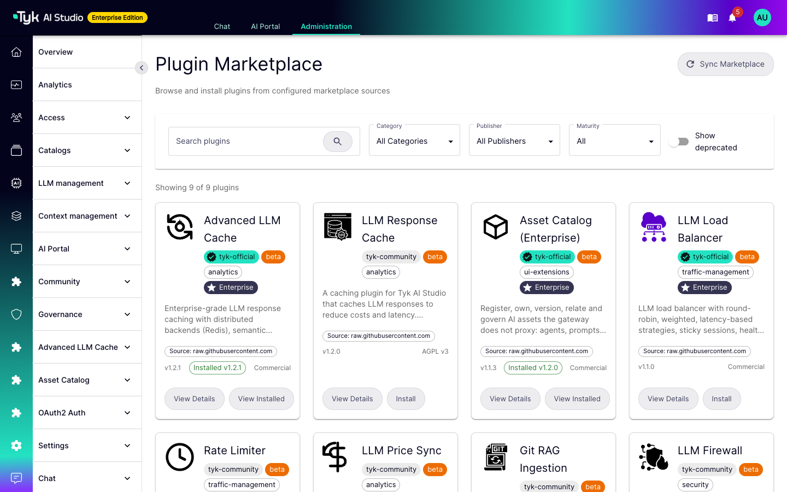
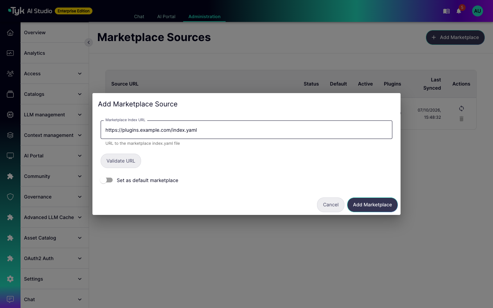
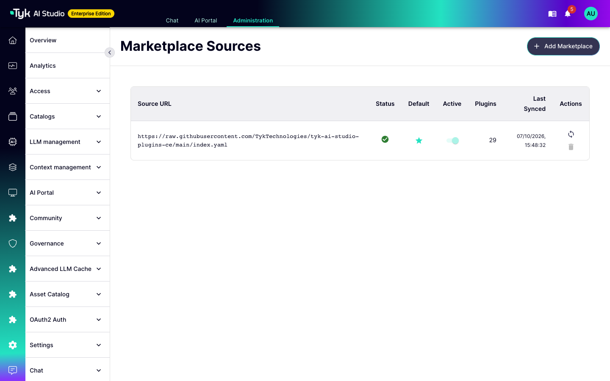
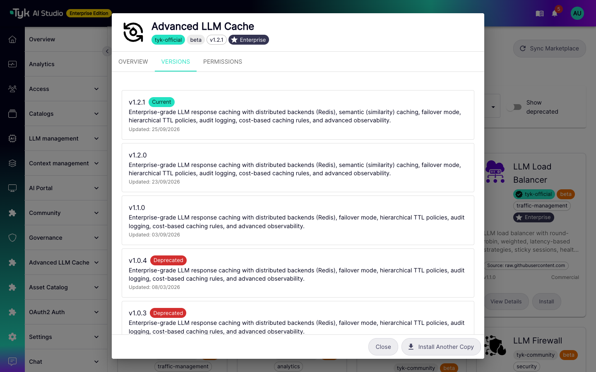
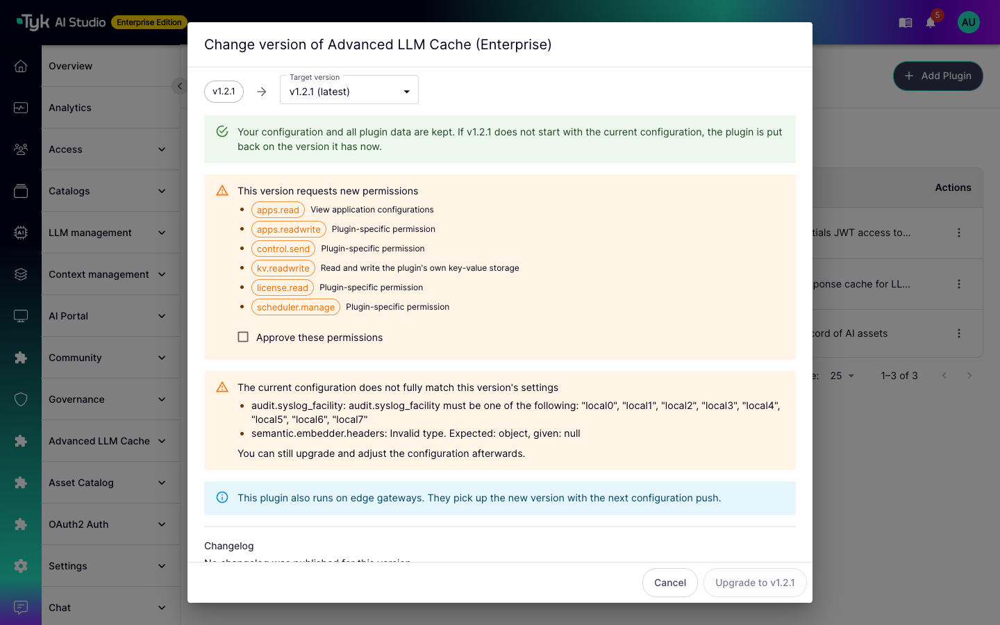
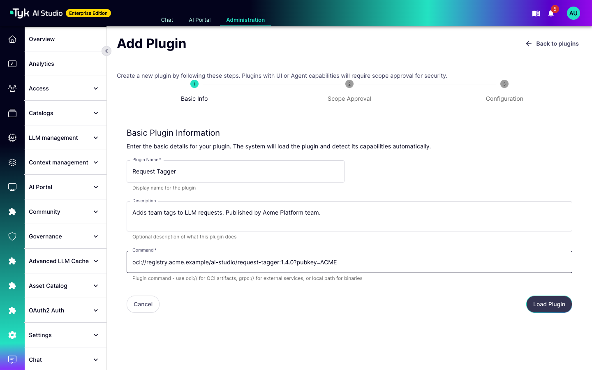

## Availability

| Edition   | Deployment Type |
| :------------- | :---------------------- |
| [Community](/ai-management/ai-studio/overview#community-edition) & [Enterprise](/ai-management/ai-studio/overview#enterprise-edition) | Self-Managed |

## Overview

To publish a plugin, you put it where AI Studio can download it, and you tell administrators where it is. Publishing has three parts:

1. **Package**: You push the plugin binary to an OCI registry as an OCI artifact.
2. **Sign**: You sign the artifact with cosign. From Tyk AI Studio 2.3.0, Enterprise Edition installations require a signature by default.
3. **List**: You add an entry for the version to a marketplace index. This part is optional.

An administrator can install a published plugin in two ways:

- From the **Marketplace** page, when the plugin is in a marketplace index that AI Studio syncs.
- From the **Add Plugin** form, with the `oci://` reference of the artifact.

Both ways download the same artifact. For the other ways to run a plugin, such as a local file or a remote gRPC server, refer to [Deployment Options](/ai-management/ai-studio/plugins/deployment).

## Package the Plugin as an OCI Artifact

AI Studio reads the first layer of the artifact as the plugin binary. It does not unpack the layer. For this reason, push the binary itself with [ORAS](https://oras.land). Do not package it as a Docker image.

1. If the plugin has a UI, build the UI bundle before you compile the binary.
2. Compile a static binary for each platform that runs the plugin. AI Studio and Edge Gateways can run on different platforms.
3. Push each binary to its own tag, with the Tyk plugin artifact type.
4. Combine the platform tags into a multi-platform index under the version tag.

```bash expandable
VERSION=1.4.0
REPO=registry.example.com/ai-studio/request-tagger

GOOS=linux  GOARCH=amd64 CGO_ENABLED=0 go build -o request-tagger-linux-amd64 .
GOOS=darwin GOARCH=arm64 CGO_ENABLED=0 go build -o request-tagger-darwin-arm64 .

oras push $REPO:$VERSION-linux_amd64 \
  --artifact-type application/vnd.tyk.plugin.binary.v1 \
  --artifact-platform linux/amd64 \
  ./request-tagger-linux-amd64:application/vnd.tyk.plugin.layer.v1

oras push $REPO:$VERSION-darwin_arm64 \
  --artifact-type application/vnd.tyk.plugin.binary.v1 \
  --artifact-platform darwin/arm64 \
  ./request-tagger-darwin-arm64:application/vnd.tyk.plugin.layer.v1

oras manifest index create $REPO:$VERSION $VERSION-linux_amd64 $VERSION-darwin_arm64
```

When the reference points to a multi-platform index, AI Studio selects the manifest for the platform of the host. To select a different platform, add `?arch=<os>/<arch>` to the `oci://` reference.

Put the version in each platform tag, as in the example. Then an incomplete release cannot make the version tag point to the binary of an earlier version.

For the maximum layer size and registry access, refer to [Plugin Size Limit](/ai-management/ai-studio/plugins/deployment#plugin-size-limit) and [Registry Authentication](/ai-management/ai-studio/plugins/deployment#registry-authentication).

## Sign the Plugin

Sign plugins with the [cosign](https://docs.sigstore.dev/cosign/) CLI. AI Studio and the Edge Gateway verify signatures in their own process, so the hosts do not need cosign. Sign the index by its digest, and then verify the signature:

```bash
DIGEST=$(oras manifest fetch --descriptor $REPO:$VERSION | jq -r .digest)
cosign sign --key plugin-signing.key $REPO@$DIGEST
cosign verify --key plugin-signing.pub $REPO@$DIGEST
```

Signature verification runs only in the Enterprise Edition. For the settings and their defaults, refer to [Signature Settings](/ai-management/ai-studio/plugins/security#signature-settings).

### Signature Formats

AI Studio 2.3.0 and later accept two formats:

- A cosign v2 signature, stored as the `sha256-<digest>.sig` tag.
- A cosign v3 Sigstore bundle, attached to the plugin as an OCI referrer. This is the default format of cosign v3.

Releases before 2.3.0 read only the `.sig` tag. If administrators run an earlier release and you sign with cosign v3, add `--new-bundle-format=false --use-signing-config=false` to `cosign sign`.

### Transparency Log

By default, the host also requires a valid entry in the Rekor transparency log for the signature. `cosign sign` uploads the entry by default. If you sign without an entry (`--tlog-upload=false`), for example in an air-gapped environment, tell administrators to set `AI_STUDIO_OCI_TLOG_POLICY` and `OCI_PLUGINS_TLOG_POLICY` to `disabled`. Refer to [Transparency Log Policy](/ai-management/ai-studio/plugins/security#transparency-log-policy).

### Public Keys

To verify your own plugins, give administrators your public key. They add it on AI Studio and on each Edge Gateway. From Tyk AI Studio 2.3.0, the host tries each configured key. A plugin that you sign with your own key then installs from the **Marketplace** page with no change to the command. For the key variables and key selection with `?pubkey=<NAME>`, refer to [Public Keys](/ai-management/ai-studio/plugins/security#public-keys).

### FIPS Variants

Each plugin does its own cryptography. A FIPS 140-3 deployment of AI Studio therefore needs FIPS builds of its plugins. Refer to [FIPS Plugin Variants](/ai-management/ai-studio/plugins/security#fips-plugin-variants).

For the FIPS builds of Tyk products, refer to [FIPS 140-3 Compliance](/developer-support/release-types/fips-release).

To publish a FIPS variant of a version:

1. Build each platform with `GOFIPS140=v1.0.0`, for example `GOFIPS140=v1.0.0 CGO_ENABLED=0 go build -trimpath -tags fips -o request-tagger-linux-amd64 .`.
2. Push the binaries and the index under the tag `<version>-fips`, for example `1.4.0-fips`.
3. Sign the FIPS index by its digest.

Administrators install the FIPS variant with its tag or digest, for example `oci://registry.example.com/ai-studio/request-tagger:1.4.0-fips`.

## List the Plugin in a Marketplace

A marketplace is an `index.yaml` file at an HTTP or HTTPS URL. AI Studio downloads the index at each sync and shows its plugins on the **Marketplace** page.

Serve the index over HTTPS. AI Studio installs the artifact that the index names, so a changed index can make administrators install a different artifact.



### The Index File

The index has an `apiVersion` and a `plugins` map. Each key is a plugin ID. Its value is a list with one entry for each published version:

```yaml expandable
apiVersion: v1
generated: '2026-10-07T09:00:00Z'
plugins:
  com.acme.request-tagger:
  - id: com.acme.request-tagger
    name: Request Tagger
    version: 1.4.0
    description: Adds team tags to LLM requests.
    oci_registry: registry.example.com
    oci_repository: ai-studio/request-tagger
    oci_tag: 1.4.0
    oci_digest: sha256:4f1c...
    oci_platform: [linux/amd64, darwin/arm64]
    category: tools
    maturity: stable
    publisher: community
    primary_hook: pre_auth
    hooks: [pre_auth]
    min_studio_version: 2.2.0
    manifest_url: https://plugins.example.com/plugins/request-tagger/1.4.0/manifest.yaml
```

AI Studio refuses an index when:

- `apiVersion` or `plugins` is missing.
- A plugin has no versions.
- The `id` of an entry is different from its key in `plugins`.
- An entry has no `version`, `oci_registry`, or `oci_repository`.

These fields control what administrators see and what AI Studio offers:

| Field | Effect |
| :--- | :--- |
| `oci_digest`, `oci_tag` | AI Studio installs `oci_registry/oci_repository@oci_digest`. If there is no digest, it uses the tag. Always set `oci_digest`, so that a moved tag cannot change the artifact that AI Studio installs. |
| `category`, `maturity`, `publisher` | The filters on the **Marketplace** page |
| `hooks`, `primary_hook` | The hook types of the plugin that AI Studio installs |
| `min_studio_version` | Shown as **Minimum AI Studio Version**. AI Studio does not enforce it. Refer to [Version Compatibility](#version-compatibility). |
| `enterprise_only` | The Community Edition does not offer the version as an upgrade. |
| `deprecated`, `deprecated_message`, `replacement` | The **Marketplace** page hides the version until a user turns on **Show deprecated**. AI Studio does not offer it as an upgrade. |
| `required_services` | The service scopes that the administrator approves at installation |
| `manifest_url` | The location of the full manifest of the version. AI Studio also reads the changelog from this location. |

### Changelogs

The upgrade dialog shows the changelog of the target version. AI Studio reads `CHANGELOG.md` from the directory of `manifest_url`. The changelog must be on the same scheme and host as the index. AI Studio shows the first 256 KB.

### Add a Marketplace Source

The default marketplace is the Tyk marketplace at `https://raw.githubusercontent.com/TykTechnologies/tyk-ai-studio-plugins-ce/main/index.yaml`.

- **Community Edition**: AI Studio syncs one marketplace. To use a different index, set `MARKETPLACE_INDEX_URL`.
- **Enterprise Edition**: Administrators can add more marketplaces. Go to **Plugins > Marketplace Sources** and click **Add Marketplace**. Enter the index URL, and click **Validate URL** to check that AI Studio can read the index. To make it the default marketplace, turn on **Set as default marketplace**.



The **Marketplace Sources** page shows the status, the number of plugins, and the last sync of each source. You cannot remove or deactivate the default marketplace. When you remove a source, its plugins go off the **Marketplace** page.



AI Studio syncs every hour. To change the interval, set `MARKETPLACE_SYNC_INTERVAL`, for example `30m`. To sync immediately, click **Sync Marketplace** on the **Marketplace** page, or the sync icon of a source. A manual sync bypasses HTTP caches.

## Release a New Version

1. Increase `version` in the plugin manifest.
2. Push the new binaries, and create the index under a new version tag. Do not push a different binary to a tag that you already published.
3. Sign the new index.
4. Add an entry for the new version to `index.yaml`, and put its `CHANGELOG.md` next to its `manifest.yaml`. Keep the entries of the earlier versions.

After the next sync, the **Versions** tab of the plugin shows the new version.



A version that is in the registry but not in the index does not appear on the **Marketplace** page. Administrators can install it only with its `oci://` reference. A version that you remove from the index goes off the **Marketplace** page at the next sync.

### How Installed Plugins Get the Update

AI Studio links an installed plugin to a marketplace entry by its OCI registry and repository. This applies to plugins installed from the **Marketplace** page and to plugins installed with an `oci://` reference to the same repository. AI Studio identifies the installed version from the digest, then from the tag.

When a newer version is available, the **Plugins** page shows an **Update** chip. The administrator selects the target version and approves new permissions in the upgrade dialog. The dialog also shows your changelog.



An upgrade keeps the configuration and data of the plugin. For the full upgrade process, refer to [Upgrade Installed Plugins](/ai-management/ai-studio/plugins/overview#upgrade-installed-plugins).

## Version Compatibility

Declare the minimum AI Studio version in `compat.min_studio_version` of the plugin manifest, and copy it to `min_studio_version` in the index entry. Refer to [Minimum Versions](/ai-management/ai-studio/plugins/manifests#minimum-versions).

AI Studio shows the value on the **Marketplace** page, but it does not block an installation on an older version. The index has no field for `min_gateway_version`, so administrators see only the AI Studio minimum. State both minimums in your README.

## Install Without a Marketplace

Administrators can also install any published artifact from **Plugins > Add Plugin**. In **Command**, they enter the `oci://` reference. To accept only one signing key, they add `?pubkey=<NAME>`.


