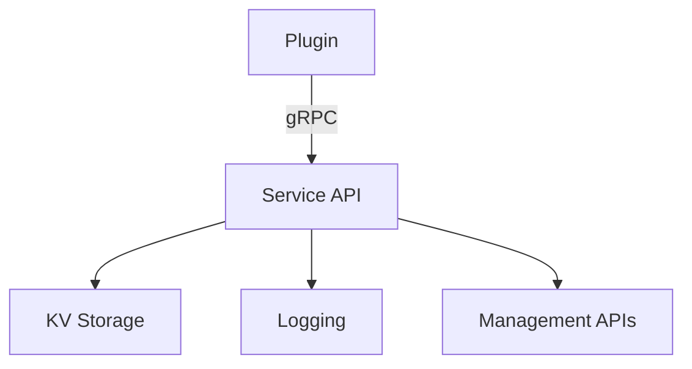

## Availability

| Edition   | Deployment Type |
| :------------- | :---------------------- |
| [Community](/ai-management/ai-studio/overview#community-edition) & [Enterprise](/ai-management/ai-studio/overview#enterprise-edition) | Self-Managed |

The Service API is available to plugins in AI Studio and on Edge Gateways.



The Service API lets plugins read and change platform data, such as LLMs, Apps and plugin KV storage. Plugins call it through the `Context.Services` interface of the unified plugin SDK (`pkg/plugin_sdk`).

## Services by Runtime

The services that a plugin can use depend on its runtime:

- **Universal services**, in AI Studio and on Edge Gateways: [KV storage](#kv-storage), the [logger](#logger), and the [Event Service](/ai-management/ai-studio/plugins/service-api-events).
- **Studio Services**, in AI Studio: LLMs, tools, plugins, Apps, notifications, resource types, permissions, governed metadata, governance reads and schedules. Refer to [Studio Services](/ai-management/ai-studio/plugins/service-api-studio).
- **RAG and datasource services**, in AI Studio: embeddings, document storage, vector search and datasource management. Refer to [RAG and Datasource Services](/ai-management/ai-studio/plugins/service-api-rag).
- **Gateway Services**, on Edge Gateways: Apps, LLMs, budget status, model prices, credential validation and App storage. Refer to [Gateway Services](/ai-management/ai-studio/plugins/service-api-gateway).

## Access Pattern

All services are accessed through the `Context.Services` interface provided to your plugin handlers:

```go Expandable expandable
func (p *MyPlugin) HandlePostAuth(ctx plugin_sdk.Context, req *pb.EnrichedRequest) (*pb.PluginResponse, error) {
    // Universal services
    ctx.Services.Logger().Info("Processing request", "app_id", ctx.AppID)
    data, err := ctx.Services.KV().Read(ctx, "my-key")

    // Runtime-specific services
    if ctx.Runtime == plugin_sdk.RuntimeStudio {
        llms, err := ctx.Services.Studio().ListLLMs(ctx, 1, 10)
    } else if ctx.Runtime == plugin_sdk.RuntimeGateway {
        app, err := ctx.Services.Gateway().GetApp(ctx, ctx.AppID)
    }

    return &pb.PluginResponse{Modified: false}, nil
}
```

## Initialization and Connection Warmup

For Service API access in AI Studio, plugins use a **session-based broker pattern**. The SDK does most of the setup. For reliable Service API access, warm up the connection as this section shows.

### The Connection Warmup Pattern

**Critical**: The go-plugin broker only accepts **ONE connection per broker ID**. A plugin can use both the Event Service and the Management Service API. Then the service that dials first succeeds, and the two services share the connection.

To ensure reliable Service API access, implement `SessionAware` and **warm up the connection in `OnSessionReady`**:

```go Expandable expandable
import (
    "context"
    "log"

    "github.com/TykTechnologies/midsommar/v2/pkg/ai_studio_sdk"
    "github.com/TykTechnologies/midsommar/v2/pkg/plugin_sdk"
)

type MyPlugin struct {
    plugin_sdk.BasePlugin
    services plugin_sdk.ServiceBroker
}

func (p *MyPlugin) Initialize(ctx plugin_sdk.Context, config map[string]string) error {
    p.services = ctx.Services
    return nil
}

// OnSessionReady implements plugin_sdk.SessionAware
// CRITICAL: Warm up the Service API connection here!
func (p *MyPlugin) OnSessionReady(ctx plugin_sdk.Context) {
    log.Printf("Session ready - warming up service API connection...")

    // Eagerly establish the broker connection by making a lightweight API call.
    // This ensures the connection is ready before any RPC calls come in.
    if ai_studio_sdk.IsInitialized() {
        _, err := ai_studio_sdk.GetLicenseInfo(context.Background()) // needs no service scope
        if err != nil {
            log.Printf("Service API warmup failed: %v", err)
        } else {
            log.Printf("Service API connection established successfully")
        }
    }
}

func (p *MyPlugin) OnSessionClosing(ctx plugin_sdk.Context) {
    log.Printf("Session closing")
}
```

### Why Warmup Is Required

Without the warmup pattern, a plugin that uses the Service API during an RPC call can get **"timeout waiting for connection info"** errors. The causes are:

1. The broker connection is time-sensitive. Open it early.
2. A late dial, during an RPC call from the UI, can fail.
3. Event subscriptions and Service API calls share the same connection. One warmup opens the connection for both.

### Legacy Pattern (Still Supported)

The older pattern of extracting the broker ID manually during `Initialize` still works but is not recommended:

```go Expandable expandable
func (p *MyPlugin) Initialize(ctx plugin_sdk.Context, config map[string]string) error {
    // Extract broker ID for Service API access (automatic with SessionAware)
    brokerIDStr := ""
    if id, ok := config["_service_broker_id"]; ok {
        brokerIDStr = id
    } else if id, ok := config["service_broker_id"]; ok {
        brokerIDStr = id
    }

    if brokerIDStr != "" {
        var brokerID uint32
        fmt.Sscanf(brokerIDStr, "%d", &brokerID)
        ai_studio_sdk.SetServiceBrokerID(brokerID)
    }

    return nil
}
```

**Note**: The SDK now handles broker ID extraction automatically via `OpenSession`. You only need to implement `SessionAware` and warm up the connection.

## Universal Services

These services are available in both Studio and Gateway runtimes.

### KV Storage

Key-value storage for plugin data:
- **Studio**: PostgreSQL-backed, shared across hosts, durable
- **Gateway**: Local database, per-instance, ephemeral

The KV namespace belongs to the plugin record. When you delete the plugin in AI Studio, AI Studio also deletes its KV data. If you install the plugin again, it starts with an empty store. In AI Studio, KV calls need the `kv.readwrite` scope.

#### Write Data

```go
created, err := ctx.Services.KV().Write(ctx, "my-key", []byte("value"), nil)
```

Returns `true` if the call created the key, and `false` if it updated the key. Pass an expiry time (`*time.Time`) as the last argument, or `nil` for no expiry.

Example:
```go
settings := map[string]interface{}{
    "enabled": true,
    "rate_limit": 100,
}

data, _ := json.Marshal(settings)
_, err := ctx.Services.KV().Write(ctx, "settings", data, nil)
if err != nil {
    ctx.Services.Logger().Error("Failed to write settings", "error", err)
}
```

#### Write Data with TTL

```go
created, err := ctx.Services.KV().WriteWithTTL(ctx, "cache:response:123", data, 1*time.Hour)
```

Writes data with a relative time-to-live. The platform removes expired keys. A read of an expired key returns a not-found error.

#### Read Data

```go
data, err := ctx.Services.KV().Read(ctx, "my-key")
```

Returns an error if the key does not exist or has expired.

Example:
```go
data, err := ctx.Services.KV().Read(ctx, "settings")
if err != nil {
    ctx.Services.Logger().Warn("Settings not found", "error", err)
    // Use defaults
}

var settings map[string]interface{}
json.Unmarshal(data, &settings)
```

#### Delete Data

```go
deleted, err := ctx.Services.KV().Delete(ctx, "my-key")
```

Returns `true` if the key existed.

#### List Keys

`ctx.Services.KV().List(ctx, prefix)` is not implemented. In both runtimes, it returns the error `list operation not yet supported`.

#### Direct SDK Calls

Studio plugins can also call the KV functions of the `ai_studio_sdk` package: `WritePluginKV`, `WritePluginKVWithTTL`, `ReadPluginKV` and `DeletePluginKV`. They take the same arguments as the `KV()` methods.

### Logger

Structured logging with key-value pairs:

```go
ctx.Services.Logger().Info("Message", "key", "value")
ctx.Services.Logger().Warn("Warning", "error", err)
ctx.Services.Logger().Error("Error", "details", details)
ctx.Services.Logger().Debug("Debug info", "data", data)
```

Example:
```go Expandable expandable
func (p *MyPlugin) HandlePostAuth(ctx plugin_sdk.Context, req *pb.EnrichedRequest) (*pb.PluginResponse, error) {
    ctx.Services.Logger().Info("Request received",
        "app_id", ctx.AppID,
        "user_id", ctx.UserID,
        "path", req.Path,
        "method", req.Method,
    )

    // Process request...

    ctx.Services.Logger().Info("Request processed",
        "app_id", ctx.AppID,
        "duration_ms", time.Since(startTime).Milliseconds(),
    )

    return &pb.PluginResponse{Modified: false}, nil
}
```

## Scopes

Each Service API call in AI Studio needs a scope. Declare the scopes under `permissions.services` in the plugin manifest. Refer to [Plugin Scopes](/ai-management/ai-studio/plugins/manifests#plugin-scopes).

| Operation | Required Scope |
|-----------|----------------|
| ListLLMs, GetLLM | `llms.read` |
| CallLLM | `llms.proxy` |
| CreateLLM, UpdateLLM | `llms.write` |
| ListTools, GetTool | `tools.read` |
| ExecuteTool | `tools.call` |
| CreateTool, UpdateTool | `tools.write` |
| ListApps, ListAppsWithFilters, GetApp | `apps.read` |
| CreateApp, UpdateApp, PatchAppMetadata | `apps.write` |
| ListPlugins, GetPlugin (other plugins) | `plugins.read` |
| GetPlugin, UpdatePluginConfig (own plugin) | None |
| GetLicenseInfo | None |
| WritePluginKV, ReadPluginKV, DeletePluginKV | `kv.readwrite` |
| ListDatasources, GetDatasource | `datasources.read` |
| CreateDatasource, UpdateDatasource, DeleteDatasource | `datasources.write` |
| GenerateEmbedding, StoreDocuments, ProcessAndStoreDocuments | `datasources.embeddings` |
| QueryDatasource, QueryDatasourceByVector | `datasources.query` |
| CreateSchedule, GetSchedule, ListSchedules, UpdateSchedule, DeleteSchedule | `scheduler.manage` |
| StoreApp (Gateway) | `apps.write` |
| ListModelPrices, GetModelPricesByVendor | `pricing.read` |
| CreateNotification | `notifications.write` |
| RegisterResourceTypes, SyncResourceTypes | `resource-types.manage` |
| RegisterPermissionResources | `rbac.register` |
| GetObjectMetadata, GetResolvedMetadataSchema, ValidateObjectMetadata, ListObjectMetadataAudit | `metadata.read` |
| SetObjectMetadata, DeleteObjectMetadata | `metadata.write` |
| ListAuditRecords | `audit.read` |
| ListMCPServers, GetMCPServer | `mcp-servers.read` |
| ListModelRouters, GetModelRouter, ListSemanticRouters, GetSemanticRouter | `routers.read` |
| ListGroups, GetResourceInstanceGroups, SetResourceInstanceGroups, ListAccessibleResourceInstances | `resource-access.manage` |
| SetAppGovernanceState | `apps.lifecycle` |

## Error Handling

Service API calls return standard Go errors:

```go
llmsResp, err := ai_studio_sdk.ListLLMs(ctx, 1, 10)
if err != nil {
    log.Printf("Failed to list LLMs: %v", err)
    return err
}
```

Common error types:
- Permission denied: Missing required scope
- Not found: Resource doesn't exist
- Invalid argument: Bad request parameters
- Unavailable: Service not ready

Retry failed calls with exponential backoff:

```go Expandable expandable
func callWithRetry(ctx context.Context, fn func() error) error {
    maxRetries := 3
    backoff := time.Second

    for i := 0; i < maxRetries; i++ {
        err := fn()
        if err == nil {
            return nil
        }

        if i < maxRetries-1 {
            time.Sleep(backoff)
            backoff *= 2
        }
    }

    return fmt.Errorf("max retries exceeded")
}
```

## Context and Timeouts

Always use contexts with timeouts:

```go
ctx, cancel := context.WithTimeout(context.Background(), 10*time.Second)
defer cancel()

llmsResp, err := ai_studio_sdk.ListLLMs(ctx, 1, 10)
```

## Valid UTF-8 in Protobuf Strings

Protobuf string fields must contain valid UTF-8. The SDK cleans strings at its own gRPC boundary, for example in `Call()` and `PortalCall()`. If your plugin puts external data (file content, third-party responses) into a protobuf string field, clean the data first. Otherwise the call fails with `string field contains invalid UTF-8`.

```go
content, _ := os.ReadFile(path)
resp := &pb.ProcessFileResponse{
    Content: plugin_sdk.SanitizeUTF8(content),   // []byte to valid string
}
clean := plugin_sdk.SanitizeUTF8String(rawString) // string to valid string
```

Both functions replace invalid sequences with the Unicode replacement character (U+FFFD).

## Best Practices

1. **Check SDK Initialization**:
   ```go
   if !ai_studio_sdk.IsInitialized() {
       return fmt.Errorf("SDK not initialized")
   }
   ```

2. **Check the Runtime**: Check `ctx.Runtime` before you call a runtime-specific service.

3. **Type Assert the Results**: Gateway Services and some Studio Services return `interface{}`. Type assert the result to the correct response type.

4. **Handle Pagination**:
   ```go Expandable expandable
   page := int32(1)
   limit := int32(100)

   for {
       resp, err := ai_studio_sdk.ListTools(ctx, page, limit)
       if err != nil {
           return err
       }

       // Process tools...

       if len(resp.Tools) < int(limit) {
           break  // Last page
       }

       page++
   }
   ```

5. **Cache Results**: Cache data that you read often, in memory or in KV storage, to reduce API calls.
   ```go
   // Cache LLM list for 5 minutes
   var cachedLLMs []*mgmtpb.LLMInfo
   var cacheTime time.Time

   if time.Since(cacheTime) > 5*time.Minute {
       resp, _ := ai_studio_sdk.ListLLMs(ctx, 1, 100)
       cachedLLMs = resp.Llms
       cacheTime = time.Now()
   }
   ```

6. **Log Errors**: Use `ctx.Services.Logger()` for consistent structured logs, and check the error of every Service API call.

## Complete Examples

For complete working examples of Service API usage:
- **Studio**: `examples/plugins/studio/service-api-test/` - Comprehensive Studio Services testing
- **Gateway**: `examples/plugins/gateway/gateway-service-test/` - Gateway Services examples
- **Rate Limiter**: `examples/plugins/studio/llm-rate-limiter-multiphase/` - Multi-capability plugin with KV storage
- **Scheduler**: `examples/plugins/studio/scheduler-demo/` - Scheduled tasks with manifest and API patterns

