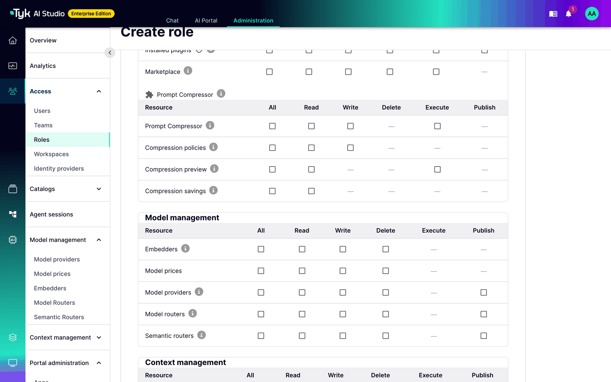

## Availability

| Edition | Deployment Type |
| :------------- | :---------------------- |
| [Community](/ai-management/ai-studio/overview#community-edition) and [Enterprise](/ai-management/ai-studio/overview#enterprise-edition) | Self-Managed |

The Prompt Compressor is available from Tyk AI Studio 2.3.0.

For how the plugin compresses requests, refer to [Prompt Compressor](/ai-management/ai-studio/prompt-compressor).

## Top-Level Settings

| Field | Default | Description |
| :--- | :--- | :--- |
| `mode` | `audit` | `off`, `audit`, or `enforce`. Refer to [Modes](/ai-management/ai-studio/prompt-compressor#modes). |
| `default_policy` | `default` | The policy for requests that no binding matches. If you do not define a policy with the name `default`, `default` uses the default policy settings. `off` turns off compression. |
| `policies` | `{}` | The named policies, 64 at most. A name has lowercase letters, digits, hyphens, and underscores. The name `off` is reserved. |
| `bindings` | `{}` | The policy for each LLM or App. Keys are `llm:<slug>`, `llm_id:<id>`, or `app:<id>`. Values are a policy name or `off`. |
| `allow_client_bypass` | `false` | When `true`, a client can send the header `X-Tyk-Compression: off` to skip compression for its own requests. The header cannot select a policy or increase a level. |
| `failure_mode` | `open` | The result when an external engine fails. `open` forwards the unit without compression. `closed` returns a `502` response, in `enforce` mode only. |
| `lossy_with_request_filters` | `false` | When `true`, the plugin applies level 3 and external engines on LLMs that have request filters. |
| `max_body_bytes` | `4194304` (4 MiB) | Larger bodies go to the vendor without compression. The maximum is 16 MiB. |
| `max_in_flight_bytes` | `16777216` (16 MiB) | The total body size that the plugin compresses at the same time, for all requests. A request over this limit goes to the vendor without compression, which can cause a prompt cache miss. The value is between `max_body_bytes` and 256 MiB, and you cannot change it on the **Policies** page. |
| `cache_drop_alert` | `0.25` | The dashboard shows a warning when the cache-read share decreases by more than this fraction in the hour after a policy change. `0` turns off the warning. |
| `engine_<name>_url`, `engine_<name>_token` | None | The URL and the token of an external engine. You can use a `$SECRET/` reference. Refer to [External Engines](#external-engines). |

## Policy Settings

| Field | Default | Description |
| :--- | :--- | :--- |
| `level` | `1` | `0` to `3`. Refer to [Compression Levels](/ai-management/ai-studio/prompt-compressor#compression-levels). |
| `roles` | `["tool"]` | The messages to compress: `tool`, `user`, `assistant`, or `system`. |
| `min_unit_tokens` | `300` | The plugin does not change smaller units. |
| `protect_recent_turns` | `1` | The number of newest turns that stay at level 1 at most. |
| `cache_mode` | `deterministic` | `deterministic` compresses all the selected units in the same way on each turn. `skip_cached` does not change the content up to the last cache breakpoint of the request. |
| `dedupe_references` | `false` | When `true`, a tool output that is identical to an earlier tool output in the same request becomes a reference to it. |
| `tool_overrides` | None | Settings for each tool, by tool name: `exclude`, `level`, or `max_unit_tokens`. |
| `protect_patterns` | None | RE2 regular expressions. Levels 2 and 3 keep the lines that match. |
| `compress_server_tool_results` | `false` | When `true`, the plugin also compresses some results of the vendor's own tools: Anthropic web search, web fetch, and code execution results, and OpenAI Responses file search and code interpreter results. |
| `drop_tools` | None | Tool definitions to remove from requests, by name or by a prefix that ends with `*`. Applies at all levels. Refer to [Remove Unused Tool Definitions](/ai-management/ai-studio/prompt-compressor#remove-unused-tool-definitions). |
| `max_unit_tokens` | `6000` | Level 3 cuts each tool output that is larger than this size. |
| `mask_after_turns` | `0` | Level 3 replaces tool results that are older than this number of turns with a placeholder. `0` turns off masking. |
| `mask_step_tokens` | `20000` | Level 3 moves the masking boundary only when the move masks at least this number of additional tokens. |
| `engine` | None | An external engine for level 3, with `name`, `kind` (`headroom` or `llmlingua2`), and `timeout_ms` (default `2000`). |

Token counts are estimates. The plugin divides the number of UTF-8 bytes by 4, so the count depends only on the text.

If the configuration is not valid, the plugin logs an error and turns off compression. The plugin continues to load.

## External Engines

A level 3 policy can send the selected text to an external compression service. The plugin supports two engines:

- Headroom, at `POST <url>/v1/compress`
- LLMLingua-2, at `POST <url>/compressPrompt`

To use an engine, set the URL and the token as top-level settings, and name the engine in the policy:

```json
{
  "engine_lingua_url": "https://lingua.internal.example.com",
  "engine_lingua_token": "$SECRET/LINGUA_TOKEN",
  "policies": {
    "deep": { "level": 3, "engine": { "name": "lingua", "kind": "llmlingua2", "timeout_ms": 2000 } }
  }
}
```

The plugin does not send system prompts, tool definitions, protected turns, or masked results to the engine.

The plugin keeps each engine answer, by the text, the policy, and the engine. Thus, a unit compresses to the same text on each later turn. This is also true when the engine is not available or is not deterministic.

The plugin stores the answers in the key-value store of the Edge Gateway for 7 days. It stores the compressed text only when the Edge Gateway keeps request bodies for the LLM.

The plugin applies these security rules to engines:

- The URL must use `http` or `https`, and it must not contain credentials. Put the token in `engine_<name>_token`.
- The plugin sends the token as a bearer token, only over `https` or to a loopback address.
- The plugin does not connect to link-local addresses, such as cloud metadata endpoints. The plugin can connect to loopback and private addresses, for sidecars.
- The plugin ignores proxy settings and does not follow redirects.

You cannot change engine URLs or tokens on the **Policies** page. Edit them in the configuration form of the plugin, which needs permission to edit plugins. For more information about `$SECRET/` references, refer to [Secrets Management](/ai-management/ai-studio/secrets).

{/* TODO: Add screenshot: Prompt Compressor configuration form with the engine URL and token fields. Blocked (2026-11-27): the form does not show the engine_<name>_url and engine_<name>_token fields in 2.3.0-rc6, because the schema form ignores patternProperties. Issue: https://github.com/TykTechnologies/ai-studio-community-plugins/issues/41. Fix: https://github.com/TykTechnologies/ai-studio/pull/1134. Take the screenshot after the fix ships. If it does not ship in 2.3, change the text above to say that the engine settings are set with the API. */}

## Response Headers

The plugin adds these headers to responses, including streamed responses:

| Header | Description |
| :--- | :--- |
| `X-Tyk-Compression` | The outcome: `applied`, `audit`, `bypassed`, `skipped`, `rejected`, or `failed_open`. |
| `X-Tyk-Compression-Tokens-Saved` | The estimated number of tokens that the plugin removed, or that it would remove in `audit` mode. |
| `X-Tyk-Compression-Policy` | A short hash of the policy that applied. |

When `allow_client_bypass` is `true`, a client can send the request header `X-Tyk-Compression: off`. The gateway removes this header before the request goes to the vendor.

## Permissions and Scopes

### Page Permissions

Each page of the plugin has its own permission. You give these permissions through roles, the same as for other plugin permissions.

| Page | Permission |
| :--- | :--- |
| **Dashboard** | **Compression savings**: read |
| **Policies** | **Compression policies**: read to view, write to save |
| **Preview** | **Compression preview**: execute |



### Service Scopes

| Scope | Purpose |
| :--- | :--- |
| `kv.readwrite` | Stores the savings records and the engine answers. |
| `control.send` | Sends the savings records from the Edge Gateways to AI Studio. |
| `pricing.read` | Reads the model prices, including the cache-read price, to calculate the cost savings. |
| `apps.read` | Reads the policy in App metadata, and lists the Apps on the **Policies** page. Without this scope, the plugin does not compress requests from Apps. |
| `llms.read` | Lists the LLMs on the **Policies** page, and reads the LLM endpoint, which sets the request format. |
