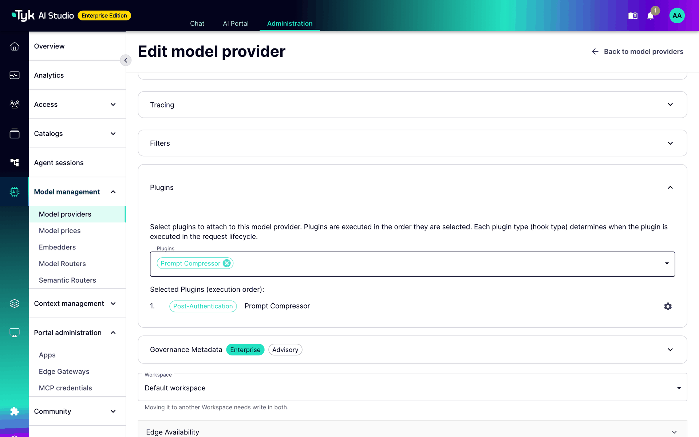
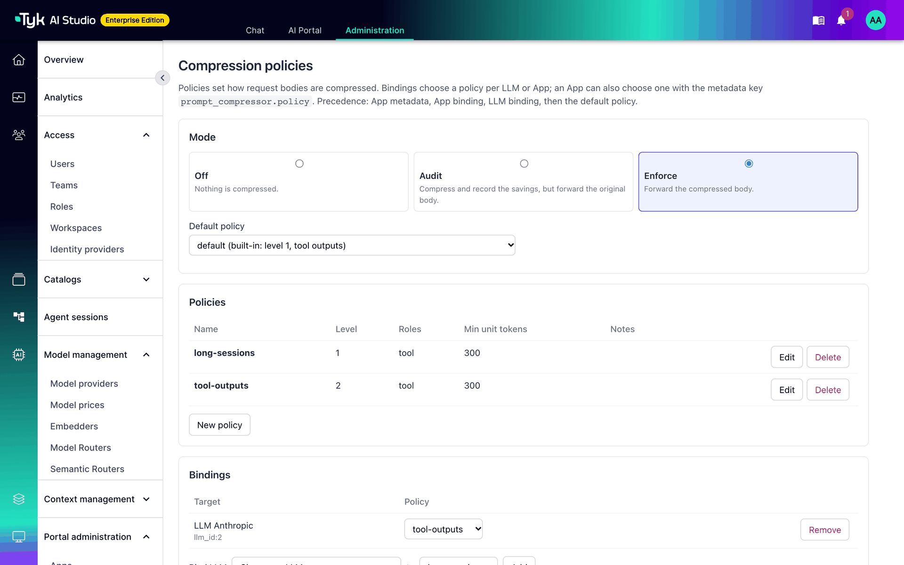
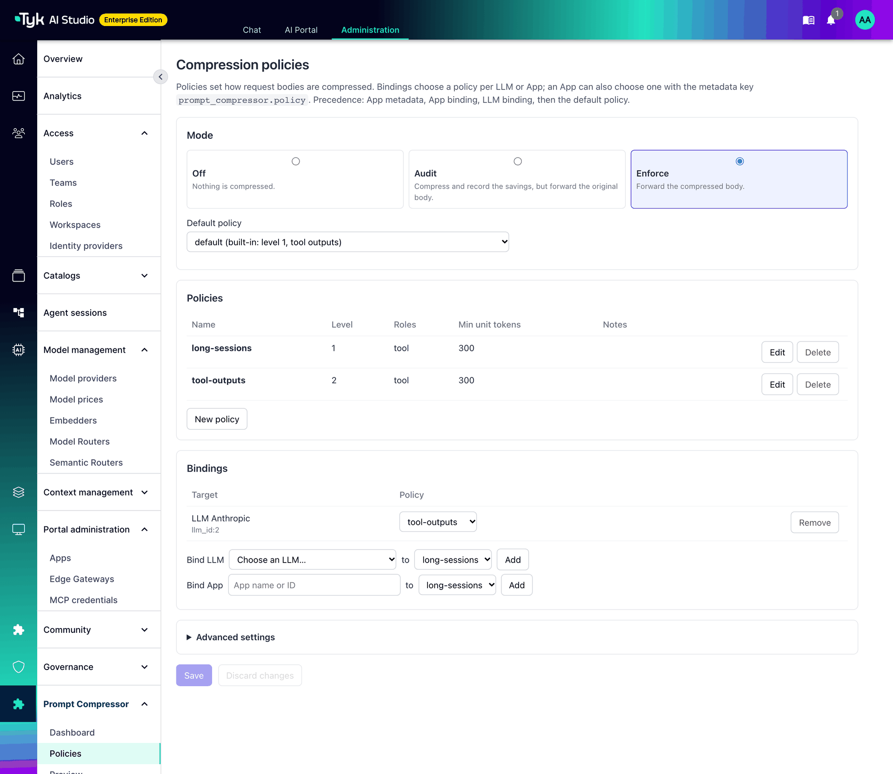
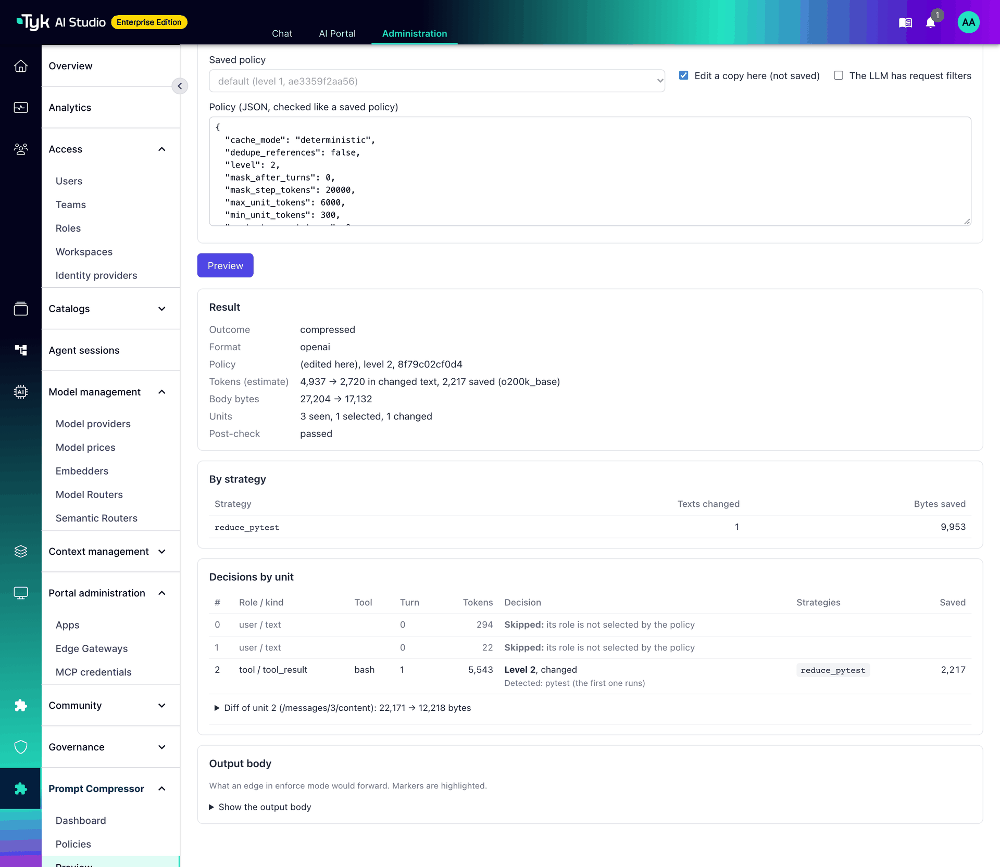
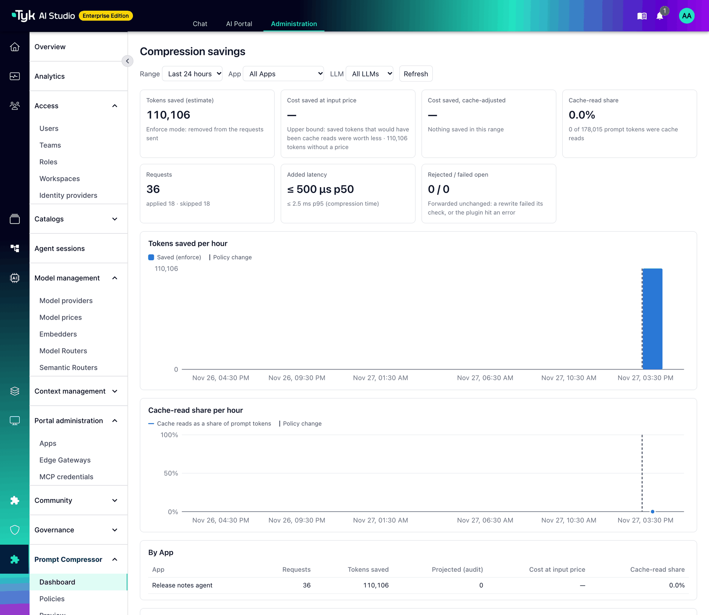
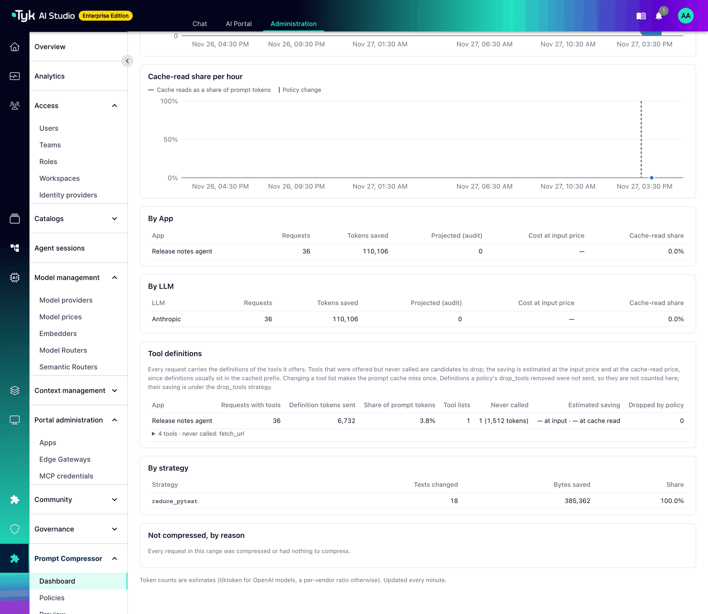
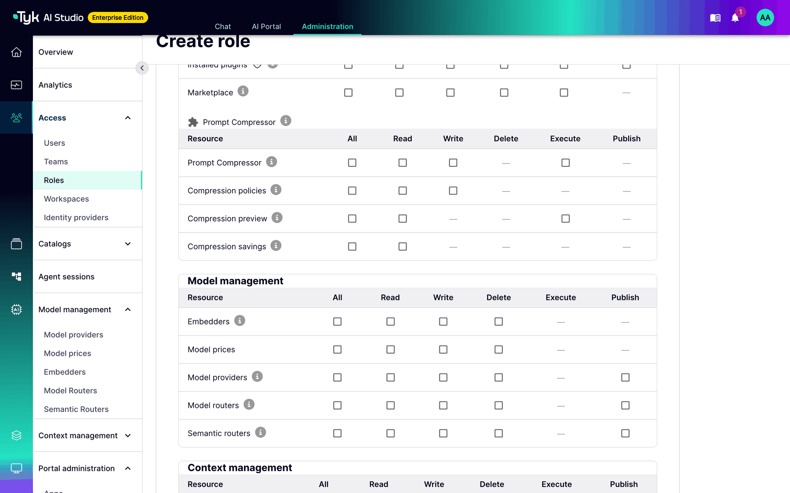

## Availability

| Edition | Deployment Type |
| :------------- | :---------------------- |
| [Community](/ai-management/ai-studio/overview#community-edition) and [Enterprise](/ai-management/ai-studio/overview#enterprise-edition) | Self-Managed |

The Prompt Compressor is available from Tyk AI Studio 2.3.0.

The Prompt Compressor is a community plugin that makes LLM request bodies smaller on the Edge Gateway. Thus, you pay the vendor for fewer input tokens. It compresses the content that agents send most often: tool outputs, such as test runs, build logs, directory listings, and large JSON results.

## Where the Plugin Runs

The plugin compresses requests only on [Edge Gateways](/ai-management/ai-studio/manage-edge-gateway).

On the Edge Gateway, the plugin runs as a post-authentication plugin on the `/llm/` endpoints. The other LLM endpoints send each request through an internal `/llm/call/` step, so the plugin compresses that traffic too. Request filters and guardrails run after the plugin. They check the compressed body.

| Traffic through an Edge Gateway | Compressed |
| :--- | :--- |
| `/llm/rest`, `/llm/stream`, and `/llm/call` | Yes |
| `/ai/`, the Main Ingress (`/v1`), and Model Router (`/router/`) requests to an LLM that does not use Bedrock | Yes, on the internal `/llm/call/` step |
| `/ai/`, the Main Ingress (`/v1`), Model Router (`/router/`), and `/anthropic/` requests to a Bedrock LLM | Yes, on the internal `/llm/call/` step, with the Bedrock Converse body |
| Chat in AI Studio | No |
| Traffic through the embedded gateway of AI Studio | No |

For more information about these endpoints, refer to [Endpoints](/ai-management/ai-studio/proxy-endpoints-reference).

### Supported Request Formats

The plugin compresses requests in these formats:

- OpenAI Chat Completions, also for vendors with an OpenAI-compatible API
- OpenAI Responses
- Anthropic Messages
- Google AI and Vertex AI (Gemini)
- Amazon Bedrock Converse
- Ollama

A body in a different format goes to the vendor unchanged.

### What the Plugin Does Not Change

By default, the plugin compresses only tool outputs. A policy can add user, assistant, or system messages with the `roles` setting. The plugin never changes these items:

- Tool call IDs, images, thinking and reasoning blocks, and signatures
- Prompt cache markers, such as `cache_control` and `cachePoint`
- The structure of the body. The plugin changes only string values, in the same location.

Results of the vendor's own tools, such as Anthropic web search or the OpenAI Responses built-in tools, stay as the vendor sent them. A policy with `compress_server_tool_results` set to `true` compresses some of these results. Refer to [Policy Settings](#policy-settings).

A compressed unit is never longer than the original, and it never moves to a different role. Tool calls stay paired with their results.

The plugin fails open. If an error or a timeout occurs, the plugin forwards the request exactly as the client sent it. It does the same if the compressed body fails one of these checks.

## Compression Levels

Each level includes all the levels below it.

0. **Off**
   - The plugin does not change the request.
1. **Lossless**
   - Makes JSON compact, but keeps the key order, duplicate keys, number format, and escapes.
   - Removes ANSI escape codes, progress lines that a terminal overwrites, trailing spaces, and repeated blank lines from text.
   - When a request uses the vendor's own context management, the plugin uses level 1 for that request.
2. **Noise reduction**
   - Shortens output that has a known format.
   - Test runner output keeps each failure with its message and location, and the totals. Supported runners are pytest, jest, go test, cargo test, Maven Surefire, and Gradle.
   - Logs and listings keep each line that mentions an error. Examples are terraform plan, kubectl, git diff, grep, directory listings, build logs, and stack traces.
   - Long JSON arrays keep the first 5 and the last 5 items. They also keep each item that shows a failure or an unusual value.
   - Other text, such as prose or code, gets level 1 only.
3. **Aggressive**
   - Cuts each tool output that is still larger than `max_unit_tokens` (default 6000) to its start and its end.
   - Optionally, replaces old tool results with a placeholder.
   - Optionally, sends the remaining text to an [external engine](#external-engines).

When the plugin removes content, it adds a marker in a fixed format that tells the model:

```text
[tyk-compressed: pytest output, 18,400 → 1,150 tokens; 3 failures kept]
[tyk-compressed: 12 lines]
```

Some settings protect content from levels 2 and 3:

- Lines that match a regular expression in `protect_patterns`, such as ticket IDs, stay in the output.
- The newest turns stay at level 1 at most. The `protect_recent_turns` setting sets the number of turns (default 1). Thus, the model reads its latest tool output in full.

For more information about these settings, refer to [Policy Settings](#policy-settings).

On an LLM that has [request filters](/ai-management/ai-studio/filters), the plugin uses level 2 at most. The request filters run after the plugin and check the compressed body. To also apply level 3 and external engines on these LLMs, set [`lossy_with_request_filters`](#top-level-settings) to `true`.

## Modes

The mode applies to all the LLMs that the plugin is attached to.

| Mode | What happens |
| :--- | :--- |
| `off` | The plugin does not compress requests. |
| `audit` (default) | The plugin compresses each request and records the result, but forwards the original body. The dashboard shows the projected savings. |
| `enforce` | The plugin forwards the compressed body. The dashboard shows the actual savings. |

## Set Up the Prompt Compressor

### Install the Plugin

These steps install version 1.0.2 of the plugin. The marketplace ID is `com.tyk.prompt-compressor`.

1. In the admin console, go to **Plugins > Marketplace**.
2. Find **Prompt Compressor** and install version 1.0.2.
3. Approve the service scopes that the plugin requests. Refer to [Service Scopes](#service-scopes).
4. Make sure that the plugin is active. The admin sidebar then shows a **Prompt Compressor** section with the **Dashboard**, **Policies**, and **Preview** pages.

{/* TODO: Add screenshot: Plugins > Marketplace with the Prompt Compressor plugin and the service scopes to approve. Blocked (2026-11-27): Prompt Compressor is not in the public marketplace index (TykTechnologies/tyk-ai-studio-plugins-ce, index.yaml) yet. Take the screenshot when it is published there. */}

### Attach the Plugin to an LLM

The plugin compresses requests only to the LLMs that it is attached to.

1. Go to **LLM management > LLM providers** and edit the LLM.
2. In the **Plugins** section, select **Prompt Compressor**.
3. Save the LLM.
4. [Push the configuration](/ai-management/ai-studio/how-to-push-edge-configuration) to your Edge Gateways.



### Measure the Savings in Audit Mode

A new installation starts in `audit` mode with level 1 on tool outputs. In this mode, the plugin does not change the requests that go to the vendor.

1. Send your usual traffic through the Edge Gateways for a few days.
2. Go to **Prompt Compressor > Dashboard** and examine the projected savings and the cache-read share. Refer to [Savings Dashboard](#savings-dashboard).
3. Go to **Prompt Compressor > Preview** and test your policies on real request bodies. Refer to [Preview a Policy](#preview-a-policy).

### Turn On Enforce Mode

1. Go to **Prompt Compressor > Policies**.
2. Set **Mode** to **Enforce**.
3. Select **Save**.
4. [Push the configuration](/ai-management/ai-studio/how-to-push-edge-configuration) to your Edge Gateways. The Edge Gateways show the change as pending until the push.



Before you use level 2 or level 3 in `enforce` mode, use the level in `audit` mode first. Compare the dashboard with your own quality signals.

## Configure Policies

The plugin has one configuration for all the LLMs that it is attached to. The configuration contains named policies and bindings:

- A policy holds the compression settings. Each policy starts from the default settings and lists only the settings that it changes.
- A binding selects a policy for an LLM or an App.

You can edit the mode, the policies, and the bindings on the **Prompt Compressor > Policies** page. The page validates the configuration before it saves it. It also tells you that a change causes one prompt cache miss for each affected session.



This example uses level 1 for most traffic. It uses level 2 for the LLM with ID 3, and it turns off compression for the App with ID 42:

```json expandable
{
  "mode": "audit",
  "default_policy": "safe",
  "policies": {
    "safe": { "level": 1 },
    "agents": {
      "level": 2,
      "min_unit_tokens": 400,
      "tool_overrides": {
        "Bash": { "max_unit_tokens": 4000 },
        "read_contract": { "exclude": true }
      },
      "protect_patterns": ["[A-Z]{2,6}-[0-9]+"]
    }
  },
  "bindings": { "llm_id:3": "agents", "app:42": "off" }
}
```

### Which Policy Applies

The plugin uses the first match in this table:

| Order | Source | Example |
| :--- | :--- | :--- |
| 1 | The App metadata key `prompt_compressor.policy` | `"prompt_compressor.policy": "off"` |
| 2 | An `app:` binding | `"app:42": "agents"` |
| 3 | An `llm_id:` binding | `"llm_id:3": "agents"` |
| 4 | An `llm:` binding, with the LLM slug | `"llm:claude-prod": "agents"` |
| 5 | `default_policy` | `"default_policy": "safe"` |

- To read App metadata, the plugin needs the `apps.read` scope. It reads the metadata of each App again after 30 seconds.
- If App metadata names a policy that does not exist, the plugin uses the bindings.
- Until the plugin knows the metadata of an App, it forwards the requests of that App unchanged. The App can turn off compression in its metadata.
- Do not use the per-LLM plugin configuration override for bindings. The gateway applies the override only when the plugin is attached to exactly one LLM.

### Top-Level Settings

| Field | Default | Description |
| :--- | :--- | :--- |
| `mode` | `audit` | `off`, `audit`, or `enforce`. Refer to [Modes](#modes). |
| `default_policy` | `default` | The policy for requests that no binding matches. If you do not define a policy with the name `default`, `default` uses the default policy settings. `off` turns off compression. |
| `policies` | `{}` | The named policies, 64 at most. A name has lowercase letters, digits, hyphens, and underscores. The name `off` is reserved. |
| `bindings` | `{}` | The policy for each LLM or App. Keys are `llm:<slug>`, `llm_id:<id>`, or `app:<id>`. Values are a policy name or `off`. |
| `allow_client_bypass` | `false` | When `true`, a client can send the header `X-Tyk-Compression: off` to skip compression for its own requests. The header cannot select a policy or increase a level. |
| `failure_mode` | `open` | The result when an external engine fails. `open` forwards the unit without compression. `closed` returns a `502` response, in `enforce` mode only. |
| `lossy_with_request_filters` | `false` | When `true`, the plugin applies level 3 and external engines on LLMs that have request filters. |
| `max_body_bytes` | `4194304` (4 MiB) | Larger bodies go to the vendor without compression. The maximum is 16 MiB. |
| `max_in_flight_bytes` | `16777216` (16 MiB) | The total body size that the plugin compresses at the same time, for all requests. A request over this limit goes to the vendor without compression, which can cause a prompt cache miss. The value is between `max_body_bytes` and 256 MiB, and you cannot change it on the **Policies** page. |
| `cache_drop_alert` | `0.25` | The dashboard shows a warning when the cache-read share decreases by more than this fraction in the hour after a policy change. `0` turns off the warning. |
| `engine_<name>_url`, `engine_<name>_token` | None | The URL and the token of an external engine. You can use a `$SECRET/` reference. Refer to [External Engines](#external-engines). |

### Policy Settings

| Field | Default | Description |
| :--- | :--- | :--- |
| `level` | `1` | `0` to `3`. Refer to [Compression Levels](#compression-levels). |
| `roles` | `["tool"]` | The messages to compress: `tool`, `user`, `assistant`, or `system`. |
| `min_unit_tokens` | `300` | The plugin does not change smaller units. |
| `protect_recent_turns` | `1` | The number of newest turns that stay at level 1 at most. |
| `cache_mode` | `deterministic` | `deterministic` compresses all the selected units in the same way on each turn. `skip_cached` does not change the content up to the last cache breakpoint of the request. |
| `dedupe_references` | `false` | When `true`, a tool output that is identical to an earlier tool output in the same request becomes a reference to it. |
| `tool_overrides` | None | Settings for each tool, by tool name: `exclude`, `level`, or `max_unit_tokens`. |
| `protect_patterns` | None | RE2 regular expressions. Levels 2 and 3 keep the lines that match. |
| `compress_server_tool_results` | `false` | When `true`, the plugin also compresses some results of the vendor's own tools: Anthropic web search, web fetch, and code execution results, and OpenAI Responses file search and code interpreter results. |
| `drop_tools` | None | Tool definitions to remove from requests, by name or by a prefix that ends with `*`. Applies at all levels. Refer to [Remove Unused Tool Definitions](#remove-unused-tool-definitions). |
| `max_unit_tokens` | `6000` | Level 3 cuts each tool output that is larger than this size. |
| `mask_after_turns` | `0` | Level 3 replaces tool results that are older than this number of turns with a placeholder. `0` turns off masking. |
| `mask_step_tokens` | `20000` | Level 3 moves the masking boundary only when the move masks at least this number of additional tokens. |
| `engine` | None | An external engine for level 3, with `name`, `kind` (`headroom` or `llmlingua2`), and `timeout_ms` (default `2000`). |

Token counts are estimates. The plugin divides the number of UTF-8 bytes by 4, so the count depends only on the text.

If the configuration is not valid, the plugin logs an error and turns off compression. The plugin continues to load.

## Preview a Policy

The **Prompt Compressor > Preview** page shows the result of a policy before you use it.

1. Go to **Prompt Compressor > Preview**.
2. In the **Input** section, select the type of input:
   - **Tool output**: Paste a tool output.
   - **Request body**: Select the **Vendor**. Then paste a request body, or upload a JSON file.
3. In the **Policy** section, select a policy in **Saved policy**. To try a change, select **Edit a copy here (not saved)** and edit the policy.
4. Select **Preview**.

The page shows the compressed output with each change marked, the decision for each unit, and the tool definitions that `drop_tools` removes or keeps. The preview uses the same compression as the Edge Gateway. It does not call an external engine, and AI Studio does not store the input.



## Savings Dashboard

Each Edge Gateway sends hourly totals per App, LLM, policy, and outcome to AI Studio, approximately one time each minute. The records contain counts and IDs only. No prompt text or tool output leaves the Edge Gateway. AI Studio keeps the records for 90 days.

The **Prompt Compressor > Dashboard** page shows the savings for a time range from 24 hours to 90 days. You can filter by App or by LLM. The page shows:

- **Tokens saved (estimate)** in `enforce` mode, and **Projected tokens saved** in `audit` mode.
- **Cost saved at input price**: the saved tokens at the input price of the model. This is the maximum saving, because some saved tokens were cache reads, which cost less.
- **Cost saved, cache-adjusted**: the saved tokens at the cache-read price, in proportion to the cache-read share. The real saving is between the two cost values.
- **Cache-read share**: the cache reads as a share of the prompt tokens, over time. A marker shows each policy change. When the share decreases by more than `cache_drop_alert` in the hour after a policy change, the page shows a warning.
- **Tool definitions**: the tokens that the tool definitions of each App use. The panel also shows the tools that the App offered but did not call. It also shows the estimated saving if you remove them.
- The savings by strategy, and the latency that the plugin added.
- The requests that the plugin did not compress, by reason.

To price the savings, the plugin uses the model prices in AI Studio, including the cache-read price.



## Remove Unused Tool Definitions

Agents often send the definitions of many tools in each request, but they call only some of them. The `drop_tools` policy setting removes the tool definitions that you name, for example `["legacy_*", "browser_screenshot"]`. It applies at all levels, to OpenAI Chat Completions, OpenAI Responses, Anthropic, Google, and Bedrock Converse requests.

To find the tools to remove, look at the **Tool definitions** panel on the dashboard. It shows the tools that each App offered but did not call. The **Policies** page suggests these tools.



The plugin always keeps a request valid:

- It keeps a tool that a tool call in the conversation names, or that `tool_choice` names.
- If the list removes all the tools and the conversation has tool calls, the plugin ignores the list.
- It sends the kept definitions and the remainder of the body without changes.

When you change the list, each session of each App that uses the policy gets one prompt cache miss. To change the tools for only one App, bind a separate policy to that App.

<Warning>
`drop_tools` reduces token cost. It does not control access to tools. A tool can stay in the request in these cases:

- The client names the tool in the conversation history or in `tool_choice`.
- The request goes to the vendor without compression, for example in `audit` mode or when the body is larger than `max_body_bytes`.

To keep a tool away from a model, do not give the App access to the tool. You can also block the tool calls with a [filter](/ai-management/ai-studio/filters) or a [guardrail](/ai-management/ai-studio/guardrails).
</Warning>

## External Engines

A level 3 policy can send the selected text to an external compression service. The plugin supports two engines:

- Headroom, at `POST <url>/v1/compress`
- LLMLingua-2, at `POST <url>/compressPrompt`

To use an engine, set the URL and the token as top-level settings, and name the engine in the policy:

```json
{
  "engine_lingua_url": "https://lingua.internal.example.com",
  "engine_lingua_token": "$SECRET/LINGUA_TOKEN",
  "policies": {
    "deep": { "level": 3, "engine": { "name": "lingua", "kind": "llmlingua2", "timeout_ms": 2000 } }
  }
}
```

The plugin does not send system prompts, tool definitions, protected turns, or masked results to the engine.

The plugin keeps each engine answer, by the text, the policy, and the engine. Thus, a unit compresses to the same text on each later turn. This is also true when the engine is not available or is not deterministic.

The plugin stores the answers in the key-value store of the Edge Gateway for 7 days. It stores the compressed text only when the Edge Gateway keeps request bodies for the LLM.

The plugin applies these security rules to engines:

- The URL must use `http` or `https`, and it must not contain credentials. Put the token in `engine_<name>_token`.
- The plugin sends the token as a bearer token, only over `https` or to a loopback address.
- The plugin does not connect to link-local addresses, such as cloud metadata endpoints. The plugin can connect to loopback and private addresses, for sidecars.
- The plugin ignores proxy settings and does not follow redirects.

You cannot change engine URLs or tokens on the **Policies** page. Edit them in the configuration form of the plugin, which needs permission to edit plugins. For more information about `$SECRET/` references, refer to [Secrets Management](/ai-management/ai-studio/secrets).

{/* TODO: Add screenshot: Prompt Compressor configuration form with the engine URL and token fields. Blocked (2026-11-27): the form does not show the engine_<name>_url and engine_<name>_token fields in 2.3.0-rc6, because the schema form ignores patternProperties. Issue: https://github.com/TykTechnologies/ai-studio-community-plugins/issues/41. Fix: https://github.com/TykTechnologies/ai-studio/pull/1134. Take the screenshot after the fix ships. If it does not ship in 2.3, change the text above to say that the engine settings are set with the API. */}

## Prompt Caching

LLM vendors charge less for cached prompt tokens. A compressor that causes cache misses can cost more than it saves.

The compressed text depends only on the input text and the policy. Time, load, and earlier requests have no effect on it. Thus, the compressed start of a conversation is identical on each turn. The vendor's prompt cache continues to get hits.

- **Policy changes.** A policy change changes the start of each affected conversation one time. Each affected session gets one cache miss. Change policies when traffic is low, and look at the cache-read share on the dashboard after the change.
- **Breakpoints.** For clients that set cache breakpoints, `cache_mode: skip_cached` compresses only the content after the last breakpoint.
- **Masking.** `mask_after_turns` is off by default. Each masking step changes the cached start of the conversation. Masking saves money when cached input costs approximately half of the input price, such as for OpenAI chat models. For vendors with very cheap cache reads, such as Anthropic and GPT-5, masking costs more than it saves.
- **Several Edge Gateways.** Each Edge Gateway keeps its own engine answers. The requests of one session can go to several Edge Gateways. If the engine is not deterministic, these Edge Gateways can compress a unit in different ways.

## Plugin Order

The plugins of an LLM run in the order that you set on the LLM. Each post-authentication plugin gets the body from the plugin before it. A plugin that answers the request, for example with a cache hit, stops the plugins after it.

Use this order:

1. LLM Firewall, when it runs after authentication
2. The cache plugins
3. Rate Limiter
4. Prompt Compressor
5. LLM Load Balancer

- **Cache plugins before the Prompt Compressor.** A cache hit does not need compression. The cache keys come from the body that the client sent. Thus, a policy change does not cause response cache misses. For more information about the cache plugins, refer to [Semantic Caching](/ai-management/ai-studio/semantic-caching).
- **Rate Limiter before the Prompt Compressor.** The Rate Limiter can refuse a request before the plugin compresses it.
- **LLM Load Balancer last.** Its token-aware routing then measures the body that the vendor gets.

Requests that a cache plugin answers do not get to the Prompt Compressor, so the dashboard does not include them.

## Response Headers

The plugin adds these headers to responses, including streamed responses:

| Header | Description |
| :--- | :--- |
| `X-Tyk-Compression` | The outcome: `applied`, `audit`, `bypassed`, `skipped`, `rejected`, or `failed_open`. |
| `X-Tyk-Compression-Tokens-Saved` | The estimated number of tokens that the plugin removed, or that it would remove in `audit` mode. |
| `X-Tyk-Compression-Policy` | A short hash of the policy that applied. |

When `allow_client_bypass` is `true`, a client can send the request header `X-Tyk-Compression: off`. The gateway removes this header before the request goes to the vendor.

## Permissions and Scopes

### Page Permissions

Each page of the plugin has its own permission. You give these permissions through roles, the same as for other plugin permissions.

| Page | Permission |
| :--- | :--- |
| **Dashboard** | **Compression savings**: read |
| **Policies** | **Compression policies**: read to view, write to save |
| **Preview** | **Compression preview**: execute |



### Service Scopes

| Scope | Purpose |
| :--- | :--- |
| `kv.readwrite` | Stores the savings records and the engine answers. |
| `control.send` | Sends the savings records from the Edge Gateways to AI Studio. |
| `pricing.read` | Reads the model prices, including the cache-read price, to calculate the cost savings. |
| `apps.read` | Reads the policy in App metadata, and lists the Apps on the **Policies** page. Without this scope, the plugin does not compress requests from Apps. |
| `llms.read` | Lists the LLMs on the **Policies** page, and reads the LLM endpoint, which sets the request format. |
