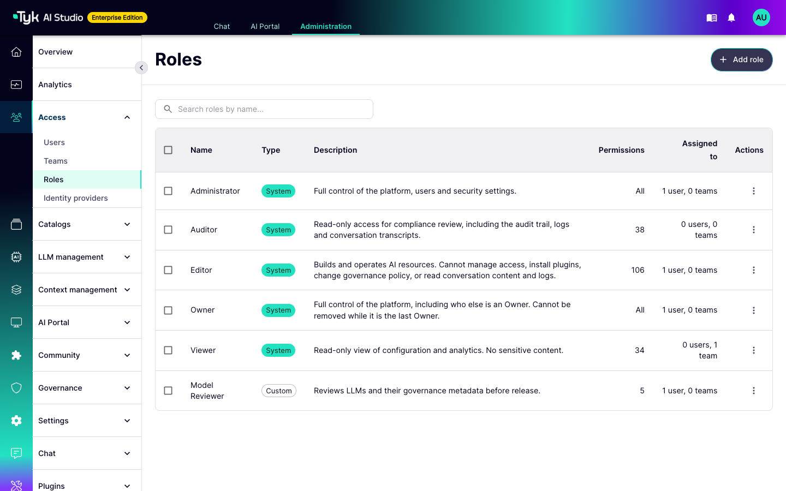
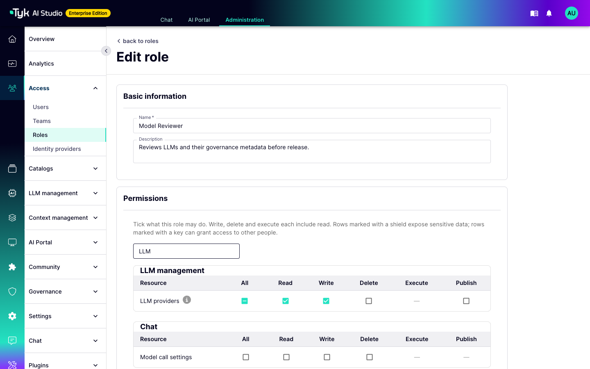
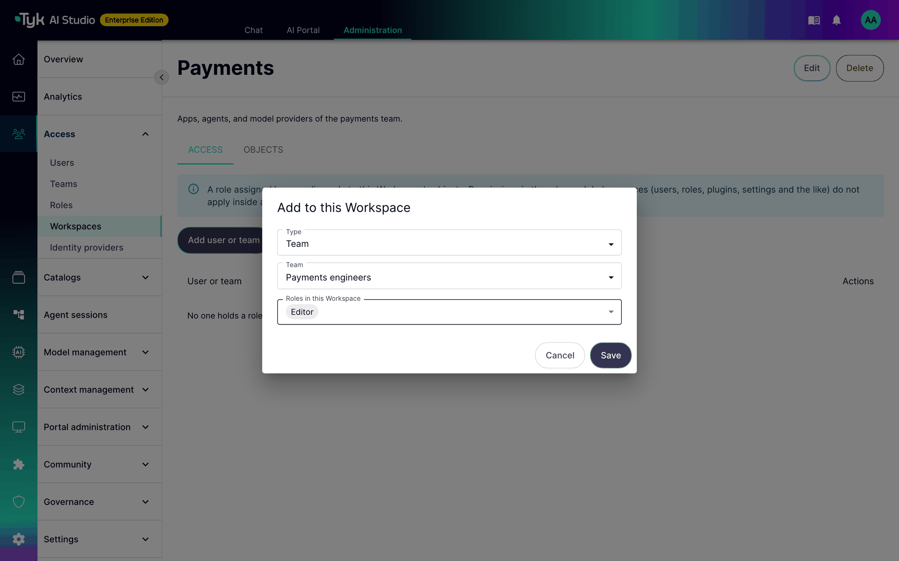
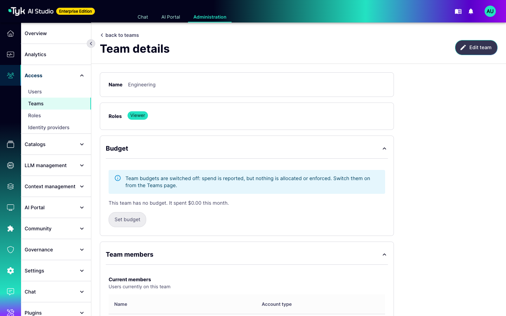
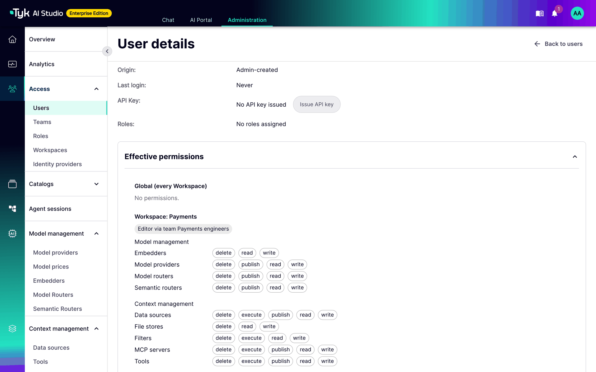

## Availability

| Edition | Deployment Type |
| :------------- | :---------------------- |
| [Enterprise](/ai-management/ai-studio/overview#enterprise-edition) | Self-Managed |

Roles need an Enterprise license that includes the roles feature.

Roles control what a person can see and do in the admin console and the management API of Tyk AI Studio. For example:

- A platform engineer can manage LLM providers and tools, but cannot change who has access.
- An auditor can read the [audit trail](/ai-management/ai-studio/audit-trail), but cannot change anything.
- A reviewer can see only the community submission queue.

### Community Edition vs Enterprise Edition

In the **Community Edition**, a user is an administrator or not. Set the **Admin User** switch on the user to give full access to the admin console. AI Studio also uses this rule when the Enterprise license does not include the roles feature.

In the **Enterprise Edition**, roles give fine-grained access.

Roles do not control the AI Portal and the Chat interface. The **Show Portal** and **Show Chat** switches on the user control access to them. The [Catalogs](/ai-management/ai-studio/catalogs) of the user's [Teams](/ai-management/ai-studio/teams) control what the user sees in them.

## How Roles Work

- A **permission** has the form `resource:action`, for example `llms:write` or `audit:read`.
- A **role** is a named set of permissions.
- You assign roles to **users**, **service accounts**, and **Teams**. A user gets the permissions of their own roles. The user also gets the roles of each Team that they belong to.
- A role assignment is **global** or **within a Workspace**. A global role applies everywhere. A role within a Workspace applies only to the objects of that Workspace. Refer to [Roles Within a Workspace](#roles-within-a-workspace).
- Permissions apply to the admin console navigation, pages, buttons, and every management API call.

When you map identity provider groups to Teams, the IdP also controls the roles of the user. Refer to [Single Sign-On](/ai-management/ai-studio/sso).

The management API uses different names for some of these terms. It calls a Team a *group* (`/api/v1/groups`, `"subject_type": "group"`, and the `groups` permission). It calls a role assignment a *binding* (`/api/v1/rbac/bindings`).

### Actions

| Action | Allows |
| :--- | :--- |
| `read` | List, get, search, and view status and history. Download an existing export. |
| `write` | Create and update, including links to sub-resources, approvals, and rollbacks. |
| `delete` | Remove a resource or a link to a sub-resource. |
| `execute` | Operations such as test, call, reload, sync, and process again. It does not change the configuration, except for [`plugins:execute`](#plugin-permissions). |
| `publish` | Make an object live: set an LLM, router, tool, data source, App, or agent active, enable a plugin, or activate a metadata schema. |

Each action includes `read`. The `publish` action does not include `write`. Thus, one role can edit drafts but not release them. Another role can release objects but not edit them. Only resources with an active switch offer `publish`.

If a user without `llms:publish` sets an LLM provider active, AI Studio returns `403` with `"permission": "llms:publish"`. The admin console disables the switch for that user.

## Built-in Roles

AI Studio has five system roles:

- **Owner**: For the people who are responsible for the installation. All permissions. Refer to [Owner Rules](#owner-rules).
- **Administrator**: For platform administrators. All permissions, but cannot assign or remove the Owner role.
- **Editor**: For engineers who build and operate AI resources. All actions on all resources, with these exceptions:
  - No access to `roles`, `workspaces`, `sso-profiles`, `audit`, `exports`, `proxy-logs`, `chat-history`, and `trace-content`.
  - Read only on `users`, `groups` (Teams), `metadata`, and `traces`.
  - Read and execute only on `plugins` and `marketplace`. An Editor can call plugins and change the configuration, name, and description of an installed plugin. An Editor cannot install, remove, enable, or disable plugins.
  - Full access to `credentials`, so an Editor can read secrets.
- **Viewer**: For people who need to look but not change anything. `read` on all resources, except `proxy-logs`, `chat-history`, `exports`, `audit`, `credentials`, `sso-profiles`, and `trace-content`.
- **Auditor**: For compliance and security reviewers. Viewer, plus `read` on `audit`, `proxy-logs`, `chat-history`, and `exports`. No access to `credentials`, `sso-profiles`, or `trace-content`.

You cannot edit or delete a system role. To change one, clone it and edit the copy. When you clone Owner or Administrator, the copy gets every concrete permission. Only the Owner and Administrator roles have the full-access wildcard (`*`). A custom role cannot have it.

AI Studio calculates the permissions of Editor, Viewer, and Auditor from the permission catalog. It does this at each start, and each time a plugin adds or removes permissions. Thus, new resources and plugin resources go into these roles automatically.

### Owner Rules

- You can assign the Owner role to users only. You cannot assign it to a Team.
- Only an Owner can assign or remove the Owner role.
- You cannot remove the last Owner. You also cannot delete, disable, or demote the last Owner.

### The First User and Upgrades

On a new installation, the first user gets the Administrator role. At the next start of AI Studio, if no Owner exists, AI Studio gives the Owner role to the first administrator.

For the effect of an upgrade to v2.3.0 or a rollback on role assignments, refer to [Upgrade and Rollback](/ai-management/ai-studio/workspaces#upgrade-and-rollback).

## Permission Reference

Each row is one resource. The table shows the actions that each resource offers.

- **Sensitive** resources hold data such as transcripts, logs, and secrets. You can withhold `read` on them separately.
- **Privileged** resources can give access to other people when you change them. The role editor shows a warning for them.

The **In a Workspace** column shows how a permission behaves when you assign it within a Workspace:

- **Global**: The permission counts only in a global role. A role within a Workspace does not give it.
- **Shared**: Users read the objects from every Workspace. They change, delete, publish, or test an object only in its own Workspace.
- **Owned**: Users do not see the objects outside the Workspaces where they have a role.
- **Follows its App**: The Workspace of the App controls access.

For the objects in each group, refer to [What Is Visible Across Workspaces](/ai-management/ai-studio/workspaces#what-is-visible-across-workspaces).

| Group | Resource | Label | Actions | In a Workspace | Notes |
| :--- | :--- | :--- | :--- | :--- | :--- |
| Analytics | `analytics` | Analytics | read | Global | Usage, cost, and token dashboards |
| Analytics | `proxy-logs` | Proxy logs | read | Global | Sensitive. Raw gateway logs, including prompt and completion bodies |
| Analytics | `traces` | Agent traces | read, write, delete, execute | Global | Agent sessions, traces, and spans. Available from v2.3.0. |
| Analytics | `trace-content` | Agent trace content | read | Global | Sensitive. Available from v2.3.0. |
| Plugins | `plugins` | Installed plugins | read, write, delete, execute, publish | Global | Privileged |
| Plugins | `marketplace` | Marketplace | read, write, delete, execute | Global | Marketplace and its sources |
| Model management | `llms` | Model providers | read, write, delete, publish | Shared | |
| Model management | `model-prices` | Model prices | read, write, delete | Global | |
| Model management | `model-routers` | Model routers | read, write, delete, publish | Owned | |
| Model management | `semantic-routers` | [Semantic routers](/ai-management/ai-studio/semantic-router) | read, write, delete, publish | Owned | |
| Model management | `embedders` | [Embedders](/ai-management/ai-studio/embedders) | read, write, delete | Shared | Also needed to create an embedder from a data source or router form |
| Context management | `datasources` | Data sources | read, write, delete, execute, publish | Shared | |
| Context management | `tools` | Tools | read, write, delete, execute, publish | Shared | |
| Context management | `mcp-servers` | MCP servers | read, write, delete, execute, publish | Shared | |
| Context management | `filters` | Filters | read, write, delete, execute | Shared | |
| Context management | `filestores` | File stores | read, write, delete | Shared | |
| Context management | `tags` | Tags | read, write, delete | Global | |
| Community | `submissions` | Submission queue | read, write, execute | Global | |
| Community | `attestation-templates` | Attestation templates | read, write, delete | Global | |
| Access | `users` | Users | read, write, delete | Global | Privileged. Includes service accounts, and issuing and rolling API keys |
| Access | `groups` | Teams | read, write, delete | Global | Privileged. Team roles apply to all members |
| Access | `roles` | Roles | read, write, delete | Global | Privileged |
| Access | `workspaces` | Workspaces | read, write, delete | Global | Privileged. Create, rename, and delete Workspaces. Available from v2.3.0. |
| Access | `sso-profiles` | Identity providers | read, write, delete | Global | Sensitive and privileged. Includes IdP secrets and group mappings |
| Governance | `audit` | Audit trail | read | Global | Sensitive |
| Governance | `compliance` | Compliance | read | Global | |
| Governance | `metadata` | Metadata schemas | read, write, delete, publish | Global | |
| Governance | `exports` | Log exports | read, write | Global | Sensitive. Bulk proxy log exports |
| Governance | `webhooks` | [Webhooks](/ai-management/ai-studio/webhooks) | read, write, delete, execute | Global | Sensitive and privileged |
| Settings | `tyk-connections` | [Tyk connections](/ai-management/ai-studio/tyk-mcp-integration) | read, write, delete, execute | Global | Sensitive and privileged |
| Settings | `secrets` | Secrets | read, write, delete | Shared | The API never returns secret values. |
| Settings | `branding` | Branding | read, write | Global | |
| AI Portal | `apps` | Apps | read, write, delete, publish | Owned | An inactive App cannot authenticate at the gateway. |
| AI Portal | `credentials` | Credentials | read, write, delete | Follows its App | Sensitive |
| AI Portal | `mcp-credentials` | MCP credentials | read, write, delete, execute | Follows its App | Sensitive and privileged |
| AI Portal | `edges` | Edge gateways | read, write, delete, execute | Global | Edge Gateways, namespaces, and configuration push |
| Chat | `chats` | Chats | read, write, delete | Global | |
| Chat | `agents` | Agents | read, write, delete, execute, publish | Owned | |
| Chat | `llm-settings` | Model call settings | read, write, delete | Global | |
| Chat | `chat-history` | Chat history | read, write, delete | Global | Sensitive. Conversation transcripts |
| Catalogs | `catalogues` | LLM catalogues | read, write, delete | Owned | |
| Catalogs | `data-catalogues` | Data catalogues | read, write, delete | Owned | |
| Catalogs | `tool-catalogues` | Tool catalogues | read, write, delete | Owned | |

The role editor shows the current catalog, including plugin resources.

### Resource Details

- `traces`: End users show as pseudonyms. `write` changes tracing settings. `delete` purges sessions. `execute` exports.
- `trace-content`: Raw end-user IDs and captured prompts, responses, and tool data. AI Studio audits each view.
- `plugins`: `publish` enables or disables a plugin. `execute` calls every plugin and can change the configuration of an installed plugin. Refer to [Plugin Permissions](#plugin-permissions).
- `marketplace`: `write` also validates a marketplace URL.
- `mcp-servers`: `execute` registers and pushes definitions to the Tyk Dashboard and creates policies. `publish` shows a server in the AI Portal.
- `metadata`: `publish` activates a schema. The permission of an object controls the metadata on that object.
- `webhooks`: `execute` approves, revokes, tests, and replays deliveries.
- `tyk-connections`: `execute` activates, disables, probes, and syncs a connection. It also lets a connection use a Tyk Dashboard at a private network address.
- `credentials`: Reading a credential shows its secret. Grant it only to roles that need it.
- `mcp-credentials`: `execute` mints, rotates, suspends, and revokes keys.

## Manage Roles

To see roles, you need `roles:read`. To change roles, you need `roles:write`.

1. In the admin console, go to **Access > Roles**.
2. Click **Add role**. The permission matrix opens. It has one row for each resource, grouped as in the navigation, and one column for each action.
3. Enter a name and a description, and select the permissions. When you select `write`, `delete`, or `execute`, the editor also selects `read`.
4. Click **Create role**.

To start from a system role, open the role and click **Clone role**. Then edit the copy.

When you delete a custom role, AI Studio removes it from every user and Team that has it.

### Assign Roles

- **To a user or a service account:** Edit the user and select roles in the **Roles** field. These roles are global.
- **To a Team:** Edit the Team and select roles in the **Team roles** field. Every member of the Team gets these global roles. Refer to [Teams](/ai-management/ai-studio/teams).
- **Within a Workspace:** Go to **Access > Workspaces** and open the Workspace. On the **Access** tab, click **Add user or team**. Select a user, a service account, or a Team, and select the **Roles in this Workspace**. Refer to [Roles Within a Workspace](#roles-within-a-workspace).

The detail page of a user shows their roles. The **Effective permissions** section shows the combined permissions from the direct roles and the Team roles. It shows the global permissions and, separately, the permissions in each Workspace.

### Roles Within a Workspace

A Workspace groups configuration objects, such as model providers, Apps, tools, data sources, routers, and catalogs. Refer to [Workspaces](/ai-management/ai-studio/workspaces).

- A role within a Workspace gives only the permissions that are not **Global** in the [Permission Reference](#permission-reference). For global resources, such as `users`, `roles`, `edges`, and `analytics`, assign a global role.
- The API refuses a scoped Owner role with `409` and `"code": "owner_scope_forbidden"`.

For the other rules of scoped role assignments, refer to [How Workspaces Work](/ai-management/ai-studio/workspaces#how-workspaces-work) and [Manage Workspaces](/ai-management/ai-studio/how-to-manage-workspaces#manage-workspaces).

## Plugin Permissions

Plugins can add their own resources to the catalog, under the **Plugins** group. Each installed plugin with pages or resource types has its own row. The resource key is `plugin:<manifest id>`. The row has three actions:

- `read` opens the pages of the plugin, calls the RPC methods that the plugin declares as read-only, and shows its configuration.
- `write` calls the other RPC methods of the plugin and edits its configuration.
- `execute` is for operations that the plugin declares.

A plugin can also declare finer rows below its own row. For example, the [Asset Catalog](/ai-management/ai-studio/asset-catalog) plugin has rows for asset types, assets, and access requests. The plugin documentation tells you which actions each row allows.

- `plugins:execute` grants every permission that any plugin declares (`plugin:...` resources), including `write` and `delete`. It does not grant `plugins:write` or `plugins:delete`.
  - A user with `plugins:execute` can change the configuration, name, and description of an installed plugin.
  - The user cannot install or remove plugins, or change any other plugin field.
  - To give access to one plugin only, select the row of that plugin instead.
- When you uninstall a plugin, its permissions stay on the role. The role editor shows them under **Not installed**. They have no effect until the plugin is installed again.
- An admin page of a plugin needs the `read` permission of that plugin. The plugin manifest can set a different permission in `mount_config.required_permission`. Refer to [Plugin Manifests](/ai-management/ai-studio/plugins/manifests).
- AI Studio sends the permissions of the caller to the plugin, together with the `is_admin` flag.

## Examples

| Role | How to Make It |
| :--- | :--- |
| Platform engineer who pushes configuration and tests filters and tools, but cannot change them | Clone Viewer. Add `edges:execute`, `filters:execute`, and `tools:execute`. |
| Submission reviewer | Clone Viewer. Add `submissions:write` and `submissions:execute`. To also add approved tools or data sources to catalogs, add `tool-catalogues:write` or `data-catalogues:write`. |
| Tyk Operator | Refer to [Set Up an Automated Client](/ai-management/ai-studio/how-to-set-up-workspace-client). |
| LLM submitter | A new role with `llms:read` and `llms:write`. The user can create and edit LLM providers, but cannot set them active. |
| LLM reviewer | Add `llms:publish`. A role with only `llms:publish` can set providers active or inactive, but cannot edit them. |
| LLM cost analyst | A new role with `analytics:read` and `model-prices:read`. |

To make a reviewer enter a value before release, add a [governed metadata](/ai-management/ai-studio/governed-metadata) field that is required to publish. A submitter can save without the field. AI Studio refuses activation until someone fills it in.

