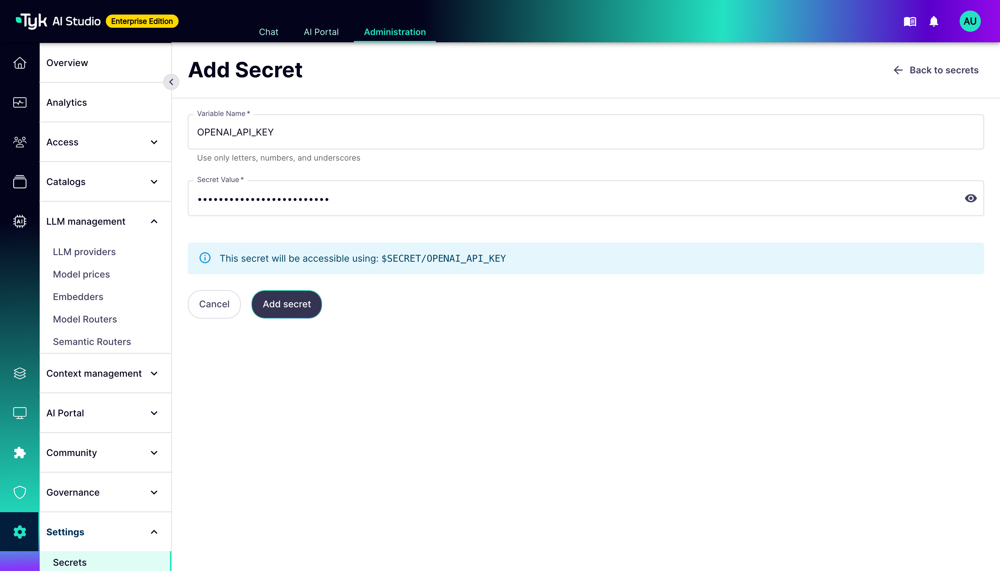

## Availability

| Edition   | Deployment Type |
| :------------- | :---------------------- |
| [Community](/ai-management/ai-studio/overview#community-edition) & [Enterprise](/ai-management/ai-studio/overview#enterprise-edition) | Self-Managed |

Tyk AI Studio provides a secure mechanism for storing and managing sensitive information, such as API keys, passwords, authentication tokens, or other credentials required by various platform configurations.

## Purpose

The Secrets Management system aims to:

*   **Prevent Exposure:** Avoid hardcoding sensitive values directly in configuration files or UI fields.
*   **Centralize Management:** Provide a single place to manage and update credentials.
*   **Enhance Security:** Store sensitive data encrypted at rest.

## Core Concepts

*   **Secret:** A named key-value pair where the 'key' is the **Variable Name** used for reference, and the 'value' is the actual sensitive data (e.g., an API key string).

*   **Encryption:**
    *   Secret values are **encrypted at rest** within Tyk AI Studio's storage.
    *   The encryption and decryption process relies on a key derived from the **`TYK_AI_SECRET_KEY` environment variable** set when running the Tyk AI Studio instance.
    *   **CRITICAL:** Keep `TYK_AI_SECRET_KEY` confidential. From v2.3.0, the key also encrypts LLM credentials and App keys. Do not change or lose the key after you set it. Refer to [Without the Key or With a Changed Key](#without-the-key-or-with-a-changed-key).
    *   From v2.2.0, AI Studio encrypts each value with AES-256-GCM. It derives the key from `TYK_AI_SECRET_KEY` with scrypt and a random salt for each value. Encrypted values start with `v2:`.
    *   On the first start of v2.2.0 or later, AI Studio encrypts existing values again in the background. Values in the old format stay readable during this process. If AI Studio cannot decrypt a value, it skips the value and logs a warning. It does not delete the value.
    *   **If `TYK_AI_SECRET_KEY` is not set, AI Studio stores secrets as plain text.** It logs a `SECURITY WARNING` one time for each process. Always set `TYK_AI_SECRET_KEY`, also in test deployments that contain real credentials. Webhooks also use this key to encrypt their headers and signing secrets.

*   **Reference Syntax:** Secrets are referenced within configuration fields (like API key fields in LLM or Tool setups) using a specific syntax:
    ```
    $SECRET/VariableName
    ```
    Replace `VariableName` with the exact name given to the secret when it was created (e.g., `$SECRET/OPENAI_API_KEY`, `$SECRET/JIRA_AUTH_TOKEN`).

*   **Environment Variable References:** A field can also hold `$ENV/VARIABLE_NAME`. AI Studio reads the value from its own environment at runtime. Refer to [Environment Variable References](#environment-variable-references).

*   **Runtime Resolution:** When a configuration uses a field containing a secret reference (e.g., `$SECRET/MY_KEY`):
    1.  The configuration itself stores the `$SECRET/MY_KEY` string, *not* the actual secret value.
    2.  Only when the system needs the actual value at runtime (e.g., the [Proxy](/ai-management/ai-studio/proxy) preparing a request for an LLM, or a [Tool](/ai-management/ai-studio/tools) calling its external API), Tyk AI Studio retrieves the encrypted secret value, decrypts it using the `TYK_AI_SECRET_KEY`, and injects the plain text value into the operation.
    3.  The decrypted value is typically used immediately and not persisted further.

## Environment Variable References

From v2.3.0, a `$ENV/` reference resolves only when its variable name is in `AI_STUDIO_ENV_REF_ALLOWLIST` {/* TODO: link reference for AI_STUDIO_ENV_REF_ALLOWLIST */}.

The environment of AI Studio also holds its own secrets, such as the encryption key and the database URL. The allowlist stops a reference from sending these values to an endpoint. List only the variables that you inject for credentials, for example Kubernetes secrets, or values from a vault agent or a CI/CD pipeline. Store other credentials as `$SECRET/` references.

AI Studio does not resolve a `$ENV/` reference to a name that is not in the list. The field keeps the reference text, and AI Studio does not read the variable. The result depends on the field:

1.  **LLM API key, embedder API key, or REST tool auth key:** AI Studio does not send the credential. The gateway returns `502` with `LLM credential not usable`. Studio Chat, embedders, and tool calls fail with `credential is an unresolved reference`.
2.  **Other credentials, such as a data source connection string:** AI Studio sends the reference text. The provider refuses the call, usually with `401`.
3.  **Guardrail provider credentials:** The guardrail applies its fail mode.

`$ENV/` references work for LLMs, tools, data sources, embedders, and guardrails. Plugin configuration resolves only `$SECRET/` references. AI Studio passes a `$ENV/` value to the plugin unresolved. For plugins, refer to [Plugin Security](/ai-management/ai-studio/plugins/security).

From v2.3.0, AI Studio does not read vendor keys or endpoints from environment variables such as `OPENAI_API_KEY`, `ANTHROPIC_API_KEY`, `GOOGLE_API_KEY`, `HF_TOKEN`, `PINECONE_API_KEY`, `CHROMA_URL`, or `OLLAMA_HOST`. If an LLM, embedder, or data source has an empty key or endpoint, AI Studio does not fill it from the environment. Set the key and the endpoint on each object.

## Who Can Write a Reference

To add or change a `$SECRET/` or `$ENV/` reference, a user needs read access to secrets (`secrets:read`). AI Studio resolves the reference and sends the value to the endpoint that the user configures, so this rule applies to these fields:

*   The API key, endpoint, and metadata of an LLM.
*   The auth key of a tool.
*   The connection fields of a data source.
*   The API key of an embedder.

Without the permission, AI Studio returns `403`. To edit an object and keep its stored references, a user needs no extra permission. Contributor submissions and plugins cannot set references. AI Studio refuses them with `400`.

## Credentials Without a Reference

From v2.3.0, AI Studio also encrypts credentials that you type in directly, and the gateway keys of Apps.

### LLM Credentials

AI Studio encrypts these values with `TYK_AI_SECRET_KEY` when you enter the value itself instead of a reference:

*   The API key of an LLM.
*   The values of LLM metadata fields whose names contain `key`, `secret`, or `token`. For example, the `aws_access_key_id`, `aws_secret_access_key`, and `aws_session_token` fields of a Bedrock LLM.

AI Studio encrypts the credentials of LLMs saved before v2.3.0 when it starts. The admin API, plugin events, object hooks, and the cluster event log show `[redacted]` in place of these values. They show a reference as written. SQL logs do not contain values unless you set `DB_LOG_SQL_PARAMS=true` {/* TODO: link reference for DB_LOG_SQL_PARAMS */}. Use that setting only for local debugging.

### App Keys

AI Studio stores the gateway key of each [App](/ai-management/ai-studio/admin-apps) encrypted with AES-256-GCM. It finds a key by a keyed hash, not by its value. A copy of the database, such as a backup, does not contain usable keys. AI Studio shows the key in the same places as before. It converts existing keys when it first starts on v2.3.0.

*   **The salt:** AI Studio derives the encryption key from `TYK_AI_SECRET_KEY` and a salt in the `data_key_salts` table. If you restore or copy the `credentials` table, also copy `data_key_salts`. If the salt is missing while encrypted keys exist, AI Studio does not start. The error names the table.
*   **Rollback:** The conversion is one-way. A version before v2.3.0 cannot read converted keys. To roll back, restore the database backup that you took before the upgrade.

### Without the Key or With a Changed Key

If `TYK_AI_SECRET_KEY` is not set, AI Studio stores LLM credentials and App keys as written, and logs a security warning at startup. Set the key and restart AI Studio to encrypt them.

If the key changes or is missing, AI Studio cannot read what it encrypted with the old key:

*   **LLM credentials:** Calls fail before they reach the provider, with `LLM credential not usable` on the gateway and `credential is an unresolved reference` in Studio Chat. Enter the credentials again, or set the original key.
*   **Secrets:** `$SECRET/` references fail. Enter the secret values again, or set the original key.
*   **App keys:** No App key validates (`Invalid token`). The console shows `refused-credential-reference` in place of the key. Set the original key again. The stored values do not change, so no data is lost.

`$ENV/` references do not use the key.

<Warning>
With several AI Studio replicas, set the same `TYK_AI_SECRET_KEY` on every replica. The cluster status (`GET /api/v1/cluster/status`) and the startup log of each replica name the setting when the replicas use different values.
</Warning>

## Edge Gateways

[Edge Gateways](/ai-management/ai-studio/manage-edge-gateway) do not resolve references. AI Studio resolves the allowed references, and puts the values into the configuration that it pushes. Edge Gateways receive LLM credentials encrypted with `MICROGATEWAY_ENCRYPTION_KEY`, and store them encrypted. {/* TODO: link reference for MICROGATEWAY_ENCRYPTION_KEY */}

If a key or token reference gives no value, the Edge Gateway receives the value `refused-credential-reference`. This happens when AI Studio refuses the reference, cannot resolve it, or finds an empty secret. An Edge Gateway on v2.3.0 or later refuses an LLM, embedder, or REST tool call that would send this value. An empty key field, such as an Ollama LLM without a key, stays empty. The Edge Gateway never fills a key from its own environment.

When you create, change, or delete a secret, AI Studio marks the Edge Gateways that use it as pending. The new value reaches them at the next configuration push.

Upgrade Edge Gateways together with AI Studio. An Edge Gateway older than v2.3.0 cannot read the encrypted metadata credentials of a Bedrock LLM, so its Bedrock calls fail. Do not set vendor variables such as `OPENAI_API_KEY` on Edge Gateways, because older Edge Gateways still read them.

## Creating & Managing Secrets (Admin)

Administrators manage secrets via the Tyk AI Studio UI or API:

1.  Navigate to **Settings > Secrets** in the admin UI sidebar.
2.  Create a new secret by providing:
    *   **Variable Name:** A unique identifier (letters, numbers, underscores) used in the `$SECRET/VariableName` reference.
    *   **Secret Value:** The actual sensitive string (e.g., `sk-abc123xyz...`).
3.  Save the secret. It is immediately encrypted and stored.

    

The secrets list shows if each secret has a value (**Set** or **Empty**), and the objects that use it (**Used by**). Before you delete a secret, AI Studio shows the objects that use it.

Secrets can be updated or deleted as needed. Updating a secret value will automatically apply the new value wherever the `$SECRET/VariableName` reference is used, without needing to modify the configurations themselves.

## Usage Examples

Secrets are commonly used in:

*   **[LLM Configurations](/ai-management/ai-studio/llm-management):** Storing API keys for providers like OpenAI, Anthropic, Google Vertex AI, etc.
    *   *Example:* In the API Key field for an OpenAI configuration: `$SECRET/OPENAI_API_KEY`
*   **[Tool Configurations](/ai-management/ai-studio/tools):** Storing API keys, authentication tokens (Bearer, Basic Auth), or other credentials needed to interact with the external API the tool represents.
    *   *Example:* In a field for a custom header for a JIRA tool: `Authorization: Basic $SECRET/JIRA_BASIC_AUTH_TOKEN`
*   **[Data Source Configurations](/ai-management/ai-studio/datasources-rag):** Storing API keys or connection credentials for vector databases (e.g., Pinecone, PGVector) or embedding service providers.
    *   *Example:* In the API Key field for a Pinecone vector store: `$SECRET/PINECONE_API_KEY`

## Security Considerations

*   **Protect `TYK_AI_SECRET_KEY`:** This is the master key for secrets. Treat it with the same level of security as database passwords or root credentials. Use environment variable management best practices.
*   **Principle of Least Privilege:** Grant administrative access (which includes secrets management) only to trusted users.
*   **Regular Rotation:** Consider policies for regularly rotating sensitive credentials by updating the Secret Value in Tyk AI Studio.
