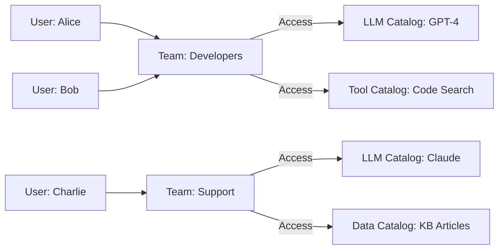
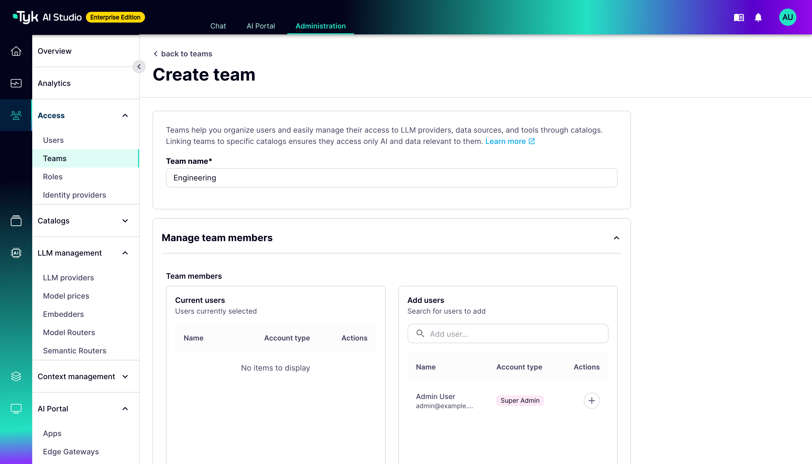

## Availability

| Edition | Deployment Type |
| :------------- | :---------------------- |
| [Community](/ai-management/ai-studio/overview#community-edition) & [Enterprise](/ai-management/ai-studio/overview#enterprise-edition) | Self-Managed |
Teams in Tyk AI Studio help you organize [Users](/ai-management/ai-studio/users) and easily manage their access to [LLM providers](/ai-management/ai-studio/llm-management), [data sources](/ai-management/ai-studio/datasources-rag), and [tools](/ai-management/ai-studio/tools). By linking Teams to specific [Catalogs](/ai-management/ai-studio/catalogs), you ensure users access only the AI resources relevant to their role.

### Use cases
- **Role-Based Access Control**: Group developers into an "Engineering" Team and grant them access to advanced LLM models and coding tools, while grouping support staff into a "Support" Team with access to customer knowledge bases.
- **Resource Isolation**: Ensure that sensitive data sources (like HR documents) are only accessible to the "HR" Team by linking the specific data [Catalog](/ai-management/ai-studio/catalogs) only to that Team.
- **Simplified Onboarding**: When a new employee joins, simply add them to the relevant Team to automatically grant them access to all the necessary AI tools and models for their department.

### Community vs Enterprise Edition
In the **Community Edition**, the Teams feature is not available for custom configuration. Instead, there is a single, built-in **"Default" Team**. All users are automatically assigned to this Default Team, and it is permanently linked to the default catalogs.

In the **Enterprise Edition**, you have full access to create, manage, and delete custom Teams, allowing for granular Role-Based Access Control (RBAC) across your organization. Note that even in the Enterprise Edition, the "Default" Team cannot be deleted.

Every user belongs to the Default Team. Do not give the Default Team a global role, because every user then gets that role in every Workspace.

## What is a Team?

A Team acts as the central access control mechanism in Tyk AI Studio. Instead of assigning permissions to individual [Users](/ai-management/ai-studio/users), administrators assign [Catalogs](/ai-management/ai-studio/catalogs) (LLM providers, Data sources, and Tools) to a Team. Users are then added as members of the Team.

This architecture simplifies permission management, as a user's access rights are dynamically inherited from their Team memberships. A user can belong to multiple Teams, and a Team can have multiple Catalogs of different types.

## Configuration
When configuring a Team, the following options are available:
- **Team Name**: A descriptive name for the Team (e.g., "Solutions Architects", "Marketing").
- **Manage Team Members**: An interface to search and add existing users to the Team, or remove current members.
- **Roles** (Enterprise Edition): Global roles that every member of the Team inherits. To give the Team a role in one Workspace only, use the **Access** tab of that Workspace. Refer to [Roles Within a Workspace](/ai-management/ai-studio/rbac#roles-within-a-workspace).
- **Add Catalogs**: Sections to link the Team to specific catalogs:
  - **LLM providers catalogs**: Grants access to specific AI models.
  - **Data sources catalogs**: Grants access to specific datasets or knowledge bases.
  - **Tools catalogs**: Grants access to specific tools (e.g., web search, calculators).

  In the Enterprise Edition, the form lists only the catalogs in your Workspaces. When you save, AI Studio keeps the links of the Team to catalogs in other Workspaces.
- **Team budget** (Enterprise Edition, when Team budgets are on): The monthly budget, the budget start date, and the default allocation for each new App. You also select the action at the limit: **Alert administrators only** or **Alert and block the team's Apps**. Refer to [Team Budgets](/ai-management/ai-studio/budgeting#team-budgets).
- **App quota** (Enterprise Edition): The number of Apps that each member can create. Refer to [App Quota](#app-quota).

## How to Create a Team
To create a new Team in Tyk AI Studio:
1. Navigate to **Access > Teams** in the admin UI sidebar.
2. Click on the **Create team** button.
3. Enter a descriptive **Team name**.
4. In the **Manage team members** section, search for existing [Users](/ai-management/ai-studio/users) and add them to the Team.
5. (Enterprise Edition) In the **Roles** section, select the **Team roles** that the members inherit.
6. In the **Add catalogs** section, select one or more [Catalogs](/ai-management/ai-studio/catalogs) for this Team. You can select LLM provider, Data source, and Tool catalogs.
7. Click **Create team** to create the Team and apply the access rules.

  

## Team Budgets

In the Enterprise Edition, a Team can have a budget. The budget limits the total spend of the Team's Apps, and gives each new App an allocation from a pool. Team budgets are off by default. To turn them on, set the **Team budgets** switch on the Teams page. For the full behavior, refer to [Team Budgets](/ai-management/ai-studio/budgeting#team-budgets).

To make sure that an App goes to the correct Team, set a **Budget team** on the user. AI Studio gives each new App of the user to that Team.

## App Quota

In the Enterprise Edition, the App quota limits how many Apps each user can create. It applies to Apps from the AI Portal and from plugins. Apps that an administrator creates in the admin area do not count against the quota. App quotas are available from Tyk AI Studio 2.3.0.

AI Studio uses the first setting in this table that applies to the user:

| Setting | When it applies | Quota |
| :--- | :--- | :--- |
| Team quota | The user is a member of a Team that sets a quota. | The quota of the Team. If more than one Team sets a quota, the largest one applies. |
| [`DEFAULT_APP_QUOTA`](/ai-management/ai-studio/ai-studio-env#default_app_quota) | No Team of the user sets a quota. | A number, or `*` for no limit. `0` stops users from creating Apps. If the value is not valid, AI Studio logs a warning and uses `1`. |
| Built-in default | No Team quota, and `DEFAULT_APP_QUOTA` is not set. | `1` App |

The quota counts the Apps that the user owns. If a user tries to create an App over the quota, AI Studio refuses it with HTTP `409` and the code `QUOTA_EXCEEDED`. The message tells the user to remove an App, or to ask an administrator for a larger quota.

### Set a Team Quota

1. Go to **Access > Teams**, and open the Team.
2. In the **App quota** section, enter a number in **Apps per member**. For no limit, select **Unlimited**.
3. Click **Save**.

To remove the Team quota, select **Use the default**. The members then get the quota from `DEFAULT_APP_QUOTA`.

{/* TODO: Add screenshot: Team detail page, App quota section with Apps per member, Unlimited, and Save */}
