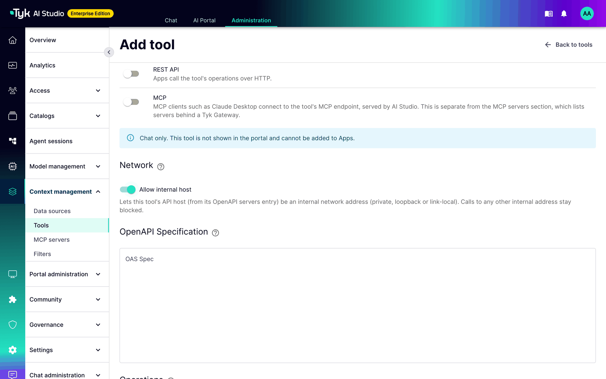
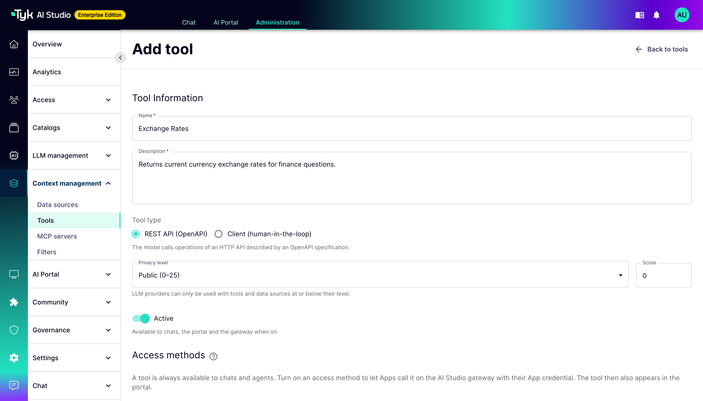
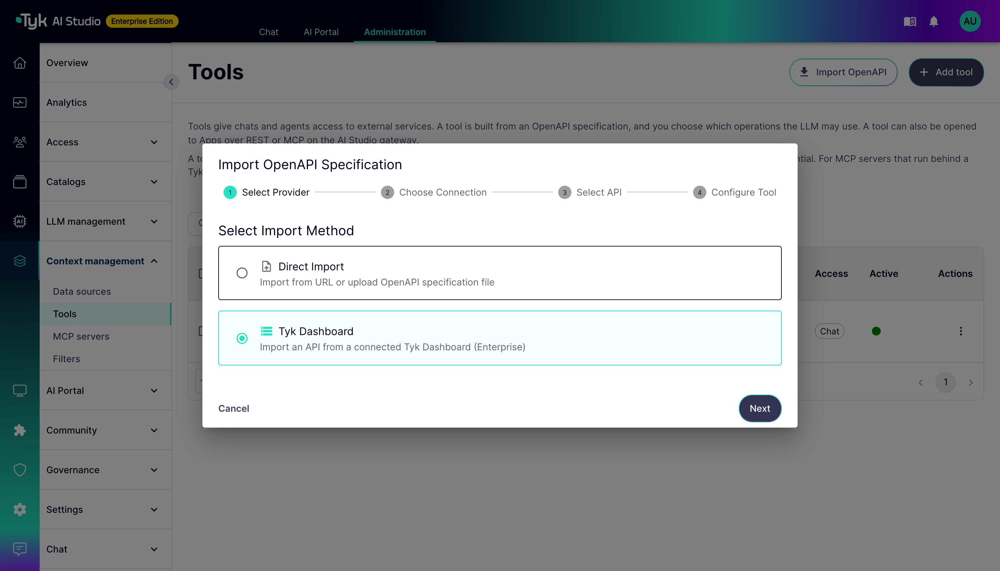
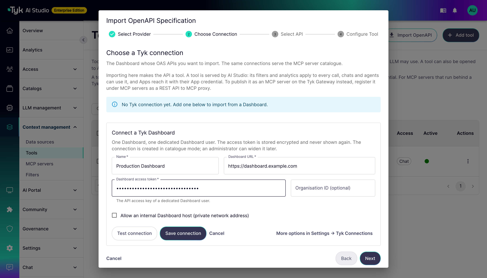
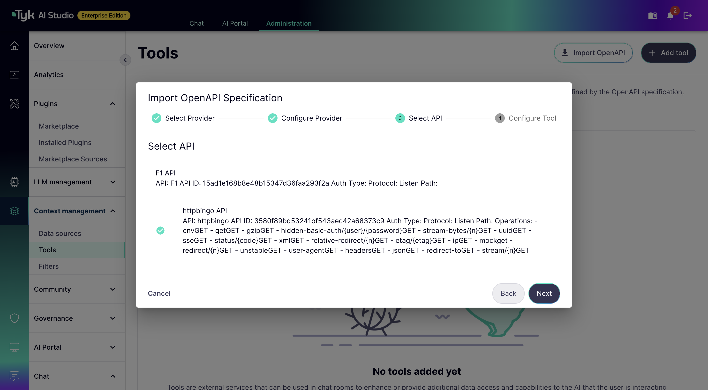
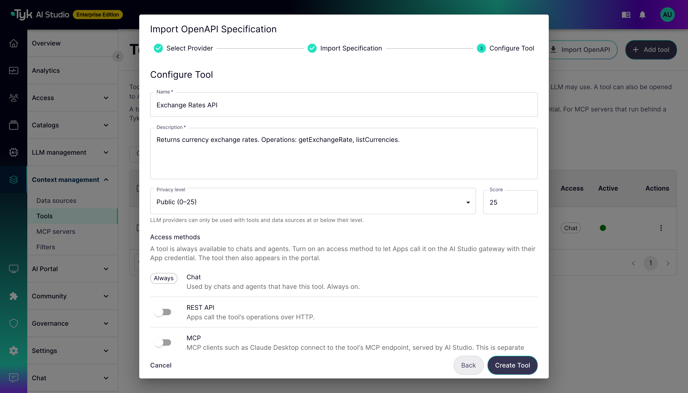
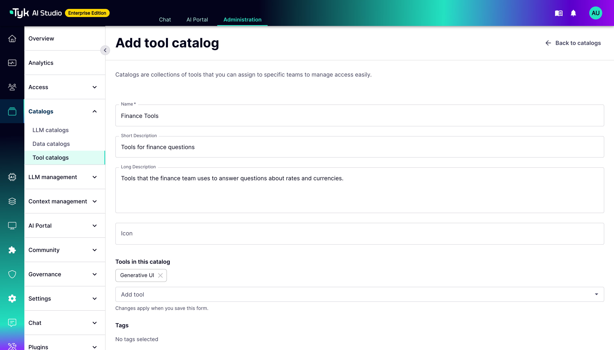

## Availability

| Edition   | Deployment Type |
| :------------- | :---------------------- |
| [Community](/ai-management/ai-studio/overview#community-edition) & [Enterprise](/ai-management/ai-studio/overview#enterprise-edition) | Self-Managed |

Tools are available in the Community and Enterprise Editions.

Tools let Large Language Models (LLMs) call external APIs and services. With tools, LLMs can perform actions and get real-time data.

To manage Tools, go to **Context management > Tools** in the AI Studio admin UI sidebar.

## Purpose

Tools let LLMs in the [Chat Interface](/ai-management/ai-studio/chat-interface) or the API do these tasks:

*   Get real-time information, such as weather, stock prices, or database records.
*   Use other software, for example to search Jira tickets, update CRM records, or trigger webhooks.
*   Do complex calculations or data changes with specialized services.

## Core Concepts

*   **Tool Definition:** A tool is a wrapper around an external API. An **OpenAPI Specification (OAS)** (v3.x, JSON or YAML) defines its structure and operations.
*   **Unique Names:** AI Studio addresses a tool by its slug. The slug is the name in lower case, with spaces and punctuation changed to `-`. For example, `Page fetcher` becomes `page-fetcher`.
    *   From v2.3.0, slugs are unique across all namespaces. A name that gives the slug of another tool returns `409 Conflict` in the admin API and in submission approvals. Plugins get `AlreadyExists`.
    *   Rename duplicates created before v2.3.0, because Edge Gateways leave them out.
*   **Allowed Operations:** Administrators select the `operationIds` of the OAS that the LLM can call.
*   **Authentication:** Select the authentication method of the OAS, such as Bearer Token or Basic Auth. Reference a stored [Secret](/ai-management/ai-studio/secrets) that contains the credentials.

    A `$ENV/` reference resolves only for allowlisted names, and a user needs `secrets:read` to add or change a reference. Refer to [Secrets Management](/ai-management/ai-studio/secrets#environment-variable-references).
*   **Privacy Levels:** Each tool has a privacy level. The level of the tool must not be higher than the level of the [LLM provider](/ai-management/ai-studio/llm-management). Thus, less secure or external LLMs cannot use sensitive tools. For the score mapping, refer to [Privacy Levels](/ai-management/ai-studio/privacy-levels).

    From v2.3.0, the tool form and the import wizard warn you when no active LLM provider has a level high enough for the tool. Refer to [Privacy Level Warnings](/ai-management/ai-studio/privacy-levels#privacy-level-warnings).
*   **Tool Catalogues:** Collections of tools. Teams get access to tools through catalogues.
*   **Filters:** Optional [Filters](/ai-management/ai-studio/filters) can check and change the arguments sent to the tool and the responses from it. For example, they can remove sensitive data. Refer to [Tool Filters](/ai-management/ai-studio/filters#tool-filters).
*   **Documentation:** Instructions for the LLM, in natural language, on how and when to use the tool.
*   **Dependencies:** Tools can declare dependencies on other tools.

## Where Tools Run

Tools run on the embedded gateway of AI Studio and on Edge Gateways.

*   AI Studio syncs tool configurations, OpenAPI specs, authentication credentials, and App access to the Edge Gateways.
*   Tools support namespace filtering for multi-tenant Enterprise deployments.

## Access Methods

A tool is a chat capability first. You can also make it available to [Apps](/ai-management/ai-studio/admin-apps) on the gateway. Each way to do this is an **access method**, and an administrator turns each method on for each tool:

| Access method | What it gives you | Default |
| :--- | :--- | :--- |
| **Chat** | LLMs call the tool's operations during conversations. This is the primary use case. | Always on |
| **REST API** | Developers call the tool's operations over HTTP at `/tools/{slug}`, with their App credential. | Off for a new tool |
| **MCP** | MCP clients, such as Claude Desktop, connect to the tool at `/tools/{slug}/mcp`, with the App credential or with an OAuth sign-in. The tool's operations become MCP tools. | Off for a new tool |

The switches are in the **Access methods** section of the tool form and of the last step of the import wizard. The section also shows the gateway URL of each method that is on. The Tools list shows the methods in its **Access** column.

A tool with both methods off is **chat only**:

*   It is available in the chat tool picker.
*   It is not visible in the AI Portal. It is not in Browse, on an asset or documentation page, or in the App builder.
*   You cannot add it to an App. If you turn off both methods on a tool that Apps already use, the Apps keep the tool. The gateway refuses their calls with `403`, and the App page tells the owner why.

Client (human-in-the-loop) tools, including the built-in **Generative UI** tool, run in the chat interface. They are always chat only.

Both access methods apply the same rules:

*   The calling App must have the tool. This check applies to every authentication method, including OAuth tokens on the MCP endpoint.
*   Callers can use only the operations that are selected on the tool. A REST call with an `operation_id` that is not selected returns `403`. A REST call without an `operation_id` returns `400`.
*   The tool's [filters](/ai-management/ai-studio/filters#tool-filters) run on the arguments and on the response.

A call over a method that is off returns `403`.

<Warning>
A new tool is chat only. This applies to tools that you create in the admin UI, with the import wizard, with `POST /api/v1/tools`, from an approved submission, or through the plugin API. The tool returns `403` on `/tools/{slug}` and `/tools/{slug}/mcp` until you turn on a method. Automation that creates a tool and then calls it or adds it to an App must turn on the method that it needs.
</Warning>

### Tools and MCP Servers

In the Enterprise Edition, the admin UI also has an **MCP servers** section (**Context management > MCP servers**). A tool and an MCP server are different, although you can reach a tool over MCP:

| | Tool | MCP server |
| :--- | :--- | :--- |
| Served by | AI Studio (embedded gateway and Edge Gateways) | A Tyk Gateway. AI Studio lists it in the catalog, but its traffic does not go through AI Studio. |
| Built from | An OpenAPI specification | An MCP proxy on a Tyk Dashboard or an open-source Tyk Gateway |
| Used by | Chats and agents, and Apps over REST or MCP | Apps, over MCP |
| Credential | The App's own credential | A Tyk access key that AI Studio issues for the App |
| Governed by | AI Studio filters, privacy levels, and tool analytics | Tyk policies, rate limits, and quotas |

Use a **tool** when chats and agents in AI Studio must use the API. Also use a tool when AI Studio filters must apply to it. Use an **MCP server** when your Tyk Gateway must serve and govern the MCP traffic.

The AI Portal shows which component serves each endpoint. The App page gives developers one MCP client configuration that includes both.

For MCP servers, refer to [Tyk Dashboard MCP Integration](/ai-management/ai-studio/tyk-mcp-integration).

### Authentication Plugins

A tool can have an ordered list of authentication plugins. Set the list in the **Authentication plugins** section of the tool detail page, or with `GET` and `PUT /api/v1/tools/{id}/auth-plugins`. Refer to [Edge Gateway Plugins](/ai-management/ai-studio/plugins/edge-gateway).

*   When the list is not empty, only these plugins authenticate calls to the tool on Edge Gateways. This applies to REST and to every MCP transport. The Edge Gateways then refuse App keys for the tool.
*   The embedded gateway in AI Studio does not run authentication plugins.

## How It Works

When a user interacts with an LLM via the [Chat Interface](/ai-management/ai-studio/chat-interface):

1.  The LLM receives the user prompt and the definitions of available tools (based on team permissions and Chat Experience configuration).
2.  The LLM determines whether it needs one or more tools to answer the prompt. If so, it generates a request to invoke the specific tool operation(s) with the required parameters.
3.  Tyk AI Studio intercepts this request.
4.  It validates the request, checks permissions, and retrieves necessary secrets for authentication.
5.  Tyk AI Studio applies any configured request Filters.
6.  It calls the external API defined by the Tool.
7.  It receives the response from the external API.
8.  Tyk AI Studio applies any configured response Filters.
9.  It sends the tool's response back to the LLM.
10. The LLM uses the tool's response to formulate its final answer to the user.

## Creating & Managing Tools (Admin)

1.  **Define Tool:** Provide a name, description, and privacy level. In **Tool type**, keep **REST API (OpenAPI)** for a tool that calls an HTTP API. **Client (human-in-the-loop)** tools run in the chat interface. Refer to [Chat Interface](/ai-management/ai-studio/chat-interface).
2.  **Upload OpenAPI Spec:** Provide the OAS document (JSON/YAML). From v2.3.0, AI Studio refuses a document that does not parse as an OpenAPI document. **Import from URL** shows the reason.
3.  **Select Operations:** Choose the specific `operationIds` the LLM can use.
4.  **Configure Authentication:** Select the OAS security scheme and link to a stored [Secret](/ai-management/ai-studio/secrets) for credentials.
5.  **Allow Internal Host (Optional):** Turn on **Allow internal host** if the API is on your own network. Refer to [Allow Internal Host](/ai-management/ai-studio/outbound-network-policy#allow-internal-host).

    
6.  **Add Documentation:** Provide natural language instructions for the LLM.
7.  **Assign Filters (Optional):** Add request/response filters.
8.  **Choose Access Methods (Optional):** Turn on **REST API** or **MCP** if Apps must reach the tool on the gateway. A new tool is chat only. Refer to [Access Methods](#access-methods).

    

In the API, the two switches are the `rest_access_enabled` and `mcp_access_enabled` attributes of a tool. If you do not send them in a create request, the tool is chat only. If you do not send them in an update request, they keep their current values. Tool responses also contain `slug`, `app_grantable`, `rest_endpoint_url`, and `mcp_endpoint_url`.

In the API, the `oas_spec` attribute of a REST tool is the base64-encoded OpenAPI document. AI Studio refuses a spec that is not base64 or does not parse as an OpenAPI document with `400`. It checks the spec when you create a tool, and when an update changes the spec.

When an App is created, AI Studio checks the privacy level of each tool against the LLMs of the App. A tool with a higher privacy level than the LLMs is refused, and the error names the tool and the LLM.

## Importing Tools from a Tyk Dashboard (Admin)

The **Import OpenAPI** wizard on the Tools page creates a tool from an OpenAPI specification. It has two import methods:

*   **Direct Import:** Imports a specification from a URL, an uploaded file, or pasted text. This method is available in all editions.
*   **Tyk Dashboard** (Enterprise Edition): Imports an API from a Tyk Dashboard, through a saved Tyk connection.

The wizard uses the same Tyk connections as the Tyk Dashboard MCP integration. You connect a Tyk Dashboard one time. AI Studio stores its access token encrypted, and you use the connection again for each import.

### Start the Wizard

1.  Go to **Context management > Tools**.
2.  Click **Import OpenAPI**.
3.  Select **Tyk Dashboard**.
4.  Click **Next**.

### Choose a Connection

The wizard lists the saved Tyk connections and their status. Select a connection, then click **Next**.

If there is no correct connection, add one in the wizard:

1.  Click **Add connection**.
2.  Enter the **Name** of the connection.
3.  Enter the **Dashboard URL**, for example `https://dashboard.example.com`.
4.  Enter the **Dashboard access token**. Use the API access key of a dedicated Tyk Dashboard user.
5.  Optional: Enter the **Organisation ID**.
6.  If the Tyk Dashboard has a private network address, select **Allow an internal Dashboard host (private network address)**. Select it only for a Tyk Dashboard at a fixed internal address that you trust. By default, AI Studio refuses internal addresses. Thus, a connection cannot send requests to other services on your internal network.
7.  Click **Test connection**. AI Studio checks the URL and the token against the Tyk Dashboard API.
8.  Click **Save connection**. AI Studio creates the connection in `catalogue` mode and selects it.

To add a connection, you need the `tyk-connections:write` permission. To import a tool, you need `tools:write`. To change the other settings of a connection (trust mode, gateway URLs, MDCB, and API template), go to **Settings > Tyk Connections**.

### Select an API

The wizard lists the Tyk OAS APIs on the Tyk Dashboard, by name and listen path. Inactive APIs show an **inactive** label. You cannot import Tyk Classic API definitions as tools.

Select one API from the list, then click **Next**. To import more APIs, repeat the wizard.

### Configure the Tool

The wizard pre-fills these fields from the selected API. Review and edit them before you save.

*   **Name:** The API's name in Tyk Dashboard.
*   **Description:** A generated summary of the API. It includes the API ID, authentication type, protocol, listen path, and available operations.
*   **Privacy Level:** Select a level, or enter a score from 0 to 100. Change it to match the sensitivity of the data the API returns. Refer to [Privacy Levels](/ai-management/ai-studio/privacy-levels).
*   **Auth Schema Name:** The name of the security scheme detected in the specification.
*   **Auth Key:** The credential the tool uses to call the imported API. AI Studio does not fetch it. Enter a direct value or a secret reference, such as `$SECRET/JiraAuthToken`. Leave it blank if the API needs no authentication.
*   **Access methods:** Turn on **REST API** or **MCP** if Apps must reach the tool on the gateway. Refer to [Access Methods](#access-methods).

The imported document keeps its `x-tyk-api-gateway` extension. AI Studio masks every credential in it, such as upstream authentication and request headers that look like credentials. The wizard and the new tool get only the masked document.

The wizard also lists every operation it found in the specification, and adds all of them to the new tool automatically. To limit which operations the LLM can use, edit the tool after import and remove the ones you do not need.

Click **Create Tool**. Tyk AI Studio creates the tool and opens its details page.

To make the tool available in chat, add it to a Tool Catalogue and assign that catalogue to a Team.

## Organizing & Assigning Tools (Admin)

*   **Create Catalogues:** Group related tools into Tool Catalogues, for example "CRM Tools" or "Search Tools".
*   **Assign to Teams:** Assign Tool Catalogues to [Teams](/ai-management/ai-studio/teams). The members of those Teams get *potential* access to the tools in the catalogue.

    

## Using Tools (User)

Tools become available to end-users within the [Chat Interface](/ai-management/ai-studio/chat-interface) if:

1.  The specific Chat Experience configuration includes the relevant Tool Catalogue.
2.  The user belongs to a Team that has been assigned that Tool Catalogue.
3.  The Tool's privacy level is compatible with the LLM being used in the Chat Experience.

The LLM then decides when to use these tools, based on the conversation.
