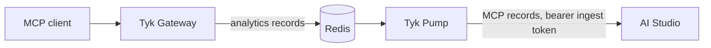

## Availability

| Edition | Deployment Type |
| :------------- | :---------------------- |
| [Enterprise](/ai-management/ai-studio/overview#enterprise-edition) | Self-Managed |

MCP analytics is available from Tyk AI Studio 2.3.0.

## Overview

Clients call MCP servers on Tyk Gateway directly, so AI Studio is not on the traffic path. To show MCP usage, AI Studio receives the analytics records of Tyk Gateway through Tyk Pump. This works for [Tyk Dashboard connections](/ai-management/ai-studio/tyk-mcp-integration) and for [Tyk Gateway (open source) connections](/ai-management/ai-studio/tyk-oss-gateway-mcp).

AI Studio keeps the MCP calls and shows them in these places:

- The **Usage** tab of each MCP server. It shows calls, errors, latency, the use of each tool, resource and prompt, and the top Apps.
- The **MCP usage** section of App pages, in the admin UI and in the AI Portal.
- The **MCP traffic** panel on the AI Studio dashboard.

AI Studio does not store API keys, request or response bodies, or client addresses. AI Portal users see the MCP usage of their own Apps only. The admin views need the `read` action on `analytics`.

The error rate counts HTTP errors and the JSON-RPC errors that the gateway finds. A tool result with `isError` counts as a successful call. REST-to-MCP proxies do not report the upstream latency, so use the total latency for them. AI Studio does not delete old MCP call records yet, so the table grows with MCP traffic.

{/* TODO: Add screenshot: Usage tab of an MCP server with the overview tiles, the calls and latency charts, and the Top Apps table */}

{/* Diagram for the designer.
Purpose: show the path of MCP analytics records to AI Studio.
Structure: left to right. MCP client, Tyk Gateway, Redis, Tyk Pump, AI Studio.
Key elements: the gateway writes records to Redis. Tyk Pump sends MCP records to AI Studio with the bearer ingest token.
Design notes: AI Studio is not on the client traffic path. */}



## Prerequisites

- Tyk Gateway 5.14 or later, with [`enable_analytics`](/tyk-oss-gateway/configuration#enable_analytics) set to `true`.
- Traffic logs on each MCP proxy: `x-tyk-api-gateway.middleware.global.trafficLogs.enabled` set to `true`. The proxies that AI Studio creates have this setting. A proxy that someone else created records nothing until they turn it on.
- Tyk Pump 1.16 or later.

## Create an Ingest Token

1. Open the Tyk connection, and go to its **Analytics** section.
2. Click **Generate token**.
3. Copy the token. AI Studio shows it one time only, and stores only its hash.

Tyk Pump sends the token in the `Authorization: Bearer` header with each batch. **Rotate token** stops the old token at once. **Revoke** stops all analytics for the connection. Managing the token needs the `write` action on `tyk-connections`.

A token belongs to one connection. AI Studio matches records only with the MCP servers of that connection. It counts and drops the records of other APIs. Calls that arrive after you delete their server also count as unknown APIs, and AI Studio drops them.

The **Analytics** section also shows the time of the last batch. It shows these counts for the last 24 hours:

- **MCP records**
- **Records for unknown APIs**
- **MCP records without an App**
- **Non-MCP records dropped**

The section also gives Tyk Pump and Vector configurations that you can copy.

## Configure Tyk Pump

Tyk Pump reads the analytics records from Redis and removes them. To send them to AI Studio, use the stdout pump with Vector.

### Tyk Pump Stdout Pump With Vector

The [stdout pump](/api-management/tyk-pump) writes each record to the output of the Tyk Pump container. [Vector](https://vector.dev) reads that output, keeps the MCP records, and posts them to AI Studio.

Add the stdout pump to `pump.conf`:

```json expandable
{
  "dont_purge_uptime_data": true,
  "pumps": {
    "stdout": {
      "type": "stdout",
      "omit_detailed_recording": true,
      "meta": { "format": "json", "log_field_name": "tyk-analytics-record" }
    }
  }
}
```

- `dont_purge_uptime_data`: Set to `true` unless you run an uptime pump. Otherwise Tyk Pump looks for MongoDB at start and stops. The environment variable is `TYK_PMP_DONTPURGEUPTIMEDATA`.
- `omit_detailed_recording`: Set to `true` to keep the raw requests and responses out of the records.

Configure Vector in `vector.toml`. Set `MCP_INGEST_URL` to `https://<ai-studio-host>/api/v1/ingest/tyk-analytics`, and `MCP_INGEST_TOKEN` to the ingest token:

```toml expandable
# The output of the Tyk Pump container. On Kubernetes, use a kubernetes_logs
# source with an extra_label_selector for the Tyk Pump pods.
[sources.pump]
type = "docker_logs"
include_labels = ["com.docker.compose.service=pump"]

# Keep only the analytics records of MCP traffic.
[transforms.mcp_records]
type = "remap"
inputs = ["pump"]
drop_on_error = true
drop_on_abort = true
source = '''
parsed = object!(parse_json!(string!(.message)))
record = object!(parsed."tyk-analytics-record")
if record.mcp_stats.is_mcp != true { abort }
. = record
'''

# Send a JSON array of records in each request, with a bearer token and gzip.
[sinks.studio]
type = "http"
inputs = ["mcp_records"]
uri = "${MCP_INGEST_URL}"
method = "post"
compression = "gzip"
encoding.codec = "json"
auth.strategy = "bearer"
auth.token = "${MCP_INGEST_TOKEN}"
batch.max_events = 500
batch.timeout_secs = 5
request.retry_attempts = 5
```

Vector reads the output of Tyk Pump from the time that it connects. If Vector is down, the records that Tyk Pump writes in that time are lost.

{/* TODO: Add the Tyk Pump http pump (tyk-pump#1132) when a Tyk Pump release includes it. Add back the pump.conf example, the mcp_only, max_retries: 8, and timeout fields, and the retry window paragraph. */}

## Ingest Limits

The ingest endpoint accepts a JSON array of records, with no compression or with gzip. It refuses these requests:

- A missing, incorrect, or revoked token, or a disabled connection: `401`. Tyk Pump drops the batch.
- A body that is not a JSON array: `400`. A body larger than 16 MiB (also after gzip) or with more than 5000 records: `413`. Another content encoding: `415`. Tyk Pump drops the batch.
- In the Community Edition, or when the integration is off ([`TYK_MCP_ENABLED`](/ai-management/ai-studio/ai-studio-env#tyk_mcp_enabled) is `false`): `404`. Tyk Pump drops the batch.
- More than 20 batches each second for one connection: `429`. If AI Studio is busy: `503`. Tyk Pump tries again.

Delivery is at least once. Records have no ID, so AI Studio can count a batch that Tyk Pump sends again two times.

For the endpoint, refer to the [AI Studio API reference](/ai-management/ai-studio/ai-studio-swagger).

## App Attribution

AI Studio links a call to an App in one of these ways:

- The key of the call is a key that AI Studio issued for the App on this connection. AI Studio matches the key hash that the gateway records. If the gateway has `hash_keys` off, it matches the key.
- If there is no such key, the key alias names an App that has a key on this connection.

AI Studio does not issue keys for servers that use OAuth, JWT, mTLS, or no authentication. It counts their calls for each server only.
