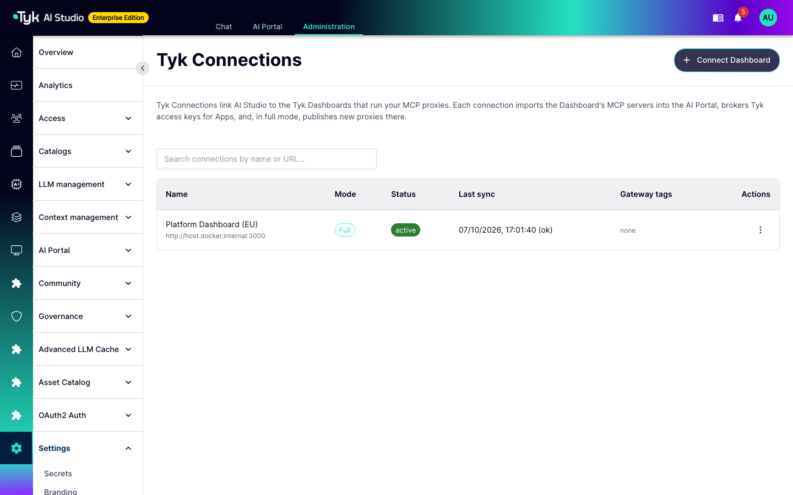
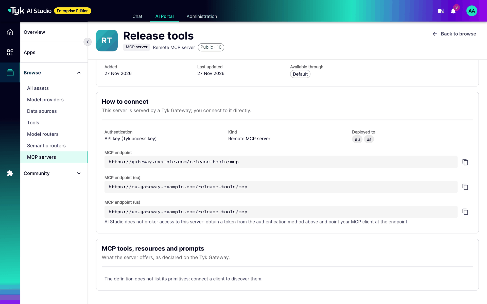

## Availability

| Edition | Deployment Type |
| :------------- | :---------------------- |
| [Enterprise](/ai-management/ai-studio/overview#enterprise-edition) | Self-Managed |

In the Community Edition, the **Tyk Connections** page describes the feature, and the integration API refuses each request with `403`.

## Overview

The Tyk Dashboard MCP integration connects AI Studio to the MCP proxies that a [Tyk Dashboard](/ai-management/mcp-gateway/managing-proxies) manages. With the integration, AI Studio does these tasks:

- It imports the MCP proxies of the Tyk Dashboard. An administrator reviews each one and publishes it in the [AI Portal](/ai-management/ai-studio/ai-portal), next to LLMs, tools, and data sources.
- It gives each App that uses an MCP server a Tyk access key. The key gets its access rights and limits from Tyk policies that an administrator selects. Refer to [MCP Access Keys](/ai-management/ai-studio/mcp-access-keys).
- It creates new MCP proxies on the Tyk Dashboard, from the admin UI or from a community submission. Refer to [Register an MCP Proxy](/ai-management/ai-studio/how-to-register-mcp-proxy).
- It records each key, change, and registration in the [audit trail](/ai-management/ai-studio/audit-trail).

From v2.3.0, AI Studio can also manage MCP proxies and keys directly on open-source Tyk Gateways, without a Tyk Dashboard. Refer to [Tyk OSS Gateway MCP Integration](/ai-management/ai-studio/tyk-oss-gateway-mcp).

Tyk MCP Gateway serves all MCP traffic. A client calls the listen path of the proxy on the gateway, with its Tyk access key. AI Studio is not on that path. The gateway applies the MCP access rules, rate limits, and quotas.

For the gateway side, refer to [Tyk MCP Gateway](/ai-management/mcp-gateway/overview). To see MCP usage in AI Studio, refer to [MCP Analytics With Tyk Pump](/ai-management/ai-studio/tyk-mcp-analytics).

An MCP server in AI Studio is different from a [tool](/ai-management/ai-studio/tools) that you can call over MCP. Refer to [Tools and MCP Servers](/ai-management/ai-studio/tools#tools-and-mcp-servers).

## Connections

A connection is one Tyk Dashboard URL, the access key of one Tyk Dashboard user, and one Organisation. You can add more than one connection. Each imported server, each cached policy, and each issued key belongs to one connection.

To manage connections, go to **Settings > Tyk Connections**. To add one, click **Connect Dashboard**. You can also add a connection inline in the **Import OpenAPI** wizard on the **Tools** page. Refer to [Importing Tools from a Tyk Dashboard](/ai-management/ai-studio/tools#importing-tools-from-a-tyk-dashboard-admin).

By default, AI Studio refuses Tyk Dashboard and Tyk MDCB URLs on internal network addresses. To permit one, select **Allow this Dashboard host to be on an internal network address** on the connection.

### Trust Modes

The permissions of the Tyk Dashboard user set the limit of what AI Studio can do. The trust mode of the connection can only make that set smaller:

| Mode | What AI Studio Can Do |
| :--- | :--- |
| Catalogue | Import MCP proxies and policies. Read the keys that it issued before. |
| Broker | Catalogue, and also issue, change, and revoke keys from the selected policies. |
| Full | Broker, and also create and edit MCP proxies and policies on the Tyk Dashboard. |

Use a dedicated Tyk Dashboard user for each connection, with only the permissions that the mode needs:

- Catalogue mode: read access to APIs, policies, and MCP proxies.
- Broker mode: also write access to keys.
- Full mode: also write access to APIs, policies, and MCP proxies.

AI Studio does not accept the Tyk Dashboard admin secret.

### Capabilities

When you activate a connection, and at each sync, AI Studio probes the Tyk Dashboard. The probe uses only calls that change nothing. The connection page shows the result for each capability.

- A read capability shows **ok** when the Tyk Dashboard answers.
- Some write capabilities show **unverified** until the first real write. For example, the first issued key proves **Mint keys**.
- If the Tyk Dashboard refuses a request with `401` or `403`, AI Studio marks the connection as degraded. It names the failed capability.
- The effective mode is the highest mode that the capabilities permit, up to the mode that you selected. If the probe cannot prove a capability, AI Studio uses a lower mode and shows a warning.

Activating a connection needs the `execute` action on `tyk-connections`. To require that a different person activates the connection, set `TYK_MCP_REQUIRE_DIFFERENT_ACTIVATOR=true`.

When AI Studio runs inside a Tyk Dashboard, the Tyk Dashboard supplies one connection. This connection shows **Managed by host**.

- The Tyk Dashboard sets its URL, Organisation, trust mode, gateway URL, and access key.
- You cannot delete it. You can change its name, sync interval, and governance settings, and you can disable it.

### API Template

A connection can name a Tyk Dashboard API template. Use a template to give each proxy the traffic logs, middleware, and tags that your platform team requires.

- AI Studio merges the defaults of the template into each MCP proxy that it creates on that connection. It does this again each time it pushes a definition.
- If AI Studio cannot read the template, the registration fails, and AI Studio does not create the proxy.

### Segmented Gateways

If your gateways are [segmented](/api-management/multiple-environments), a proxy loads only on the gateways that have its tags. A connection can learn the tags from Tyk MDCB, or you can enter a list of known tags. When a connection knows at least one tag, the registration wizard and the submission form show a deployment target. You can also set a public gateway URL for each tag, so the AI Portal shows the correct endpoint.

### Endpoint URLs in the AI Portal

The endpoint URL that AI Portal users see is the address where Tyk Gateway serves the proxy. It is never an AI Studio gateway address.

AI Studio uses the first of these URLs that it can build:

1. The custom domain of the proxy, when [server.customDomain](/api-management/gateway-config-tyk-oas#domain) is enabled: `<scheme>://<custom domain><listen path><transport path>`.
   - The scheme comes from the **Public gateway base URL** of the connection, or is `https`.
   - The gateway must have [enable_custom_domains](/tyk-oss-gateway/configuration#enable_custom_domains) on.
   - AI Studio ignores domain patterns, such as `{tenant:[a-z]+}.example.com`.
2. The URL of each gateway tag of the proxy. The AI Portal shows one URL for each target.
3. The **Public gateway base URL** of the connection, with the listen path and the transport path. For example, `https://gateway.example.com/weather/mcp`. Usually, this base URL is the load balancer in front of the gateways.

If AI Studio cannot build a URL, the AI Portal tells the user that the endpoint URL is not configured.

When you change the base URLs of a connection, AI Studio updates the URL of each server at the next sync.

## Discover and Publish MCP Servers

AI Studio syncs each active connection at its sync interval. A sync does these steps:

1. It lists each MCP proxy on the Tyk Dashboard and reads its listen path, kind, authentication, tools, and gateway tags.
2. It stores the definition. It masks the upstream credentials.
3. It updates the cached policies, and it checks the keys that it issued.

The imported servers show on the **Context management > MCP servers** page. An imported server is not published. To publish it, refer to [Publish an MCP Server](/ai-management/ai-studio/how-to-publish-mcp-server).

If a connection has **Auto-publish imported servers** on and a default privacy score, AI Studio publishes each new active server in the Default tool catalog.

AI Studio keeps its own name override, descriptions, logo, tags, privacy score, catalogs, and bundle for each server. A sync does not change them. The other fields always follow the Tyk Dashboard.

If a proxy is no longer on the Tyk Dashboard, AI Studio marks the server as missing, unpublishes it, and suspends its keys. If the proxy comes back with the same ID, AI Studio resumes the server and its keys.

## Community Submissions

AI Portal users can submit an MCP server for review, in the same way as a tool or a data source. Refer to [Community Submissions](/ai-management/ai-studio/community). AI Studio encrypts the upstream credential of a submission, and does not show it in responses.

What happens when a reviewer approves a submission depends on the connection:

- **Full mode:** AI Studio creates the proxy on the Tyk Dashboard. The submitter owns the new server.
- **Catalogue or Broker mode, with handoffs accepted:** AI Studio records the server as awaiting the platform team, and notifies administrators.
  - The server page gives a handoff package with the definition, the policy shape, and the steps.
  - After the platform team creates the proxy and a sync imports it, click **Link** on the server page. AI Studio then moves the owner, privacy score, catalogs, and submission to the imported server.

The handoff publishes the `system.mcp_server.registration_handoff` event. You can send it to a [webhook](/ai-management/ai-studio/webhooks).

## Permissions

Three resources in the [permission catalog](/ai-management/ai-studio/rbac#permission-reference) control the integration:

- `tyk-connections` controls the connections. The `execute` action activates, disables, probes, and syncs a connection. The `write` action generates, rotates, and revokes the ingest token.
- `mcp-servers` controls the MCP servers. The `execute` action registers servers, finds the tools of an upstream server, pushes definitions, links handoffs, and creates policies. The `publish` action shows a server in the AI Portal.
- `mcp-credentials` controls the issued keys. The `execute` action issues, rotates, suspends, resumes, and revokes keys, and applies pending changes.

Roles do not control actions in the AI Portal. A user can add a server to their own App and request a key for it when one of their Teams can see the server.

## Configuration

For defaults and formats, refer to the [AI Studio environment variables](/ai-management/ai-studio/ai-studio-env).

| Variable | Description |
| :--- | :--- |
| [TYK_MCP_ENABLED](/ai-management/ai-studio/ai-studio-env#tyk_mcp_enabled) | Set to `false` to turn off the integration. |
| [TYK_MCP_SYNC_MIN_INTERVAL](/ai-management/ai-studio/ai-studio-env#tyk_mcp_sync_min_interval) | The shortest sync interval that a connection can use. |
| [TYK_MCP_REQUEST_TIMEOUT](/ai-management/ai-studio/ai-studio-env#tyk_mcp_request_timeout) | The timeout for Tyk Dashboard requests. |
| [TYK_MCP_RATE_LIMIT_PER_SECOND](/ai-management/ai-studio/ai-studio-env#tyk_mcp_rate_limit_per_second) | The maximum outbound requests per second for each connection. |
| [TYK_MCP_ALLOWED_HOSTS](/ai-management/ai-studio/ai-studio-env#tyk_mcp_allowed_hosts) | The Tyk Dashboard, MDCB, and upstream MCP hosts that AI Studio can call. |
| [TYK_MCP_DENIED_HOSTS](/ai-management/ai-studio/ai-studio-env#tyk_mcp_denied_hosts) | Hosts that AI Studio never calls. |
| [TYK_MCP_REQUIRE_DIFFERENT_ACTIVATOR](/ai-management/ai-studio/ai-studio-env#tyk_mcp_require_different_activator) | Requires that a different person activates a connection. |
| [TYK_MCP_SYNC_RUN_RETENTION](/ai-management/ai-studio/ai-studio-env#tyk_mcp_sync_run_retention) | How long AI Studio keeps the sync run records. |

<Warning>
You must set `TYK_AI_SECRET_KEY`. AI Studio uses it to encrypt the Tyk Dashboard access keys and the submitted upstream credentials. If it is not set, the integration does not start.
</Warning>
