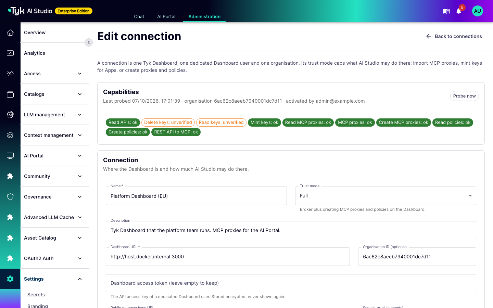
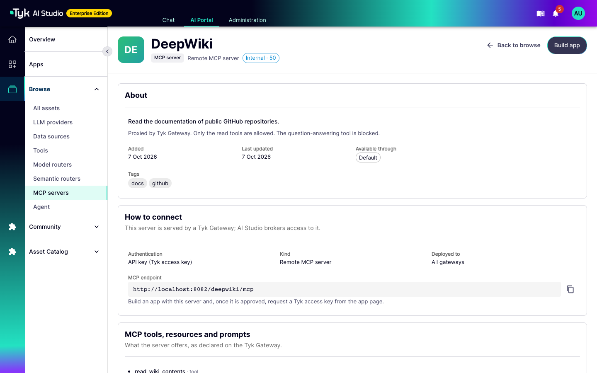
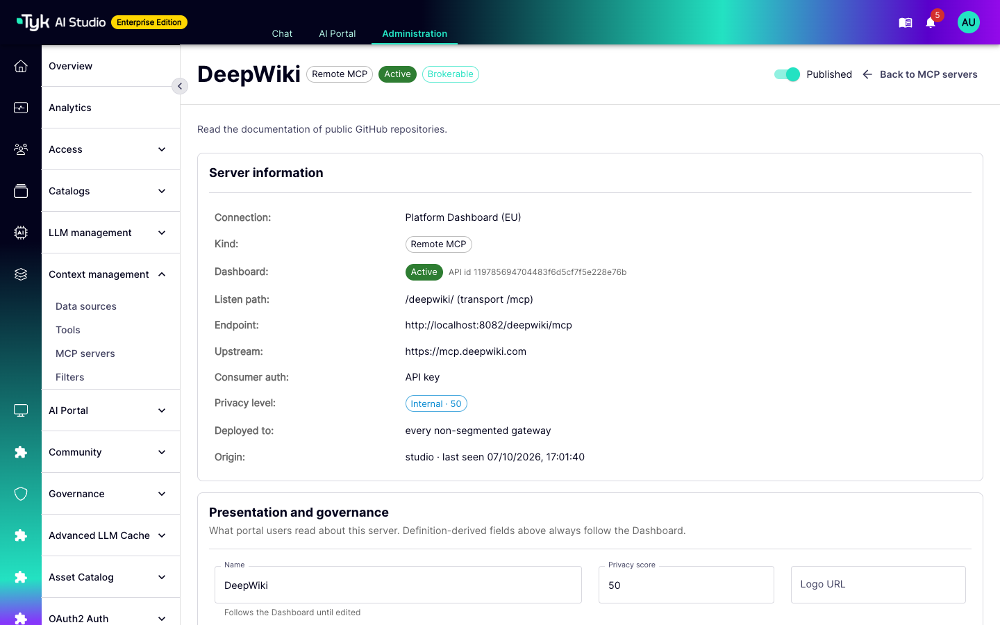
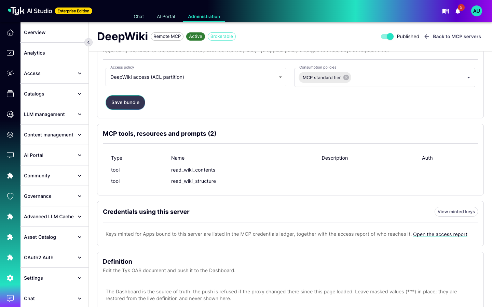
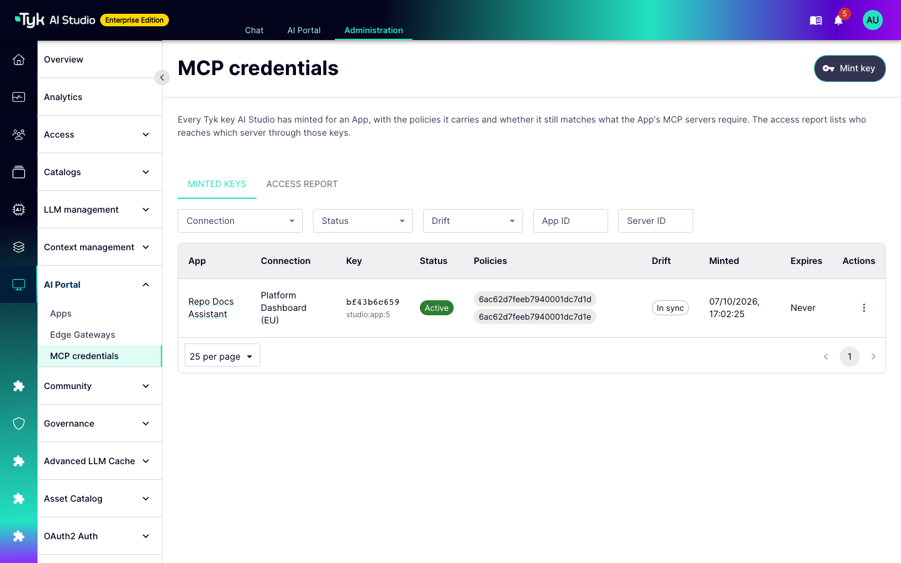

## Availability

| Edition | Deployment Type |
| :------------- | :---------------------- |
| [Enterprise](/ai-management/ai-studio/overview#enterprise-edition) | Self-Managed |

The integration is available from v2.2.0. In the Community Edition, the **Tyk Connections** page describes the feature, and the integration API refuses each request with `403`.

From v2.3.0, AI Studio can also manage MCP proxies and keys directly on open-source Tyk Gateways, without a Tyk Dashboard. {/* TODO: link to tyk-oss-gateway-mcp once merged */}

## Overview

The Tyk Dashboard MCP integration connects AI Studio to the MCP proxies that a [Tyk Dashboard](/ai-management/mcp-gateway/managing-proxies) manages. With the integration, AI Studio does these tasks:

- It imports the MCP proxies of the Dashboard. An administrator reviews each one and publishes it in the [AI Portal](/ai-management/ai-studio/ai-portal), next to LLMs, tools, and data sources.
- It gives each App that uses an MCP server a Tyk access key. The key gets its access rights and limits from Tyk policies that an administrator selects.
- It creates new MCP proxies on the Dashboard, from the admin UI or from a community submission.
- It records each key, change, and registration in the [audit trail](/ai-management/ai-studio/audit-trail).

Tyk MCP Gateway serves all MCP traffic. A client calls the listen path of the proxy on the gateway, with its Tyk access key. AI Studio is not on that path. The gateway applies the MCP access rules, rate limits, and quotas. For the gateway side, refer to [Tyk MCP Gateway](/ai-management/mcp-gateway/overview). To see MCP usage in AI Studio, refer to [MCP Analytics With Tyk Pump](/ai-management/ai-studio/tyk-mcp-analytics).

An MCP server in AI Studio is not the same as a [tool](/ai-management/ai-studio/tools) that you can call over MCP. AI Studio serves a tool, and chats and agents can use it. Tyk Gateway serves an MCP server, and only Apps can use it. Refer to [Tools and MCP Servers](/ai-management/ai-studio/tools#tools-and-mcp-servers).

## Connections

A connection is one Tyk Dashboard URL, one Dashboard user access key, and one Organisation. You can add more than one connection. Each imported server, each cached policy, and each issued key belongs to one connection.

To manage connections, go to **Settings > Tyk Connections**. To add one, click **Connect Dashboard**. You can also add a connection inline in the **Import OpenAPI** wizard on the **Tools** page. Refer to [Importing Tools from a Tyk Dashboard](/ai-management/ai-studio/tools#importing-tools-from-a-tyk-dashboard-admin).


### Trust Modes

The permissions of the Dashboard user set the limit of what AI Studio can do. The trust mode of the connection can only make that set smaller:

| Mode | What AI Studio Can Do |
| :--- | :--- |
| Catalogue | Import MCP proxies and policies. Read the keys that it issued before. |
| Broker | Catalogue, and also issue, change, and revoke keys from the selected policies. |
| Full | Broker, and also create and edit MCP proxies and policies on the Dashboard. |

Use a dedicated Dashboard user for each connection, with only the permissions that the mode needs:

- Catalogue mode: read access to APIs, policies, and MCP proxies.
- Broker mode: also write access to keys.
- Full mode: also write access to APIs, policies, and MCP proxies.

AI Studio does not accept the Dashboard admin secret.

### Capabilities

When you activate a connection, and at each sync, AI Studio probes the Dashboard. The probe uses only calls that change nothing. The connection page shows the result for each capability.



- A read capability shows **ok** when the Dashboard answers.
- Some write capabilities show **unverified** until the first real write. For example, the first issued key proves **Mint keys**.
- If the Dashboard refuses a request with `401` or `403`, AI Studio marks the connection as degraded. It names the failed capability.
- The effective mode is the highest mode that the capabilities permit, up to the mode that you selected. If the probe cannot prove a capability, AI Studio uses a lower mode and shows a warning.

Activating a connection needs the `execute` action on `tyk-connections`. To require that a different person activates the connection, set `TYK_MCP_REQUIRE_DIFFERENT_ACTIVATOR=true`.

When AI Studio runs inside a Tyk Dashboard, the Dashboard supplies one connection. This connection shows **Managed by host**. The Dashboard sets its URL, Organisation, trust mode, gateway URL, and access key. You cannot delete it, but you can change its name, sync interval, and governance settings, and you can disable it.

### API Template

A connection can name a Tyk Dashboard API template. AI Studio merges the defaults of the template into each MCP proxy that it creates on that connection. It does this again each time it pushes a definition. Use a template to give each proxy the traffic logs, middleware, and tags that your platform team requires. If AI Studio cannot read the template, the registration fails, and AI Studio does not create the proxy.

### Segmented Gateways

If your gateways are [segmented](/api-management/multiple-environments), a proxy loads only on the gateways that have its tags. A connection can learn the tags from MDCB, or you can enter a list of known tags. When a connection knows at least one tag, the registration wizard and the submission form show a deployment target. You can also set a public gateway URL for each tag, so the AI Portal shows the correct endpoint.

### Endpoint URLs in the AI Portal

The endpoint URL that AI Portal users see is the address where Tyk Gateway serves the proxy, not the AI Studio gateway.

AI Studio uses the first of these URLs that it can build:

1. The custom domain of the proxy, when [`server.customDomain`](/api-management/gateway-config-tyk-oas#domain) is enabled: `<scheme>://<custom domain><listen path><transport path>`. The scheme comes from the **Public gateway base URL** of the connection, or is `https`. The gateway must have [`enable_custom_domains`](/tyk-oss-gateway/configuration#enable_custom_domains) on. AI Studio ignores domain patterns, such as `{tenant:[a-z]+}.example.com`.
2. The URL of each gateway tag of the proxy. The AI Portal shows one URL for each target.

   {/* TODO: Add screenshot: MCP server page in the AI Portal with one endpoint URL for each gateway tag */}
3. The **Public gateway base URL** of the connection, with the listen path and the transport path. For example, `https://gateway.example.com/weather/mcp`. Usually, this base URL is the load balancer in front of the gateways.

If AI Studio cannot build a URL, the AI Portal tells the user that the endpoint URL is not configured.

When you change the base URLs of a connection, AI Studio updates the URL of each server at the next sync.

## Discover and Publish MCP Servers

AI Studio syncs each active connection at its sync interval. To sync at once, click **Sync now** on the **MCP servers** page. A sync does these steps:

1. It lists each MCP proxy on the Dashboard and reads its listen path, kind, authentication, tools, and gateway tags.
2. It stores the definition. It masks the upstream credentials.
3. It updates the cached policies, and it checks the keys that it issued.

The imported servers show on the **Context management > MCP servers** page. You can also register a new server from this page. Refer to [Register an MCP Proxy From AI Studio](#register-an-mcp-proxy-from-ai-studio).


An imported server is not published. Before you publish a server, do these steps:

1. Set a **Privacy score**. An imported server has no privacy score until you set one.
2. Add the server to the [tool catalogs](/ai-management/ai-studio/catalogs) of the Teams that must see it in the AI Portal.
3. To let AI Studio issue keys for the server, select a policy bundle. Refer to [Policy Bundles](#policy-bundles).

You can publish a server only while its proxy is active on the Dashboard. If a connection has **Auto-publish imported servers** on and a default privacy score, AI Studio publishes each new active server in the Default tool catalog.

In the AI Portal, a published server has its own page with its authentication, its MCP endpoint, and its tools.





AI Studio keeps its own name override, descriptions, logo, tags, privacy score, catalogs, and bundle for each server. A sync does not change them. The other fields always follow the Dashboard.

If a proxy is no longer on the Dashboard, AI Studio marks the server as missing, unpublishes it, and suspends its keys. If the proxy comes back with the same ID, AI Studio resumes the server and its keys.

## Policy Bundles

A Tyk key does not carry its own access rights. It carries policy IDs, and Tyk Gateway applies those policies to each request. AI Studio does not create a policy for each App. Instead, you select a bundle of policies for each MCP server:

- One access policy. Its access rights must include the MCP proxy. It must be unpartitioned, or it must use the ACL partition.
- Zero or more consumption policies. Each one must use the rate limit, quota, or complexity partition, and must not use the ACL partition.

You cannot select a policy that uses the `per_api` partition. For the partitions, refer to [Partitioned Policies](/api-management/access-control/policies/applying-policies#partitioned-policies). For the MCP access rules in a policy, refer to [MCP Gateway Policies](/ai-management/mcp-gateway/policies).



On a Full mode connection, you can also create a policy from the server page. AI Studio creates a partitioned policy on the Dashboard, tags it `studio-managed`, and adds it to the bundle. You can edit these policies from AI Studio. Policies from other sources link to the Dashboard.

When you change a policy on the Dashboard, the change applies to every key that uses it. AI Studio does not need to do anything.

## Access Keys for Apps

A user adds MCP servers to an App, in the same way as tools. Only servers with an API key authentication can go into an App.

After an administrator approves the App, the App page shows a **Connect via MCP** section. It has one card for each connection, with the endpoint of each server and the key actions. The section also gives one MCP client configuration for all the MCP servers and tools of the App.


A key is issued in one of two ways:

- The App owner requests the key on the App page in the AI Portal.
- An administrator clicks **Mint key** on the **Portal administration > MCP credentials** page, for an App.

Each App gets one key for each connection. The key carries the policies of the bundles of all the App's MCP servers on that connection. AI Studio shows the key one time only. It does not store the key in plain text.



On the **MCP credentials** page, an administrator can rotate, suspend, resume, and revoke keys. The **Access report** tab shows which App reaches which MCP server, and with which key.

When you rotate a key, the old key stops at once. There is no grace period.

When you revoke a key, AI Studio deletes it on the Dashboard. Some gateways do not let AI Studio delete a key by its hash. In this case, AI Studio switches the key off and records this on the connection.

### Policy Changes on Keys

A key must get different policies when a bundle changes, when an App gains or loses a server, or when a policy is deleted. AI Studio checks this at once and at each sync:

| Change | What AI Studio Does |
| :--- | :--- |
| The key loses access, for example a policy is removed | It applies the change at once. |
| The key gets access to an MCP proxy that it did not reach before | It waits for an administrator to apply the change. The key shows **Change pending**. If the person who made the change has the `execute` action on `mcp-credentials`, AI Studio applies it at once. |
| No access policy is left | It switches the key off. |
| Someone added a policy to the key on the Dashboard | It keeps the policy and shows it as external. |

### Servers Without Keys

AI Studio catalogs and publishes servers that use OAuth 2.1, external OAuth, JWT, mTLS, or no authentication. It does not issue keys for them. You cannot add these servers to an App. Their page in the AI Portal tells the user how to connect directly. The access report does not show them.

## Register an MCP Proxy From AI Studio

On a Full mode connection, you can create a new MCP proxy on the Dashboard. Go to **Context management > MCP servers**, and click **Register MCP server**. The wizard has four steps:

1. **Connection and kind:** Select the connection and the kind. **Remote MCP server** proxies an existing MCP endpoint. **REST API to MCP** makes the operations of a Tyk OAS API into MCP tools. It needs Tyk 5.15 or later.
2. **Proxy details:** Enter the name and the listen path. Then do one of these steps:
   - For a remote MCP server, enter the upstream MCP URL, and select which tools the gateway allows. Enter the base URL of the server. The gateway adds `/mcp` itself, so AI Studio removes a `/mcp` suffix from the URL that you enter.
   - For REST API to MCP, select the source API and its operations.
3. **Access and governance:** Select the consumer authentication: API key, OAuth 2.1, or keyless. Then select the deployment target, the privacy score, the tool catalogs, and whether to publish at once.
4. **Review and create:** Examine the definition, the endpoint, and the warnings. Then create the proxy.


To find the tools of a remote server, AI Studio calls the upstream server one time. It does this only from the wizard, and only for users with the `execute` action on `mcp-servers`. The call uses the same host rules as connections, with no exception for internal hosts. To permit an internal upstream host, add it to `TYK_MCP_ALLOWED_HOSTS`. If AI Studio cannot reach the upstream server, type the tool names. The gateway blocks each tool that you do not select, including tools that the server adds later.

AI Studio sends the upstream credential to the Dashboard and does not store it.

You can edit the definition on the server page and push it to the Dashboard. AI Studio refuses the push if the proxy changed on the Dashboard after you opened the page. Before AI Studio overwrites a proxy that was created on the Dashboard, it asks you to confirm.

When you delete a proxy that AI Studio registered, AI Studio deletes it from the Dashboard. For a proxy created on the Dashboard, you can only unpublish it in AI Studio.

## Community Submissions

AI Portal users can submit an MCP server for review, in the same way as a tool or a data source. Refer to [Community Submissions](/ai-management/ai-studio/community). AI Studio encrypts the upstream credential of a submission, and does not show it in responses.

What happens when a reviewer approves a submission depends on the connection:

- **Full mode:** AI Studio creates the proxy on the Dashboard. The submitter owns the new server.
- **Catalogue or Broker mode, with handoffs accepted:** AI Studio records the server as awaiting the platform team, and notifies administrators. The server page gives a handoff package with the definition, the policy shape, and the steps. After the platform team creates the proxy and a sync imports it, click **Link** on the server page. AI Studio then moves the owner, privacy score, catalogs, and submission to the imported server.

The handoff publishes the `system.mcp_server.registration_handoff` event. You can send it to a [webhook](/ai-management/ai-studio/webhooks).

## MCP Analytics

Available from Tyk AI Studio 2.3.0.

AI Studio gets MCP usage from the analytics records of Tyk Gateway, for Dashboard and Gateway connections. Tyk Pump sends the records to an ingest endpoint on AI Studio. AI Studio shows calls, error rates, latency (p50 and p95), use per tool, and use per App in these places:

- The **Usage** tab of each MCP server.
- The **MCP usage** section of the App pages, in the admin UI and in the AI Portal.
- The **MCP traffic** panel of the admin dashboard.

{/* TODO: Add screenshot: MCP traffic panel of the admin dashboard */}

{/* TODO: Add screenshot: Usage tab of an MCP server with calls, error rate, latency, and per-tool usage */}

### Prerequisites

- Tyk Gateway 5.14 or later, with [`enable_analytics`](/tyk-oss-gateway/configuration#enable_analytics) set to `true`.
- [Traffic logs](/api-management/logs/traffic-logs) on each MCP proxy (`x-tyk-api-gateway.middleware.global.trafficLogs.enabled: true`). The proxies that AI Studio registers have traffic logs on.
- Tyk Pump 1.16 or later.

### Ingest Token

Each connection has its own ingest token. To create one, open the connection, go to the **Analytics** section, and click **Generate token**. AI Studio shows the token one time only. It stores only a hash of the token.

Tyk Pump sends the token in the `Authorization: Bearer` header with each batch. AI Studio matches the records only against the MCP servers of that connection. It counts and drops the records of other APIs.

- **Rotate token** stops the old token at once.
- **Revoke** stops the ingest for the connection.

The **Analytics** section also shows when the last batch arrived and the record counts for the last 24 hours. It gives configurations for Tyk Pump and Vector that you can copy.

{/* TODO: Add screenshot: Analytics section of a Tyk connection with the ingest token and the record counts */}

### Send Records With the HTTP Pump

The Tyk Pump `http` pump sends records directly to AI Studio. It is not in a Tyk Pump release yet. Until your Tyk Pump has it, use [Vector with the stdout pump](#send-records-with-vector-and-the-stdout-pump). {/* TODO: Name the Tyk Pump version that ships the http pump (TT-18824) and drop the Vector fallback note. */}

Add the pump to `pump.conf`. Replace the URL with the address of your AI Studio, and `<INGEST_TOKEN>` with the ingest token:

```json expandable
{
  "dont_purge_uptime_data": true,
  "pumps": {
    "http": {
      "type": "http",
      "timeout": 30,
      "omit_detailed_recording": true,
      "meta": {
        "url": "https://studio.example.com/api/v1/ingest/tyk-analytics",
        "headers": { "Authorization": "Bearer <INGEST_TOKEN>" },
        "mcp_only": true,
        "gzip": true,
        "batch_size": 500,
        "max_retries": 8
      }
    }
  }
}
```

- `mcp_only` sends only MCP records. Without it, Tyk Pump sends the records of all APIs, and AI Studio drops them. A `filters.api_ids` list also limits the records. {/* TODO: link reference for mcp_only and filters.api_ids */}
- [`omit_detailed_recording`](/tyk-pump/tyk-pump-configuration/tyk-pump-environment-variables#omit_detailed_recording) keeps the raw requests and responses out of the batches.
- [`dont_purge_uptime_data`](/tyk-pump/tyk-pump-configuration/tyk-pump-environment-variables#dont_purge_uptime_data) is a top-level setting. Keep it `true` unless you run an uptime pump. If it is `false`, Tyk Pump looks for MongoDB and stops at start.

Tyk Pump removes records from Redis when it reads them. It retries a failed batch `max_retries` times, with a wait that doubles each time, within the pump `timeout`. {/* TODO: link reference for max_retries and timeout */} With the example above (`max_retries: 8`, `timeout: 30`), this covers about 30 seconds of AI Studio downtime. After the last try, Tyk Pump drops the batch. For longer outages, run more than one AI Studio replica behind the ingest URL.

### Send Records With Vector and the Stdout Pump

The stdout pump writes the records to its output, and [Vector](https://vector.dev/) sends them to AI Studio.

1. Add the stdout pump to `pump.conf`. Also set [`dont_purge_uptime_data`](/tyk-pump/tyk-pump-configuration/tyk-pump-environment-variables#dont_purge_uptime_data) to `true`, unless you run an uptime pump.

    ```json
    {
      "pumps": {
        "stdout": {
          "type": "stdout",
          "omit_detailed_recording": true,
          "meta": { "format": "json", "log_field_name": "tyk-analytics-record" }
        }
      }
    }
    ```

2. In the Vector environment, set `MCP_INGEST_URL` to `https://studio.example.com/api/v1/ingest/tyk-analytics` and `MCP_INGEST_TOKEN` to the ingest token.

3. Add this configuration to `vector.toml`:

    ```toml expandable
    # Pump's container output. On Kubernetes use a kubernetes_logs source with an
    # extra_label_selector for the Pump pods instead.
    [sources.pump]
    type = "docker_logs"
    include_labels = ["com.docker.compose.service=pump"]

    # Keep only analytics records of MCP traffic.
    [transforms.mcp_records]
    type = "remap"
    inputs = ["pump"]
    drop_on_error = true
    drop_on_abort = true
    source = '''
    parsed = object!(parse_json!(string!(.message)))
    record = object!(parsed."tyk-analytics-record")
    if record.mcp_stats.is_mcp != true { abort }
    . = record
    '''

    # A JSON array of records per request, bearer token, gzip.
    [sinks.studio]
    type = "http"
    inputs = ["mcp_records"]
    uri = "${MCP_INGEST_URL}"
    method = "post"
    compression = "gzip"
    encoding.codec = "json"
    auth.strategy = "bearer"
    auth.token = "${MCP_INGEST_TOKEN}"
    batch.max_events = 500
    batch.timeout_secs = 5
    request.retry_attempts = 5
    ```

Vector reads the output of Tyk Pump from the time that it attaches. If Vector is down, the output of that time is lost, because Tyk Pump already removed the records from Redis.

### Ingest Endpoint Responses

| Status | Cause | Tyk Pump Action |
| :--- | :--- | :--- |
| `202` | AI Studio accepted the batch. The body gives the counts of accepted, stored, non-MCP, unknown-API, and unattributed records. | Done |
| `400` | The body is not a JSON array. | Drops the batch |
| `401` | The token is missing, wrong, or revoked, or the connection is disabled. | Drops the batch |
| `404` | Community Edition, or the integration is off. | Drops the batch |
| `413` | The body is larger than 16 MiB, also after gzip expansion, or has more than 5000 records. | Drops the batch |
| `415` | The `Content-Encoding` is not `gzip` or none. | Drops the batch |
| `429` | The connection sent more than 20 batches a second, with bursts of up to 40. | Tries again |
| `503` | AI Studio is busy. | Tries again |

For the endpoint, refer to the [AI Studio API reference](/ai-management/ai-studio/ai-studio-swagger).

### App Attribution

AI Studio assigns a call to an App in one of these ways:

- The call uses a key that AI Studio issued for the App on this connection. AI Studio matches the key hash that the gateway records. If [`hash_keys`](/tyk-oss-gateway/configuration#hash_keys) is off on the gateway, it matches the key.
- The key alias names an App that has a key on this connection.

Calls to [servers without keys](#servers-without-keys) count for each server only, without an App. AI Studio does not store API keys, request or response bodies, or client addresses.

AI Portal users see the MCP usage of their own Apps only.

### Analytics Limits

- Delivery is at least once. The records have no ID, so AI Studio can count a batch two times if Tyk Pump sends it again.
- Records are lost when AI Studio is down for longer than the Tyk Pump retries cover. Refer to [Send Records With the HTTP Pump](#send-records-with-the-http-pump).
- The error rate counts HTTP errors and JSON-RPC errors. The gateway finds JSON-RPC errors in the first 64 KiB of the response. A tool result with `isError` shows as a successful call. On Tyk Gateway 5.15, the JSON-RPC errors of the upstream server also show as successful calls.
- Tyk Gateway 5.15 writes no record when the MCP access rights of the key refuse a call. Tools that key access blocks do not show. Tyk Gateway 5.16 records these calls as errors. Tyk Gateway records calls with a missing or bad key, without an App.
- REST-to-MCP proxies do not report the upstream latency. Use the total latency.
- If a call arrives after you delete its server, AI Studio counts it as an unknown API and drops it.
- AI Studio keeps MCP call records with no time limit. The table grows with MCP traffic.

## Permissions

Three resources in the [permission catalog](/ai-management/ai-studio/rbac#permission-reference) control the integration:

- `tyk-connections` controls the connections. The `execute` action activates, disables, probes, and syncs a connection. The `write` action generates, rotates, and revokes the ingest token.
- `mcp-servers` controls the MCP servers. The `execute` action registers servers, finds the tools of an upstream server, pushes definitions, links handoffs, and creates policies. The `publish` action shows a server in the AI Portal.
- `mcp-credentials` controls the issued keys. The `execute` action issues, rotates, suspends, resumes, and revokes keys, and applies pending changes.

The MCP usage views in the admin UI need the `read` action on `analytics`.

Roles do not control actions in the AI Portal. A user can add a server to their own App and request a key for it when one of their Teams can see the server.

## Configuration

| Variable | Default | Description |
| :--- | :--- | :--- |
| `TYK_MCP_ENABLED` | `true` | Set to `false` to turn off the integration. |
| `TYK_MCP_SYNC_MIN_INTERVAL` | `60s` | The shortest sync interval that a connection can use. The minimum is `10s`. |
| `TYK_MCP_REQUEST_TIMEOUT` | `10s` | The timeout for Dashboard reads. Writes get three times this value. The maximum is `60s`. |
| `TYK_MCP_RATE_LIMIT_PER_SECOND` | `10` | The maximum outbound requests per second for each connection. |
| `TYK_MCP_ALLOWED_HOSTS` | Empty | The Dashboard, MDCB, and upstream MCP hosts that AI Studio can call. Empty means any public host. |
| `TYK_MCP_DENIED_HOSTS` | Empty | Hosts that AI Studio never calls. |
| `TYK_MCP_REQUIRE_DIFFERENT_ACTIVATOR` | `false` | Requires that a different person activates a connection. |
| `TYK_MCP_SYNC_RUN_RETENTION` | `720h` | How long AI Studio keeps the sync run records. |

<Warning>
You must set `TYK_AI_SECRET_KEY`. AI Studio uses it to encrypt the Dashboard access keys and the submitted upstream credentials. If it is not set, the integration does not start.
</Warning>

By default, AI Studio refuses Dashboard and MDCB URLs on internal network addresses. To permit one, select **Allow this Dashboard host to be on an internal network address** on the connection.

## Limitations

- Chats and agents in AI Studio do not use Tyk-managed MCP servers. Only Apps use them.
- Each server has one policy bundle.
- When you rotate a key, the old key stops at once.
- On a Tyk Dashboard connection, the proxies that AI Studio registers with API key authentication do not set [`stripAuthorizationData`](/api-management/client-authentication#managing-authorization-data). Tyk Gateway then sends the Tyk key of the App to the upstream MCP server. Proxies on Tyk Gateway connections set it.
