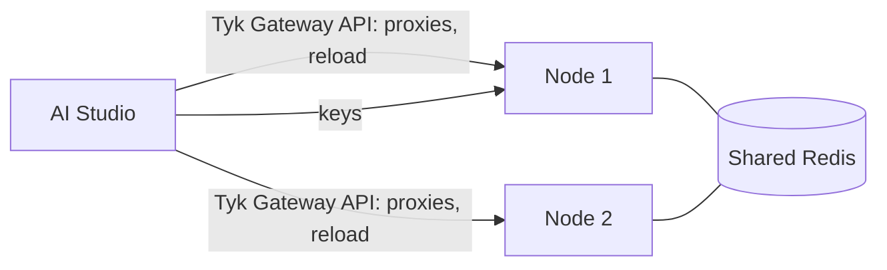

## Availability

| Edition | Deployment Type |
| :------------- | :---------------------- |
| [Enterprise](/ai-management/ai-studio/overview#enterprise-edition) | Self-Managed |

Tyk Gateway connections are available from Tyk AI Studio 2.3.0.

## Overview

AI Studio can manage MCP proxies on open-source Tyk Gateways directly. You do not need a Tyk Dashboard. AI Studio calls the Tyk Gateway API of each gateway node. It gives you the same features as the [Tyk Dashboard MCP integration](/ai-management/ai-studio/tyk-mcp-integration):

- It imports the MCP proxies of the gateways, so that you can publish them in the [AI Portal](/ai-management/ai-studio/ai-portal).
- It creates new MCP proxies, from the admin UI or from a community submission.
- It issues, rotates, and revokes Tyk keys for Apps.

Use a Tyk Gateway connection for governed MCP access without the full Tyk API management stack.

For publishing, Apps, the **MCP credentials** page, community submissions, and permissions, refer to [Tyk Dashboard MCP Integration](/ai-management/ai-studio/tyk-mcp-integration). They work in the same way on a Tyk Gateway connection. For MCP usage, refer to [MCP Analytics With Tyk Pump](/ai-management/ai-studio/tyk-mcp-analytics).

## What AI Studio Manages

A Tyk Gateway connection manages MCP proxies and keys only.

- AI Studio can call a fixed list of Tyk Gateway API endpoints: `/hello`, `/tyk/mcps`, `/tyk/keys`, and `/tyk/reload`. It refuses every other call before it sends it.
- AI Studio does not manage REST or GraphQL APIs, Policies, certificates, or OAuth clients on the gateways.
- AI Studio does not change or delete an MCP proxy that it did not create.

These features of a Tyk Dashboard connection are not available on a Tyk Gateway connection:

- REST API to MCP proxies
- API templates
- Policies and policy bundles
- MDCB data planes and gateway segmentation tags
- The **Import OpenAPI** wizard on the **Tools** page

## Requirements

| Requirement | Why AI Studio needs it |
| :--- | :--- |
| Tyk Gateway 5.13 or later on each node | Earlier versions do not have MCP proxies. The probe names each node with an earlier version. |
| The gateway `secret` | AI Studio sends it in the `X-Tyk-Authorization` header. The secret gives full control of a gateway. AI Studio stores it encrypted. |
| `TYK_AI_SECRET_KEY` on AI Studio | AI Studio uses it to encrypt the gateway secret. Without it, the integration does not start. |
| One Redis for all nodes | Keys live in Redis. A key that AI Studio creates through one node then works on each node. |
| A writable `app_path` on each node | The Tyk Gateway API writes the proxy definitions to this directory. |

Expose the Tyk Gateway API on a [`control_api_port`](/tyk-oss-gateway/configuration#control_api_port) that clients on the internet cannot reach. The official Tyk Gateway image runs as a non-root user. If you mount a new volume at `app_path`, make sure that this user can write to it.

## How AI Studio Keeps the Nodes in Sync

An open-source gateway node keeps its API definitions on its own disk. No Tyk Gateway API call changes all the nodes of a cluster. For this reason, AI Studio does these steps:

1. It keeps the definition of each proxy that it creates, encrypted, in its own database.
2. At each sync, it finds the nodes of the connection.
3. On each node, it writes the AI Studio proxies that are missing or out of date. It removes the AI Studio proxies that it no longer needs. Then it reloads the node.
4. When you register or edit a proxy, it writes the change to each node at once. The next sync tries again on each node that failed.

If someone edits an AI Studio proxy directly on a node, the next sync restores the AI Studio version.

The proxies that AI Studio creates have an API ID that starts with `studio-`, then a random part for each connection. Two AI Studio installations, or two connections, can share one cluster. They do not remove the proxies of each other.

{/* Diagram for the designer.
Purpose: show how AI Studio keeps several open-source gateway nodes in sync.
Structure: AI Studio on the left. Two gateway nodes in the middle. One shared Redis on the right.
Key elements: AI Studio writes proxies and reloads each node through the Tyk Gateway API. It creates keys through one node. Both nodes use the shared Redis.
Design notes: label the arrows "proxies, reload" and "keys". */}

### Find the Nodes

Select how AI Studio finds the nodes in **Find nodes by**:

| Option | Nodes |
| :--- | :--- |
| **Single node** | The **Gateway API URL** of the connection. |
| **List of nodes** | The **Gateway API URL**, and each URL in **Other node URLs (one per line)**. |
| **DNS (every address the hostname resolves to)** | Each address of the hostname in the **Gateway API URL**. AI Studio resolves the name again at each sync. Use a Kubernetes headless Service or a Docker Compose service name. |

With DNS, AI Studio connects to each address directly. The URL, the `Host` header, and the TLS server name keep the hostname. A connection can have a maximum of 64 nodes.

### Shared Storage

If all nodes use one shared volume for `app_path`, select **The nodes share app_path (shared volume)**. AI Studio then writes each proxy through one node, and a group reload loads it on all nodes. A new node serves the proxies from its first start.

Without shared storage, a new node serves the AI Studio proxies only after the next sync. Until then, it returns `404` on their listen paths. If your gateways autoscale, use shared storage or a short sync interval. The default sync interval is 300 seconds. The minimum is [`TYK_MCP_SYNC_MIN_INTERVAL`](/ai-management/ai-studio/ai-studio-env#tyk_mcp_sync_min_interval) (default `60s`).

### Gateway Nodes Panel

The **Gateway nodes** section of the connection page has one row for each node. The row shows the version, the number of AI Studio proxies, the number of all MCP proxies, and the time of the last sync. Each node has one of these states:

| State | Meaning |
| :--- | :--- |
| **In sync** | The node has each AI Studio proxy in its current version. |
| **Pending** | The node is not up to date yet. For example, a write failed, a reload has not finished, or the node refused the gateway secret. The next sync tries again. |
| **Unreachable** | AI Studio could not connect to the node. |
| **Gone** | AI Studio no longer finds the node. It keeps the row for the history. |

To see the error for a node, hold the pointer over its state.

{/* TODO: Add screenshot: Gateway nodes section of a Tyk Gateway connection with two nodes In sync and one Unreachable */}

### Proxies on Some Nodes Only

AI Studio does not copy a proxy that it did not create. If such a proxy is on some nodes only, AI Studio imports it and shows how many nodes serve it. Clients would get a `404` from the other nodes. For this reason:

- You can publish the server, but AI Studio does not issue keys for it.
- You cannot add the server to an App.

AI Studio also notifies administrators. When each node serves the proxy, the next sync removes the restriction.

## Create a Tyk Gateway Connection

1. Go to **Settings > Tyk Connections**, and click **Add connection**.
2. In **Connect to**, select **Tyk Gateway (open source)**.
3. Enter a **Name**, and select a **Trust mode**:
   - **Catalogue**: Import the MCP proxies that the gateways serve.
   - **Broker**: Also issue and revoke Tyk keys for Apps.
   - **Full**: Also create MCP proxies on each node, and keep the nodes in sync.
4. In **Gateway API URL**, enter the Tyk Gateway API URL of one node, for example `http://tyk-gateway:8080`.
5. In **Gateway secret**, enter the `secret` of the gateways.
6. In **Public gateway base URL**, enter the URL that clients use to reach the gateways. This is usually the load balancer or the ingress in front of the nodes.
7. For a Tyk Gateway API on an internal address, select **Allow the Gateway hosts to be on an internal network address**. This option needs the `execute` action on `tyk-connections`.
8. In the **Nodes** section, select **Find nodes by**. If the nodes share `app_path`, select **The nodes share app_path (shared volume)**.
9. Click **Test connection**, and examine the result.
10. Click **Create connection**.
11. Activate the connection from the **Tyk Connections** page. This needs the `execute` action on `tyk-connections`. With [`TYK_MCP_REQUIRE_DIFFERENT_ACTIVATOR`](/ai-management/ai-studio/ai-studio-env#tyk_mcp_require_different_activator) set to `true`, a different administrator must activate it.

Most Tyk Gateway API URLs use an internal address, such as a private range, `localhost`, or a cluster name. If you do not allow internal hosts, the probe shows the nodes as not reachable. AI Studio then refuses to save the connection with the error `url is not allowed by the Tyk Dashboard URL policy`. The error names the Tyk Dashboard on a Tyk Gateway connection too.

{/* TODO: Add screenshot: Connect Tyk Gateways form with Tyk Gateway (open source) selected and the Nodes section */}

The probe reports these results:

- The version of each node
- If the gateways accept the secret
- If the nodes share one Redis. AI Studio creates a switched-off test key through one node and reads it through another. Broker mode needs a shared Redis.
- If a dry-run proxy validates. Full mode needs this.

## Endpoint URLs in the AI Portal

Clients call the gateways directly. AI Studio is not on the traffic path. The AI Portal shows the endpoint of each proxy from the **Public gateway base URL** of the connection, plus the listen path, for example `https://gateway.example.com/weather/mcp`. If a proxy has a custom domain, the AI Portal uses that domain instead. Each node serves each proxy, so there are no URLs for each gateway tag.

## Key Access

On a Tyk Dashboard connection, a key carries Policies. On an open-source gateway, Policies are files on the disk of each node. A key that names a Policy that a node did not load fails on that node.

For this reason, the keys that AI Studio issues on a Tyk Gateway connection carry the access rights directly. The key has one access rights entry for each MCP proxy that the App uses. The key is in the shared Redis, so it works on each node at once.

Each MCP server on a Tyk Gateway connection has a **Key access** section. It replaces the **Access policies** section of a Tyk Dashboard connection.

| Field | Default | Description |
| :--- | :--- | :--- |
| **Allowed tools** | Empty | The tools that keys can list and call. `tools/list` shows only these tools. Empty means each tool of the proxy. Type the names exactly as the server returns them. |
| **Requests** and **per seconds** | Empty | The rate limit for each App key on this server. Empty means no rate limit. |
| **Quota (requests)** and **renews every (seconds)** | Empty | The quota for each App key on this server. Empty means no quota. |

The rate limit and the quota apply separately to each server. A rate limit needs a period, and a quota needs a renewal period. The key has no limits other than the limits of its servers.

When you click **Save key access**, AI Studio changes the keys of each App that uses the server. It does this at once, without approval.

When an App gets an additional server, its key can reach a new proxy. This change waits for an administrator to apply it, in the same way as on a Tyk Dashboard connection. Refer to [Policy Changes on Keys](/ai-management/ai-studio/tyk-mcp-integration#policy-changes-on-keys). If someone adds rights for other APIs to a key on the gateway, AI Studio keeps them and shows them as external.

{/* TODO: Add screenshot: Key access section of an MCP server with two allowed tools, a rate limit, and a quota */}

## Register an MCP Proxy

On a Full mode connection, you can register a remote MCP server from **Context management > MCP servers**. The wizard is the same as for a [Tyk Dashboard connection](/ai-management/ai-studio/tyk-mcp-integration#register-an-mcp-proxy-from-ai-studio), with these differences:

- A gateway node validates the preview as a dry run. It writes nothing.
- On proxies with API key authentication, AI Studio sets `stripAuthorizationData`. The gateway then does not send the Tyk key of the client to the upstream MCP server.
- AI Studio writes the upstream credential into the proxy definition on the disk of each node. Use a gateway secret reference instead of a literal token. For example, the value `$secret_env.WEATHER_TOKEN` reads the `TYK_SECRET_WEATHER_TOKEN` environment variable of the gateway.
