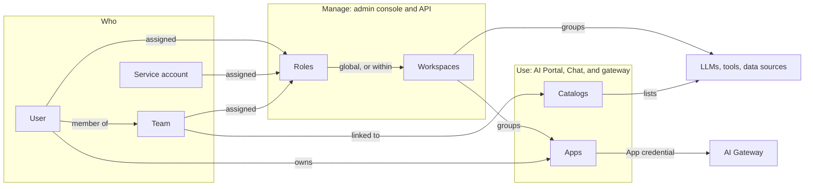

## Availability

| Edition   | Deployment Type |
| :------------- | :---------------------- |
| [Community](/ai-management/ai-studio/overview#community-edition) & [Enterprise](/ai-management/ai-studio/overview#enterprise-edition) | Self-Managed |

## Overview

Tyk AI Studio controls access in two separate ways:

- **Manage.** Roles control what a user can see and change in the admin console and the management API. You assign a role globally, or within a Workspace.
- **Use.** Teams and Catalogs control which LLMs, tools, and data sources a user can use in the AI Portal and Chat. Apps call them through the AI Gateway with their own App credentials.

{/* Diagram for the designer.
Purpose: show the two access systems in one view.
Structure: three groups. "Who" has User, Service account, and Team. "Manage" has Roles and Workspaces. "Use" has Catalogs and Apps. Add the shared box "LLMs, tools, data sources" and the AI Gateway.
Key elements: Roles apply globally or within a Workspace. Catalogs list resources for Teams. Apps call the gateway with their own credential.
Design notes: keep Manage and Use visually separate. Do not connect a Service account to a Team. */}



In the Community Edition, the **Admin User** switch replaces roles, and Workspaces are not available.

## Core Concepts

| Concept | What it is | Refer to |
| :--- | :--- | :--- |
| User | A person who signs in with a password or [SSO](/ai-management/ai-studio/sso). A user can also have one API key for the management API and the AI Portal. | [Users](/ai-management/ai-studio/users) |
| Service account | A user for automation, such as the Tyk Operator or a CI pipeline. It signs in with its API key only, and cannot belong to a Team. | [Service Accounts](/ai-management/ai-studio/users#service-accounts) |
| Team | A group of users. A Team gets access to Catalogs, and can have roles. Every user belongs to the Default Team. | [Teams](/ai-management/ai-studio/teams) |
| Catalog | A list of LLMs, tools, or data sources. A Team member can use the items in the Catalogs of their Teams. | [Catalogs](/ai-management/ai-studio/catalogs) |
| Role | A set of `resource:action` permissions for the admin console and the management API. Enterprise Edition. | [Roles and Permissions](/ai-management/ai-studio/rbac) |
| Workspace | A group of configuration objects. A role assigned within a Workspace applies only to the objects of that Workspace. Enterprise Edition. | [Workspaces](/ai-management/ai-studio/workspaces) |
| App | A client of the AI Gateway, owned by a user. Its credential decides which LLMs, tools, and data sources it can call. | [Manage Apps](/ai-management/ai-studio/admin-apps) |

## Authentication Methods

*   **UI Login:** Users access the web interface by logging in with their credentials (username/password) or via a configured [SSO Provider](/ai-management/ai-studio/sso). This establishes a browser session.
    *   A user has one browser session at a time. A login from a second browser, device, or private window replaces the session. The first browser is then signed out on its next request. Tabs in the same browser share the session. The session length is `SESSION_DURATION` (default `6h`).
*   **API Key Authentication:**
    1.  An administrator issues an API Key on the user's detail page. Users can also create or roll their own key from the account menu (**My API key**). Self-registered users and service accounts get a key automatically.
    2.  The user copies the key when AI Studio shows it, and securely provides it to their application or script.
    3.  The application includes the key in the `Authorization` header for requests to Tyk AI Studio APIs:
        ```
        Authorization: Bearer <your-ai-studio-api-key>
        ```
    4.  Tyk AI Studio validates the key and associates the request with its user. AI Studio refuses the key if the user is disabled. AI Studio also refuses the key of an SSO user without a recent identity provider login. The period is `SSO_API_KEY_LIVENESS`.
    5.  In the Enterprise Edition, the [audit trail](/ai-management/ai-studio/audit-trail) records if each action used a browser session or an API key (`auth_method`).

    The API key of a user is for the management API and the AI Portal. LLM traffic through the AI Gateway uses App credentials. Refer to [Proxy & API Gateway](/ai-management/ai-studio/proxy).
