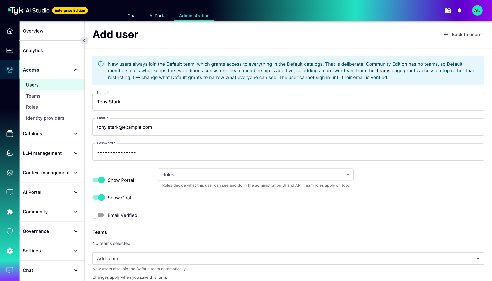
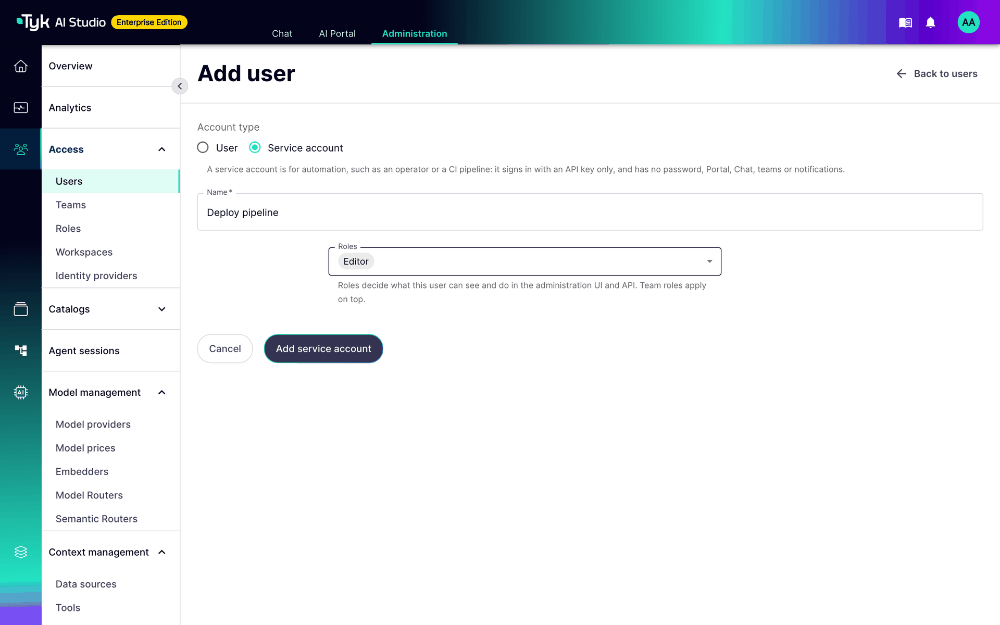

## Availability

| Edition | Deployment Type |
| :------------- | :---------------------- |
| [Community](/ai-management/ai-studio/overview#community-edition) & [Enterprise](/ai-management/ai-studio/overview#enterprise-edition) | Self-Managed |

In the Community Edition, every user is in the built-in **Default** [Team](/ai-management/ai-studio/teams).

Users are the administrators, developers, and chat users of Tyk AI Studio. For how users, Teams, roles, and Workspaces work together, refer to [User Management](/ai-management/ai-studio/user-management).

In the **Enterprise Edition**, you can also put users in more Teams and provision them through Single Sign-On (SSO). Roles control administrative access. You assign them to users, to Teams, or within a Workspace. Refer to [Roles and Permissions](/ai-management/ai-studio/rbac).

## What Is a User?

A user is the identity for authentication and authorization in Tyk AI Studio. Each user has a name, an email address, a password, and access switches.

You do not assign AI resources, such as LLMs or data sources, to a user. The [Teams](/ai-management/ai-studio/teams) of the user control access. A user in a Team gets access to all the [Catalogs](/ai-management/ai-studio/catalogs) of that Team.

### The Initial User and User Types

The first user who registers becomes an administrator. AI Studio marks the email address of this user as verified.

In the **Community Edition**, the **Admin User** switch controls access to the admin console. AI Studio describes each user with one of these types:

| Type | When It Applies | Access |
| :--- | :--- | :--- |
| **Super Admin** | The first user (user ID 1), with **Admin User** on | Full access to the admin console. You cannot disable or delete this user. |
| **Admin** | Any other user with **Admin User** on | Full access to the admin console |
| **Developer** | **Admin User** off and **Show Portal** on | The [AI Portal](/ai-management/ai-studio/ai-portal), where the user creates Apps and gets credentials |
| **Chat user** | **Admin User** off and **Show Portal** off | The [Chat interface](/ai-management/ai-studio/chat-interface), when **Show Chat** is on |

In the **Enterprise Edition**, roles control access to the admin console. The user form does not show the **Admin User** switch. The first user gets the Administrator role, and then the Owner role. Refer to [The First User and Upgrades](/ai-management/ai-studio/rbac#the-first-user-and-upgrades). The **Show Portal** and **Show Chat** switches still control access to the AI Portal and the Chat interface.

### API Keys
A user can have one **API Key**. The key gives programmatic access to the [AI Studio management APIs](/ai-management/ai-studio/ai-studio-swagger) (the Admin API) and the AI Portal, with the full permissions of the user.

- Only self-registered users and [service accounts](#service-accounts) get a key automatically. Users that an administrator creates, and users that SSO provisions, have no key until someone issues one.
- An administrator issues, regenerates, or revokes a key on the user's detail page. The detail page also shows when the key was last used.
- A user can create, roll, or revoke their own key from the account menu (**My API key**).
- AI Studio does not issue keys to SSO-provisioned users unless `ALLOW_SSO_USER_API_KEYS=true`. Refer to [SSO Users and API Keys](/ai-management/ai-studio/sso#provisioned-users-api-keys-and-offboarding).

## Configuration

- **Name**: The full name of the user.
- **Email**: The email address that the user logs in with.
- **Password**: The password of the user.
- **Admin User** (Community Edition): Gives the user full access to the admin console.
- **Show Portal**: Gives the user access to the AI Portal.
- **Show Chat**: Gives the user access to the Chat interface.
- **Email Verified**: Shows if the email address is verified. A user cannot log in until the email address is verified.
- **Roles** (Enterprise Edition): The roles that control what the user can see and do in the admin UI and API. Team roles apply in addition to these roles.
- **Teams**: The Teams that the user belongs to. New users also join the Default Team automatically.
- **Budget team** (Enterprise Edition): The Team that the spend of the new Apps of the user counts against. The form shows this field when the user belongs to more than one Team. The default is **Automatic (first team other than Default)**. Select the Team explicitly, so that the spend goes to the correct Team. Refer to [Team Budgets](/ai-management/ai-studio/budgeting#team-budgets).

## How to Create a User

1. Go to **Access > Users** in the admin UI sidebar.
2. Click **Add User**.
3. Enter the **Name**, **Email**, and **Password**.
4. Set the switches for the user, such as **Show Portal** and **Show Chat**. In the Community Edition, also set **Admin User** if the user is an administrator.
5. Click **Add User**.
6. Optional: Open the details of the user to issue an API key, or to add the user to [Teams](/ai-management/ai-studio/teams).

    

## Users List

The **Users** list shows these columns for each user:

- **Name**, **Email**, and **Email Verified**
- **Origin**: How the account was created: **Self-registered**, **Admin-created**, or **SSO** (created on the first login through an identity provider).
  - The origin does not change. A user who registered before you turned on SSO stays **Self-registered**, also after an SSO login.
- **API key**: **Issued** when the user has an API key, or **None**.
- **Status**: **Active** or **Disabled**.
- **Is Admin** (Community Edition) or **Roles** (Enterprise Edition): The roles column shows direct roles and Team roles. A role from a Team has a "via team" badge.
- **Actions**: Add the user to a Team, edit, disable, enable, or delete the user.

## Disable a User

To stop all access for a user immediately, disable the user. Click the **Actions** menu of the user, then click **Disable user**. You can also click **Disable user** on the user's detail page.

A disabled user is refused everywhere: browser sessions, API key, password login, SSO login, OAuth tokens, and password reset. When you disable a user, AI Studio also does these steps:

- It ends the user's current session.
- It cancels any pending password reset.
- It deactivates the credentials of the Apps that the user owns.

To restore access, click **Enable user**. Enabling a user does not activate the App credentials again. Activate them for each App.

You cannot disable your own account. In the Community Edition, you also cannot disable the **Super Admin**, which is the first user created. Refer to [The Initial User and User Types](#the-initial-user-and-user-types). In the Enterprise Edition, you cannot disable the last user with the Owner role.

## Service Accounts

A service account is a user for automation, such as the Tyk Operator or a CI pipeline. Use one for each program that calls the management API. The key of a person stops working when you disable that person.

Service accounts are available from Tyk AI Studio 2.3.0.

- It authenticates with its API key only. It has no password, and it cannot sign in through SSO.
- AI Studio generates its email address (`svc-<name>-<random>@service-account.invalid`). The address never receives email.
- It has no AI Portal access, no Chat access, and no notifications.
- It cannot belong to a Team or have the Owner role. Assign roles to it directly, globally or within a Workspace. Refer to [Roles Within a Workspace](/ai-management/ai-studio/rbac#roles-within-a-workspace).
- In the Enterprise Edition, an enabled service account uses one admin seat of the license. To release the seat, disable the service account.

If a request sets any of these for a service account, the API returns `422` with `"code": "service_account"`.

### Create a Service Account

1. Go to **Access > Users**.
2. Click **Add user**.
3. In **Account type**, select **Service account**.
4. Enter a **Name**.
5. Select the roles of the service account. In the Community Edition, set **Admin User** instead.
6. Click **Add service account**.
7. Copy the API key from the **Service account created** dialog and keep it in your secret manager. AI Studio does not show the key again.

If you lose the key, roll a new key on the user's detail page. The old key stops working immediately.

You cannot change the account type later.

To create a service account through the API, send `"account_type": "service"` and a `name` to the users API. The response contains the API key, one time only. To list service accounts, filter the users list with `account_type=service`. Refer to the [AI Studio API reference](/ai-management/ai-studio/ai-studio-swagger).
