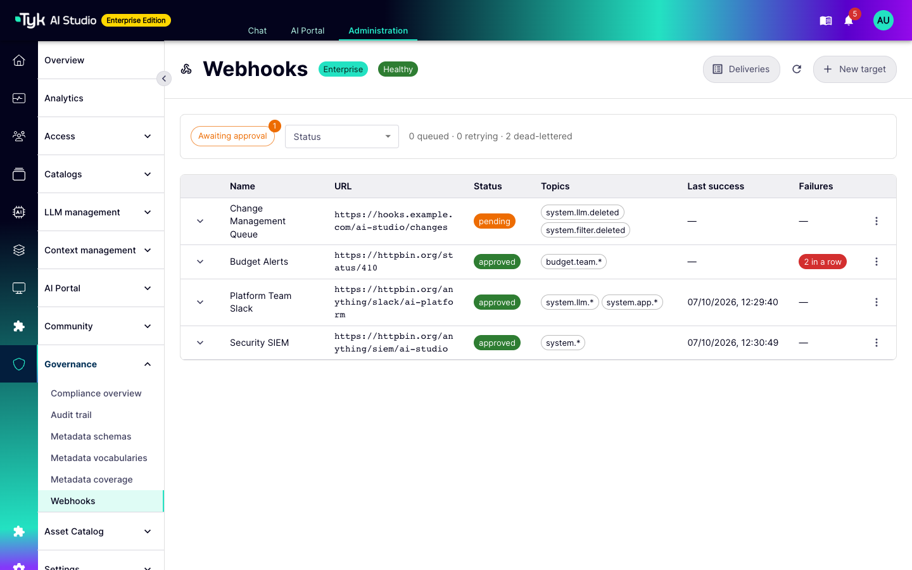
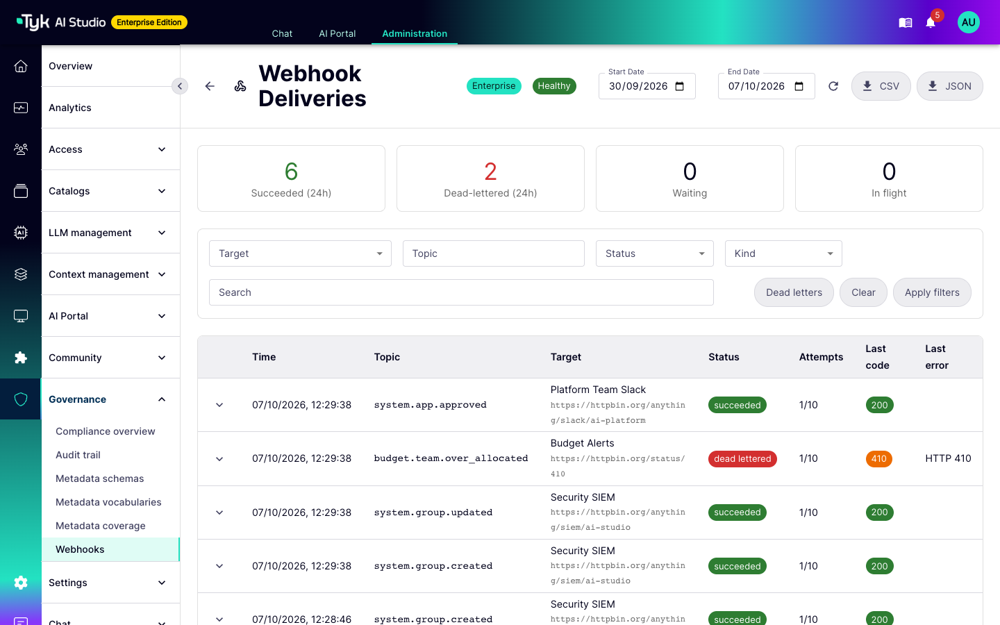
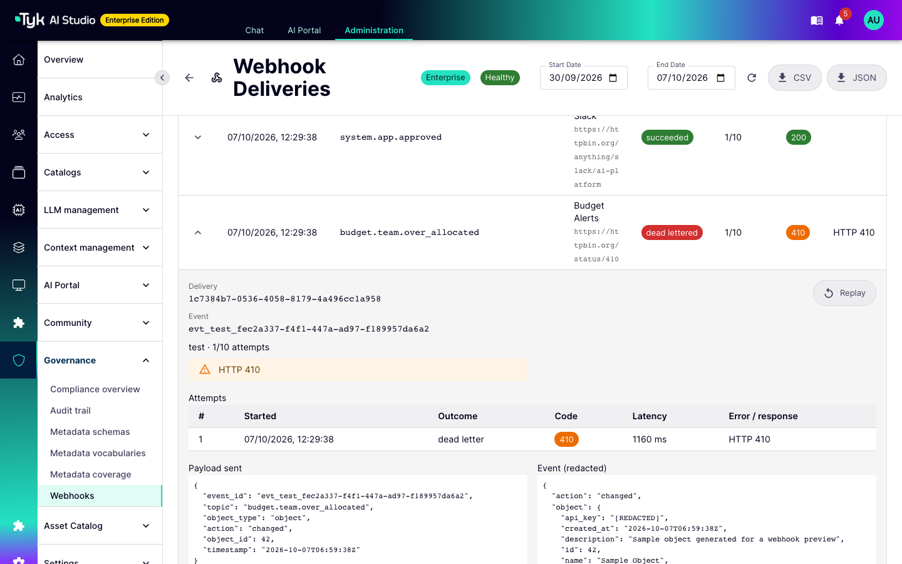

## Availability

| Edition   | Deployment Type |
| :------------- | :---------------------- |
| [Enterprise](/ai-management/ai-studio/overview#enterprise-edition) | Self-Managed |

In the Community Edition, the **Webhooks** page is not in the admin sidebar. The webhook API endpoints return `403` with the title `Enterprise Feature`.

## Overview

A webhook sends an AI Studio event to an HTTP endpoint that you operate. For example, AI Studio can tell your SIEM when an administrator deletes an LLM. It can also post a message to a Slack channel when an administrator approves an App.

Each endpoint is a **target**. A target has a URL, a list of the [topics](/ai-management/ai-studio/webhooks-reference#topics) that it receives, and a [payload template](/ai-management/ai-studio/webhooks-reference#payloads). AI Studio sends each event as a signed JSON document. The receiver [verifies the signature](/ai-management/ai-studio/how-to-verify-webhook-delivery).

If the receiver is not available, AI Studio tries again. When all attempts fail, AI Studio keeps the delivery in a dead-letter queue, so that you can send it again later.

A target URL can send platform data out of your organization. For this reason, a target receives nothing until an administrator approves its URL. To add a target, refer to [Create a Webhook Target](/ai-management/ai-studio/how-to-create-webhook-target).

Webhooks are one-way. AI Studio does not accept data back from the receiver. A `2xx` response is the only acknowledgement.

Webhooks use the `webhooks` resource in the **Governance** group. For the actions that each permission allows, refer to [Permissions](/ai-management/ai-studio/webhooks-reference#permissions).

## Target Lifecycle

Each target has one of these states:

| State | What AI Studio does |
| :--- | :--- |
| `pending` | Sends nothing. AI Studio notifies administrators that the target waits for approval. |
| `approved` | Sends the events that match the topic filters of the target. |
| `rejected` | Sends nothing. An administrator refused the target and gave a reason. |
| `revoked` | Sends nothing. An administrator stopped an approved target. AI Studio cancels the deliveries that are in the queue. |

A new target always starts as `pending`. These changes also put a target back to `pending`:

- A change to the URL or the custom headers of an approved target. The destination changes, so an administrator must approve it again.
- Any change to a rejected or revoked target. This submits the target again.

A change to the name, description, topic filters, payload template, or maximum concurrency does not change the state. These fields change what AI Studio sends, not where it sends it.

You can also **pause** an approved target. AI Studio continues to put new deliveries in the queue, but it does not send them. When you **resume** the target, AI Studio sends the queued deliveries.

By default, the administrator who creates a target can also approve it. To require a second administrator, set [WEBHOOKS_REQUIRE_DIFFERENT_APPROVER](/ai-management/ai-studio/ai-studio-env#webhooks_require_different_approver) to `true`.

The [audit trail](/ai-management/ai-studio/audit-trail) records each action on a target, such as create, approve, reject, revoke, pause, and secret rotation. For each change, it records which fields changed. It does not record header values or signing secrets.

## URL Policy

AI Studio checks each target URL when you create, edit, or approve the target, and again before each delivery:

- The URL must use `http` or `https`.
- The URL must not contain a user name, a password, or a fragment (`#...`). To send credentials, use a custom header.
- By default, AI Studio rejects internal destinations. These are loopback, private (RFC 1918), link-local, cloud metadata, and unique-local IPv6 addresses. They also include `localhost` and host names that end in `.localhost`, `.local`, or `.internal`.
- AI Studio also checks the IP address that a host name resolves to when it connects. A host name that later points to an internal address is still blocked.
- AI Studio does not follow redirects. A `3xx` response stops the delivery. To use a new location, change the target URL and approve it again.

A chat webhook URL is itself a credential. From 2.3.0, AI Studio hides the secret part of each target URL. This applies to the target list, the **Approve** dialog, the edit form, the delivery log, and the API. AI Studio shows the scheme and the host, and replaces the secret part with `***`. The secret part includes:

- The path of Slack, Discord, Microsoft Teams, and Zapier webhooks
- Every query value, such as the key of a Google Chat webhook
- Path segments that look like tokens

To keep the URL when you edit a target, leave the field unchanged. To change it, enter the full new URL.

To change the policy, use these environment variables:

| Variable | Description |
| :--- | :--- |
| [WEBHOOKS_ALLOW_INTERNAL_TARGETS](/ai-management/ai-studio/ai-studio-env#webhooks_allow_internal_targets) | Permits internal destinations. |
| [WEBHOOKS_ALLOWED_HOSTS](/ai-management/ai-studio/ai-studio-env#webhooks_allowed_hosts) | Limits targets to these hosts. Use `hooks.example.com` for one exact host, or `.example.com` for a domain and all its subdomains. A host that you list exactly can also be internal. |
| [WEBHOOKS_DENIED_HOSTS](/ai-management/ai-studio/ai-studio-env#webhooks_denied_hosts) | Hosts that AI Studio always rejects. This list has priority over `WEBHOOKS_ALLOWED_HOSTS`. |

## Retries and Dead Letters

AI Studio puts each matching event in a queue for each approved target. A delivery worker then sends it. The result of each attempt decides what happens next:

| Result | What AI Studio does |
| :--- | :--- |
| `2xx` | Marks the delivery as `succeeded`. |
| `408`, `425`, `429`, `5xx`, a timeout, or a connection error | Tries again later. The delivery is `retrying`. |
| Other `4xx`, `3xx`, or a destination that the URL policy blocks | Stops at once and marks the delivery as `dead_lettered`. |

The time between attempts doubles after each attempt, with a random variation. [WEBHOOKS_BASE_BACKOFF](/ai-management/ai-studio/ai-studio-env#webhooks_base_backoff) sets the first wait, and [WEBHOOKS_MAX_BACKOFF](/ai-management/ai-studio/ai-studio-env#webhooks_max_backoff) sets the maximum. If the receiver sends a `Retry-After` header with a longer time, AI Studio waits for that time. After [WEBHOOKS_MAX_ATTEMPTS](/ai-management/ai-studio/ai-studio-env#webhooks_max_attempts) attempts, AI Studio marks the delivery as `dead_lettered`.

Each attempt sends the same body and the same `X-Webhook-Id`. The `X-Webhook-Attempt`, `X-Webhook-Timestamp`, and `X-Webhook-Signature` headers change. For all headers, refer to [Delivery Headers](/ai-management/ai-studio/webhooks-reference#delivery-headers).

AI Studio delivers each event at least one time. A receiver can get the same event more than one time, for example after a replay. If your receiver must process each event only one time, use the `X-Webhook-Event-Id` header to find duplicates.

When AI Studio dead-letters a delivery, it:

- Notifies administrators. It sends a maximum of one notification for each target in each hour.
- Records a `Webhook Delivery Dead-Lettered` entry in the audit trail, with the user `system`.

## Delivery Log

To manage targets, go to **Governance > Webhooks** in the admin console. The page shows each target with its state, topic filters, time of the last successful delivery, and number of failures in a row. The **Awaiting approval** filter shows the targets that need a decision. The status bar shows the number of queued, retrying, and dead-lettered deliveries.

To see each delivery, select **Deliveries**. The page shows:

- Tiles with the number of succeeded and dead-lettered deliveries in the last 24 hours. Two more tiles show the deliveries that wait and the deliveries in progress.
- Filters for the target, topic, status, kind (event, test, or replay), date range, and a text search.
- A row for each delivery with its status, number of attempts, last status code, and last error.

Expand a row to see each attempt with its status code, latency, and the start of the response. The row also shows the payload that AI Studio sent and the redacted event.

From the delivery log, you can:

- **Replay** a finished delivery. AI Studio sends the same event to the target again as a new delivery. This works only for an approved target.
- Replay all dead-lettered deliveries in one action. Select **Dead letters**, then **Replay all dead letters**.
- **Cancel** a delivery that waits in the queue or for a retry.
- Export the filtered deliveries as CSV or JSON, with a maximum of 50,000 rows.

The menu of each target has the actions **Approve**, **Reject**, **Revoke**, **Pause** or **Resume**, **Send test event**, **Rotate signing secret**, **Edit**, and **Delete**.

## Configuration

Webhooks need the `TYK_AI_SECRET_KEY` environment variable. AI Studio encrypts the custom header values and signing secrets with this key. If the key is not set, the webhook feature does not start, and the **Webhooks** page shows the reason. Refer to [Secrets Management](/ai-management/ai-studio/secrets).

For the other webhook environment variables, refer to [Configuration Variables](/ai-management/ai-studio/webhooks-reference#configuration-variables).

### Multiple AI Studio Nodes

Each AI Studio node receives the events that it creates and stores them in the shared database. Each node with a delivery worker takes deliveries from the database. Two nodes do not send the same delivery at the same time. AI Studio does not guarantee the order of deliveries.

Edge Gateways do not publish `system.*` events. Only changes on the AI Studio control plane create webhook events.

AI Studio sends an event only after it saves the change. If AI Studio stops between the save and the event, that one event is lost.
