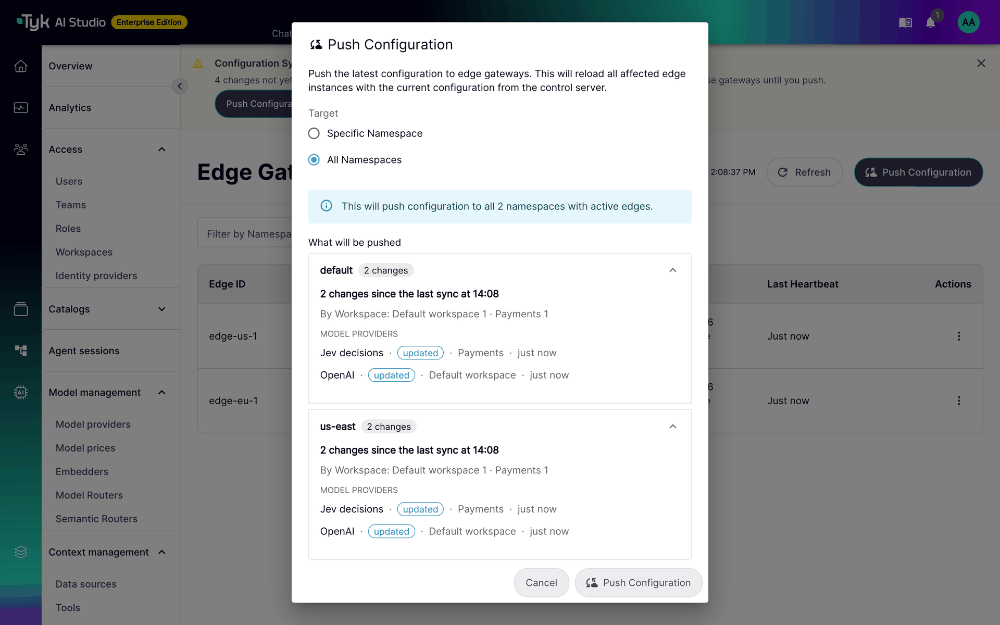

## Availability

| Edition | Deployment Type |
| :------------- | :---------------------- |
| [Enterprise](/ai-management/ai-studio/overview#enterprise-edition) | Self-Managed |

Workspaces are available from Tyk AI Studio 2.3.0.

A Workspace is a group of configuration objects, such as LLM providers, Apps, tools, data sources, routers, and catalogs. You give a user, a service account, or a [Team](/ai-management/ai-studio/teams) a role within a Workspace. The role then applies only to the objects of that Workspace.

Use Workspaces for these tasks:

- Give each Team a Workspace for its Apps and agents. The Team members manage only those objects. Refer to [Give a Team a Workspace](/ai-management/ai-studio/how-to-manage-workspaces#give-a-team-a-workspace).
- Give an automated client, such as the Tyk Operator, its own Workspace. The client manages only its own objects. It can also detect when a push to the Edge Gateways would include changes that other people made. Refer to [Set Up an Automated Client](/ai-management/ai-studio/how-to-set-up-workspace-client).

Workspaces need a license with [role-based access control](/ai-management/ai-studio/rbac). In the Community Edition, every object is in the **Default** Workspace. The **Workspaces** page shows an upgrade message, and the Workspaces API returns `402`.

## How Workspaces Work

Three items control access in AI Studio:

| Item | Controls |
| :--- | :--- |
| [Role](/ai-management/ai-studio/rbac) | What a person can do |
| [User](/ai-management/ai-studio/users) or [Team](/ai-management/ai-studio/teams) | Who gets the role |
| Workspace | Where the role applies |

Each role assignment is global or scoped to one Workspace:

- A **global** role assignment applies in every Workspace.
- A **scoped** role assignment applies only to the objects of its Workspace. It ignores the permissions of the role on global resources. Examples are users, Teams, roles, plugins, webhooks, Edge Gateways, and settings. Give those permissions with a global role.

You can assign any built-in or custom role within a Workspace, except Owner, which is always global. Administrator within a Workspace gives all permissions on the objects of that Workspace only.

A Workspace and a namespace are different. The Workspace sets who manages an object. The namespace sets which Edge Gateways receive the object.

<Warning>
Every user is a member of the **Default** Team. If the **Default** Team, or another Team that all users are in, has a global role, every user can work in every Workspace. Give such Teams a scoped role.
</Warning>

## What Is Visible Across Workspaces

Each object type is in one of three groups. The group sets what a user sees outside their Workspaces:

1. **Shared building blocks**: LLM providers, tools, data sources, filters, embedders, secrets, file stores, and MCP servers.
   - Visible and read-only, with credentials redacted, to a user who can read this object type in any Workspace.
   - The user can link them to an App or a catalog that the user can write.
   - To change, delete, publish, or test one, the user needs the permission in the Workspace of the object.
2. **Owned objects**: Apps, agents, model routers, semantic routers, LLM catalogs, data catalogs, and tool catalogs.
   - Hidden. They are not in lists, and a request for one returns "not found".
3. **Credentials**: App credentials and MCP credentials.
   - They follow their App. They are hidden when the App is hidden. You manage them with the permissions in the Workspace of the App.

Other resources are global and belong to no Workspace. Refer to [What Workspaces Do Not Cover](#what-workspaces-do-not-cover).

<Warning>
An App that links to an LLM provider, tool, or data source in another Workspace uses that object, and its credentials, when it serves requests. Workspaces control who can change an object. They do not control who can use it. Keep restricted credentials on objects that only the correct Teams link to, and review the links of your Apps.
</Warning>

### Rules Across Workspaces

- A `$SECRET/NAME` reference must name a secret in the same Workspace as the object. You cannot delete, rename, or move a secret that an object references. Refer to [Secrets](/ai-management/ai-studio/secrets).
- Do not keep secrets in file stores. A user who can read file stores in any Workspace can read every file.
- Plugin resources are global, for example the MCP servers of a registry plugin. To add a plugin resource to an App, you need write access to the App and the global `plugins:read` permission. Without this permission, the API returns `403`. To keep or remove the plugin resources that an App already has, you need only write access to the App.
- Tyk Dashboard and Tyk Gateway connections are global. A user who can run MCP server actions in one Workspace can use any connection.
- Names that must be unique, such as secret names and agent slugs, are unique across all Workspaces. A create request that uses the name of a hidden object fails with a conflict. Thus, the conflict shows that the name exists.
- Dependency counts and pending change counts include hidden objects. AI Studio never shows the names or IDs of hidden objects.

## What Workspaces Do Not Cover

Workspaces control the admin console and the management API. These parts of AI Studio do not use Workspaces:

- **AI Portal and Chat**: The catalogs of the Teams of a user control what the user sees. Apps that users create in the AI Portal go into the **Default** Workspace.
- **Request serving**: The embedded gateway, the Edge Gateways, and Chat and agent sessions serve objects from all Workspaces.
- **Edge Gateways and namespaces**: They belong to no Workspace.
- **Analytics, logs, traces, and the audit trail**: These include compliance reports and MCP analytics. Global permissions control them.
- **Plugins and webhooks**: They are global.
- **Access management**: Users, Teams, roles, App quotas, and the license are global.
- **Governed metadata on MCP servers and plugin resources**: This needs the global `metadata` permission.

A management API route that does not check Workspaces needs its permission as a global permission. A user with only scoped roles gets `403` from these routes.

## What a User With Only a Workspace Role Sees

In this example, Alice is a member of "Payments engineers", the Team from [Give a Team a Workspace](/ai-management/ai-studio/how-to-manage-workspaces#give-a-team-a-workspace). Her only role is Editor within the "Payments" Workspace. She has no global role.

- **Admin console**: Alice can sign in. The menu shows only the sections where she has a permission, in any Workspace. Users, Teams, roles, Edge Gateways, analytics, plugins, and settings are not in the menu. This is also true for the permissions that the Editor role includes.
- **Shared building blocks**: Alice sees all LLM providers, tools, data sources, and other shared building blocks, with credentials redacted. She can change, delete, publish, and test only the objects in "Payments".
- **Owned objects**: Alice sees only the Apps, agents, routers, and catalogs in "Payments". AI Studio returns "not found" for the others.
- **New objects**: Everything that Alice creates goes into "Payments". The **Workspace** field of the form shows only "Payments", and the field is locked.
- **Links**: Alice can link a "Payments" App to any LLM provider, tool, or data source that she can see. This includes objects in the **Default** Workspace.
- **Edge Gateways**: Alice cannot push configuration, see the Edge Gateway status, or open analytics.
- **AI Portal and Chat**: Workspaces do not change them. The catalogs of her Teams, and the **Show Portal** and **Show Chat** switches on her account, control what she sees.

If Alice also has the Viewer role as a global role, she sees all objects as read-only. She can still change only the objects in "Payments".

## Workspaces and Edge Gateway Pushes

A push to the Edge Gateways sends all the pending changes of a namespace, from all Workspaces. The push dialog shows the Workspace of each pending change and a count for each Workspace. Check the list before you push.

A push is a global action that needs the `edges:read` and `edges:execute` permissions. A role within a Workspace never allows a push.

An API client can ask AI Studio to refuse a push that includes changes from other Workspaces. AI Studio never refuses a push from the admin console for this reason. Refer to [Push Only the Changes of the Workspace](/ai-management/ai-studio/how-to-set-up-workspace-client#push-only-the-changes-of-the-workspace).

To prevent blocked pushes, give each Team and each automated client its own namespace. Keep few objects in the global namespace, because a change to them is pending in every namespace. To unblock a namespace, a user with a global push role pushes it from the admin console.

Refer to [Push Configuration to Edge Gateways](/ai-management/ai-studio/how-to-push-edge-configuration).

## Upgrade and Rollback

These rules apply when you upgrade from a release without Workspaces, and when you roll back to one. For the other changes of each release, refer to the [AI Studio release notes](/developer-support/release-notes/ai-studio).

- **Upgrade**: Every object goes into the **Default** Workspace, and every role assignment stays global. No user gets or loses access. The upgrade does not create pending changes.
- **Rollback**: A release without Workspaces ignores them, so scoped role assignments give no permissions. A service account continues to work with its API key, as a usual user without the service account restrictions.
