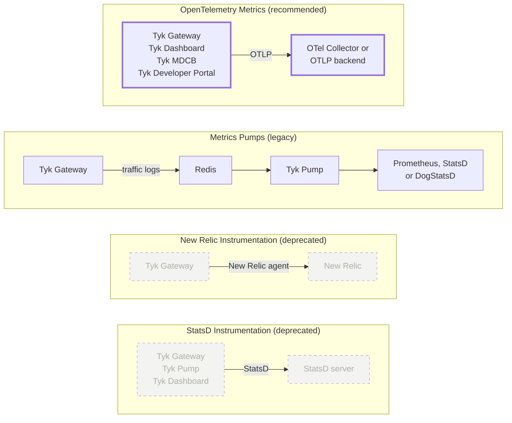

## Introduction

Metrics provide aggregated, quantitative data about the performance and behavior of your APIs over time. They offer insights into the overall health of the system.

Tyk supports several ways to export metrics, from different components:

| Method | Component | Status | Description |
|--------|-----------|--------|-------------|
| [OpenTelemetry Metrics](#opentelemetry-metrics) | Tyk Gateway, Tyk Dashboard, Tyk MDCB, Tyk Developer Portal | **Recommended** | Native OTLP metrics export. Works with any OpenTelemetry-compatible backend. |
| [Metrics Pumps](#metrics-pumps) | Tyk Pump | Legacy | Prometheus, StatsD, or DogStatsD metrics derived from traffic logs. Relevant for existing deployments. |
| [New Relic Instrumentation](#new-relic-instrumentation) | Tyk Gateway | [Deprecated](/developer-support/deprecation#understanding-deprecation-and-end-of-life-eol) | Legacy New Relic agent integration available since Tyk Gateway v2.5. |
| [StatsD Instrumentation](#statsd-instrumentation) | Tyk Gateway, Tyk Pump, Tyk Dashboard | [Deprecated](/developer-support/deprecation#understanding-deprecation-and-end-of-life-eol) | Legacy StatsD protocol export for these three components. |

OpenTelemetry Metrics cover the control plane as well as Tyk Gateway. See [Tyk Dashboard Metrics](#tyk-dashboard-metrics), [Tyk MDCB Metrics](#tyk-mdcb-metrics), and [Tyk Developer Portal Metrics](#tyk-developer-portal-metrics).



## OpenTelemetry Metrics

### Availability

| Component | Version | Edition |
| :-------- | :------ | :------- |
| Tyk Gateway | Available since [v5.13.0](/developer-support/release-notes/gateway#5-13-0-release-notes) | Community & Enterprise |
| Tyk Dashboard | Available since v5.16.0 | Enterprise |
| Tyk MDCB | Available since v2.14.0 | Enterprise |
| Tyk Developer Portal | Available since v1.20.0 | Enterprise |

### Tyk Gateway Metrics

Tyk Gateway natively exports metrics via the OpenTelemetry Protocol (OTLP), the recommended way to collect its metrics. When enabled, it pushes standard RED metrics (Rate, Errors, Duration) plus Go runtime and configuration state metrics to any OTLP-compatible backend. Some backends accept this natively; others need an OpenTelemetry Collector in between, see [Supported Backends](#supported-backends) below.

For a complete reference, see:

- [Default Metrics](/api-management/metrics/default-metrics): all metrics exported automatically (RED, Go runtime, configuration state)
- [Custom Metrics](/api-management/metrics/custom-metrics): defining custom counters and histograms with your own dimensions

### Tyk Dashboard Metrics

Tyk Dashboard natively exports metrics through the same OTLP pipeline. These cover:

- Gateway node registry and fleet state
- License capacity and expiry
- Request rate, errors, and duration for its own management API
- Change propagation
- Dependency pool pressure
- Object counts
- Go runtime metrics

For a complete reference, see [Default Metrics](/api-management/metrics/default-metrics).

### Tyk MDCB Metrics

Tyk MDCB natively exports metrics through the same OTLP pipeline, which completes observability coverage across the control plane. These cover:

- Connectivity for each gateway, and how often gateways connect and disconnect
- RPC load
- Configuration and key sync health
- Analytics ingestion
- Dependency health and its own health
- Go runtime metrics

For a complete reference, see [Default Metrics](/api-management/metrics/default-metrics).

### Tyk Developer Portal Metrics

Tyk Developer Portal exports metrics through the same OTLP pipeline. These cover:

- Provider sync health, which tracks the sync job that runs every 10 minutes between the portal and Tyk Dashboard
- Portal health, which covers database and storage connectivity
- A Go process uptime canary

Tyk Developer Portal does not share Redis with the rest of the control plane, so it does not get a `control_plane_id` resource attribute. To correlate its metrics with the rest of the control plane, use `deployment.environment`.

For a complete reference, see [Default Metrics](/api-management/metrics/default-metrics).

{/* SCREENSHOT NEEDED: Control plane metrics dashboard.
What to show: a Grafana dashboard with one row per component (Tyk Dashboard, Tyk MDCB, Tyk Developer Portal), each showing its main health panels: connected gateways, dependency health, `process.uptime`, and for Tyk Developer Portal the time since `tyk.portal.provider.sync.last_success_timestamp`.
*/}

### Supported Backends

The metrics exporter sends data using standard OTLP, so any OTLP-compatible backend works. Some common setups:

**Via OTel Collector (recommended for self-managed):** Route metrics from the OTel Collector to Prometheus, Grafana Mimir, Splunk, or other backends. The Collector also handles batching, retries, and fanout to multiple destinations.

**Direct OTLP:** Send directly to backends that natively accept OTLP, such as:

- New Relic (`otlp.nr-data.net:4317`)
- Dynatrace (via the Dynatrace OTLP endpoint)
- Grafana Cloud Mimir

Standalone Prometheus doesn't accept OTLP by default: use the OTel Collector path above, unless you're running Prometheus v3.0+ with its native OTLP receiver explicitly enabled.

## Configuration Options

Metrics can be enabled independently; distributed tracing does not need to be configured. To configure distributed tracing alongside metrics, see [Distributed Tracing](/api-management/traces).

### Enable Metrics

If you only need metrics export, configure the `metrics` sub-object directly:

```json
{
  "opentelemetry": {
    "metrics": {
      "enabled": true,
      "endpoint": "otel-collector:4317"
    }
  }
}
```

Tyk Dashboard and Tyk MDCB use the same `opentelemetry.metrics` block, in `tyk_analytics.conf` and `tyk_sink.conf` respectively. For a worked example of both, see [Get Started with Tyk Observability](/api-management/observability-getting-started#add-tyk-dashboard-tyk-mdcb-and-tyk-developer-portal).

Tyk Developer Portal uses a separate `OpenTelemetry.Metrics` configuration section instead of the `opentelemetry.metrics` block. Set it with the `PORTAL_OPENTELEMETRY_METRICS_*` or `TYK_PORTAL_OPENTELEMETRY_METRICS_*` environment variables. For a worked example, see [Configure Tyk Developer Portal](/api-management/observability-getting-started#configure-tyk-developer-portal). For what it exports, see [Tyk Developer Portal Metrics](#tyk-developer-portal-metrics).

### Traces and Metrics Together

When both are configured, `metrics.endpoint` defaults to the `traces.endpoint` value if not set explicitly:

```json
{
  "opentelemetry": {
    "traces": {
      "enabled": true,
      "endpoint": "otel-collector:4317"
    },
    "metrics": {
      "enabled": true
    }
  }
}
```

This is enough to start exporting [default Tyk Gateway metrics](/api-management/metrics/default-metrics) to the same OTLP endpoint configured for traces.

### Reference

| Field | Description | Default |
|-------|-------------|---------|
| [opentelemetry.metrics.enabled](/tyk-oss-gateway/configuration#opentelemetry-metrics-enabled) | Enable OTLP metrics export | `false` |
| [opentelemetry.metrics.exporter](/tyk-oss-gateway/configuration#opentelemetry-metrics-exporter) | Export protocol: `grpc` or `http` | `grpc` |
| [opentelemetry.metrics.endpoint](/tyk-oss-gateway/configuration#opentelemetry-metrics-endpoint) | OTLP collector endpoint. Defaults to `opentelemetry.traces.endpoint` if not set | None |
| [opentelemetry.metrics.connection_timeout](/tyk-oss-gateway/configuration#opentelemetry-metrics-connection_timeout) | Connection timeout in seconds | `1` |
| [opentelemetry.metrics.headers](/tyk-oss-gateway/configuration#opentelemetry-metrics-headers) | Additional HTTP headers sent with each OTLP export request | None |
| [opentelemetry.metrics.tls](/tyk-oss-gateway/configuration#opentelemetry-metrics-tls) | TLS configuration for the OTLP connection | None |
| [opentelemetry.metrics.export_interval](/tyk-oss-gateway/configuration#opentelemetry-metrics-export_interval) | How often metrics are pushed to the backend, in seconds | `60` |
| [opentelemetry.metrics.shutdown_timeout](/tyk-oss-gateway/configuration#opentelemetry-metrics-shutdown_timeout) | Maximum time allowed for a single export request, in seconds | `30` |
| [opentelemetry.metrics.cardinality_limit](/tyk-oss-gateway/configuration#opentelemetry-metrics-cardinality_limit) | Maximum unique attribute combinations tracked per instrument. Set to `0` to disable | `2000` |
| [opentelemetry.metrics.runtime_metrics](/tyk-oss-gateway/configuration#opentelemetry-metrics-runtime_metrics) | Export Go runtime metrics (memory, goroutines, GC). Set to `false` to disable | `true` |
| [opentelemetry.metrics.api_metrics](/tyk-oss-gateway/configuration#opentelemetry-metrics-api_metrics) | Custom metric instrument definitions. See [Custom Metrics](/api-management/metrics/custom-metrics) | None |

All fields are also documented in the [Tyk Gateway Configuration Reference](/tyk-oss-gateway/configuration#opentelemetry).

<Note>
Root-level configuration such as `opentelemetry.enabled` and `opentelemetry.endpoint` still work for traces but are deprecated. Use `opentelemetry.traces.*` for new deployments.
</Note>

#### Control Plane Fields

Tyk Dashboard and Tyk MDCB add two fields that Tyk Gateway does not have:

| Field | Description | Default |
|-------|-------------|---------|
| `control_plane_id` | Identifies this control plane. This is a top-level setting, not part of the `opentelemetry.metrics` block. The environment variable is `TYK_DB_CONTROLPLANEID` for Tyk Dashboard and `TYK_MDCB_CONTROLPLANEID` for Tyk MDCB. Leave it blank to generate it automatically and share it with the other component through Redis. | None (generated automatically if blank) |
| `opentelemetry.metrics.deployment_environment` | Exported as the `deployment.environment` resource attribute. Set the same value on Tyk Dashboard, Tyk MDCB, and Tyk Developer Portal so that you can correlate their metrics. | Unset (Tyk MDCB reports `unknown`) |

Tyk Developer Portal does not have a `control_plane_id` field. It does not share Redis with Tyk Dashboard and Tyk MDCB, so it correlates through `deployment.environment`. Set this with its `DeploymentEnvironment` field, which defaults to `unknown`.

As with Tyk Dashboard and Tyk MDCB, each metric family in Tyk Developer Portal has its own on/off flag, for example `ProviderMetrics` and `HealthMetrics`. Its flags use PascalCase to match the rest of its configuration.

For what a metric family is and why it exists, see [Metric Groups and Families](/api-management/metrics/control-plane-metrics-concepts#metric-groups-and-families).

### Cardinality Control

Each unique combination of dimension values creates a separate time series in your metrics backend. For example, a metric with 100 APIs × 5 methods × 10 status codes = 5,000 time series. Adding dimensions that have many possible values (such as user IDs or free-text fields) can create millions of time series, causing high storage costs and potential out-of-memory crashes.

The `opentelemetry.metrics.cardinality_limit` field caps how many unique attribute combinations are tracked per metric instrument:

- **Default limit:** 2,000 combinations per instrument
- **When the limit is reached:** New attribute combinations are aggregated into an overflow bucket marked with `otel.metric.overflow=true`
- **Existing time series are not affected**; only new combinations are blocked
- **To disable the limit:** Set to `0` (not recommended for production)

You can alert on cardinality overflow using this PromQL expression:

```promql
increase(some_metric{otel_metric_overflow="true"}[5m]) > 0
```

This lets you catch runaway cardinality before costs escalate.

The same limit and overflow behavior apply to Tyk Dashboard, Tyk MDCB, and Tyk Developer Portal. Their label sets depend on fleet and organization size, not on request-level data. Overflow is much rarer than on Tyk Gateway, but you can use the same PromQL pattern to alert on it.

## Tyk Cloud

On Tyk Cloud, metrics export is enabled per environment via the **Telemetry** settings in the Tyk Cloud UI. A **Telemetry entitlement** is required; contact your account team if it is not available on your plan.

**Supported export destinations on Tyk Cloud:**

- New Relic
- Elastic (Elasticsearch / OpenSearch)
- Dynatrace
- Custom OTLP endpoint (any OTLP-compatible backend)

Tyk Cloud exports the [default gateway metrics](/api-management/metrics/default-metrics) through the telemetry pipeline. Custom metric configuration is not currently self-service on Tyk Cloud; contact Tyk support to request it.

Tyk Dashboard and Tyk MDCB metrics are not available through the Tyk Cloud Telemetry settings.

## Metrics Pumps

[Tyk Pump](/api-management/tyk-pump) can expose metrics derived from the traffic logs that Tyk Gateway stores in Redis, the same traffic logs used for [Tyk Dashboard Analytics](/api-management/dashboard-analytics). This is an older, separate mechanism: computed by Tyk Pump after the fact from traffic log records, not by the gateway in real time, so it can only produce traffic-derived counters and histograms (status codes, latency, and whatever traffic log fields you tag). It has no visibility into the gateway's own runtime health or configuration state.

There are three Metrics Pumps, [documented here](/api-management/metrics/metrics-pumps), that target different backends:

- Prometheus
- DogStatsD (Datadog)
- StatsD (not to be confused with the native Tyk Gateway [StatsD instrumentation](#statsd-instrumentation))

Metrics Pumps aren't deprecated, and existing deployments can keep using them, but we recommend [OpenTelemetry Metrics](#opentelemetry-metrics) where you can: it's more powerful and flexible, and doesn't require the Redis and Tyk Pump hop to get metrics out.

## Deprecated Backends

### New Relic Instrumentation

<Warning>
This instrumentation method is deprecated. New Relic users should migrate to the [OpenTelemetry metrics exporter](/api-management/logs-metrics#opentelemetry-metrics) with a New Relic OTLP endpoint. The OTel approach provides richer metrics, more dimensions, and does not require a New Relic agent license.
</Warning>

Tyk Gateway has been instrumented for New Relic metrics since v2.5. Add the following to `tyk.conf` to enable it:

```json
{
  "newrelic": {
    "app_name": "<app-name>",
    "license_key": "<license_key>"
  }
}
```

### StatsD Instrumentation

<Warning>
This instrumentation method is deprecated. We recommend using [OpenTelemetry metrics](/api-management/logs-metrics#opentelemetry-metrics) instead, which provides richer metrics and works with any modern observability backend.
</Warning>

Tyk Gateway, Tyk Pump, and Tyk Dashboard have been instrumented for [StatsD](https://github.com/etsy/statsd) monitoring. StatsD is a network daemon that listens for statistics sent over UDP or TCP and forwards aggregates to pluggable backend services.

<Note>
Not to be confused with Tyk Pump's `statsd`/`dogstatsd` [Metrics Pumps](#metrics-pumps) above: those export traffic-log-derived request metrics, a different mechanism from this internal system instrumentation.
</Note>

#### Configuring StatsD

To enable StatsD instrumentation, set the environment variable `TYK_INSTRUMENTATION=1` and configure `statsd_connection_string` in each component's config file. This field specifies how to connect to the StatsD server (host, port, and optional configuration).

You can also set `statsd_prefix` to a custom value to differentiate metrics between environments (for example, separate prefixes for production and staging).

For Tyk Pump specifically, both fields sit at the top level of `pump.conf`, alongside `log_level` and the other [global settings](/api-management/tyk-pump#configuring-tyk-pump).

#### StatsD Keys

| Key | Description |
|-----|-------------|
| `gauges.<prefix>.Load.rps` | API traffic handled by Tyk Gateway (requests per second) |
| `counters.<prefix>.SystemAPICall.called.count` | Tyk Gateway API call count |
| `timers.<prefix>.SystemAPICall.success` | Tyk Gateway API response time |
| `counters.<prefix>.SystemAPICall.SystemCallComplete.count` | Tyk Dashboard API request count |
| `counters.<prefix>.DashSystemAPIError.*` | Tyk Dashboard API error reporting |
| `counters.<prefix>.record.count` | Number of records processed by Tyk Pump |
