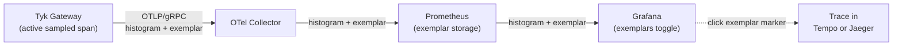

## Availability

| Component | Version | Edition |
| :-------- | :------ | :------- |
| Tyk Gateway | Available since [v5.13.0](/developer-support/release-notes/gateway#5-13-0-release-notes) | Community & Enterprise |
| Tyk Dashboard | Available since v5.16.0 | Enterprise |
| Tyk MDCB | Available since v2.14.0 | Enterprise |
| Tyk Developer Portal | Available since v1.20.0 | Enterprise |

This page lists the metrics. For what they mean and how to use them, see [Control Plane Metrics Concepts](/api-management/metrics/control-plane-metrics-concepts).

## Tyk Gateway Metrics

When `opentelemetry.metrics.enabled` is set to `true`, Tyk Gateway automatically exports four groups of metrics, no additional configuration required:

1. [Request metrics](#request-metrics): Rate, Errors, and Duration (RED) for every API request
2. [Go runtime metrics](#go-runtime-metrics): Memory, goroutines, and GC health
3. [Configuration state metrics](#configuration-state-metrics): API/policy load counts and reload events
4. [Token exchange metrics](#token-exchange-metrics): Volume, latency, and cache hit-rate for [token exchange](/api-management/authentication/token-exchange) (Enterprise only)

All metrics are exported as OpenTelemetry-semantic-convention-compliant instruments and include [resource attributes](#resource-attributes) that identify the gateway instance.

### Request Metrics

These four instruments cover the standard RED signals for every API proxied by the gateway.

| Metric Name | Type | Unit | Description |
|-------------|------|------|-------------|
| `http.server.request.duration` | Histogram | seconds | End-to-end request latency (client to gateway to upstream and back). |
| `tyk.gateway.request.duration` | Histogram | seconds | Time spent inside the gateway only (middleware processing, routing). Excludes upstream response time. |
| `tyk.upstream.request.duration` | Histogram | seconds | Time spent waiting for the upstream service to respond. |
| `tyk.api.requests.total` | Counter | requests | Total number of requests processed. |

The three-way latency breakdown is particularly useful for distinguishing gateway processing overhead from upstream service slowness.

#### Default Dimensions

Default dimensions vary by instrument:

| Instrument | `http.request.method` | `http.response.status_code` | `tyk.api.id` | `tyk.response_flag` |
|-----------|:---:|:---:|:---:|:---:|
| `http.server.request.duration` | Yes | Yes | Yes | Yes |
| `tyk.gateway.request.duration` | Yes | - | Yes | Yes |
| `tyk.upstream.request.duration` | Yes | - | Yes | Yes |
| `tyk.api.requests.total` | Yes | Yes | Yes | - |

| Dimension | Description |
|-----------|-------------|
| `http.request.method` | HTTP request method (`GET`, `POST`, etc.). |
| `tyk.api.id` | The Tyk API ID. |
| `http.response.status_code` | HTTP response status code (`200`, `404`, `500`, etc.). |
| `tyk.response_flag` | Tyk 3-letter error classification code (for example `AKI`, `URS`, `CBO`), or the HTTP status code string (for example `"200"`) for successful requests or when error classification is absent. See the [full list of response flags](/api-management/logs/access-logs#error-classification). |

You can add more dimensions to any instrument using [custom metrics](/api-management/metrics/custom-metrics).

### Go Runtime Metrics

Tyk Gateway, Tyk Dashboard, and Tyk MDCB export the same set of Go runtime metrics. For what these mean, how to read them, and how to disable them, see [Go Runtime Metrics](/api-management/metrics/control-plane-metrics-concepts#go-runtime-metrics) in the concepts page.

| Metric Name | Type | Unit | Description |
|-------------|------|------|-------------|
| `go.memory.used` | Gauge | bytes | Current heap memory in use. |
| `go.memory.limit` | Gauge | bytes | Soft memory limit set via `GOMEMLIMIT`. |
| `go.memory.allocated` | Gauge | bytes | Total bytes allocated to the heap. |
| `go.memory.allocations` | Counter | bytes | Cumulative bytes allocated since startup. |
| `go.memory.gc.goal` | Gauge | bytes | Target heap size for the next GC cycle. |
| `go.goroutine.count` | Gauge | goroutines | Number of active goroutines. Useful for detecting goroutine leaks. |
| `go.processor.limit` | Gauge | threads | Number of OS threads available (`GOMAXPROCS`). |
| `go.config.gogc` | Gauge | percent | GC target percentage (`GOGC` env var). |

### Configuration State Metrics

These metrics reflect the operational state of the gateway's loaded configuration. They are useful for detecting silent configuration failures, for example, alerting when the number of loaded APIs drops unexpectedly.

| Metric Name | Type | Unit | Description |
|-------------|------|------|-------------|
| `tyk.gateway.apis.loaded` | Gauge | APIs | Number of API definitions currently loaded and active. |
| `tyk.gateway.policies.loaded` | Gauge | policies | Number of policies currently loaded and active. |
| `tyk.gateway.config.reload.total` | Counter | reloads | Cumulative number of configuration reload events since startup. |
| `tyk.gateway.config.reload.duration` | Histogram | seconds | Time taken to complete each configuration reload cycle. |

### Token Exchange Metrics

<Note>
Token exchange is an [Enterprise-only](/api-management/authentication/token-exchange) feature, available from Tyk 5.15.0. These metrics are only emitted on APIs with `oauth2.tokenExchange` configured.
</Note>

These metrics cover every [token exchange](/api-management/authentication/token-exchange) decision the gateway makes when exchanging an inbound token for a downstream token (RFC 8693).

| Metric Name | Type | Unit | Description |
|-------------|------|------|-------------|
| `tyk.oauth2.exchange.requests` | Counter | exchanges | Total token exchange decisions, labeled by outcome and provider. Recorded on every attempt, including cache hits. |
| `tyk.oauth2.exchange.duration` | Histogram | seconds | Time to obtain the exchanged token: the IdP round-trip on a cache miss, or the cache lookup on a hit. Recorded on every attempt, so cache hits land in the lowest buckets while live IdP calls dominate the upper ones. |
| `tyk.oauth2.exchange.cache_hit` | Counter | hits | Number of exchange requests served from the token exchange cache. A separate signal, not a distinct outcome: a warm-cache exchange still increments `tyk.oauth2.exchange.requests` with `outcome="ok"`. |

#### Dimensions

All three metrics carry the following dimensions:

| Instrument | outcome | provider |
|-----------|:---:|:---:|
| `tyk.oauth2.exchange.requests` | Yes | Yes |
| `tyk.oauth2.exchange.duration` | Yes | Yes |
| `tyk.oauth2.exchange.cache_hit` | - | Yes |

| Dimension | Description |
|-----------|-------------|
| `outcome` | One of `ok`, `idp_error`, `misconfig`, `no_matching_provider`, or `step_up_required` ([jwt-bearer grant](/api-management/authentication/token-exchange#grant-type) only). |
| `provider` | The operator-defined `name` of the token exchange provider (`oauth2.tokenExchange.providers[].name`). A handful of values per API, so safe as a label. |

Identity, audience, and requested scopes are never metric labels or dimensions. They're only available in structured logs and audit events. See [Token exchange observability](/api-management/authentication/token-exchange#observability).

### Resource Attributes

Every metric exported from a gateway instance carries resource attributes, metadata that identifies the source. These are set once at startup and attached to all metrics.

#### Tyk-Specific Resource Attributes

| Attribute | Always Present | Example | Description |
|-----------|---------------|---------|-------------|
| `tyk.gw.id` | Yes | `gw-prod-eu-west-1-a` | Unique gateway ID. |
| `tyk.gw.dataplane` | Yes | `true` | Whether the gateway is running in a distributed Data Plane |
| `tyk.gw.group.id` | No | `prod-eu-west-1` | Present only for Data Plane gateways, identifies the group. |
| `tyk.gw.tags` | No | `["region:eu", "env:prod"]` | Present only when the gateway has [segment tags](/api-management/api-sharding#what-is-api-sharding-) configured. |

#### Standard OTel Resource Attributes

| Category | Attributes |
|----------|-----------|
| Service | `service.name`, `service.version`, `service.instance.id` |
| Host | `host.name`, `host.arch`, `host.ip` |
| Process | `process.pid` |

#### Using Resource Attributes in Prometheus

When using an OTel Collector to export to Prometheus, enable `resource_to_telemetry_conversion` to expose resource attributes as metric labels:

```yaml
exporters:
  prometheus:
    endpoint: "0.0.0.0:8889"
    resource_to_telemetry_conversion:
      enabled: true
```

Alternatively, add a transform processor to metrics pipeline for OTLP exporters:

```yaml
processors:
  transform/tyk_gw_resource_attrs:
    error_mode: ignore
    metric_statements:
      - context: datapoint
        statements:
          - set(attributes["tyk_gw_group_id"], resource.attributes["tyk.gw.group.id"]) where resource.attributes["tyk.gw.group.id"] != nil
          - set(attributes["tyk_gw_id"], resource.attributes["tyk.gw.id"]) where resource.attributes["tyk.gw.id"] != nil
          - set(attributes["tyk_gw_tags"], resource.attributes["tyk.gw.tags"]) where resource.attributes["tyk.gw.tags"] != nil
          - set(attributes["tyk_gw_dataplane"], resource.attributes["tyk.gw.dataplane"]) where resource.attributes["tyk.gw.dataplane"] != nil
```

This allows PromQL queries such as:

```promql
# All metrics from a specific gateway node
{tyk_gw_id="gw-prod-eu-west-1-a"}

# Compare request rates across gateways in an edge group
sum by (tyk_gw_id) (
  rate(tyk_api_requests_total{tyk_gw_group_id="edge-eu-west"}[5m])
)
```

Without this setting, resource attributes are available via the `target_info` metric and can be joined in PromQL.

Tyk Dashboard and Tyk MDCB add one more resource attribute: `control_plane_id`. Tyk Developer Portal does not share Redis with them, so it has no `control_plane_id`. It carries `deployment.environment` instead. For what these attributes are for and how they are resolved, see [Control Plane Identity](/api-management/metrics/control-plane-metrics-concepts#control-plane-identity).

### Exemplars

Exemplars are sample observations attached to histogram metric data points that carry the active trace context (specifically the `trace_id` and `span_id` of the request that produced the measurement). They create a direct, clickable link from an aggregated metric to the specific trace that caused an anomaly.

#### How They Work in Tyk

When OpenTelemetry tracing is enabled and a histogram metric (such as `http.server.request.duration`) is recorded during an active sampled request, the OTel Go SDK automatically attaches the current trace and span IDs to the observation. Exemplars are only attached for sampled requests.

#### Infrastructure Requirements

Exemplar storage and rendering must be enabled in your observability stack; nothing additional is needed on the Tyk side.

For example, in the following standard OTel pipeline:



| Component | Requirement |
|-----------|-------------|
| OTel Collector | Any version supporting OTLP metrics with exemplar passthrough |
| Prometheus | v2.26+. Start with `--enable-feature=exemplar-storage` |
| Grafana | v7.4+. Enable "Exemplars" toggle on the Prometheus data source |

#### Querying Exemplars in Prometheus

Exemplars are accessible via the Prometheus exemplar API:

```
GET /api/v1/query_exemplars?query=http_server_request_duration_seconds&start=<start>&end=<end>
```

#### Grafana Workflow

When exemplar rendering is enabled, Grafana displays scatter plot markers on histogram panels. Clicking a marker navigates directly to the linked trace in your configured tracing backend (Jaeger, Grafana Tempo, etc.), with no manual trace ID lookup required.
{/* SCREENSHOT NEEDED: Exemplar markers in Grafana.
What to show: a histogram panel with exemplar scatter markers, one marker hovered to show the tooltip with `trace_id` and the "Query with Tempo" button.
*/}

## Tyk MDCB Metrics

This section is a plain reference. For what these metrics mean and how to use them, follow the concepts link at the end of each group.

### Uptime

| Metric Name | Type | Unit | Description |
|-------------|------|------|-------------|
| `process.uptime` | Gauge | s | Time since the Tyk MDCB replica started. Confirms that the OTLP metrics pipeline works. Present once metrics are enabled, independent of any family flag. |

### Connectivity and Churn

| Metric Name | Type | Unit | Description |
|-------------|------|------|-------------|
| `tyk.mdcb.gateway.connected` | Gauge | - | Whether a gateway is currently connected to Tyk MDCB (1 per connected node), by gateway, hostname, organization, group, version, and whether it is segmented. |
| `tyk.mdcb.gateway.apis_loaded` | Gauge | 1 | Number of APIs currently loaded on a connected gateway, by gateway, hostname, organization, group, and version. |
| `tyk.mdcb.gateway.policies_loaded` | Gauge | 1 | Number of policies currently loaded on a connected gateway, by gateway, hostname, organization, group, and version. |
| `tyk.mdcb.gateway.connect_errors` | Counter | - | Failed gateway connection attempts, by error type (`eof`, `timeout`, `tls`, `bad_request`, `invalid_credentials`, `malformed_session`, `hybrid_not_enabled`, `hybrid_check_error`, `node_register_error`). |
| `tyk.mdcb.gateway.reconnects` | Counter | - | Reconnection attempts from a gateway that was already registered, by gateway, hostname, organization, and group. |
| `tyk.mdcb.gateway.last_heartbeat_timestamp` | Gauge | unix timestamp (seconds) | Time of the last heartbeat received from a gateway, by gateway, hostname, and group. |

See [Connectivity and Fleet Health](/api-management/metrics/control-plane-metrics-concepts#connectivity-and-fleet-health).

### RPC

| Metric Name | Type | Unit | Description |
|-------------|------|------|-------------|
| `tyk.mdcb.rpc.requests` | Counter | - | RPC calls handled, by method, gateway, group, and result (`ok`, `denied`, `error`). |
| `tyk.mdcb.rpc.bytes` | Counter | By | Payload size of RPC traffic, counted before encoding and compression, by method, gateway, group, and direction (`inbound`, `outbound`). |
| `tyk.mdcb.rpc.duration` | Histogram | s | Time to handle an RPC call, by method. |

### Configuration and Key Sync Health

| Metric Name | Type | Unit | Description |
|-------------|------|------|-------------|
| `tyk.mdcb.sync.last_success_timestamp` | Gauge | unix timestamp (seconds) | Time of the last successful sync, by group, resource type (`keys`, `certs`, `oauth`, `apis`, `policies`), and sync mode (`synchronizer`, `on_demand`). |
| `tyk.mdcb.sync.failures` | Counter | - | Failed sync attempts, by group, resource type, error type, and sync mode. |
| `tyk.mdcb.sync.duration` | Histogram | s | Time to complete a batched synchronizer sync, by resource type. |
| `tyk.mdcb.keyspace.events` | Counter | - | Key-space events processed, by event type. |

### Analytics Ingestion

| Metric Name | Type | Unit | Description |
|-------------|------|------|-------------|
| `tyk.mdcb.analytics.records` | Counter | - | Analytics records processed, by organization, analytics type (`raw`, `aggregated`, `mcp`, `mcp_aggregated`), and result (`accepted`, `stored`, `failed`). Aggregated types count documents, not requests. |
| `tyk.mdcb.analytics.purge.duration` | Histogram | s | Time to hand a batch of analytics records to storage, by analytics type and result (`stored`, `failed`). |
| `tyk.mdcb.analytics.bytes` | Counter | bytes | Volume of analytics data ingested. |

### Dependency Pressure

| Metric Name | Type | Unit | Description |
|-------------|------|------|-------------|
| `tyk.mdcb.connection_pool.active` | Gauge | - | Active connections in a dependency pool, by component (`rpc_server`, `datastore`, `temporal_storage`) and store (`mongo`, `postgres`, `redis`). Store is not set for `rpc_server`. |
| `tyk.mdcb.connection_pool.idle` | Gauge | - | Idle connections in a dependency pool, by component and store. Not reported for `rpc_server` or for backends that do not report it. |
| `tyk.mdcb.connection_pool.max` | Gauge | - | Configured maximum size of a dependency pool, by component and store. Not reported when the pool is unbounded. |
| `tyk.mdcb.connection_pool.rejected` | Counter | - | Connections refused because a pool was at its limit, by component (currently `rpc_server` only). |

See [Dependency and Pool Metrics](/api-management/metrics/control-plane-metrics-concepts#dependency-and-pool-metrics).

### Self Health

| Metric Name | Type | Unit | Description |
|-------------|------|------|-------------|
| `tyk.mdcb.health` | Gauge | 1 | Whether a dependency is healthy (1) or not (0), by component (`datastore`, `temporal_storage`, `rpc_server`) and store (`mongo`, `postgres`, `redis`). |

### Certificate and License Expiry

| Metric Name | Type | Unit | Description |
|-------------|------|------|-------------|
| `tyk.mdcb.cert.expiry_timestamp` | Gauge | unix timestamp (seconds) | Expiry time of a certificate, by certificate type (`rpc_tls`, `http_tls`). Not reported when TLS is off or the certificate cannot be parsed. |
| `tyk.mdcb.license.expiry_timestamp` | Gauge | unix timestamp (seconds) | Expiry time of the Tyk MDCB license. Not reported when the license has no expiry. |

See [Expiry and Build Info](/api-management/metrics/control-plane-metrics-concepts#expiry-and-build-info).

### Go Runtime

Same metric set as the Tyk Gateway [Go Runtime Metrics](#go-runtime-metrics). See [Go Runtime Metrics](/api-management/metrics/control-plane-metrics-concepts#go-runtime-metrics) in the concepts page.

### Build Info and Exporter Health

| Metric Name | Type | Unit | Description |
|-------------|------|------|-------------|
| `tyk.mdcb.build.info` | Gauge | - | Always 1. Carries the Tyk MDCB version and Go version as labels. |
| `tyk.mdcb.telemetry.exporter.healthy` | Gauge | 1 | Whether the metrics exporter itself is healthy (1) or not (0), by provider. A fully failed exporter cannot report 0, so also alert when the series is absent. |

See [Expiry and Build Info](/api-management/metrics/control-plane-metrics-concepts#expiry-and-build-info).

{/* SCREENSHOT NEEDED: Tyk MDCB metrics in Grafana.
What to show: a Grafana dashboard for Tyk MDCB with connected gateways (`tyk.mdcb.gateway.connected` by group), reconnects and connect errors, time since `tyk.mdcb.sync.last_success_timestamp`, and connection pool active versus max.
*/}

## Tyk Dashboard Metrics

This section is a plain reference. For what these metrics mean and how to use them, follow the concepts link at the end of each group.

### Uptime

| Metric Name | Type | Unit | Description |
|-------------|------|------|-------------|
| `process.uptime` | Gauge | s | Time the process has been running. Confirms that the OTLP metrics pipeline works. Present once metrics are enabled, independent of any family flag. |

### Gateway Node Registry

| Metric Name | Type | Unit | Description |
|-------------|------|------|-------------|
| `tyk.dashboard.gateways.connected` | Gauge | - | Gateways currently registered with Tyk Dashboard, by node version, segmentation, and tags. |
| `tyk.dashboard.gateways.heartbeat_timestamp` | Gauge | unix timestamp (seconds) | Time of the last heartbeat from a registered gateway, by node ID, hostname, node version, segmentation, tags, address, and process ID. |
| `tyk.dashboard.gateways.loaded_apis` | Gauge | - | Number of APIs loaded on a registered gateway, by the same labels as the heartbeat. Only reported for gateways that send their counts. |
| `tyk.dashboard.gateways.loaded_policies` | Gauge | - | Number of policies loaded on a registered gateway, by the same labels as the heartbeat. Only reported for gateways that send their counts. |

Full label detail (node version, tags, address, process ID) depends on the connecting gateway sending node metadata headers. Older gateways report a limited label set until you upgrade them. See [Connectivity and Fleet Health](/api-management/metrics/control-plane-metrics-concepts#connectivity-and-fleet-health).

### Management API

| Metric Name | Type | Unit | Description |
|-------------|------|------|-------------|
| `http.server.request.duration` | Histogram | s | Tyk Dashboard API request latency, by HTTP method, route (the registered route pattern, or `unmatched`), and status class (`1xx` to `5xx`). |
| `http.server.active_requests` | UpDownCounter | `{request}` | Tyk Dashboard API requests currently in flight, by HTTP method. |

### License

| Metric Name | Type | Unit | Description |
|-------------|------|------|-------------|
| `tyk.dashboard.license.gateways_limit` | Gauge | count | Number of gateway connections allowed under the current license. -1 means unlimited. 0 means the license could not be verified. |
| `tyk.dashboard.license.gateways_used` | Gauge | count | Number of gateway connections currently in use against the license. Not reported until the first successful read. |
| `tyk.dashboard.license.expiry_timestamp` | Gauge | unix timestamp (seconds) | Expiry time of the Tyk Dashboard license. 0 means the license could not be verified. |

See [Expiry and Build Info](/api-management/metrics/control-plane-metrics-concepts#expiry-and-build-info).

### Change Propagation

| Metric Name | Type | Unit | Description |
|-------------|------|------|-------------|
| `tyk.dashboard.notifications.published` | Counter | 1 | Configuration change notifications published to gateways, by channel (`tyk.cluster.notifications`, `tyk.cluster.keyspace.ops`) and resource type. |
| `tyk.dashboard.notifications.failures` | Counter | 1 | Configuration change notifications that failed to publish, including marshal errors, by channel and resource type. |

### Dependency Pressure

| Metric Name | Type | Unit | Description |
|-------------|------|------|-------------|
| `tyk.dashboard.redis.pool.active` | Gauge | - | Active connections in the shared Redis pool, by component (`temporal_storage`), store (`redis`), and pool (`shared`). |
| `tyk.dashboard.redis.pool.idle` | Gauge | - | Idle connections in the shared Redis pool, by component, store, and pool. |
| `tyk.dashboard.redis.pool.max` | Gauge | - | Configured maximum size of the Redis pool, by component, store, and pool. Not reported when the pool is unbounded or Redis runs as a cluster client. |
| `tyk.dashboard.datastore.pool.active` | Gauge | - | Active datastore connections, by component (`main`, `analytics`, `logs`, `uptime`), store (`mongo`, `postgres`, `mysql`), and pool (`read`, `write`, `shared`). |
| `tyk.dashboard.datastore.pool.idle` | Gauge | - | Idle datastore connections, by component, store, and pool. |
| `tyk.dashboard.datastore.pool.max` | Gauge | - | Configured maximum size of a datastore pool, by component, store, and pool. Not reported when `max_open_connections` is unset. |
| `tyk.dashboard.datastore.pool.wait_duration` | Counter | s | Cumulative time that requests have waited for a datastore connection, by component, store, and pool. |

See [Dependency and Pool Metrics](/api-management/metrics/control-plane-metrics-concepts#dependency-and-pool-metrics).

### Self Health

| Metric Name | Type | Unit | Description |
|-------------|------|------|-------------|
| `tyk.dashboard.health` | Gauge | 1 | Whether a dependency is healthy (1) or not (0), by component (`main`, `analytics`, `logs`, `uptime`, `temporal_storage`) and store (`mongo`, `postgres`, `mysql`, `redis`). |

### Go Runtime

Same metric set as Tyk MDCB and the Tyk Gateway [Go Runtime Metrics](#go-runtime-metrics). See [Go Runtime Metrics](/api-management/metrics/control-plane-metrics-concepts#go-runtime-metrics) in the concepts page.

### Build Info and Exporter Health

| Metric Name | Type | Unit | Description |
|-------------|------|------|-------------|
| `tyk.dashboard.build.info` | Gauge | - | Always 1. Carries the Tyk Dashboard version and Go version as labels. |
| `tyk.dashboard.telemetry.exporter.healthy` | Gauge | - | Whether the metrics exporter itself is healthy (1) or not (0), by provider. A fully failed exporter cannot report 0, so also alert when the series is absent. |

### Certificate Expiry

| Metric Name | Type | Unit | Description |
|-------------|------|------|-------------|
| `tyk.dashboard.cert.expiry_timestamp` | Gauge | unix timestamp (seconds) | Expiry time of a Tyk Dashboard TLS certificate, by certificate type (`http_tls`) and domain. Not reported when TLS is off. |

### Objects and Governance

| Metric Name | Type | Unit | Description |
|-------------|------|------|-------------|
| `tyk.dashboard.objects.orgs.count` | Gauge | `{organization}` | Number of organizations. |
| `tyk.dashboard.objects.apis.count` | Gauge | `{api}` | Number of APIs, by organization, API type (`classic`, `oas`, `mcp`), and state (`active`, `inactive`). |
| `tyk.dashboard.objects.policies.count` | Gauge | `{policy}` | Number of policies, by organization and state (`active`, `draft`, `deny`). |
| `tyk.dashboard.objects.users.count` | Gauge | `{user}` | Number of Tyk Dashboard users, by organization and state (`active`, `inactive`). |
| `tyk.dashboard.objects.rulesets.count` | Gauge | `{ruleset}` | Number of governance rulesets, by organization, resource type (`oas-api`, `mcp-api`, `unknown`), and state (`active`, `inactive`). |
| `tyk.dashboard.governance.apis.count` | Gauge | `{api}` | Number of APIs by governance compliance status (`compliant`, `non_compliant`, `unassessed`), by organization, scope (`overall`, `category`), and category. |
| `tyk.dashboard.governance.rulesets.count` | Gauge | `{ruleset}` | Number of governance rulesets per category view, by organization, category, resource type, and state. Only reported when category views are configured. |

Tyk Dashboard refreshes these counts every 300 seconds by default, independently of the export interval. To change it, set `opentelemetry.metrics.objects_metrics.collection_interval`.

The governance metrics are only exported when the license includes governance and `opentelemetry.metrics.objects_metrics.governance` is not set to `false`. The inventory metrics keep exporting without them.


## Tyk Developer Portal Metrics

This section is a plain reference. For what these metrics mean and how to use them, follow the concepts link at the end of each group.

### Uptime

| Metric Name | Type | Unit | Description |
|-------------|------|------|-------------|
| `process.uptime` | Gauge | s | Process uptime canary. Confirms that the OTLP metrics pipeline works. Present once metrics are enabled, independent of any family flag. |

### Provider Sync Health

| Metric Name | Type | Unit | Description |
|-------------|------|------|-------------|
| `tyk.portal.provider.sync.last_success_timestamp` | Gauge | s (unix timestamp) | Unix timestamp of the last successful sync between the portal and its Tyk Dashboard provider, per provider. Keeps its last good value when a sync stalls, so a stalled sync never reads as healthy. |
| `tyk.portal.provider.sync.failures` | Counter | - | Count of failed provider syncs, by provider and error type (`auth`, `network`, `timeout`, `dashboard_error`, `init`, `db`, `other`). |
| `tyk.portal.provider.sync.duration` | Histogram | s | Duration of each provider sync attempt, by provider and result (`success` or `failure`). |
| `tyk.portal.provider.reachable` | Gauge | - | Whether the portal reached its Tyk Dashboard provider on the last sync attempt: 1 reachable, 0 not. Stays at 1 on an internal (`db`) failure, because the provider did answer. |

See [Provider Sync Health](/api-management/metrics/control-plane-metrics-concepts#provider-sync-health).

### Self Health

| Metric Name | Type | Unit | Description |
|-------------|------|------|-------------|
| `tyk.portal.health` | Gauge | - | Whether a portal dependency is healthy (1) or not (0), by component (`database`, `storage`) and store, which is the engine behind it (`sqlite3`, `mysql`, `postgres` for database; `fs`, `db`, `s3` for storage). |

See [Dependency and Pool Metrics](/api-management/metrics/control-plane-metrics-concepts#dependency-and-pool-metrics).

{/* SCREENSHOT NEEDED: Tyk Developer Portal provider sync in Grafana.
What to show: a Grafana panel with the time since `tyk.portal.provider.sync.last_success_timestamp` per provider, the failure counter split by `error_type`, and `tyk.portal.provider.reachable`, ideally including a stalled sync so that the alert condition is visible.
*/}

{/* REVIEWER NOTE: The epic also lists HTTP/SLO metrics, auth and provisioning events, email delivery errors, certificate expiry, build info, and Go runtime metrics for the portal as Should-have. None of those have a Jira story yet (checked TT-18342 through TT-18360). Only the three families above are ticketed and documented here. Keep the rest out of this page until they have stories. */}
