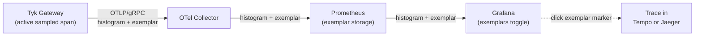

## Metric Groups and Families

Each component groups its metrics into families, such as dependency health, fleet state, and expiry. Each family has its own on/off flag under `opentelemetry.metrics`. For the flags and their defaults, see [Metrics Configuration](/api-management/logs-metrics#control-plane-fields).

## Tyk Gateway Metrics

These concepts apply to the metrics that only Tyk Gateway exports.

### Request Metrics

The three request latency histograms help you tell gateway processing overhead apart from upstream service slowness. When end-to-end latency (`http.server.request.duration`) rises, check whether `tyk.gateway.request.duration` or `tyk.upstream.request.duration` rose with it.

### Configuration State Metrics

Configuration state metrics reflect the operational state of the configuration that Tyk Gateway has loaded. Use them to detect silent configuration failures. For example, alert when the number of loaded APIs drops unexpectedly.

### Exemplars

Exemplars are sample observations attached to histogram metric data points that carry the active trace context (specifically the `trace_id` and `span_id` of the request that produced the measurement). They create a direct, clickable link from an aggregated metric to the specific trace that caused an anomaly.

#### How They Work in Tyk

When OpenTelemetry tracing is enabled and a histogram metric (such as `http.server.request.duration`) is recorded during an active sampled request, the OTel Go SDK automatically attaches the current trace and span IDs to the observation. Exemplars are only attached for sampled requests.

#### Infrastructure Requirements

Exemplar storage and rendering must be enabled in your observability stack; nothing additional is needed on the Tyk side.

For example, in the following standard OTel pipeline:



| Component | Requirement |
|-----------|-------------|
| OTel Collector | Any version supporting OTLP metrics with exemplar passthrough |
| Prometheus | v2.26+. Start with `--enable-feature=exemplar-storage` |
| Grafana | v7.4+. Enable "Exemplars" toggle on the Prometheus data source |

#### Querying Exemplars in Prometheus

Exemplars are accessible via the Prometheus exemplar API:

```
GET /api/v1/query_exemplars?query=http_server_request_duration_seconds&start=<start>&end=<end>
```

#### Grafana Workflow

When exemplar rendering is enabled, Grafana displays scatter plot markers on histogram panels. Clicking a marker navigates directly to the linked trace in your configured tracing backend (Jaeger, Grafana Tempo, etc.), with no manual trace ID lookup required.

## Shared Across Components

These concepts apply to Tyk Gateway and the control plane components.

### Go Runtime Metrics

Tyk Gateway, Tyk Dashboard, and Tyk MDCB export Go runtime metrics automatically. These metrics reflect the health of the Go runtime inside that process. They come from the standard Go `runtime/metrics` package, through the runtime instrumentation in the OpenTelemetry Go SDK. They are not specific to Tyk.

Because the instrumentation is shared, the metric names and meanings are the same across these components. For example, `go.memory.used` means the same thing on all three. To tell instances apart, use the resource attributes of the component, not the metric name. These are `service.name`, plus `tyk.gw.id` or `control_plane_id` where they apply.

Keep these points in mind when you read them:

- A goroutine count that climbs without a matching rise in traffic is the most common early signal of a goroutine leak. The cause is usually a blocked channel or a context that is never canceled.
- Heap memory that approaches the configured limit means that garbage collection will soon work harder to stay under it. This trades CPU for memory headroom.
- A sudden step change right after a deployment tells you more than the absolute value. Compare values before and after a release, not against a fixed number.

### Resource Attributes in Prometheus

Every Tyk component attaches resource attributes to its metrics, such as `tyk.gw.id` on Tyk Gateway and `control_plane_id` on Tyk Dashboard and Tyk MDCB. For the full list, see [Resource Attributes](/api-management/metrics/default-metrics#resource-attributes).

When using an OTel Collector to export to Prometheus, enable `resource_to_telemetry_conversion` to expose resource attributes as metric labels:

```yaml
exporters:
  prometheus:
    endpoint: "0.0.0.0:8889"
    resource_to_telemetry_conversion:
      enabled: true
```

Alternatively, add a transform processor to metrics pipeline for OTLP exporters:

```yaml
processors:
  transform/tyk_gw_resource_attrs:
    error_mode: ignore
    metric_statements:
      - context: datapoint
        statements:
          - set(attributes["tyk_gw_group_id"], resource.attributes["tyk.gw.group.id"]) where resource.attributes["tyk.gw.group.id"] != nil
          - set(attributes["tyk_gw_id"], resource.attributes["tyk.gw.id"]) where resource.attributes["tyk.gw.id"] != nil
          - set(attributes["tyk_gw_tags"], resource.attributes["tyk.gw.tags"]) where resource.attributes["tyk.gw.tags"] != nil
          - set(attributes["tyk_gw_dataplane"], resource.attributes["tyk.gw.dataplane"]) where resource.attributes["tyk.gw.dataplane"] != nil
```

This allows PromQL queries such as:

```promql
# All metrics from a specific gateway node
{tyk_gw_id="gw-prod-eu-west-1-a"}

# Compare request rates across gateways in an edge group
sum by (tyk_gw_id) (
  rate(tyk_api_requests_total{tyk_gw_group_id="edge-eu-west"}[5m])
)
```

Without this setting, resource attributes are available via the `target_info` metric and can be joined in PromQL.

## Control Plane Metrics

These concepts apply to Tyk Dashboard, Tyk MDCB, and Tyk Developer Portal.

### Control Plane Identity

As with Tyk Gateway metrics, every metric that Tyk Dashboard and Tyk MDCB export carries resource attributes that are set once at process startup:

- `service.name` and `service.instance.id` identify the component and the specific process instance.
- `service.version` carries the build version.
- `control_plane_id` identifies the logical control plane that this instance belongs to.

Tyk Dashboard and Tyk MDCB are separate processes, and often separate deployments. In most installations, they represent one logical control plane that serves one set of gateways. `control_plane_id` gives both components the same value for the same logical deployment. A query or dashboard can then group their metrics together, without depending on how the components are named.

There are two ways to resolve `control_plane_id`:

- **Set it explicitly:** set the same value in the Tyk Dashboard and Tyk MDCB configuration for a deployment. We recommend this approach if you want predictable, human-readable IDs.
- **Leave it unset:** the ID is generated once and shared between the paired instances through the Redis instance that they already share for coordination.

A pair that does not share Redis, and has no explicit `control_plane_id`, does not correlate automatically. In that case, set the ID explicitly.

Tyk Developer Portal is the exception. It does not share Redis with Tyk Dashboard and Tyk MDCB, so it never gets a `control_plane_id`, generated or explicit. To correlate its metrics with the rest of the control plane, use `deployment.environment`. Set it to the same value on all three components for a deployment.

If you export through an OTel Collector to Prometheus, enable `resource_to_telemetry_conversion` or add a transform processor, as for [Tyk Gateway resource attributes](#resource-attributes-in-prometheus). `control_plane_id` is then available as a label, not only in `target_info`.

### Connectivity and Fleet Health

A gateway reaches the control plane in one of two ways:

- **Through Tyk MDCB:** in a distributed Data Plane deployment, Tyk MDCB tracks the connection, RPC traffic, and sync state of the gateway.
- **Directly through Tyk Dashboard:** in deployments without Tyk MDCB, the node registry of Tyk Dashboard tracks the connection and heartbeat of the gateway.

Each gateway reports through exactly one of these paths. Check your topology before you decide which metric family to alert on.

"Connected" and "healthy" answer two different questions:

- **Connected** means that the gateway currently has an open, authenticated connection to the control plane. A gateway can be connected and still be in a bad state, for example connected but failing to load its APIs.
- **Healthy** is a broader judgment that combines several signals: the gateway is connected, has sent a recent heartbeat, and reports the expected, non-zero number of loaded APIs.

Do not alert only on a connected or disconnected flag for a gateway that must be running. A gateway that is connected but stale, or connected but empty, can be a worse state. It still serves traffic on stale configuration instead of failing visibly.

The node version and address detail on the Tyk Dashboard node registry metrics depend on the connecting gateway sending node metadata headers. Gateways on older builds still appear as connected, but with fewer labels. Expect this during a rolling upgrade. It is not a sign of a problem.

### Dependency and Pool Metrics

Dependency metrics carry two labels that are deliberately kept apart:

- `component` tells you which logical part of the system uses a dependency. For Tyk MDCB, the values are `rpc_server`, `datastore`, and `temporal_storage`. For Tyk Dashboard, the values are `main`, `analytics`, `logs`, `uptime`, and `temporal_storage`.
- `store` tells you which physical engine the component talks to, such as `redis`, `postgres`, or `mongo`.

Because the labels are separate, a query can ask either question on its own. For example, you can check all your Redis connections across every component that uses Redis. Or you can check the sync component, whichever store backs it.

There is no built-in pool saturation metric. Compute it at query time from the active and max gauges, for example to flag pools that run above 80% of their configured maximum.

When a pool has no configured maximum, its max gauge is not exported at all. It is not reported as zero, because zero would read as a pool with no capacity. Treat a missing max series as unbounded and skip it. Do not assume that every active series has a matching max series.

Idle and active connections together describe the current pool size. This can be smaller than the maximum, even under load, because pools usually grow on demand. High active connections with almost no idle connections mean that every open connection is in use. The next request either waits or forces the pool to grow.

The self health signal is simpler and binary. It tells you whether a dependency is currently reachable and responding, independent of pool pressure. A dependency can be healthy with a saturated pool, or unhealthy with many idle connections. These signals catch different failures, so watch both. Do not treat one as a substitute for the other.

The Tyk Developer Portal health metric, `tyk.portal.health`, uses the same component and store shape. `component` is the stable role (`database` or `storage`), and `store` is the engine behind it. The portal has no pool pressure metrics and no gateway connectivity equivalent. Its provider sync metrics cover whether it can reach Tyk Dashboard.

### Provider Sync Health

Tyk Developer Portal syncs its catalog with Tyk Dashboard in the background, every 10 minutes by default (`PORTAL_REFRESHINTERVAL`). When the sync stalls or fails, the first sign is often a developer who reports stale content or credentials that never arrive. The provider sync metrics make a stall visible before anyone reports it.

Alert on the timestamp. `tyk.portal.provider.sync.last_success_timestamp` is recorded per provider and keeps its last good value while syncs fail, so a stalled sync never looks healthy. A good starting rule is to alert when the time since the last success is more than three refresh intervals. With the default settings, that is 30 minutes.

The failure counter splits by `error_type`, because each type points to a different fix:

| Error Type | Meaning |
|------------|---------|
| `auth` | Tyk Dashboard rejected the portal credentials, often after a secret rotation. |
| `network` | The portal could not reach Tyk Dashboard. |
| `timeout` | Tyk Dashboard did not answer in time. |
| `dashboard_error` | Tyk Dashboard answered with an error. |
| `init` | The provider configuration could not be initialized. |
| `db` | The portal's own database failed during the sync. |
| `other` | Fallback for anything else. This should stay rare. |

`tyk.portal.provider.reachable` answers a narrower question: could the portal reach this Tyk Dashboard on its last sync attempt? It is 0 after an `auth`, `network`, `timeout`, `dashboard_error`, or `init` failure. It stays at 1 after a `db` failure, because Tyk Dashboard did answer. This is the only metric that shows Tyk Dashboard reachability from the portal side. The portal health metric does not repeat it.

Sync duration carries a `result` label, so failed syncs do not distort the latency of successful ones. A duration that slowly increases over several days is an early warning of a stall. Large deployments of Tyk Dashboard can legitimately take minutes. All of these series are per `provider_id`, which is the internal provider ID of the portal, not the provider name.

### Expiry and Build Info

Certificate and license expiry metrics export the raw expiry time as a Unix timestamp. They do not export a pre-computed "days until expiry" value. Compute the remaining time at query time, so that it is always current. The same convention applies to every other timestamp metric in Tyk MDCB and Tyk Dashboard, such as the last heartbeat and the last successful sync.

A single Tyk Dashboard or Tyk MDCB instance can hold more than one certificate. For example, it can have separate certificates for the management API and the RPC listener, or one certificate for each domain behind a wildcard setup. Certificate expiry carries a certificate type label, and on Tyk Dashboard a domain label. Each certificate then gets its own time series, and no certificate is averaged with or overwritten by the others. Always group or filter by these labels. Do not assume one series per component. If you drop these labels in an aggregation, you hide the certificate that expires first.

Build info follows the standard OpenTelemetry and Prometheus "info metric" pattern. The value is always 1, and the useful content is in its labels: the component version and the Go version. Join it with other metrics in a query to add a version label. You can also use it to build a simple panel that shows which version each component runs.

Exporter health answers a narrower question than dependency health. It tells you whether the metrics exporter itself can export, independent of the health of the component's dependencies. A component that is otherwise healthy can still have a broken telemetry pipeline, for example:

- A misconfigured OTLP endpoint
- Expired export credentials
- A collector that is down

If exporter health drops, treat every other metric from that instance as unreliable. Do not conclude that the dependencies have failed, because you may simply have stopped receiving fresh data.

## How Platform Teams Use These Metrics

### What to Check First

Check dependency health and gateway connectivity first. If a dependency is not connected, or the gateway count does not match what you expect, resolve that before you look at anything else.

### Set Baselines and Alerts

Most of these metrics are more useful as a baseline than as an absolute number. Watch a value such as request latency for one or two weeks to learn what is normal for your deployment. Then alert on deviation from that baseline, not on a fixed threshold, because normal load varies a lot between environments.

Handle certificate and license expiry with alerts, not by checking a dashboard. Set a threshold alert and move on. Panels deep in a dashboard are easy to forget.

Read memory and Go runtime metrics together with latency. Memory that rises toward a configured limit is often the earliest sign of garbage collection pressure, which later shows up as slower requests. Check it first when you investigate a latency spike.

### Signals That Need More Context

Gateway reconnects happen during normal operation. An occasional reconnect that succeeds is not a concern. Investigate a gateway that keeps reconnecting. This usually also shows up as a discrepancy in the gateway registry.

Matching loaded API and policy counts across gateways is a good first check for configuration drift. But a matching count does not guarantee matching content. A field-level change to an existing API or policy can propagate correctly without any change to the count.

`tyk.mdcb.keyspace.events` counts the key-space change events that propagate to gateways. It splits by event type, with an `invalid` bucket for payloads that cannot be parsed. It is easier to read as a trend than as a single snapshot. A few failures that later succeed are usually a short, temporary problem. Investigate a sustained run of failures, especially with a stale gateway registry.

RPC byte volume and call duration between Tyk MDCB and its gateways are most useful when you already suspect a problem. You do not need to watch them all the time. To confirm where a slowdown started, compare the current volume with a day when the system worked correctly.

### Version Consistency

Watch the version spread of the gateway fleet on its own panel. Expect one version across the fleet, or at most two during a rolling upgrade or canary release. Three or more active versions outside a planned rollout usually mean that an upgrade did not complete.

### Tyk MDCB Connection Pools

Connection pool pressure in Tyk MDCB (active versus idle connections, exhausted connections) is a common root cause of its connectivity problems. Check it early when a group of gateways starts to report connectivity problems. Do not wait until you troubleshoot Tyk MDCB on its own.
