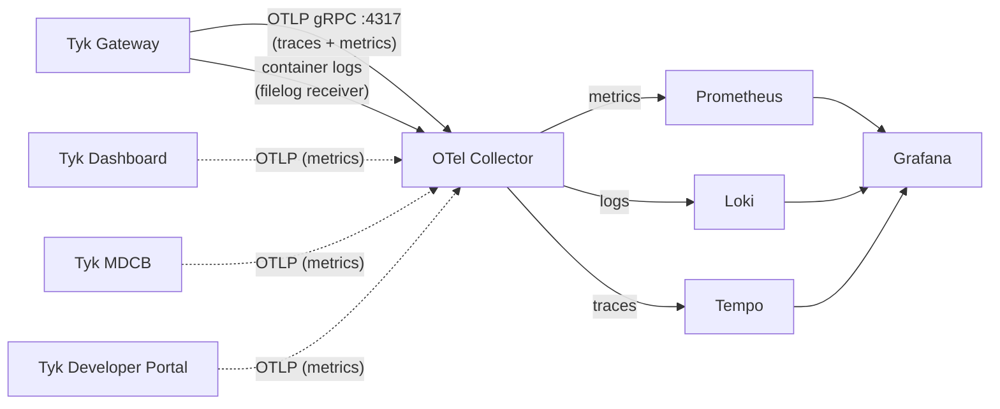

## Introduction

Tyk Gateway exports all three observability signals (structured logs, distributed traces, and metrics) via the OpenTelemetry Protocol (OTLP). This guide shows you how to enable each signal and route them to a local Grafana stack (Prometheus, Loki, Tempo) using an OpenTelemetry Collector.

By the end of this guide you will have:

- Structured JSON access logs from Tyk Gateway shipping to [Loki](https://grafana.com/oss/loki/)
- Distributed traces exporting to [Tempo](https://grafana.com/oss/tempo/)
- Metrics (request rate, latency, error rate) flowing to [Prometheus](https://grafana.com/oss/prometheus/)
- A Grafana instance wired up to all three backends

## Availability

| Signal | Minimum Tyk Gateway Version |
|--------|-----------------------------|
| Structured JSON logs (`log_format: json`) | 5.6.0 |
| Access logs (`access_logs.enabled`) | 5.8.0 |
| Distributed traces (OTLP) | 5.3.0 |
| OTLP metrics | 5.13.0 |

OTLP metrics for Tyk Dashboard, Tyk MDCB, and Tyk Developer Portal have their own minimum versions: v5.16.0, v2.14.0, and v1.20.0 respectively.

## Prerequisites

- [Docker](https://docs.docker.com/get-docker/) and [Docker Compose](https://docs.docker.com/compose/install/) installed
- A running Tyk deployment. We recommend following the [Tyk getting started guide](https://tyk.io/docs/getting-started/quick-start#getting-started-with-tyk-self-managed) to set up a local Docker environment
- Basic familiarity with Docker Compose

## Architecture

All three signals flow from Tyk Gateway to a single OpenTelemetry Collector endpoint. The Collector fans them out to the appropriate backend. Grafana queries all three. The control plane components can also send their metrics to the same Collector. See [Add Tyk Dashboard, Tyk MDCB, and Tyk Developer Portal](#add-tyk-dashboard-tyk-mdcb-and-tyk-developer-portal).



<Note>
Tyk Gateway does not export logs via OTLP. It writes structured JSON to `stderr`. The OTel Collector reads those logs from the Docker container log path using the `filelog` receiver.
</Note>

## Instructions

### Step 1: Configure Tyk Gateway

Add the following environment variables to your `tyk-gateway` service. These enable all three signals:

```yaml expandable
services:
  tyk-gateway:
    environment:
      # Structured JSON logs (requires v5.6.0+)
      - TYK_GW_LOGFORMAT=json
      # Per-request access logs with trace ID correlation (requires v5.8.0+)
      - TYK_GW_ACCESSLOGS_ENABLED=true

      # Distributed tracing
      - TYK_GW_OPENTELEMETRY_TRACES_ENABLED=true
      - TYK_GW_OPENTELEMETRY_TRACES_ENDPOINT=otel-collector:4317
      - TYK_GW_OPENTELEMETRY_TRACES_SAMPLING_TYPE=TraceIDRatioBased
      - TYK_GW_OPENTELEMETRY_TRACES_SAMPLING_RATE=1.0

      # OTLP metrics
      - TYK_GW_OPENTELEMETRY_METRICS_ENABLED=true
      - TYK_GW_OPENTELEMETRY_METRICS_ENDPOINT=otel-collector:4317
      - TYK_GW_OPENTELEMETRY_METRICS_EXPORTINTERVAL=15
```

If you prefer `tyk.conf`, the equivalent configuration is:

```json expandable
{
  "log_format": "json",
  "access_logs": {
    "enabled": true
  },
  "opentelemetry": {
    "traces": {
      "enabled": true,
      "endpoint": "otel-collector:4317",
      "sampling": {
        "type": "TraceIDRatioBased",
        "rate": 1.0
      }
    },
    "metrics": {
      "enabled": true,
      "endpoint": "otel-collector:4317",
      "export_interval": 15
    }
  }
}
```

<Note>
`sampling.rate: 1.0` captures every request, which is suitable for getting started. In production, lower this to `0.1` (10%) or use `ParentBased` sampling. See the [Tyk Gateway configuration reference](/tyk-oss-gateway/configuration#opentelemetry-sampling) for all options.
</Note>

### Step 2: Add the OTel Collector

Create an `otelcol-config.yml` file in your deployment directory:

```yaml expandable
receivers:
  otlp:
    protocols:
      grpc:
        endpoint: 0.0.0.0:4317
      http:
        endpoint: 0.0.0.0:4318

  filelog/tyk-gateway:
    include: ["/var/lib/docker/containers/*/*-json.log"]
    include_file_name: false
    include_file_path: true
    start_at: end
    operators:
      - type: json_parser
        parse_from: body
        parse_to: attributes.docker
        on_error: drop
      - type: move
        from: attributes.docker.log
        to: body
      - type: json_parser
        parse_from: body
        parse_to: attributes.tyk
        on_error: drop
      - type: filter
        expr: 'attributes.tyk.prefix == nil and attributes.tyk.msg == nil'
      - type: time_parser
        parse_from: attributes.tyk.time
        layout: '%Y-%m-%dT%H:%M:%SZ'
        on_error: send_quiet
      - type: severity_parser
        parse_from: attributes.tyk.level
        on_error: send_quiet

processors:
  batch: {}
  resource/tyk_gateway_logs:
    attributes:
      - action: upsert
        key: service.name
        value: tyk-gateway
  memory_limiter:
    check_interval: 1s
    limit_percentage: 75
    spike_limit_percentage: 20
  transform/tyk_gw_resource_attrs:
    error_mode: ignore
    metric_statements:
      - context: datapoint
        statements:
          - set(attributes["tyk_gw_id"], resource.attributes["tyk.gw.id"]) where resource.attributes["tyk.gw.id"] != nil
          - set(attributes["tyk_gw_group_id"], resource.attributes["tyk.gw.group.id"]) where resource.attributes["tyk.gw.group.id"] != nil
          - set(attributes["tyk_gw_tags"], resource.attributes["tyk.gw.tags"]) where resource.attributes["tyk.gw.tags"] != nil

exporters:
  otlphttp/prometheus:
    endpoint: "http://prometheus:9090/api/v1/otlp"
    tls:
      insecure: true
  otlphttp/loki:
    endpoint: "http://loki:3100/otlp"
    tls:
      insecure: true
  otlp/tempo:
    endpoint: "tempo:4317"
    tls:
      insecure: true

service:
  pipelines:
    traces:
      receivers: [otlp]
      processors: [memory_limiter, batch]
      exporters: [otlp/tempo]
    metrics:
      receivers: [otlp]
      processors: [memory_limiter, transform/tyk_gw_resource_attrs, batch]
      exporters: [otlphttp/prometheus]
    logs:
      receivers: [filelog/tyk-gateway]
      processors: [memory_limiter, resource/tyk_gateway_logs, batch]
      exporters: [otlphttp/loki]
```

Then add the `otel-collector` service to your `docker-compose.yml`:

```yaml expandable
services:
  otel-collector:
    image: ghcr.io/open-telemetry/opentelemetry-collector-releases/opentelemetry-collector-contrib:0.133.0
    user: "0"   # Required: without this, permission denied reading /var/lib/docker/containers
    volumes:
      - ./otelcol-config.yml:/etc/otelcol-contrib/config.yaml
      - /var/lib/docker/containers:/var/lib/docker/containers:ro
      - /var/run/docker.sock:/var/run/docker.sock:ro
    ports:
      - "4317:4317"
      - "4318:4318"
    networks:
      - tyk
```

The volume mounts give the Collector read access to Docker container logs for the `filelog` receiver.

### Step 3: Add the Grafana Stack

Add Prometheus, Loki, Tempo, and Grafana to your `docker-compose.yml`:

```yaml expandable
services:
  prometheus:
    image: prom/prometheus:v3.4.0
    command:
      - --config.file=/etc/prometheus/prometheus.yml
      - --web.enable-otlp-receiver
    volumes:
      - ./prometheus.yml:/etc/prometheus/prometheus.yml
    ports:
      - "9090:9090"
    networks:
      - tyk

  loki:
    image: grafana/loki:3.5.0
    command: -config.file=/etc/loki/local-config.yaml
    ports:
      - "3100:3100"
    networks:
      - tyk

  tempo:
    image: grafana/tempo:2.7.2
    command: -config.file=/etc/tempo.yaml
    volumes:
      - ./tempo.yaml:/etc/tempo.yaml
    ports:
      - "3200:3200"
      - "4317"
    networks:
      - tyk

  grafana:
    image: grafana/grafana:12.0.0
    environment:
      - GF_AUTH_ANONYMOUS_ENABLED=true
      - GF_AUTH_ANONYMOUS_ORG_ROLE=Admin
    volumes:
      - ./grafana/provisioning:/etc/grafana/provisioning
    ports:
      - "3001:3000"
    networks:
      - tyk
    depends_on:
      - prometheus
      - loki
      - tempo
```

<Note>
Grafana is mapped to port `3001` to avoid conflicting with Tyk Dashboard on port `3000`. Adjust if needed.
</Note>

Create a minimal `prometheus.yml` to allow OTLP ingest:

```yaml
global:
  scrape_interval: 15s

storage:
  tsdb:
    out_of_order_time_window: 10m
```

Create a minimal `tempo.yaml`:

```yaml expandable
server:
  http_listen_port: 3200

distributor:
  receivers:
    otlp:
      protocols:
        grpc:
          endpoint: 0.0.0.0:4317

storage:
  trace:
    backend: local
    local:
      path: /tmp/tempo/blocks
```

#### Provision Grafana Data Sources

Create `grafana/provisioning/datasources/tyk.yaml`:

```yaml expandable
apiVersion: 1
datasources:
  - name: Prometheus
    type: prometheus
    url: http://prometheus:9090
    isDefault: true

  - name: Loki
    type: loki
    url: http://loki:3100

  - name: Tempo
    type: tempo
    url: http://tempo:3200
```

### Step 4: Start and Verify

Restart your deployment to apply the configuration changes to Tyk Gateway and bring up the new services:

```bash
docker compose up -d
```

Send test requests through the gateway, then open Grafana at **http://localhost:3001** and verify each signal.

<Note>
If you are following this guide using the Tyk Self-Managed getting started setup, an **httpbingo** API is pre-configured. Generate test traffic with:

```bash
for i in $(seq 1 10); do curl -s -o /dev/null -w "HTTP %{http_code}\n" \
  -H "Authorization: <your-api-key>" http://localhost:8080/httpbingo/get; done
```
</Note>

**Metrics**: in Explore, select the Prometheus datasource and run:
```promql
{__name__="tyk_api_requests_total"}
```
You should see request counts rise as traffic flows through the gateway.


**Logs**: in Explore, select the Loki datasource and run:
```logql
{service_name="tyk-gateway"} | json
```
You should see structured access log entries with fields such as `api_id`, `path`, `status`, `latency_total`, and `trace_id`.


**Traces**: in Explore, select the Tempo datasource and search for recent traces. Each trace should show one span for the request.


<Tip>
If traces are not appearing, verify that `TYK_GW_OPENTELEMETRY_TRACES_ENABLED=true` is set and that Tyk Gateway can reach `otel-collector:4317`. Check the OTel Collector logs with `docker compose logs otel-collector` for any connection errors.
</Tip>

## Add Tyk Dashboard, Tyk MDCB, and Tyk Developer Portal

This section is optional. If you only need Tyk Gateway metrics, skip to [Use the Example Grafana Dashboards and Alert Rules](#use-the-example-grafana-dashboards-and-alert-rules).

Tyk Dashboard, Tyk MDCB, and Tyk Developer Portal export metrics with the same `opentelemetry.metrics` configuration pattern as Tyk Gateway. For Tyk Developer Portal, the block is `OpenTelemetry.Metrics`. This section adds all three components to the same Docker Compose deployment and points them at the same OTel Collector. The metrics from all four components then go to the Prometheus instance from [Step 3](#step-3-add-the-grafana-stack).

<Note>
The Tyk Developer Portal configuration file uses PascalCase keys for all settings, not only for OpenTelemetry. Tyk Dashboard and Tyk MDCB use lowercase keys. Each component follows its own native pattern.
</Note>

### Configure Tyk Dashboard

Add the following environment variables to your `tyk-dashboard` service:

```yaml
services:
  tyk-dashboard:
    environment:
      - TYK_DB_OPENTELEMETRY_METRICS_ENABLED=true
      - TYK_DB_OPENTELEMETRY_METRICS_ENDPOINT=otel-collector:4317
      - TYK_DB_OPENTELEMETRY_METRICS_EXPORTINTERVAL=15
```

If you prefer `tyk_analytics.conf`, the equivalent configuration is:

```json expandable
{
  "control_plane_id": "",
  "opentelemetry": {
    "metrics": {
      "enabled": true,
      "endpoint": "otel-collector:4317",
      "export_interval": 15,
      "deployment_environment": "dev",
      "gateway_metrics": true,
      "license_metrics": true,
      "http_metrics": true,
      "certificate_metrics": true,
      "dependency_metrics": true,
      "notification_metrics": true,
      "objects_metrics": {
        "enabled": true,
        "collection_interval": 300,
        "governance": true
      },
      "health_metrics": true,
      "runtime_metrics": true,
      "meta_metrics": true
    }
  }
}
```

The `objects_metrics` group also exports governance metrics. Governance metrics need a license that includes governance. To turn them off, set `governance` to `false`.

Leave `control_plane_id` blank to generate it automatically and share it with Tyk MDCB through Redis. If you run more than one control plane, set it explicitly.

### Configure Tyk MDCB

Add the following environment variables to your `tyk-sink` service:

```yaml
services:
  tyk-sink:
    environment:
      - TYK_MDCB_OPENTELEMETRY_METRICS_ENABLED=true
      - TYK_MDCB_OPENTELEMETRY_METRICS_ENDPOINT=otel-collector:4317
      - TYK_MDCB_OPENTELEMETRY_METRICS_EXPORTINTERVAL=15
```

If you prefer `tyk_sink.conf`, the equivalent configuration is:

```json expandable
{
  "control_plane_id": "",
  "opentelemetry": {
    "metrics": {
      "enabled": true,
      "endpoint": "otel-collector:4317",
      "export_interval": 15,
      "deployment_environment": "dev",
      "dataplanes_metrics": true,
      "rpc_metrics": true,
      "sync_metrics": true,
      "analytics_metrics": true,
      "dependency_metrics": true,
      "health_metrics": true,
      "expiry_metrics": true,
      "runtime_metrics": true,
      "meta_metrics": true
    }
  }
}
```

### Configure Tyk Developer Portal

Add the following environment variables to your `tyk-portal` service:

```yaml
services:
  tyk-portal:
    environment:
      - PORTAL_OPENTELEMETRY_METRICS_ENABLED=true
      - PORTAL_OPENTELEMETRY_METRICS_ENDPOINT=otel-collector:4317
      - PORTAL_OPENTELEMETRY_METRICS_EXPORTINTERVAL=15
```

The `TYK_PORTAL_*` equivalents of these variables also work.

If you prefer `portal.conf`, the equivalent configuration is:

```json
{
  "OpenTelemetry": {
    "Metrics": {
      "Enabled": true,
      "Endpoint": "otel-collector:4317",
      "ExportInterval": 15,
      "DeploymentEnvironment": "dev",
      "ProviderMetrics": true,
      "HealthMetrics": true
    }
  }
}
```

Tyk Developer Portal does not share Redis with the control plane, so it has no `control_plane_id`. To tag the environment that the portal belongs to, set `DeploymentEnvironment`. It is exported as `deployment.environment`.

### Verify the Control Plane Metrics

In Grafana Explore, select the Prometheus data source and run:

```promql
{__name__=~"tyk.dashboard.*|tyk.mdcb.*|tyk.portal.*|process.uptime"}
```

After each component completes at least one export cycle, you should see series for Tyk Dashboard, Tyk MDCB, and Tyk Developer Portal.


## Use the Example Grafana Dashboards and Alert Rules

Tyk provides example Grafana dashboards and alert rules for the OpenTelemetry metrics that Tyk components export. Use them to get started quickly, without building panels or rules from scratch.

### Example Dashboards

The dashboards start with the big picture and let you go into detail where you need it.

**Tyk Environments Overview** shows all your environments in one place. For each environment, you can see each control plane and the health, version, and connectivity of every component in it.

From the overview, go into more detail with a dashboard for each component:

- Tyk Dashboard
- Tyk MDCB
- Tyk Developer Portal

Tyk Gateway has its own dashboards:

- Tyk Gateway - Fleet Health
- Tyk Gateway - API Portfolio Overview
- Tyk Gateway - API Troubleshooting
- Tyk Gateway - API SLOs
- Tyk Gateway - Native OTLP Metrics
- Tyk Gateway - MCP Metrics


### Example Alert Rules

The examples also include alert rules for the control plane and its components:

- **Control plane:** a component stops reporting metrics, a component restarts, or memory use is above 90% of the memory limit (when a limit is set)
- **Tyk Dashboard:** a dependency is unhealthy, the API error rate or latency is high, a gateway stops sending heartbeats, or fewer gateways are connected than 15 minutes ago
- **Tyk MDCB:** a dependency is unhealthy, a Data Plane group has no connected gateways or loses gateways, gateways reconnect repeatedly or fail to connect, a gateway stops sending heartbeats, gateways in a group load different API counts or run different versions, the RPC error rate is high, the metrics exporter fails, or the license or a certificate is about to expire
- **Tyk Developer Portal:** a dependency is unhealthy, the portal cannot reach a provider, or a provider sync is stale, failing, or slow

Each alert has a `severity` label (`critical`, `warning`, or `info`) and a `tyk_component` label. The thresholds are starting points. Adjust them for your deployment.

The rules are grouped by component: `tyk-control-plane`, `tyk-dashboard`, `tyk-mdcb`, and `tyk-portal`.


### Get the Examples

The examples are in the [`observability` folder](https://github.com/TykTechnologies/tyk-install/tree/main/observability) of the public Tyk Install repository. Start with the README in that folder, not the README in the root of the repository.

The README explains how to add OpenTelemetry to a new Tyk installation and to an existing one.

Each dashboard is a single JSON file. To use one, copy the JSON and [import it into Grafana](https://grafana.com/docs/grafana/latest/dashboards/build-dashboards/import-dashboards/) as a dashboard. To find the dashboards after you import them, filter by the `tyk` tag.

The alert rules are Prometheus-format YAML files. To use them, import them into Grafana-managed alert rules:

<Steps>
  <Step title="Open the Alert Rules">
    In Grafana, go to **Alerting > Alert rules**.
  </Step>
  <Step title="Start the Import">
    In the data source-managed alert rules section, select **Import to Grafana-managed rules**.
  </Step>
  <Step title="Upload the Rule File">
    Select **Prometheus YAML file** as the import source and upload the rule file.
  </Step>
  <Step title="Import the Rules">
    Select the data source that the rules query, then select **Import**.
  </Step>
</Steps>

For all options and limitations, see [Import data source-managed rules to Grafana-managed rules](https://grafana.com/docs/grafana/latest/alerting/alerting-rules/alerting-migration/) in the Grafana documentation.

<Note>
These examples are built for Grafana. Because Tyk exports metrics with OpenTelemetry, you can use any observability backend. If you use a different backend, use the examples as a reference for which metrics to chart.
</Note>

<Note>
The examples read the metrics set up in this guide. Metrics from Tyk Dashboard, Tyk MDCB, and Tyk Developer Portal require v5.16.0, v2.14.0, and v1.20.0 or later, respectively.
</Note>

## Next Steps

- **Explore default metrics**: see all Tyk Gateway metrics available out of the box in [Default Metrics](/api-management/metrics/default-metrics)
- **Add custom metrics**: attach request headers, JWT claims, and response codes as metric dimensions using [Custom Metrics](/api-management/metrics/custom-metrics)
- **Kubernetes deployment**: for log collection in Kubernetes using the OTel Collector DaemonSet, see [Collecting Gateway Logs with OTel on Kubernetes](/api-management/collecting-gateway-logs-otel-kubernetes)
- **Explore control plane metrics**: see the full Tyk Dashboard, Tyk MDCB, and Tyk Developer Portal reference in [Default Metrics](/api-management/metrics/default-metrics)
- **Understand control plane correlation**: learn how `control_plane_id` lets Tyk Dashboard and Tyk MDCB metrics correlate in [Metrics Concepts](/api-management/metrics/metrics-concepts#control-plane-identity)
