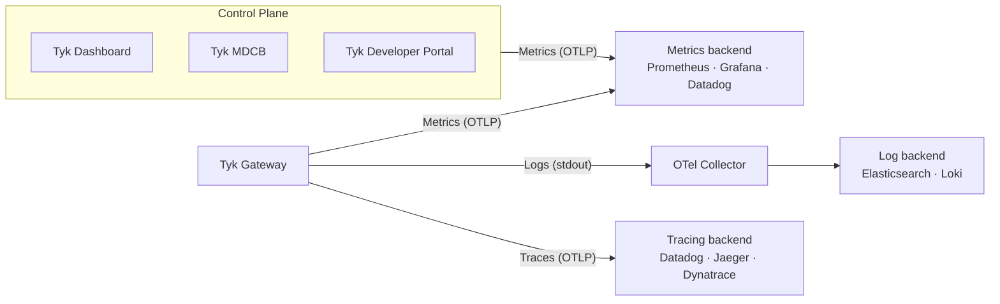

[OpenTelemetry](https://opentelemetry.io/docs/what-is-opentelemetry/) is an open-source observability framework that provides a vendor-neutral standard for collecting metrics, logs, and traces. It is the native, recommended observability approach in Tyk.

Tyk supports OpenTelemetry across its components:

- **Tyk Gateway** produces all three signals. It exports metrics and traces through the [OpenTelemetry Protocol (OTLP)](https://opentelemetry.io/docs/specs/otlp/) to any compatible backend. It writes logs as structured JSON to stderr, and an external agent collects them.
- **Tyk Dashboard, Tyk MDCB, and Tyk Developer Portal** form the control plane. They export metrics through OTLP, with the same configuration pattern and resource attribute model as Tyk Gateway.



## Metrics

Tyk Gateway natively pushes metrics to any OTLP-compatible backend with a configurable push interval. No sidecar or agent is required alongside it.

When enabled, it automatically exports three groups of metrics:

- **Request metrics:** Rate, Errors, and Duration (RED) with a three-way latency split: total, gateway-only, and upstream-only
- **Go runtime metrics:** Memory usage, goroutine count, and GC health
- **Configuration state metrics:** Number of APIs and policies loaded, config reload counts and durations

Tyk Dashboard, Tyk MDCB, and Tyk Developer Portal export their own metrics through the same pipeline. See [Control Plane Metrics](/api-management/logs-metrics#control-plane-metrics).


You can extend these with [custom counters and histograms](/api-management/metrics/custom-metrics) that use request context, JWT claims, session data, response headers, or static API metadata as dimensions.

**Compatible backends:** Prometheus, Grafana Mimir, Datadog, New Relic, Dynatrace, Elastic, and any OTel Collector.

For full configuration details, see:

- [OpenTelemetry Metrics Configuration](/api-management/logs-metrics): enabling metrics, export config, and cardinality control
- [Default Metrics](/api-management/metrics/default-metrics): all metrics that Tyk Gateway, Tyk Dashboard, Tyk MDCB, and Tyk Developer Portal export automatically
- [Custom Metrics](/api-management/metrics/custom-metrics): defining your own counters and histograms

## Logs

Tyk Gateway writes logs to `stdout`/`stderr` in structured JSON format. It does not have a native OTLP log exporter. To ship gateway logs to an observability backend, deploy the [OpenTelemetry Collector](https://opentelemetry.io/docs/collector/) with the [Filelog Receiver](https://github.com/open-telemetry/opentelemetry-collector-contrib/tree/main/receiver/filelogreceiver). The Collector tails container log files on each Kubernetes node, optionally enriches them with pod and namespace metadata, and forwards them to a backend such as Elasticsearch.

For a step-by-step guide, see [Collecting Gateway Logs with OTel on Kubernetes](/api-management/collecting-gateway-logs-otel-kubernetes).

## Tracing

Distributed tracing gives you an end-to-end view of individual API requests as they flow through Tyk Gateway and into your upstream services. Traces help you pinpoint latency bottlenecks, trace error propagation across services, and understand the full request lifecycle.

Tyk Gateway has supported OpenTelemetry tracing since v5.2. It generates parent and child [spans](https://opentelemetry.io/docs/concepts/signals/traces/#spans) for each proxied request. For each API, you can optionally enable **detailed tracing** to produce a span per middleware, giving granular visibility into authentication, rate limiting, transformation, and routing steps.

**Supported propagation formats:** W3C TraceContext (default), B3, and custom or composite header modes for proprietary correlation headers.

**Supported backends:** Datadog, Dynatrace, Jaeger, New Relic, Elastic, and any OTLP-compatible endpoint.

For configuration details and vendor-specific integration guides, see [Distributed Tracing with Tyk](/api-management/traces).

## Dashboard Analytics

Separately from OpenTelemetry, Tyk Dashboard has its own built-in Traffic Analytics UI and Log Browser, populated by [Tyk Pump](/api-management/tyk-pump) rather than OTel. This is not an alternative to OTel for external observability tooling, it's the only route into its native analytics. See [Dashboard Analytics](/api-management/dashboard-analytics).

## Resource Attributes

All OTel signals that Tyk Gateway produces carry resource attributes, such as `tyk.gw.id`. These are metadata set once at startup that identify the source instance. Use them to filter and correlate signals across nodes, edge groups, and environments. For the full list, see [Resource Attributes](/api-management/metrics/default-metrics#resource-attributes).

Tyk Dashboard and Tyk MDCB metrics also carry `control_plane_id`, which groups the metrics of both components as one control plane. See [Control Plane Identity](/api-management/metrics/metrics-concepts#control-plane-identity).

<Note>
All OpenTelemetry configuration options are documented in the [Tyk Gateway configuration reference](/tyk-oss-gateway/configuration#opentelemetry).
</Note>

## Signal Correlation

Tyk's three signal types (metrics, logs, and traces) are produced independently, but three mechanisms let you correlate them in your observability backend.

### Trace and Span IDs in Logs

When OpenTelemetry tracing is enabled, Tyk Gateway injects trace context into both log types:

[**Access logs**](/api-management/logs/access-logs) include `trace_id`, the W3C trace ID for the request, matching the root span exported to your tracing backend.

```
... status=200 trace_id=4bf92f3577b34da6a3ce929d0e0e4736 upstream_latency=61 ...
```

[**Application logs**](/api-management/logs/application-logs) include both `trace_id` and `span_id` on all request-scoped entries (middleware execution, errors, debug output):

```
... level=error msg="Rate limit exceeded" prefix=rate-limit api_id=b1a41c9a89984ffd7bb7d4e3c6844ded trace_id=4bf92f3577b34da6a3ce929d0e0e4736 span_id=00f067aa0ba902b7
```

The `span_id` identifies the exact span active when the log was emitted, so you can navigate from an error log directly to the span in a trace waterfall.

For the full log field reference, see [Logging in Tyk](/api-management/logs).

<Note>
Trace and span IDs are only present in log entries associated with a sampled request. Non-request-scoped entries (startup, configuration reload, health-checks) and unsampled requests do not carry these fields.
</Note>

### Exemplars in Histogram Metrics

When both OpenTelemetry tracing and metrics are enabled, Tyk Gateway automatically attaches exemplars whenever a histogram is recorded during an active sampled request.

An exemplar embeds the `trace_id` and `span_id` of the active request directly inside a histogram bucket, creating a direct link from an aggregated metric to a specific trace.

**What this enables:** When you see a latency spike on a `http.server.request.duration` histogram in Grafana, click the exemplar marker on the chart to navigate directly to the offending trace in Jaeger or Tempo, with no manual trace ID search required.

For full setup details, see [Exemplars](/api-management/metrics/metrics-concepts#exemplars) in the metrics concepts page.

### Resource Attributes Across All Signals

Traces and metrics both carry the same [resource attributes](#resource-attributes) set at gateway startup. The key correlating attribute is `tyk.gw.id` (also exported as `service.instance.id`), which uniquely identifies the gateway that produced each signal.

When running multiple gateway replicas, this lets you filter metrics to a specific instance using `tyk.gw.id` and find that same gateway's traces using the same attribute.

## What's Next

- **[Getting Started](/api-management/observability-getting-started):** A hands-on walkthrough spinning up a full observability stack (Loki, Grafana, Tempo, Prometheus) with Tyk Gateway.
- **[Best Practices](/api-management/observability/guides/best-practices):** Production guidance on export topology, cardinality control, trace sampling, and log collection.
- **[Gateway Observability Playbook](/api-management/observability/guides/gateway-playbook):** Diagnosing common failures using RED metrics, response flags, and PromQL alert rules.
