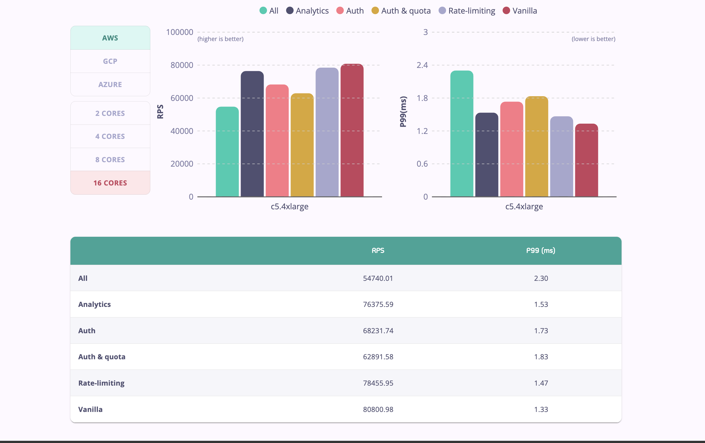

So you want to deploy Tyk to production?

There's a few things worth noting that can ensure high performance of your Tyk Gateways. Here are some of the basic things we do for load testing to make sure machines don't run out of resources.

## Performance Expectations
Tyk is a high-performance API Gateway written in [Go](https://go.dev/), capable of handling significant loads. Our official benchmarks demonstrate that Tyk can handle over **80,000 requests per second**, and over **54,000 requests per second** with a full feature set (including authentication, rate limiting, and analytics) enabled.



For detailed information on our performance testing and results, please refer to our official performance benchmarks.

- **[Tyk Performance Benchmarks](https://tyk.io/performance-benchmarks/)**: Detailed analysis of Tyk's performance across various scenarios.
- **[Tyk Performance Tests Repository](https://github.com/TykTechnologies/tyk-ansible-performance-testing)**: Replicate our performance tests yourself using our open-source testing framework.
- **[Performance Tuning Your Gateway](https://tyk.io/blog/performance-tuning-your-tyk-api-gateway/)**: A step-by-step guide to fine-tuning your Gateway for maximum performance.  
- **[Manual Performance Testing on AWS](https://tyk.io/blog/a-manual-for-simple-performance-testing-with-tyk-on-aws/)**: Best practices for setting up and running manual performance tests on AWS to ensure your Gateway is optimized.

## Change All the Shared Secrets

Tyk packages, Docker images and Helm charts ship with sample values for secrets. These values are the same in every installation. Replace each one before you deploy to production. The [Default Secrets Reference](/deployment/default-secrets-reference) lists every secret, its environment variable, its Helm value and the value that Tyk ships.

Tyk Gateway and Tyk Dashboard log a warning at startup for only some sample values, and they continue to start. Do not rely on the warning.

1. Generate a different random value for each secret, for example with `openssl rand -hex 32`.

2. Set the Tyk Gateway and Tyk Dashboard secrets. Some settings must have the same value in both components:

   | Tyk Gateway | Tyk Dashboard | Description |
   | :---- | :---- | :---- |
   | `secret` (`TYK_GW_SECRET`) | `tyk_api_config.secret` (`TYK_DB_TYKAPI_SECRET`) | Authenticates requests to the Tyk Gateway API. Must match. |
   | `node_secret` (`TYK_GW_NODESECRET`) | `shared_node_secret` (`TYK_DB_NODESECRET`) | Authenticates Tyk Gateway to Tyk Dashboard. Must match. |
   | None | `admin_secret` (`TYK_DB_ADMINSECRET`) | Authenticates requests to the Tyk Dashboard Admin API. |

3. Set `security.private_certificate_encoding_secret` to the same value in Tyk Gateway, Tyk Dashboard and Tyk MDCB. When it is empty, Tyk Gateway and Tyk Dashboard use the API secret to encrypt certificate private keys. On an existing installation, follow [Change the API Secret Safely](/deployment/default-secrets-reference#change-the-api-secret-safely) before you change the API secret.

4. Set the secrets of the other components that you use: [Tyk MDCB](/deployment/default-secrets-reference#tyk-mdcb), [Tyk Pump](/deployment/default-secrets-reference#tyk-pump), the [Developer Portal](/deployment/default-secrets-reference#tyk-developer-portal) and [Tyk AI Studio](/deployment/default-secrets-reference#tyk-ai-studio).

5. Set passwords for Redis, MongoDB and PostgreSQL, and give them to each component.

6. If you install with Helm, keep the secrets in Kubernetes Secrets and refer to them from your values file. See [Supply Helm Values From Kubernetes Secrets](/deployment/default-secrets-reference#supply-helm-values-from-kubernetes-secrets).

7. Change the password of the first admin user if your installation method created it with a fixed password. See [Admin User From the Setup Script](/deployment/default-secrets-reference#admin-user-from-the-setup-script) and the [Helm chart defaults](/deployment/default-secrets-reference#tyk-helm-charts).

<a id="use-the-publicprivate-key-message-security"></a>
## Sign Tyk Dashboard Notifications With a Key Pair

Tyk Dashboard sends notifications to Tyk Gateway instances through Redis, for example to reload APIs or to read and change the configuration of a Tyk Gateway. Tyk Gateway can verify these notifications with a key pair:

| Component | Field | Environment variable | Description |
| :---- | :---- | :---- | :---- |
| Tyk Dashboard | [`private_key_path`](/tyk-dashboard/configuration#private_key_path) | `TYK_DB_PRIVATEKEYPATH` | The private key that signs notifications. |
| Tyk Gateway | [`public_key_path`](/tyk-oss-gateway/configuration#public_key_path) | `TYK_GW_PUBLICKEYPATH` | The public key that verifies notifications and plugin bundles. |
| Tyk Gateway | [`allow_insecure_configs`](/tyk-oss-gateway/configuration#allow_insecure_configs) | `TYK_GW_ALLOWINSECURECONFIGS` | When `true`, Tyk Gateway does not verify the signatures of the notifications it receives through Redis. |

The setup templates in the Linux packages and the Tyk Helm charts (`gateway.allowInsecureConfigs`) set `allow_insecure_configs` to `true`.

<Warning>
Tyk Gateway uses the same public key to verify [plugin bundles](/api-management/plugins/overview#plugin-bundles). If you use plugin bundles, set `public_key_path` only after you sign every bundle with the matching private key. Otherwise, APIs that use plugin bundles stop loading, possibly days after the change.
</Warning>

### How the Public Key Affects Plugin Bundles

When you set `public_key_path`, these changes apply to plugin bundles:

- **One key does two jobs.** Tyk Gateway verifies Tyk Dashboard notifications and plugin bundles with the same public key. You must sign bundles with the private key that Tyk Dashboard uses, so that key must also be available where you build bundles.
- **Tyk Gateway verifies every bundle that it downloads.** If a downloaded bundle is not signed, verification fails with the error `Bundle isn't signed`. If a bundle is signed with a different key, the signature verification fails. In both cases Tyk Gateway logs `Couldn't load bundle` and does not load the API that uses the bundle. Other APIs load normally.
- **The failure can occur later.** When Tyk Gateway reloads, it does not download again a bundle that is already in `middleware_path/bundles`. It checks the signature of that bundle only if the bundle has one, so an unsigned bundle continues to load. The failure occurs when a Tyk Gateway downloads the bundle again, for example:
  - a new pod or node
  - a restart on ephemeral storage
  - a Data Plane that scales out
  - a cleared middleware directory
  - a new bundle name or version
- **API loads take longer.** Each time Tyk Gateway loads an API that uses a signed bundle, including on every reload, it reads and hashes all the files in the bundle again and verifies the signature. Tyk Gateway does not do this for unsigned bundles that are already on disk. This does not affect request processing. The extra time increases with the size of your bundles, the number of APIs that use them and how often your Tyk Gateway instances reload.
- **`skip_verify_existing_plugin_bundle: true`** stops Tyk Gateway from verifying the bundles that are already on disk, which removes this extra load time. Tyk Gateway then does not detect changes to bundle files after download. It does not change the verification of downloaded bundles.
- **To rotate the key**, sign every bundle again with the new private key and publish it under a new name before any Tyk Gateway downloads it with the new public key.

### Enable Key-Pair Signing

1. List every API that uses a plugin bundle (`custom_middleware_bundle`).
2. Generate an RSA key pair. Give the private key to Tyk Dashboard (`private_key_path`) and to the pipeline that builds your bundles. Give the public key to every Tyk Gateway.
3. Build every bundle again and sign it with the private key: `tyk bundle build --key=<private.pem>`. Do not use `-y` (`--skip-signing`). Publish the signed bundles to your bundle server under new names, so that Tyk Gateway instances do not continue to use unsigned copies that are already on disk.
4. Update your APIs to use the new bundle names.
5. Set `private_key_path` on Tyk Dashboard and `public_key_path` on every Tyk Gateway, in the Control Plane and in each Data Plane. Then set `allow_insecure_configs` to `false` and restart the components.
6. Before you roll out the change, test it on a Tyk Gateway with an empty bundle directory, such as a new pod or node. Look in the logs for `Bundle isn't signed` and `Couldn't load bundle`.

## Change your Control Port

To secure your Tyk installation, you can configure the following settings in your [tyk.conf](/tyk-oss-gateway/configuration):

`control_api_hostname` - Set the hostname to which you want to bind the REST API.

`control_api_port` - This allows you to run the Gateway Control API on a separate port, and protect it behind a firewall if needed.

If you change these values, you need to update the equivalent fields in the dashboard conf file `tyk_analytics.conf`: `tyk_api_config.Host`  and `tyk_api_config.Port`


## Recommended Topology

Keep Redis and your persistent database (MongoDB or PostgreSQL) on dedicated infrastructure, separate from the systems running Tyk Gateway and Tyk Dashboard. Both Redis and Tyk Gateway are memory-intensive and CPU-intensive; running them on the same host creates resource contention.

The recommended production topology is:

- Two or more Tyk Gateways, load balanced, each on a separate machine.
- A separate Redis instance using Redis Sentinel for high availability, or Redis Cluster for horizontal scalability.
- A separate MongoDB or PostgreSQL cluster.
- One Tyk Dashboard node on a separate machine.
- One Tyk Pump node on a separate machine.

Under high traffic, consider isolating Redis workloads across dedicated instances. Tyk Gateway supports a [separate analytics store](/api-management/in-memory-database#separate-analytics-storage) for traffic log buffering and a [separate cache store](/api-management/in-memory-database#separate-cache-storage) for API response caching, keeping them isolated from session and rate limiting data.

For guidance on configuring Redis, including clustering, Sentinel, and TLS, see [Configure Redis](/tyk-configuration-reference/redis-cluster-sentinel). For database sizing guidelines and memory management options, see [Database Management](/planning-for-production/database-settings).

## Connecting Multiple Gateways to a Single Dashboard

Please note that, for a Self-Managed installation, the number of gateway nodes you may register with your dashboard concurrently will be subject to the terms of your license.

Each gateway node must be configured in the same way, with the exception being if you want to shard your gateways. Each gateway node in the cluster will need connectivity to the same Redis server and persistent database.

### Use a Consistent License Across Dashboard Instances

When you run more than one Tyk Dashboard instance against the same Redis and database backend, every instance must use the same license key. This matters most during a rolling or blue-green upgrade, or while updating a license, because old and new instances can run side by side with different keys.

A Tyk Dashboard license defines the pool of gateway nodes that the Dashboard is allowed to register, and this node information is shared through Redis. When two instances connect to the same Redis with different licenses, one Dashboard can reject gateways that were registered against the other license. Affected gateways fail to register with an HTTP 404 response, and the Dashboard logs `level=error msg="GetSpareNode returned node not allowed by this dashboard's license"`. Gateways that cannot register lead to 404 responses and prevent API creation.

To avoid this, apply any license change to every Dashboard instance that shares the same backend. See the [Upgrading Guide](/developer-support/upgrading#upgrade-strategies) for upgrade guidance and [Troubleshooting](/api-management/troubleshooting-debugging#dashboard) to resolve the error.

## Other Dashboard Security Considerations

In addition to changing the default secrets (see [Change all the shared secrets](#change-all-the-shared-secrets)) if you change the Control API port (see [Change your Control Port](#change-your-control-port)), you also need to change the connection string settings in your `tyk_analytics.conf` file.

## Ensure you are matching only the URL paths that you want to match

We recommend that you configure Tyk Gateway to use [exact URL path matching](/getting-started/key-concepts/url-matching#matching-modes) and to enforce [strict route matching](/tyk-oss-gateway/configuration#http_server_options-enable_strict_routes) to avoid accidentally invoking your unsecured `/health` endpoint when a request is made to `/customer/{customer_id}/account/health`...

Unless you want to make use of Tyk's flexible *listen path* and *endpoint path* matching modes and understand the need to configure patterns carefully, you should enable `TYK_GW_HTTPSERVEROPTIONS_ENABLESTRICTROUTES`, `TYK_GW_HTTPSERVEROPTIONS_ENABLEPATHPREFIXMATCHING` and `TYK_GW_HTTPSERVEROPTIONS_ENABLEPATHSUFFIXMATCHING`.

## Health checks are expensive

To keep real-time health-check data and make it available to the Health-check API, Tyk needs to record information for every request, in a rolling window - this is an expensive operation and can limit throughput - you have two options: switch it off, or get a box with more cores.

## Selecting the appropriate log level

Tyk provides multiple [log levels](/api-management/logs/application-logs): error, warn, info, debug. Setting higher log levels consumes more computing resources and would have an impact on the Tyk component. Tyk installations default to log level info unless modified by config files or environment variables.

It is recommended to set to debug only for the duration of troubleshooting as it adds heavier resource overheads. In high performance use cases for Tyk Gateway, consider setting a log level lower than info to improve overall throughput.

## Use the optimization settings

The below settings will ensure connections are effectively re-used, removes a transaction from the middleware run that enforces org-level rules, enables the new rate limiter (by disabling sentinel rate limiter) and sets Tyk up to use an in-memory cache for session-state data to save a round-trip to Redis for some other transactions.

Most of the changes below should be already in your `tyk.conf` by default:

```
"close_connections": false,
"proxy_close_connections": false,
"enforce_org_quotas": false,
"enforce_org_data_detail_logging": false,
"experimental_process_org_off_thread": true,
"enable_sentinel_rate_limiter": false,
"local_session_cache": {
  "disable_cached_session_state": false
},
"max_idle_connections_per_host": 500
```

In Tyk v2.7 we optimized the connection pool between Tyk and your Upstream. In previous releases `max_idle_connections_per_host` option, was capped at 100. From v2.7 you have been able to set it to any value.

`max_idle_connections_per_host` limits the number of keep-alive connections between clients and Tyk. If you set this value too low, then Tyk will not re-use connections and you will have to open a lot of new connections to your upstream.

If you set this value too high, you may encounter issues when slow clients occupy your connection and you may reach OS limits.

You can calculate the right value using a straightforward formula:

If the latency between Tyk and your Upstream is around 50ms, then a single connection can handle 1s / 50ms = 20 requests. So if you plan to handle 2000 requests per second using Tyk, the size of your connection pool should be at least 2000 / 20 = 100. For example, on low-latency environments (like 5ms), a connection pool of 100 connections will be enough for 20k RPS.

## Protect Redis from overgrowing

Please read carefully through this [doc](/api-management/access-control/sessions-and-keys/session-lifecycle) to make an *aware decision* about the expiration of your keys in Redis, after which they will be removed from Redis. If you don't set the lifetime, a zero default means that keys will stay in Redis until you manually delete them, which is no issue if you have a process outside Tyk Gateway to handle it. If you don't - and especially in scenarios that your flow creates many keys or access tokens for every user or even per call - your Redis can quickly get cluttered with obsolete tokens and eventually affect the performance of the Tyk Gateway.

## Analytics Optimizations

If using a [Redis cluster](https://redis.io/docs/management/scaling/) under high load it is recommended that analytics are distributed among the Redis shards. This can be configured by setting the [analytics_config.enable_multiple_analytics_keys](/tyk-oss-gateway/configuration#analytics_config-enable_multiple_analytics_keys) parameter to true. Furthermore, analytics can also be disabled for an API using the [do_not_track](/api-management/gateway-config-tyk-classic#traffic-logs) configuration parameter. Alternatively, tracking for analytics can be disabled for selected endpoints using the [do not track endpoint plugin](/api-management/traffic-transformation/do-not-track#do-not-track-using-tyk-oas).

### Protobuf Serialisation

In Tyk Gateway, using [protobuf](/tyk-oss-gateway/configuration#analytics_config-serializer_type) serialisation, instead of [msgpack](https://msgpack.org) can increase performance for sending and processing analytics. 
<br/>
**Note:** *protobuf* is not currently supported in *MDCB* deployment.

If using Tyk Cloud platform under high load, it is also recommended that analytics are stored within a local region. This means that a local Tyk Pump instance can send the analytics to a localised data sink, such as PostgreSQL or MongoDB (no need for the hybrid pump). This can reduce traffic costs since your analytics would not be sent across regions.


## Pin Container Images

Tyk recommends that you pin each Tyk container image by tag and digest in production.

A tag, such as `v5.16.0`, points to an image. A tag can move to a different image. A digest, such as `sha256:7af43f37…`, identifies one immutable image. When you pin an image by tag and digest, the tag shows the version. The digest makes sure that each node runs the same image.

### Docker

Add the digest after the tag:

```bash
docker pull tykio/tyk-gateway:v5.16.0@sha256:7af43f37fcae9bccf050c934e51a2ba710c48b5916290da13ef36fcdee3c60c1
```

### Kubernetes

Set the image to the tag and digest, and set `imagePullPolicy` to `IfNotPresent`.

```yaml
containers:
  - name: tyk-gateway
    image: tykio/tyk-gateway:v5.16.0@sha256:7af43f37fcae9bccf050c934e51a2ba710c48b5916290da13ef36fcdee3c60c1
    imagePullPolicy: IfNotPresent
```

When you upgrade, change the tag and the digest together. If you change only the tag, Kubernetes continues to run the image that the old digest identifies.

## Use the right hardware

Tyk is CPU-bound: you will get exponentially better performance the more cores you throw at Tyk - it's that simple. Tyk will automatically spread itself across all cores to handle traffic, but if expensive operations like health-checks are enabled, then those can cause keyspace contention, so again, while it helps, health-checks do throttle throughput.

## Resource limits

Make sure your host operating system has resource limits set to handle an appropriate number of connections.

You can increase the maximum number of files available to the kernel by modifying `/etc/sysctl.conf`.

```
fs.file-max=160000
```

Please note that a single file, with associated inode & dcache consumes approximately 1KB RAM. As such, setting `fs.file-max=160000` will consume a maximum of 160MB ram.

The changes will apply after a system reboot, but if you do not wish to reboot quite yet, you can apply the change for the current session using `echo 160000 > /proc/sys/fs/file-max`.

## File Handles / File Descriptors

Now we need to configure the file handles available to your Tyk services.

### systemd

Override your `systemd` unit files for each of the Tyk services using `systemctl edit {service_name}`.

* Gateway `systemctl edit tyk-gateway.service`
* Dashboard `systemctl edit tyk-dashboard.service`
* Pump `systemctl edit tyk-pump.service`
* Multi Data-Center Bridge `systemctl edit tyk-sink.service`

You may then add `LimitNOFILE=80000` to the `[Service]` directive as follows:

```
[Service]
LimitNOFILE=80000
```

After making these changes, you'll need to restart your service, for example:

```
systemctl restart tyk-gateway.service
```

### Docker

You may set *ulimits* in a container using the `--ulimit` option. See *Docker* documentation for detail on [setting *ulimits*](https://docs.docker.com/engine/reference/commandline/run/#set-ulimits-in-container---ulimit)

```
docker run --ulimit nofile=80000:80000 \
  -it --name tyk-gateway \
  tykio/tyk-gateway:latest
```


<Note>
If you are not using *systemd* or Docker, please consult your Operating System documentation for controlling the number of File Descriptors available for your process.
</Note>


## File modification at runtime

Understanding what files are created or modified by the Dashboard and Gateway during runtime can be important if you are running infrastructure orchestration systems such as Puppet, which may erroneously see such changes as problems that need correcting.

*   Both the Gateway and Dashboard will create a default configuration file if one is not found.
*   Dashboard will write the license into the configuration file if you add it via the UI.
*   From Tyk v2.3 onwards it has been possible for a Dashboard to remotely change the config of a Gateway. This will cause the Gateway's configuration file to update.