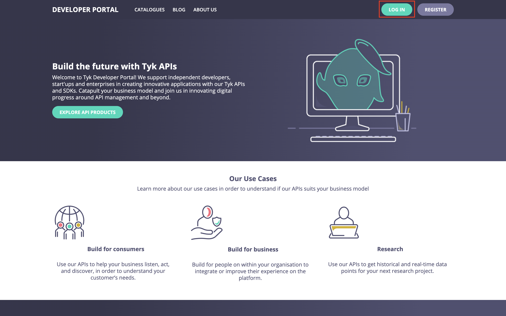
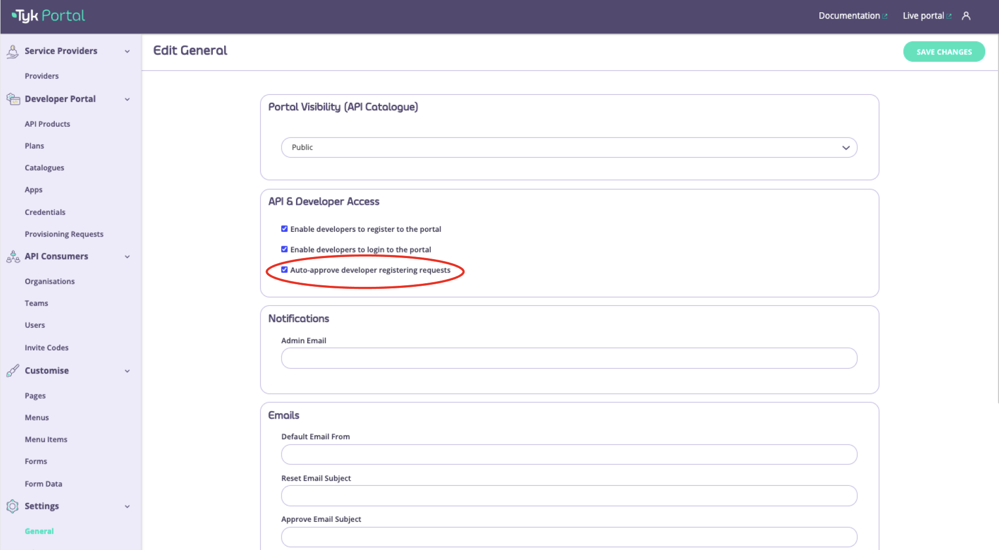

## Introduction

API Owners are the administrators who configure and manage your Tyk Developer Portal. They control the entire API lifecycle - from defining Products and Plans to managing user access and monitoring usage. With their privileged access to the Admin Portal, API Owners play a crucial role in shaping your API program's success.

Unlike [API Consumers](/portal/api-consumer) who use your APIs, API Owners are responsible for curating the API experience. They make strategic decisions about which APIs to expose, how to package them, who can access them, and under what conditions. Effectively managing your API Owner users is essential for maintaining the security and integrity of your API program.

Whether you're setting up your Developer Portal for the first time or refining your administrative structure, understanding how to properly manage API Owners will help you create a secure, well-governed API program.

### API Owner Roles And Responsibilities

An API Owner's responsibilities typically include:

- API Product Management
  - [Create and configure API Products](/portal/api-products)
  - [Define Plans with appropriate rate limits and quotas](/portal/api-plans)
  - [Organize Products into Catalogs](/tyk-stack/tyk-developer-portal/enterprise-developer-portal/managing-access/manage-catalogues)
  - [Maintain API documentation and guides](/portal/api-products#documentation)
- User Administration
  - [Create and manage API Consumer accounts](/portal/api-consumer)
  - [Establish Organisations and Teams](/tyk-stack/tyk-developer-portal/enterprise-developer-portal/managing-access/manage-api-consumer-organisations)
  - [Control access to Catalogs and API Products](/tyk-stack/tyk-developer-portal/enterprise-developer-portal/managing-access/manage-catalogues#catalog-visibility)
  - [Approve API access requests](/tyk-stack/tyk-developer-portal/enterprise-developer-portal/api-access/approve-requests)
- Portal Configuration
  - [Customize the Live Portal experience](/portal/customization)
  - [Set up email notifications](/product-stack/tyk-enterprise-developer-portal/getting-started/setup-email-notifications)
  - [Integrate with OAuth 2.0 Identity Providers](/tyk-stack/tyk-developer-portal/enterprise-developer-portal/api-access/dynamic-client-registration)
  - [Integrate with Single Sign On providers](/tyk-stack/tyk-developer-portal/enterprise-developer-portal/managing-access/enable-sso)

## Creating An API Owner User

When the Developer Portal is first started, you will go through a [bootstrapping](/portal/install#bootstrapping-developer-portal) process during which an initial API Owner user will be created. When the bootstrapped user logs into the Portal, they will reach the Admin Portal. They can create additional API Owners from the **Settings > Admin Users** screen:

1. Select **Add new admin user**
2. Provide a first and last name for the new API Owner
3. Provide a unique email address, which will be used when logging in
4. Select **Active** to activate the user immediately
5. Select **User must change password at the next login** to force the user to provide a new password when they access the Portal (recommended)
6. Set an initial password for their first log in
7. Select **Save changes**

You will observe that the new user is automatically assigned a numeric *Id* and added to the list of **Admin Users**.

 

<Note>
For legacy reasons, the original bootstrapped user is labelled as having the *super-admin* role, whereas subsequent users have the *provider-admin* role. There is no difference in capability between these roles.
</Note>

## Logging In

If you are not using Single Sign On then to access the Developer Portal, simply navigate to the Portal UI in your browser and select the **Log in** button.

 

- Note that any Public Catalogs and Blogs will be available to you prior to logging in.
- You will be taken to the log in page (`/auth/password/login`) where you enter the email address and password registered for your account.

    <Note>
    If you are using Single Sign-On (SSO) then Tyk does not provide a log in page and you should [create one](/tyk-stack/tyk-developer-portal/enterprise-developer-portal/managing-access/enable-sso#initiating-sso-login).
    </Note>

After completing authentication, as an API Owner, you will be taken to the [Admin Portal](/portal/overview/concepts#developer-portal-views).

## Managing Users in the Admin Portal

In the Admin Portal, API Owners have visibility of and permission to manage all other user accounts created on the Developer Portal. There are two separate lists:

- **API Consumers > Users**: API Consumer Admins and Team Members across all Organisations and Teams
- **Settings > Admin users**: API Owners

In each section, an API Owner can:

- create new user accounts
- edit existing user details
- reassign API Consumers to different Organisations and Teams
- approve/activate or deactivate users
- delete users

### Managing Roles

A Role is a named set of permissions. It sets one level for each of the 31 permission keys in the Admin Portal. You give Roles to users on the workspace and user screens. You cannot give a Role to a user on the **Roles** screen.

Super Admins can manage Roles. These are the admin users with the **Super Admin** checkbox selected (*provider-admin*) and the bootstrapped *super-admin* user. The same users can manage Roles with the [Portal Management API](/product-stack/tyk-enterprise-developer-portal/api-documentation/tyk-edp-api) at `/portal-api/roles`.

<Note>
Until the permission engine is enabled for the Admin Portal, Roles do not change access. When you save a Role, every API Owner keeps full administrative access.
</Note>

To open the Roles list, select **Users & Permissions > Roles** in the Admin Portal sidebar. The **Users & Permissions** group is between **Developer Portal** and **Consumers**. The list shows the **Name**, **Type** and **Description** of each Role.

#### Role Permissions

The permission matrix groups the keys under **Developer Portal**, **Settings**, **Providers**, **Access Overview**, **API Consumers**, **Administration**, **Customise** and **Blog**. Each row has one of these tags:

- **Per workspace**: Products, Plans, Catalogues, Product Docs, Access Requests, OAuth 2.0 Providers, Webhooks and Workspaces
- **Global**: all other keys

For each row, select one of these levels:

| Level | Description |
| :--- | :--- |
| **Deny** | No access. Every row starts at **Deny**. |
| **Read** | View the items. |
| **Write** | View and change the items. |

Some keys do not accept all levels. **General** accepts only **Deny** and **Write**. **About** and **Access Overview** accept only **Deny** and **Read**. The matrix shows a dash for a level that a key does not accept.

The matrix shows a **High privilege** tag on the **Admin users**, **User groups**, **Roles**, **SSO Profiles** and **Providers** rows. Write on these areas lets people change who has access, or reach Super Admin access.

Two rows have a note:

- **Access Requests**: "Until team approvals ship, this covers every access request in the portal."
- **Workspaces**: "Write = Workspace Owner"

The **Type** column of the Roles list shows **Scoped** when the Role gives **Read** or **Write** on one or more **Per workspace** keys. Otherwise it shows **Global**. Tyk Developer Portal sets the type from the permissions. You cannot select it. During an upgrade, a Role that has a permission key from a newer release keeps the type that the newer release set.

To find a Role, enter a part of its name or description in the search box above the Roles list.

#### Create a Role

1. Open **Users & Permissions > Roles** in the Admin Portal.
2. Select **Add new Role** to open the **Add Role** page. The top of the form shows "Define a named set of permissions that users can be assigned."
3. Enter a **Role name**.
4. Enter a **Description** if necessary. It is optional.
5. Select a level for each row of the permission matrix.
6. Select **Save Changes**.

The Roles list opens and shows a success message. Tyk Developer Portal saves all 31 keys. It saves each key that you keep at **Deny** as deny.

| Field | Description |
| :--- | :--- |
| **Role name** | Mandatory. A maximum of 120 characters. The name must be unique. The check ignores case and spaces at the start and end. |
| **Description** | Optional. A maximum of 1,000 characters. |

To go back without a save, select **Back to Roles**.

#### View, Edit or Delete a Role

1. Open **Users & Permissions > Roles** in the Admin Portal.
2. Select the Role. The Role page shows the Role in read-only mode.
3. To change the Role, select **Edit**, change the fields, and select **Save Changes**. The Roles list opens and shows a success message.

To delete a Role, select **Delete** from the row menu in the Roles list, and confirm. On the Role page, select **Edit** first: **Delete** shows next to **Cancel** and **Save Changes**. To go back to the list from a Role page, select **Back to Roles**.

#### Blocked Role Changes

Tyk Developer Portal blocks some changes to a Role that is in use. It then shows a dialog and does not save or delete the Role:

| Dialog | Cause | Fix | API response |
| :--- | :--- | :--- | :--- |
| **Role cannot become scoped** | You add a **Per workspace** permission to a Role that users or user groups hold as a global role. The dialog lists these users and user groups. | Remove the Role from these users and user groups, then save the Role again. | `422`, code `role_held_as_global_role` |
| **Role in use — cannot be deleted** | You delete a Role that a workspace gives, or that users or user groups hold. The dialog lists these workspaces, users and user groups. | Remove the Role from these workspaces, users and user groups, then delete the Role again. | `409`, code `delete_blocked` |

If the list is long, the dialog shows five names and a **+N more** control. Hover over the control to see more names. To close the dialog, select **Close** or press `Esc`.

The API response has a different message from the dialog. Use the code to match an API error to its dialog.

## User Account Status

Users in the Developer Portal can have their accounts set to either active or inactive status. This status controls their ability to access the portal:

 - Active users can log in and access the Developer Portal
 - Inactive users cannot log in, even with correct credentials

This status mechanism is also used when approving [self-registered users](/portal/api-consumer#self-registration), who remain inactive until approved by an administrator.

### Activating or Deactivating User Accounts

API Owners can change a user's active status at any time:

1. Navigate to the user's profile in the Admin Portal:
    - for API Consumers: **API Consumers > Users**
    - for API Owners: **Settings > Admin users**
2. Toggle the **active** checkbox to the required state
3. Click **Save Changes**
4. Changes take effect immediately - activated users can log in right away, while deactivated users will lose access

**Note**: When users self-register, they appear as inactive until approved. Approving a user registration is the same as activating their account.

### Automatically Approve User Registrations

For trusted environments such as internal developer programs, you can eliminate the manual approval process for self-registered users. When enabled, new API Consumer accounts will be automatically activated upon registration.

To enable this feature:

1. Navigate to **Settings > General** in the Admin Portal
2. Enable the **Auto-approve API consumers registering to the portal** option
3. Select **Save changes**

This setting is particularly useful for closed ecosystems where all potential users are pre-vetted or when you want to streamline the onboarding experience.

**Note**: When automatic approval is enabled, all new registrations will immediately gain access to the Developer Portal without administrator review.

### Deleting Users

The API Owner can permanently remove a user from the Developer Portal as follows:

1. Navigate to the appropriate user list in the Admin Portal:
    - for API Consumers: **API Consumers > Users**
    - for API Owners: **Settings > Admin users**
2. Use search to find the user you wish to view or manage (if required)
3. Select **Delete** from the three dot menu
4. Confirm the deletion
5. All user data will be permanently removed

When an API Owner performs the delete action, both the user and their apps (and credentials) are permanently deleted.

## Security Implications

Given that all API Owners have full administrative access, it's especially important to:

- Limit API Owner Accounts: Only create API Owner accounts for users who genuinely need full administrative access
- Carefully Vet Administrators: Thoroughly verify the identity and trustworthiness of anyone granted API Owner status
- Regular Audits: Periodically review the list of API Owners to ensure it remains current and appropriate
- Prompt Removal: Immediately remove API Owner access when it's no longer needed

## Best Practices for API Owner Management

Since all API Owners have full access, consider these operational approaches:
- Use External Identity Management: Implement SSO or other external identity solutions to control access
- Implement Procedural Controls: Create operational procedures and policies for administrative actions
- Maintain Documentation: Keep detailed records of who has API Owner access and why
- Regular Training: Ensure all API Owners understand the responsibility that comes with full access
